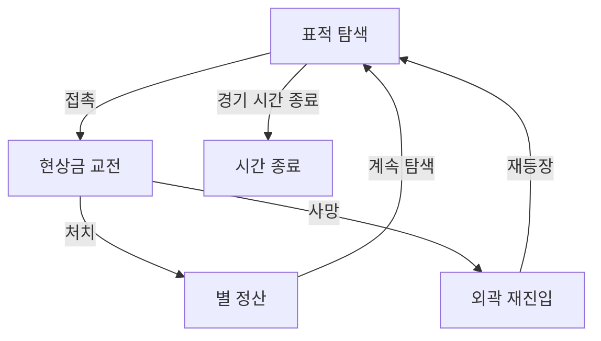

# 론 스타 — Lone Star 역기획서

| 항목 | 내용 |
| --- | --- |
| 문서 기준일 | 2026-11-13 |
| 분석 상태 | 2019 도입 공식 규칙을 분석한 역사 개인전. 현재 매칭 슬롯 여부 미확인. |
| 자료 성격 | 공개 규칙 기반 역기획. 원작 내부 구현 또는 직접 플레이 실측 보고서가 아님 |

> 표기: **[공식]** 공개 자료에 명시된 사실, **[보조]** 커뮤니티 자료, **[해석]** 규칙에서 도출한 설계 분석, **[제안]** 재구현 방법, **[미확인]** 추가 검증 대상.

## 1. 핵심 규칙과 자료 경계

[공식] 10인 개인 현상금전으로, 종료 시 별이 가장 많은 사람이 승리하며 사망자는 맵 외곽에 재등장한다. [S1]

**[미확인]** 2019의 현상금 규칙을 오늘의 바운티 목표점 규칙과 혼합하지 않는다. 별 상한·재등장 시간·최종 동률 순위는 당시 클라이언트 검증이 필요하다.

## 2. 플레이어 경험과 설계 의도 [해석]

상대마다 처치 가치가 달라지는 개인전이다. 잘하는 플레이어가 많은 별을 얻는 동시에 큰 표적이 되므로, 선두는 전투 효율과 노출 위험 사이에서 선택한다.

이 절의 의도는 규칙을 설명하기 위한 분석이다. 개발팀의 실제 의사결정이라고 인용하지 않는다.

## 3. 경기 진행과 단계별 판단 [해석]

| 단계 | 플레이 흐름 및 판단 |
| --- | --- |
| 1 | 초반 탐색: 중앙 또는 가까운 교전으로 첫 점수를 노린다. |
| 2 | 표적 선택: 쉽게 잡을 상대와 별이 많은 상대의 기대 수익을 비교한다. |
| 3 | 위험 관리: 자신의 현상금이 높아졌다면 퇴로와 탄약을 더 보수적으로 사용한다. |
| 4 | 재등장: 외곽에서 현재 교전 지역까지 이동하면서 다음 표적을 찾는다. |
| 5 | 마감: 점수 선두인지 추격자인지에 따라 생존과 공격 비중을 바꾼다. |

## 4. 규칙 상태 모델 [제안]

다음 모델은 검증 가능한 구현 단위로 규칙을 나눈 것이다. 원작의 클래스·함수·서버 처리 순서를 뜻하지 않는다.

## 5. 전략 구조·맵·조합·역전 [해석]

### 가변 처치 가치

낮은 체력보다 높은 현상금이 더 중요한 표적 정보가 될 수 있다. 그러나 멀리 추격하면 다른 플레이어에게 측면을 내준다.

### 선두의 위험

강한 플레이어를 처치했을 때 보상이 커지면 자연스러운 추격 장치가 된다. 다만 다자간 막타 경쟁으로 보상 귀속의 납득성이 어려워질 수 있다.

### 외곽 재진입

부활 위치가 중앙 전투에 다시 참여하는 시간을 결정한다. 한쪽 외곽만 가까우면 점수와 무관한 이동 운이 커진다.

### 정보의 불완전성

정확한 전체 순위를 숨기는 방식은 긴장을 유지하지만 마감 판단을 어렵게 한다. 최소한 자신이 공격해야 하는지 이해할 정보는 필요하다.

## 6. 판정 불변식과 예외 처리 [제안]

아래 항목은 재구현 시 보장할 일관성 조건이다. 원작에서 확인되지 않은 우선순위는 별도 설정과 실험 결과로 확정해야 한다.

1. 획득 누적 점수와 머리 위 현상금을 별도 상태로 관리한다. 하나를 초기화할 때 다른 하나까지 지우지 않는다.
2. 처치 직전 피해자의 현상금 스냅샷으로 보상을 계산한다. 사망 리셋 후 값을 읽으면 잘못된 점수가 된다.
3. 외곽 재등장은 게임 종료 시각 이후에 예약되지 않아야 한다.

모든 종료 조건은 동일 경기 ID의 결과를 한 번만 확정해야 한다. 시간 종료·사망·목표 달성이 같은 판정 묶음에 들어오면 화면에 보인 순서만으로 승패를 정하지 않고, 명시된 규칙 버전을 사용한다.

## 7. 데이터와 이벤트 설계 [제안]

| 필드 | 의미 |
| --- | --- |
| AccumulatedStars[] | 최종 순위용 누적 점수 |
| CurrentBounty[] | 현재 처치 보상 가치 |
| BountyGrowthRule | 처치 후 현상금 증가 |
| BountyResetRule | 사망 후 현상금 재설정 |
| EdgeSpawnCandidates[] | 재진입 위치 |
| RankDisclosurePolicy | 정확 순위·범위 표시 정책 |

공통 메타데이터로 MatchId, RulesetVersion, EventId, ServerTime을 보관한다. 보상 정산에는 별도 SettlementId를 사용해 전투 재전송과 계정 지급을 분리한다.

### 판정 처리 흐름

1. 사망 직전 현상금과 공격 귀속을 확보한다.
2. 처치자 누적 점수와 현상금을 규칙에 맞게 갱신한다.
3. 피해자의 현상금을 리셋하고 재등장을 예약한다.
4. 시간 종료 시 누적 점수와 동률 규칙으로 최종 순위를 고정한다.

## 8. UI·피드백 요구사항 [제안]

- 처치 가치와 내 누적 점수의 의미를 구분한다.
- 선두 또는 순위 범위를 보여줄 경우 정보 갱신 빈도를 일정하게 유지한다.
- 마감 전에는 살아남기만 해도 순위가 보장되는지 오해하지 않도록 현재 상태를 전달한다.

## 9. QA 시나리오와 기대 결과 [제안]

이는 실제 테스트를 실행했다는 기록이 아니다. 미확인 규칙은 우선 클라이언트에서 관찰한 결과를 기입하고, 재구현의 합격 기준을 해당 버전에 맞춰 확정한다.

| ID | 상황 | 재구현의 기대 결과 또는 검증 기준 |
| --- | --- | --- |
| Q01 | 높은 현상금 대상 처치 | 리셋 이전 가치로 점수를 계산한다. |
| Q02 | 누적 별 많은 플레이어 사망 | 누적 점수 유지/감소 정책과 현상금 리셋을 분리한다. |
| Q03 | 동시 상호 처치 | 서로의 사망 전 현상금으로 일관되게 정산한다. |
| Q04 | 부활 지점에 적 대기 | 안전도 평가 또는 보호 정책이 실행된다. |
| Q05 | 중앙 별 동시 접근 | 픽업은 한 번만 소유된다. |
| Q06 | 시간 종료 직전 사후 처치 | 시간 경계와 귀속 규칙에 맞게 처리한다. |
| Q07 | 누적 점수 동률 | 숨은 임의 순서가 아닌 정의된 동률 정책을 적용한다. |
| Q08 | 재접속 후 별 표시 | 머리 위 현상금과 누적 점수가 각각 복구된다. |

## 10. 밸런스 지표와 개선 판단 [해석·제안]

- 큰 현상금 처치의 점수 기여율: 역전 장치의 강도를 본다.
- 사망 후 유효 교전까지 시간: 재진입 공백이 과도한지 측정한다.
- 마감 구간 이동·공격량: 선두 도주만 남는 패턴인지 확인한다.

지표는 맵·실력 구간·파티 구성·규칙 버전별로 분리한다. 단일 전체 승률만으로 규칙의 문제와 매치 구성의 문제를 구분하지 않는다.

## 11. 추가 실측 계획 [미확인]

1. 동일 피해자 연속 처치와 고현상금 처치의 점수를 비교한다.
2. 사망 전후 누적 점수·현상금의 각각 변화를 기록한다.
3. 동률 결과 화면에서 순위 및 보상 차이를 확인한다.

측정에는 게임 버전, 이벤트명, 맵, 캐릭터와 능력, 화면 녹화의 시작·종료 시각을 함께 기록한다. 수치를 확인하면 기존 설명을 덮어쓰기보다 규칙 버전 표를 추가한다.

## 12. 출처와 연결 문서

- **[S1]** [공식 — Legendary Update!, 2019-09-18](https://supercell.com/en/games/brawlstars/blog/game-updates/legendary-update/)

출처 접근 기준일: 2026-11-13. 공식 페이지가 로딩 화면만 제공한 경우 검색 서비스에 노출된 공식 본문 범위만 근거로 사용했다. 보조 자료는 공식 규칙으로 승격하지 않았다.

- [팀 현상금전 비교](04_bounty.md)
- [고정 점수 레이스 비교](23_hunters.md)
- [전체 문서 목차](../README.md)
