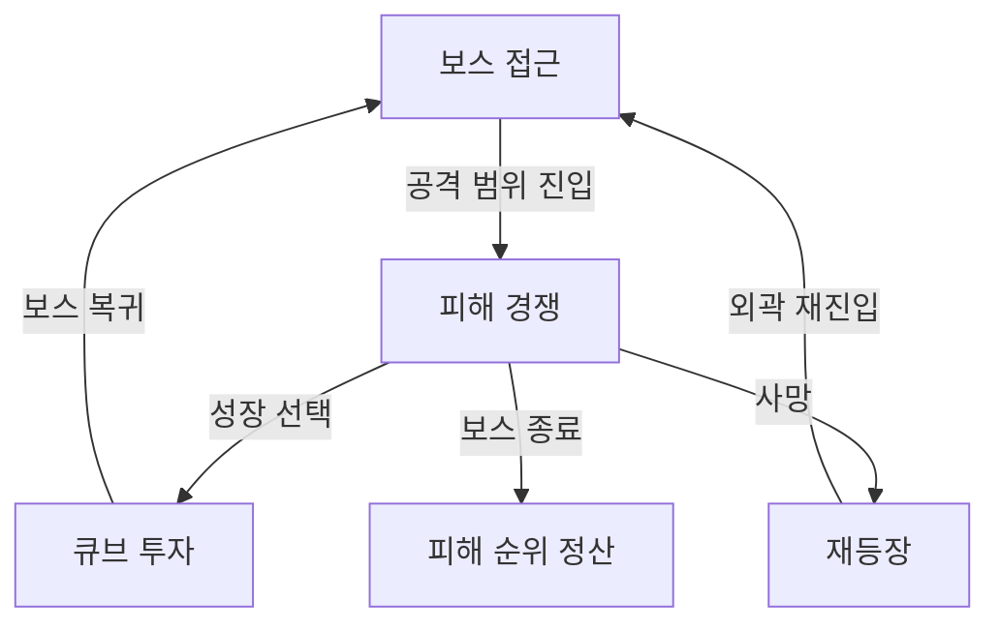

# 테이크다운 — Takedown 역기획서

| 항목 | 내용 |
| --- | --- |
| 문서 기준일 | 2026-11-13 |
| 분석 상태 | 2019 도입 공식 규칙을 분석한 역사 PvPvE 개인전. 현재 제공 여부 미확인. |
| 자료 성격 | 공개 규칙 기반 역기획. 원작 내부 구현 또는 직접 플레이 실측 보고서가 아님 |

> 표기: **[공식]** 공개 자료에 명시된 사실, **[보조]** 커뮤니티 자료, **[해석]** 규칙에서 도출한 설계 분석, **[제안]** 재구현 방법, **[미확인]** 추가 검증 대상.

## 1. 핵심 규칙과 자료 경계

[공식] 10명이 서로 견제하면서 공용 보스에게 가한 피해로 경쟁한다. 사망 후 외곽 재등장과 파워 큐브 수급이 있다. [S1]

**[미확인]** 보스 보호막·분노·종료 시간·세부 큐브 상한은 버전별로 다를 수 있어 현재 상수로 고정하지 않는다. 플레이어 처치 수가 승리 점수라고 해석하지 않는다.

## 2. 플레이어 경험과 설계 의도 [해석]

모두가 같은 보스를 때리지만 서로 협력하지 않는 경쟁 구조다. 다른 플레이어를 공격하는 행동은 직접 득점이 아니라 상대의 공격 시간을 빼앗기 위한 투자다.

이 절의 의도는 규칙을 설명하기 위한 분석이다. 개발팀의 실제 의사결정이라고 인용하지 않는다.

## 3. 경기 진행과 단계별 판단 [해석]

| 단계 | 플레이 흐름 및 판단 |
| --- | --- |
| 1 | 접근: 스폰 위치에서 보스 위치까지의 길과 큐브 수집 경로를 비교한다. |
| 2 | 피해 축적: 보스 공격을 피하면서 높은 공격 가동률을 유지한다. |
| 3 | 경쟁자 견제: 현재 경쟁자의 공격을 끊는 이득이 자신의 보스 공격 손실보다 큰지 계산한다. |
| 4 | 성장 전환: 큐브를 더 모으기 위해 보스를 떠날지, 남은 체력에 바로 피해를 넣을지 판단한다. |
| 5 | 종료: 보스가 곧 쓰러지면 장기 성장보다 즉시 피해가 중요해진다. |

## 4. 규칙 상태 모델 [제안]

다음 모델은 검증 가능한 구현 단위로 규칙을 나눈 것이다. 원작의 클래스·함수·서버 처리 순서를 뜻하지 않는다.

## 5. 전략 구조·맵·조합·역전 [해석]

### 피해 시간의 경제

보스가 살아 있는 시간은 공용 자원이다. 경쟁자를 방해하는 동안 제삼자가 점수를 얻으므로 양자 교전의 손해가 커질 수 있다.

### 성장 투자 회수

큐브 획득을 위해 쓰는 시간이 나중의 추가 피해로 회수되어야 한다. 보스 잔여 체력이 적으면 성장 투자가 늦을 수 있다.

### 스폰 운

외곽 재등장부터 보스까지 거리 차이가 공격 가동률 차이로 이어진다. 보스 이동과 스폰 선정은 별도로 공정성 검증이 필요하다.

### 공격 유형 격차

광역·지속·관통·비례 피해는 보스 상대로 서로 다른 효율을 보인다. 일반 PvP 피해 순위가 그대로 적용되지 않는다.

## 6. 판정 불변식과 예외 처리 [제안]

아래 항목은 재구현 시 보장할 일관성 조건이다. 원작에서 확인되지 않은 우선순위는 별도 설정과 실험 결과로 확정해야 한다.

1. 순위 점수는 보스에 실제 반영된 유효 피해로 계산하고 과잉 피해·무적 피해를 구분한다.
2. 소환물과 지속 피해는 생성자의 플레이어 ID를 유지하여 올바르게 귀속한다.
3. 보스 마지막 체력을 여러 사람이 동시에 공격할 때 남은 유효 피해를 어떻게 분배할지 정의해야 한다.

모든 종료 조건은 동일 경기 ID의 결과를 한 번만 확정해야 한다. 시간 종료·사망·목표 달성이 같은 판정 묶음에 들어오면 화면에 보인 순서만으로 승패를 정하지 않고, 명시된 규칙 버전을 사용한다.

## 7. 데이터와 이벤트 설계 [제안]

| 필드 | 의미 |
| --- | --- |
| BossEffectiveDamage[] | 개인별 보스 유효 피해 |
| PlayerDamage[] | 견제 분석용 별도 피해 |
| BossVulnerability | 보호막·공격 가능 상태 |
| DamageOwnerId | 소환·지속 피해 귀속 |
| PowerCubeCount[] | 성장 상태 |
| OverkillAllocationRule | 동시 막타 유효 피해 분배 |

공통 메타데이터로 MatchId, RulesetVersion, EventId, ServerTime을 보관한다. 보상 정산에는 별도 SettlementId를 사용해 전투 재전송과 계정 지급을 분리한다.

### 판정 처리 흐름

1. 피해 대상이 보스인지 일반 플레이어인지 먼저 분리한다.
2. 보스 방어·면역·남은 체력을 반영해 유효 피해를 확정한다.
3. 귀속 플레이어의 보스 점수에만 해당 피해를 더한다.
4. 보스 종료 시 총점과 동률 정책으로 개인 순위를 확정한다.

## 8. UI·피드백 요구사항 [제안]

- 보스 체력과 내 기여를 보여주어 성장 투자 종료 시점을 판단하게 한다.
- 화면 밖 보스 위치를 명확히 안내해 단순 탐색 시간을 줄인다.
- 결과 화면에서 보스 피해와 플레이어 처치를 분리해 승리 기준을 설명한다.

## 9. QA 시나리오와 기대 결과 [제안]

이는 실제 테스트를 실행했다는 기록이 아니다. 미확인 규칙은 우선 클라이언트에서 관찰한 결과를 기입하고, 재구현의 합격 기준을 해당 버전에 맞춰 확정한다.

| ID | 상황 | 재구현의 기대 결과 또는 검증 기준 |
| --- | --- | --- |
| Q01 | 보스 무적 때 공격 | 순위 점수가 잘못 늘지 않는다. |
| Q02 | 남은 체력보다 큰 피해 | 유효 피해 상한 또는 분배 규칙을 적용한다. |
| Q03 | 사망 후 소환물 보스 공격 | 설정된 귀속 정책으로 집계한다. |
| Q04 | 독 피해와 보스 종료 동시 | 종료 시간 이후 피해가 기록되지 않는다. |
| Q05 | 경쟁자 처치 | 보스 피해 점수에 직접 더하지 않는다. |
| Q06 | 두 공격이 마지막 체력 동시 소진 | 결정적이고 공정한 유효 피해 분배를 적용한다. |
| Q07 | 보스가 맵 가장자리 이동 | 재등장과 접근 경로가 유효하다. |
| Q08 | 점수와 피해 통계 불일치 | 유효 피해·과잉 피해 구분을 결과에 반영한다. |

## 10. 밸런스 지표와 개선 판단 [해석·제안]

- 보스 공격 가동률: 캐릭터·스폰·패턴별 시간 손실을 본다.
- PvP 피해 대비 순위 상승: 방해 전략이 얼마나 합리적인지 측정한다.
- 큐브 수집 시간의 회수율: 성장 투자가 사실상 강제인지 확인한다.

지표는 맵·실력 구간·파티 구성·규칙 버전별로 분리한다. 단일 전체 승률만으로 규칙의 문제와 매치 구성의 문제를 구분하지 않는다.

## 11. 추가 실측 계획 [미확인]

1. 면역·보호막·과잉 피해의 점수 반영을 비교한다.
2. 공격 주체가 죽거나 변신했을 때 지속 피해 귀속을 확인한다.
3. 보스 위치와 스폰 거리별 최종 피해 상관관계를 수집한다.

측정에는 게임 버전, 이벤트명, 맵, 캐릭터와 능력, 화면 녹화의 시작·종료 시각을 함께 기록한다. 수치를 확인하면 기존 설명을 덮어쓰기보다 규칙 버전 표를 추가한다.

## 12. 출처와 연결 문서

- **[S1]** [공식 — Legendary Update!, 2019-09-18](https://supercell.com/en/games/brawlstars/blog/game-updates/legendary-update/)

출처 접근 기준일: 2026-11-13. 공식 페이지가 로딩 화면만 제공한 경우 검색 서비스에 노출된 공식 본문 범위만 근거로 사용했다. 보조 자료는 공식 규칙으로 승격하지 않았다.

- [협동 보스 처치 비교](26_boss_fight.md)
- [다른 플레이어 처치가 직접 점수인 구조](23_hunters.md)
- [전체 문서 목차](../README.md)
