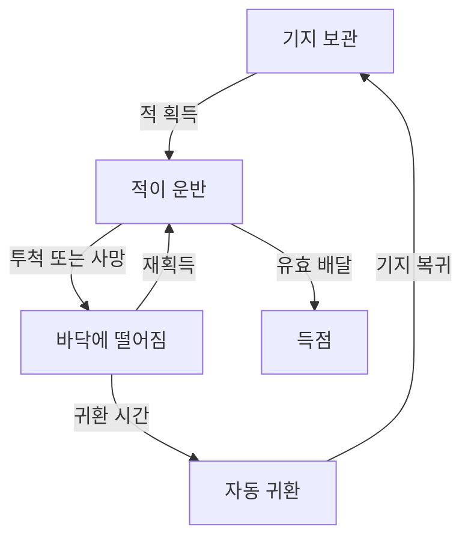

# 선물 훔치기 — Present Plunder 역기획서

| 항목 | 내용 |
| --- | --- |
| 문서 기준일 | 2026-11-13 |
| 분석 상태 | 2019 원형, 재명명 사례와 2026-11 복귀 예고를 함께 기록한다. 현재 개방 중이라는 뜻은 아니다. |
| 자료 성격 | 공개 규칙 기반 역기획. 원작 내부 구현 또는 직접 플레이 실측 보고서가 아님 |

> 표기: **[공식]** 공개 자료에 명시된 사실, **[보조]** 커뮤니티 자료, **[해석]** 규칙에서 도출한 설계 분석, **[제안]** 재구현 방법, **[미확인]** 추가 검증 대상.

## 1. 핵심 규칙과 자료 경계

[공식] 상대 선물을 자기 기지로 운반하며, 떨어진 선물은 지연 후 복귀하고 공격 입력으로 던질 수 있다. 원형은 2회 탈취로 승리한다. [S1] 2026-11 노트에 복귀가 예고되었다. [S2]

**[미확인]** Trophy Thieves·Snowtel 계열과 외형이 다른 변형을 구분해야 한다. 현재 복귀형의 투척 거리·공격 가능 여부·자기 선물 필요 조건은 직접 검증 대상이다.

## 2. 플레이어 경험과 설계 의도 [해석]

전투를 승리시키는 방향이 왕복으로 바뀐다. 적 기지까지 뚫는 공격과 선물을 들고 돌아오는 철수는 다른 경로와 역할을 요구하므로 한 번의 전투 우세로 득점이 보장되지 않는다.

이 절의 의도는 규칙을 설명하기 위한 분석이다. 개발팀의 실제 의사결정이라고 인용하지 않는다.

## 3. 경기 진행과 단계별 판단 [해석]

| 단계 | 플레이 흐름 및 판단 |
| --- | --- |
| 1 | 진입 준비: 상대 수비를 밀고 선물을 가져올 출구를 확보한다. |
| 2 | 탈취: 선물을 잡은 순간 공격과 운반 입력의 의미가 바뀌는지 인지한다. |
| 3 | 철수: 운반자는 추격을 피하고 동료는 측면 사선을 지운다. |
| 4 | 떨어진 선물 경쟁: 회수할지 귀환까지 시간을 끌지 판단한다. |
| 5 | 배달과 리셋: 득점 후 위치·체력·선물 상태가 어떻게 재설정되는지 확인한다. |

## 4. 규칙 상태 모델 [제안]

다음 모델은 검증 가능한 구현 단위로 규칙을 나눈 것이다. 원작의 클래스·함수·서버 처리 순서를 뜻하지 않는다.

## 5. 전략 구조·맵·조합·역전 [해석]

### 침투와 회수의 구분

적을 모두 쓰러뜨렸더라도 돌아오는 길에 부활 수비를 만날 수 있다. 왕복 시간과 부활 시간을 함께 생각해야 한다.

### 패스의 가치

패스는 이동 능력을 여러 플레이어에게 나누어 쓰게 한다. 반면 선물을 바닥에 두는 시간이 길어지면 귀환 위험이 생긴다.

### 동시 탈취

양쪽이 모두 선물을 가져오면 누가 수비로 돌아갈지 결정해야 한다. 자기 선물의 기지 존재가 득점 요건인지에 따라 교착 구조가 크게 달라진다.

### 장애물과 퇴로

한 방향으로만 뚫린 통로는 침투보다 철수를 더 어렵게 한다. 공격 경로와 탈출 경로를 별도로 설계하면 선택이 늘어난다.

## 6. 판정 불변식과 예외 처리 [제안]

아래 항목은 재구현 시 보장할 일관성 조건이다. 원작에서 확인되지 않은 우선순위는 별도 설정과 실험 결과로 확정해야 한다.

1. 각 팀 선물은 한 시점에 하나의 위치·운반 상태만 가진다.
2. 자동 귀환 예약은 재획득 시 무효화하고 오래된 예약 이벤트가 현재 운반 선물을 순간 이동시키지 않게 한다.
3. 득점은 기지 진입만으로 판단하지 않고 운반 주체·선물 소유 팀·추가 조건을 함께 검증한다.

모든 종료 조건은 동일 경기 ID의 결과를 한 번만 확정해야 한다. 시간 종료·사망·목표 달성이 같은 판정 묶음에 들어오면 화면에 보인 순서만으로 승패를 정하지 않고, 명시된 규칙 버전을 사용한다.

## 7. 데이터와 이벤트 설계 [제안]

| 필드 | 의미 |
| --- | --- |
| GiftHomeTeam | 선물 원소유 팀 |
| GiftState | 기지·운반·바닥·귀환 |
| CarrierId | 운반 주체 |
| ReturnDeadline | 자동 복귀 시각 |
| CaptureEligibility | 자기 선물 조건 등 |
| PostScoreResetPolicy | 득점 후 리셋 범위 |

공통 메타데이터로 MatchId, RulesetVersion, EventId, ServerTime을 보관한다. 보상 정산에는 별도 SettlementId를 사용해 전투 재전송과 계정 지급을 분리한다.

### 판정 처리 흐름

1. 선물에 대한 획득·투척·드롭을 상태 전이로 검증한다.
2. 유효 운반자가 배달 구역에 들어오면 득점 조건을 확인한다.
3. 득점 확정 시 선물과 필요한 경기 상태를 원자적으로 갱신한다.
4. 바닥 상태가 유지된 선물만 귀환 시각에 기지로 돌려보낸다.

## 8. UI·피드백 요구사항 [제안]

- 아군 선물의 위험과 적 선물의 운반 진행을 동시에 보여준다.
- 바닥 선물에는 귀환 남은 시간을 짧게 표시한다.
- 공격 버튼이 투척으로 바뀌는 경우 입력 아이콘도 즉시 바뀌어야 한다.

## 9. QA 시나리오와 기대 결과 [제안]

이는 실제 테스트를 실행했다는 기록이 아니다. 미확인 규칙은 우선 클라이언트에서 관찰한 결과를 기입하고, 재구현의 합격 기준을 해당 버전에 맞춰 확정한다.

| ID | 상황 | 재구현의 기대 결과 또는 검증 기준 |
| --- | --- | --- |
| Q01 | 선물 재획득 직후 옛 귀환 타이머 도착 | 현재 운반 상태를 유지한다. |
| Q02 | 양 팀 선물 동시 탈취 | 정의된 배달 자격 규칙대로 처리한다. |
| Q03 | 골인 구역에서 사망과 배달 동시 | 우선순위에 따라 한 번 득점 또는 드롭한다. |
| Q04 | 투척 중 벽 파괴 | 선물의 유효 위치와 경로가 유지된다. |
| Q05 | 운반자 정신 지배 | 실제 소속·일시 제어 소속 정책에 맞게 소유권을 판정한다. |
| Q06 | 선물 맵 밖 이탈 | 기지 또는 유효 지점으로 복구한다. |
| Q07 | 득점 후 잔여 투척 이벤트 | 다음 라운드 선물을 다시 이동시키지 않는다. |
| Q08 | 동시 두 번째 득점 | 종료 규칙을 한 번 적용한다. |

## 10. 밸런스 지표와 개선 판단 [해석·제안]

- 탈취 대비 배달 성공률: 침투와 철수의 난도 차이를 본다.
- 선물 기지 체류 시간: 수비 고착 또는 과도한 공세 여부를 본다.
- 패스당 진행 기여: 운반 협동이 실제로 이득을 주는지 평가한다.

지표는 맵·실력 구간·파티 구성·규칙 버전별로 분리한다. 단일 전체 승률만으로 규칙의 문제와 매치 구성의 문제를 구분하지 않는다.

## 11. 추가 실측 계획 [미확인]

1. 자기 선물이 없는 상태에서 상대 선물을 기지로 가져와 득점 자격을 확인한다.
2. 원거리 투척·점프·대시·정신 지배의 운반 제한을 검증한다.
3. 재등장 수비가 배달 경로에 도달하는 시간을 측정한다.

측정에는 게임 버전, 이벤트명, 맵, 캐릭터와 능력, 화면 녹화의 시작·종료 시각을 함께 기록한다. 수치를 확인하면 기존 설명을 덮어쓰기보다 규칙 버전 표를 추가한다.

## 12. 출처와 연결 문서

- **[S1]** [공식 — Pirate Brawlidays, 2019](https://supercell.com/en/games/brawlstars/blog/release-notes/pirate-brawlidays-update-has-arrived/)
- **[S2]** [공식 — Release Notes November 2026, 2026-11-11](https://supercell.com/brawlstars/en/blog/game-updates/release-notes-november-2026/)
- **[S3]** [공식 — Jurassic Splash, 2021-06-16 및 후속 유지보수](https://supercell.com/en/games/brawlstars/blog/release-notes/jurassicsplash-release-and-maintenance-notes/)

출처 접근 기준일: 2026-11-13. 공식 페이지가 로딩 화면만 제공한 경우 검색 서비스에 노출된 공식 본문 범위만 근거로 사용했다. 보조 자료는 공식 규칙으로 승격하지 않았다.

- [운반 유지와 배달 목표의 차이](32_hold_the_trophy.md)
- [공 입력과 목표물 운반 비교](02_brawl_ball.md)
- [전체 문서 목차](../README.md)
