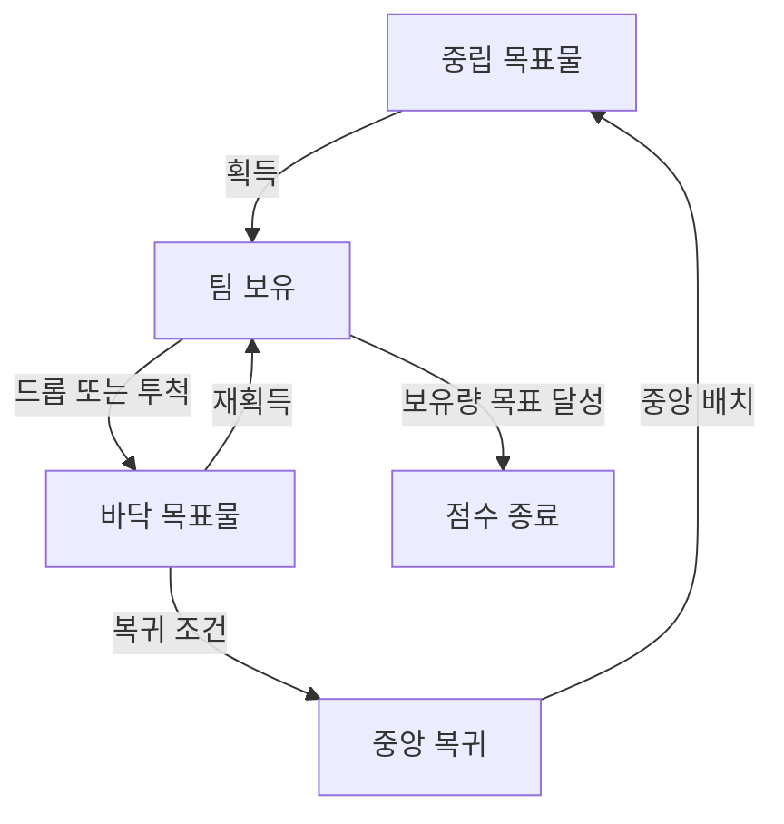

# 트로피 보유전 — Hold the Trophy / Carry the Gift 역기획서

| 항목 | 내용 |
| --- | --- |
| 문서 기준일 | 2026-11-13 |
| 분석 상태 | 2021 여름 모드와 2024 선물 외형 변형을 구분한 역사 분석. 원작 상세 규칙의 공식 근거가 상대적으로 제한적이다. |
| 자료 성격 | 공개 규칙 기반 역기획. 원작 내부 구현 또는 직접 플레이 실측 보고서가 아님 |

> 표기: **[공식]** 공개 자료에 명시된 사실, **[보조]** 커뮤니티 자료, **[해석]** 규칙에서 도출한 설계 분석, **[제안]** 재구현 방법, **[미확인]** 추가 검증 대상.

## 1. 핵심 규칙과 자료 경계

[공식] 2021에는 Hold the Trophy, 2024에는 Carry the Gift 명칭이 등재되었다. [S1][S2] [보조] 커뮤니티 설명은 목표물 보유 시간으로 100%를 채우는 구조를 제시한다. [S3]

**[미확인]** 보유 초당 증가량·이동 감속·던지기·리셋 시간은 공식 본문만으로 확정하지 않았다. 아래 모형은 보유 점수형을 분석한 것으로, Present Plunder의 배달형과 혼동하지 않는다.

## 2. 플레이어 경험과 설계 의도 [해석]

하나의 이동 가능한 점령지를 플레이어가 직접 운반하는 구조다. 점령지를 안전한 곳으로 옮길 수 있기 때문에 공간을 확보한 팀이 목표까지 함께 보호하게 된다. 보유자의 생존과 아군의 지역 방어가 사실상 같은 문제가 된다.

이 절의 의도는 규칙을 설명하기 위한 분석이다. 개발팀의 실제 의사결정이라고 인용하지 않는다.

## 3. 경기 진행과 단계별 판단 [해석]

| 단계 | 플레이 흐름 및 판단 |
| --- | --- |
| 1 | 중앙 경쟁: 목표물과 회수 후 후퇴 경로를 함께 확보한다. |
| 2 | 보유 전환: 운반자는 안전 구역으로 이동하고 동료는 접근 통로를 맡는다. |
| 3 | 추격과 포위: 비보유 팀은 보유자를 직접 추적할지 수비 지원을 먼저 끊을지 선택한다. |
| 4 | 회수 시도: 보유자가 쓰러지거나 목표물을 내려놓으면 새 소유권을 결정한다. |
| 5 | 마감: 남은 점수와 상대의 접근 시간을 비교해 도주·교대·대형을 선택한다. |

## 4. 규칙 상태 모델 [제안]

다음 모델은 검증 가능한 구현 단위로 규칙을 나눈 것이다. 원작의 클래스·함수·서버 처리 순서를 뜻하지 않는다.

## 5. 전략 구조·맵·조합·역전 [해석]

### 뒤로 갈수록 강한 방어

목표물이 수비 팀 부활 위치와 가까워질수록 공격 팀의 이동 비용이 커진다. 보유 팀이 뒤로 물러나는 선택에 어떤 제약이 있는지가 핵심 밸런스 변수다.

### 보유자 교대

교대가 허용된다면 체력이 많은 동료에게 넘기는 행동은 회복 시간을 만든다. 그러나 목표물이 바닥에 있는 동안 점수가 멈추는지에 따라 비용이 달라진다.

### 벽과 시야

포켓형 지형 안으로 목표물을 가져가면 공격 경로가 좁아진다. 벽 파괴 유무에 지나치게 결과가 의존하지 않는지 검증해야 한다.

### 리드 유지

앞선 팀이 전투를 피하고 시간만 소모하는 전략이 항상 최적이면 추격 팀의 선택이 사라진다. 이는 설계 위험에 대한 해석이며 실제 제거 이유를 뜻하지 않는다.

## 6. 판정 불변식과 예외 처리 [제안]

아래 항목은 재구현 시 보장할 일관성 조건이다. 원작에서 확인되지 않은 우선순위는 별도 설정과 실험 결과로 확정해야 한다.

1. 보유 점수는 목표물의 유효 운반 상태에만 연결하고 단순 접촉 횟수로 계산하지 않는다.
2. 소유권 변경의 정확한 시각을 기록하여 같은 시간 구간을 양 팀이 중복 적립하지 않게 한다.
3. 운반 속도 제한·공격 제한·이동 능력 제한은 버전별 정책이며 외형을 바꿨다고 자동 상속하지 않는다.

모든 종료 조건은 동일 경기 ID의 결과를 한 번만 확정해야 한다. 시간 종료·사망·목표 달성이 같은 판정 묶음에 들어오면 화면에 보인 순서만으로 승패를 정하지 않고, 명시된 규칙 버전을 사용한다.

## 7. 데이터와 이벤트 설계 [제안]

| 필드 | 의미 |
| --- | --- |
| CarrierId / TeamId | 유효 보유자 및 팀 |
| HeldTime[] | 팀별 누적 보유 시간 |
| ScoreRate | 시간을 표시 점수로 바꾸는 비율 |
| CarryRestrictions | 이동·공격·능력 제한 |
| ReturnPolicy | 바닥 체류 후 중앙 복귀 |
| GiftVariantVersion | 트로피/선물 규칙 구분 |

공통 메타데이터로 MatchId, RulesetVersion, EventId, ServerTime을 보관한다. 보상 정산에는 별도 SettlementId를 사용해 전투 재전송과 계정 지급을 분리한다.

### 판정 처리 흐름

1. 운반자의 생존·팀·제어 상태를 검사한다.
2. 이전 판정 이후의 유효 보유 시간만 해당 팀에 적립한다.
3. 목표물을 잃으면 마지막 보유 시각에서 적립을 멈춘다.
4. 목표량 또는 제한 시간에 도달하면 비교·동률 정책으로 종료한다.

## 8. UI·피드백 요구사항 [제안]

- 보유자 위치와 양 팀 누적 진행도를 함께 알린다.
- 보유 상태에서 금지된 능력은 버튼 비활성 이유로 설명한다.
- 목표물 없는 이동을 보유로 착각하지 않게 캐릭터와 목표물의 연결 상태를 선명히 표현한다.

## 9. QA 시나리오와 기대 결과 [제안]

이는 실제 테스트를 실행했다는 기록이 아니다. 미확인 규칙은 우선 클라이언트에서 관찰한 결과를 기입하고, 재구현의 합격 기준을 해당 버전에 맞춰 확정한다.

| ID | 상황 | 재구현의 기대 결과 또는 검증 기준 |
| --- | --- | --- |
| Q01 | 보유 중 사망 | 사망 이후 시간은 적립하지 않는다. |
| Q02 | 패스 도중 공중에 존재 | 운반자 없음 상태의 점수 정책을 적용한다. |
| Q03 | 보유자와 대상이 같은 시간 획득 시도 | 하나의 소유권만 승인한다. |
| Q04 | 목표물 획득 직후 중앙 복귀 예약 | 과거 예약은 무효화한다. |
| Q05 | 감속 면역 능력 사용 | 모드 운반 제한과 일반 상태 면역의 우선순위를 적용한다. |
| Q06 | 점프·대시·순간 이동 | 버전별 운반 허용표를 적용한다. |
| Q07 | 양 팀 동일 시간 보유 후 종료 | 정의된 동률 처리를 한다. |
| Q08 | 다른 외형 변형 데이터 로드 | 각 변형의 RulesetVersion을 로드하고 이름·외형 변경이 다른 변형의 규칙을 덮어쓰지 않는다. |

## 10. 밸런스 지표와 개선 판단 [해석·제안]

- 최초 획득 팀 승률: 중앙 한 번의 교전으로 결과가 고착되는지 본다.
- 목표물 평균 후퇴 거리: 수비 부활 지점이 지나치게 강한지 확인한다.
- 보유권 교체 횟수: 추격 팀이 실질적인 재탈취 기회를 가지는지 측정한다.

지표는 맵·실력 구간·파티 구성·규칙 버전별로 분리한다. 단일 전체 승률만으로 규칙의 문제와 매치 구성의 문제를 구분하지 않는다.

## 11. 추가 실측 계획 [미확인]

1. 트로피 원형과 선물 변형을 서로 다른 영상·빌드로 구분해 보유 점수를 측정한다.
2. 바닥·공중·아군 패스 동안 점수가 쌓이는지 확인한다.
3. 이동 감속과 특수 이동 능력의 상호작용을 기록한다.

측정에는 게임 버전, 이벤트명, 맵, 캐릭터와 능력, 화면 녹화의 시작·종료 시각을 함께 기록한다. 수치를 확인하면 기존 설명을 덮어쓰기보다 규칙 버전 표를 추가한다.

## 12. 출처와 연결 문서

- **[S1]** [공식 — Jurassic Splash, 2021-06-16 및 후속 유지보수](https://supercell.com/en/games/brawlstars/blog/release-notes/jurassicsplash-release-and-maintenance-notes/)
- **[S2]** [공식 — Toy Story!, 2024-12](https://supercell.com/en/games/brawlstars/blog/release-notes/patch-notes-toy-story/)
- **[S3]** [커뮤니티 보조 — Carry the Gift, 검색에 노출된 본문만 확인](https://brawlstars.fandom.com/wiki/Carry_the_Gift)

출처 접근 기준일: 2026-11-13. 공식 페이지가 로딩 화면만 제공한 경우 검색 서비스에 노출된 공식 본문 범위만 근거로 사용했다. 보조 자료는 공식 규칙으로 승격하지 않았다.

- [두 기지 배달형과의 구분](31_present_plunder.md)
- [이동 가능한 점령지라는 관점](05_hot_zone.md)
- [전체 문서 목차](../README.md)
