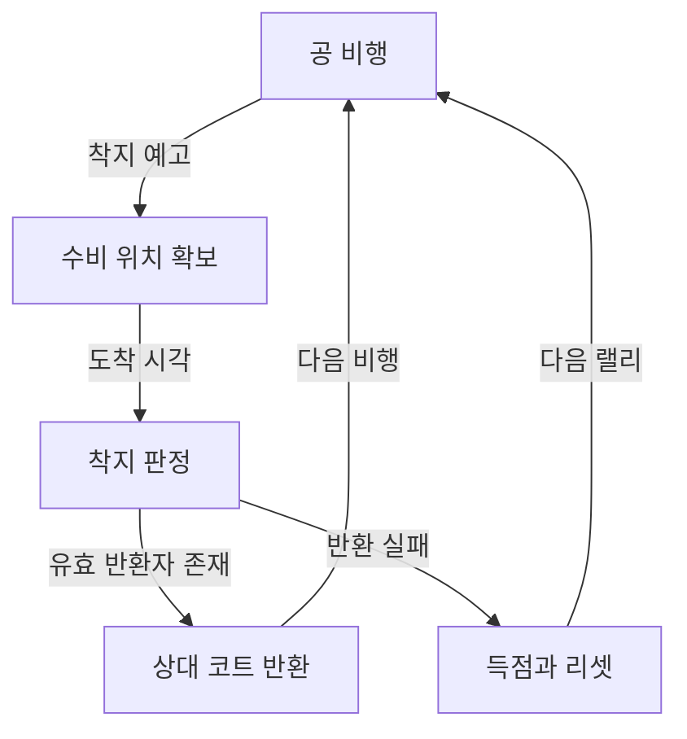

# 발리 브롤 — Volley Brawl 역기획서

| 항목 | 내용 |
| --- | --- |
| 문서 기준일 | 2026-11-13 |
| 분석 상태 | 2021 도입, 공식 반환 영역 오류 수정 및 2025 로테이션 기록 확인. 현재 슬롯 상태 미확인. |
| 자료 성격 | 공개 규칙 기반 역기획. 원작 내부 구현 또는 직접 플레이 실측 보고서가 아님 |

> 표기: **[공식]** 공개 자료에 명시된 사실, **[보조]** 커뮤니티 자료, **[해석]** 규칙에서 도출한 설계 분석, **[제안]** 재구현 방법, **[미확인]** 추가 검증 대상.

## 1. 핵심 규칙과 자료 경계

[공식] 2021 패치는 반환 표시와 실제 판정 영역 불일치를 수정했다. [S1] [보조] 상대 코트에 공을 떨어뜨려 2점 선취하고, 랠리가 길어질수록 공이 빨라지는 구조가 안내된다. [S2][S3]

**[미확인]** 공식 패치에는 전체 경기 규칙이 없어 2점·착지 반송 구조는 커뮤니티 보조 근거로 표시한다. 정확한 비행식·원형 반경·리스폰 초수·연장전은 검증 전 상수로 확정하지 않는다.

## 2. 플레이어 경험과 설계 의도 [해석]

일정 시각의 특정 위치에 서 있어야 하는 방어 조건과, 그 위치에서 상대를 밀어내는 전투를 결합한다. 총 피해보다 착지 직전에 행동 불능을 만드는 타이밍이 중요해진다.

이 절의 의도는 규칙을 설명하기 위한 분석이다. 개발팀의 실제 의사결정이라고 인용하지 않는다.

## 3. 경기 진행과 단계별 판단 [해석]

| 단계 | 플레이 흐름 및 판단 |
| --- | --- |
| 1 | 착지 읽기: 공의 다음 착지 위치와 도착 시간을 확인한다. |
| 2 | 수비 배정: 한 명이 반환 위치를 지키고 다른 선수가 침투자를 막는다. |
| 3 | 상대 방해: 공이 상대 코트로 갈 때 밀치기·기절·경로 차단을 준비한다. |
| 4 | 반환 순간: 착지 판정에 남아 있을 수 있도록 이동과 능력을 조절한다. |
| 5 | 랠리 압축: 비행 시간이 짧아질수록 공격보다 다음 수비 준비 비중을 높인다. |

## 4. 규칙 상태 모델 [제안]

다음 모델은 검증 가능한 구현 단위로 규칙을 나눈 것이다. 원작의 클래스·함수·서버 처리 순서를 뜻하지 않는다.

## 5. 전략 구조·맵·조합·역전 [해석]

### 처치와 밀치기

상대가 살아 있어도 착지 순간 원 밖이면 득점 기회가 생긴다. 공격 능력의 가치는 피해량보다 시간·위치 변화로 평가해야 한다.

### 수비 중복

한 명에게 수비를 맡기면 공격 인원이 늘지만 단일 제어기에 취약하다. 두 명이 겹치면 광역 효과에 함께 밀릴 수 있어 서로 다른 접근 경로가 필요하다.

### 왕복 시간

상대 코트 깊이 들어간 공격자가 자기 착지에 복귀할 수 있는지가 중요하다. 랠리 속도 증가가 안전한 공격 거리를 점차 줄인다.

### 반환 지점 설계

반환 영역은 전투 가능한 바닥 위에 있어야 한다. 벽·물·스폰 보호 구역과 겹치면 특정 이동 능력만 유효해질 수 있다.

## 6. 판정 불변식과 예외 처리 [제안]

아래 항목은 재구현 시 보장할 일관성 조건이다. 원작에서 확인되지 않은 우선순위는 별도 설정과 실험 결과로 확정해야 한다.

1. 착지 표시와 실제 반환 판정은 동일한 좌표·반경 데이터에서 만들어야 한다.
2. 반환 성공은 특정 순간의 유효 수비자 상태로 판정하며 애니메이션만으로 결정하지 않는다.
3. 한 착지 이벤트에 여러 수비자가 있어도 공은 한 번만 반환된다.

모든 종료 조건은 동일 경기 ID의 결과를 한 번만 확정해야 한다. 시간 종료·사망·목표 달성이 같은 판정 묶음에 들어오면 화면에 보인 순서만으로 승패를 정하지 않고, 명시된 규칙 버전을 사용한다.

## 7. 데이터와 이벤트 설계 [제안]

| 필드 | 의미 |
| --- | --- |
| LandingPosition | 다음 착지 위치 |
| LandingTime | 권위 있는 착지 시각 |
| ReturnArea | 반환 판정 영역 |
| EligibleDefenderPolicy | 공중·무적·기절 포함 기준 |
| RallyIndex / FlightCurve | 랠리 길이에 따른 비행 |
| ServeResetPolicy | 득점 후 공·플레이어 리셋 |

공통 메타데이터로 MatchId, RulesetVersion, EventId, ServerTime을 보관한다. 보상 정산에는 별도 SettlementId를 사용해 전투 재전송과 계정 지급을 분리한다.

### 판정 처리 흐름

1. 다음 착지 위치·시간을 미리 확정하고 플레이어에게 전달한다.
2. 착지 시각에 영역 안의 유효 수비자 집합을 평가한다.
3. 반환자가 있으면 한 번 반송하고 다음 궤적을 생성한다.
4. 없으면 상대 득점을 기록하고 목표 점수 또는 랠리 리셋을 처리한다.

## 8. UI·피드백 요구사항 [제안]

- 착지 원에는 남은 시간 정보를 넣고 이펙트에 가려지지 않게 한다.
- 수비가 인정되는 상태를 확실한 체크 표시로 보여주되 실제 판정과 일치해야 한다.
- 공이 빨라질 때 다음 수비 위치를 더 빨리 읽을 수 있도록 시각 우선순위를 유지한다.

## 9. QA 시나리오와 기대 결과 [제안]

이는 실제 테스트를 실행했다는 기록이 아니다. 미확인 규칙은 우선 클라이언트에서 관찰한 결과를 기입하고, 재구현의 합격 기준을 해당 버전에 맞춰 확정한다.

| ID | 상황 | 재구현의 기대 결과 또는 검증 기준 |
| --- | --- | --- |
| Q01 | 표시 원 끝에 서 있음 | 표시와 판정 반경이 정확히 일치한다. |
| Q02 | 착지 직전 넉백 | 판정 시점의 위치로 반환 여부를 정한다. |
| Q03 | 착지 순간 점프·무적·기절 | 유효 수비자 정책을 적용한다. |
| Q04 | 두 수비자 동시 반환 | 한 개의 공만 생성된다. |
| Q05 | 득점과 치명타 동시 | 랠리 결과와 사망 리셋의 순서가 일관된다. |
| Q06 | 긴 랠리로 속도 상승 | 최소 반응 시간과 비행 안정성을 유지한다. |
| Q07 | 착지 위치가 임시 벽 안으로 변경 | 합법 착지 위치 정책으로 보정한다. |
| Q08 | 저성능 클라이언트 표시 지연 | 서버 착지 시각 기준으로 보간하며 판정은 변경하지 않는다. |

## 10. 밸런스 지표와 개선 판단 [해석·제안]

- 랠리 길이 분포: 너무 즉시 끝나거나 지나치게 긴 경기를 찾는다.
- 착지 직전 제어기 성공률: 능력 유형별 점수 기여를 본다.
- 표시 안에 있었으나 실패한 신고율: 판정·네트워크·시각 오차를 구분한다.

지표는 맵·실력 구간·파티 구성·규칙 버전별로 분리한다. 단일 전체 승률만으로 규칙의 문제와 매치 구성의 문제를 구분하지 않는다.

## 11. 추가 실측 계획 [미확인]

1. 착지 원 경계를 일정 간격으로 걸어 반환 경계와 표시를 비교한다.
2. 공중·스턴·무적·소환물의 수비 인정 여부를 각각 확인한다.
3. 랠리 횟수별 왕복 시간을 기록해 속도 증가 곡선을 추정하되 실측 표본을 함께 남긴다.

측정에는 게임 버전, 이벤트명, 맵, 캐릭터와 능력, 화면 녹화의 시작·종료 시각을 함께 기록한다. 수치를 확인하면 기존 설명을 덮어쓰기보다 규칙 버전 표를 추가한다.

## 12. 출처와 연결 문서

- **[S1]** [공식 — Jurassic Splash, 2021-06-16 및 후속 유지보수](https://supercell.com/en/games/brawlstars/blog/release-notes/jurassicsplash-release-and-maintenance-notes/)
- **[S2]** [커뮤니티 보조 — Brawls Wiki, Game Modes](https://brawls.wiki/game-modes/)
- **[S3]** [커뮤니티 보조 — GameLine Volley Brawl, 2026-02-24](https://gameline.jp/brawlstars/game-mode/volley-brawl/)
- **[S4]** [공식 — Release Notes September 2025](https://supercell.com/brawlstars/en/blog/release-notes/release-notes-september-2025/)

출처 접근 기준일: 2026-11-13. 공식 페이지가 로딩 화면만 제공한 경우 검색 서비스에 노출된 공식 본문 범위만 근거로 사용했다. 보조 자료는 공식 규칙으로 승격하지 않았다.

- [골대 통과와 시간-위치 판정 비교](02_brawl_ball.md)
- [스포츠 규칙의 전투 결합 비교](12_basket_brawl.md)
- [전체 문서 목차](../README.md)
