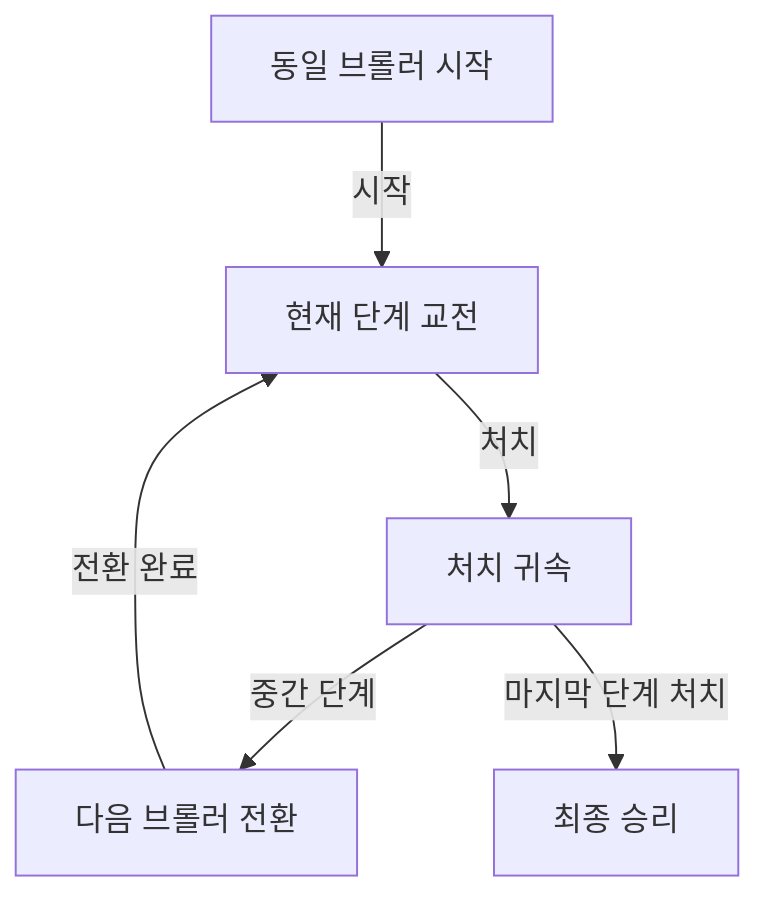

# 드럼롤 — Drumroll 역기획서

| 항목 | 내용 |
| --- | --- |
| 문서 기준일 | 2026-11-13 |
| 분석 상태 | 2024 Classic Brawl 원형과 2026-11 복귀 예고를 분리한다. |
| 자료 성격 | 공개 규칙 기반 역기획. 원작 내부 구현 또는 직접 플레이 실측 보고서가 아님 |

> 표기: **[공식]** 공개 자료에 명시된 사실, **[보조]** 커뮤니티 자료, **[해석]** 규칙에서 도출한 설계 분석, **[제안]** 재구현 방법, **[미확인]** 추가 검증 대상.

## 1. 핵심 규칙과 자료 경계

[공식] 모두 같은 브롤러로 시작하는 개인전에서 처치마다 정해진 다음 브롤러로 바뀌며 마지막 단계 처치로 승리한다. [S1] 2026-11 복귀가 예고되었다. [S2]

**[미확인]** 2024의 레벨 9·장비 제한은 당시 Classic 이벤트 규칙이다. 2026 복귀형이 같은 제한·캐릭터 순서·참가 인원인지 단정하지 않는다.

## 2. 플레이어 경험과 설계 의도 [해석]

하나의 캐릭터 숙련보다 여러 공격 유형에 연속 적응하는 능력을 시험한다. 잘 풀린 처치가 현재 강점을 계속 강화하지 않고 다음 캐릭터의 새로운 과제로 바뀌는 진행 구조다.

이 절의 의도는 규칙을 설명하기 위한 분석이다. 개발팀의 실제 의사결정이라고 인용하지 않는다.

## 3. 경기 진행과 단계별 판단 [해석]

| 단계 | 플레이 흐름 및 판단 |
| --- | --- |
| 1 | 동일 시작: 같은 능력으로 첫 교전을 시작해 스폰·조작 차이를 드러낸다. |
| 2 | 첫 전환: 처치 직후 새 사거리·탄약·이동 능력을 파악한다. |
| 3 | 단계 적응: 현재 캐릭터에게 유리한 교전 거리와 다음 상대를 찾는다. |
| 4 | 추격: 선두의 진행 단계와 자신의 다음 처치 가능성을 비교한다. |
| 5 | 최종 단계: 마지막 캐릭터로 마무리 처치를 확보해 레이스를 끝낸다. |

## 4. 규칙 상태 모델 [제안]

다음 모델은 검증 가능한 구현 단위로 규칙을 나눈 것이다. 원작의 클래스·함수·서버 처리 순서를 뜻하지 않는다.

## 5. 전략 구조·맵·조합·역전 [해석]

### 전환의 보상과 부담

처치했는데 사거리나 탄약 구조가 즉시 바뀌면 전투 문법이 달라진다. 전환 때 생존 상태가 어떻게 보정되는지에 따라 연속 처치 가능성이 크게 달라진다.

### 체인의 난도

쉬운 캐릭터를 뒤에 두면 선두가 더 쉽게 종료할 수 있다. 어려운 캐릭터를 끝에 두면 역전 창이 생기지만 마지막 단계 정체가 길어질 수 있다.

### 스폰과 단계 상성

같은 시작 조건이 이후 공정성을 보장하지는 않는다. 좁은 스폰에서 근거리형만 연속 처치하는 등 단계별 맵 상성이 생긴다.

### 막타 귀속

처치가 곧 캐릭터 업그레이드이므로 제삼자의 마지막 일격이 큰 박탈감을 줄 수 있다. 킬 피드와 전환 원인 표시가 필요하다.

## 6. 판정 불변식과 예외 처리 [제안]

아래 항목은 재구현 시 보장할 일관성 조건이다. 원작에서 확인되지 않은 우선순위는 별도 설정과 실험 결과로 확정해야 한다.

1. 한 사망 이벤트는 체인을 한 단계만 진행시킨다. 여러 피해 콜백이 같은 사망으로 중복 진행하지 않게 한다.
2. 전환 전 발사체·소환물·지속 효과의 소유권과 잔존 정책을 별도로 정한다.
3. 체인 순서와 단계별 장비 규칙을 매치 시작 때 고정하고 진행 중 로테이션 갱신으로 바꾸지 않는다.

모든 종료 조건은 동일 경기 ID의 결과를 한 번만 확정해야 한다. 시간 종료·사망·목표 달성이 같은 판정 묶음에 들어오면 화면에 보인 순서만으로 승패를 정하지 않고, 명시된 규칙 버전을 사용한다.

## 7. 데이터와 이벤트 설계 [제안]

| 필드 | 의미 |
| --- | --- |
| BrawlerChain[] | 순서가 고정된 브롤러 목록 |
| StageIndex[] | 플레이어별 현재 단계 |
| TransformPolicy | 체력·탄약·상태 재설정 |
| ResidualEffectPolicy | 기존 발사체·소환물 처리 |
| ClassicLoadoutProfile | 이벤트별 장비 제한 |
| FinalKillRule | 마지막 단계 종료 조건 |

공통 메타데이터로 MatchId, RulesetVersion, EventId, ServerTime을 보관한다. 보상 정산에는 별도 SettlementId를 사용해 전투 재전송과 계정 지급을 분리한다.

### 판정 처리 흐름

1. 유효 처치 주체를 확정하고 현재 단계 스냅샷을 읽는다.
2. 마지막 단계면 승리 후보로 처리한다.
3. 중간 단계면 기존 능력 상태를 정리하고 다음 캐릭터를 적용한다.
4. 여러 처치가 한 묶음에 발생하면 다중 단계 진행 허용 정책을 명시적으로 적용한다.

## 8. UI·피드백 요구사항 [제안]

- 현재 단계와 다음 캐릭터를 작게 미리 보여주어 전환 적응을 돕는다.
- 전환 순간 공격 버튼·사거리·탄약 표시를 함께 갱신한다.
- 선두의 종료 임박을 알려 공격 목표 선택을 지원한다.

## 9. QA 시나리오와 기대 결과 [제안]

이는 실제 테스트를 실행했다는 기록이 아니다. 미확인 규칙은 우선 클라이언트에서 관찰한 결과를 기입하고, 재구현의 합격 기준을 해당 버전에 맞춰 확정한다.

| ID | 상황 | 재구현의 기대 결과 또는 검증 기준 |
| --- | --- | --- |
| Q01 | 광역 공격으로 동시 두 명 처치 | 한 묶음의 단계 진행 정책을 적용한다. |
| Q02 | 전환 전 발사체가 추가 처치 | 잔존 효과의 단계 귀속 정책을 적용한다. |
| Q03 | 전환 중 피해 수신 | 체력·무적·사망 우선순위가 일관된다. |
| Q04 | 변신형 캐릭터에서 다음 단계 | 이전 변신 엔티티가 남지 않는다. |
| Q05 | 마지막 단계 상호 처치 | 동시 승리 정책을 적용한다. |
| Q06 | 캐릭터 체인 데이터 미보유 | 전용 대여·권한 정책으로 일관되게 로드한다. |
| Q07 | 이벤트 로테이션 갱신 중 경기 | 진행 중 체인과 장비 규칙을 유지한다. |
| Q08 | 사망 후 재접속 | 진행 단계가 되돌아가거나 중복 증가하지 않는다. |

## 10. 밸런스 지표와 개선 판단 [해석·제안]

- 단계별 체류 시간: 특정 캐릭터가 병목인지 찾는다.
- 전환 직후 사망률: UI 적응 또는 상태 보정 문제를 본다.
- 첫 처치 선두의 최종 승률: 초기 우위가 얼마나 지속되는지 평가한다.

지표는 맵·실력 구간·파티 구성·규칙 버전별로 분리한다. 단일 전체 승률만으로 규칙의 문제와 매치 구성의 문제를 구분하지 않는다.

## 11. 추가 실측 계획 [미확인]

1. 전환 시 체력·탄약·특수 공격 게이지가 유지되는지 기록한다.
2. 멀티킬과 지연 발사체 처치가 단계에 어떻게 반영되는지 확인한다.
3. 현재 이벤트의 체인·장비 제한을 입장 화면과 실제 전투에서 대조한다.

측정에는 게임 버전, 이벤트명, 맵, 캐릭터와 능력, 화면 녹화의 시작·종료 시각을 함께 기록한다. 수치를 확인하면 기존 설명을 덮어쓰기보다 규칙 버전 표를 추가한다.

## 12. 출처와 연결 문서

- **[S1]** [공식 — Classic Brawl Update, 2024](https://supercell.com/en/games/brawlstars/blog/game-updates/patch-notes-classic-brawl-update/)
- **[S2]** [공식 — Release Notes November 2026, 2026-11-11](https://supercell.com/brawlstars/en/blog/game-updates/release-notes-november-2026/)

출처 접근 기준일: 2026-11-13. 공식 페이지가 로딩 화면만 제공한 경우 검색 서비스에 노출된 공식 본문 범위만 근거로 사용했다. 보조 자료는 공식 규칙으로 승격하지 않았다.

- [고정 캐릭터 처치 레이스 비교](23_hunters.md)
- [캐릭터 순서와 적응 비교](11_duels.md)
- [전체 문서 목차](../README.md)
