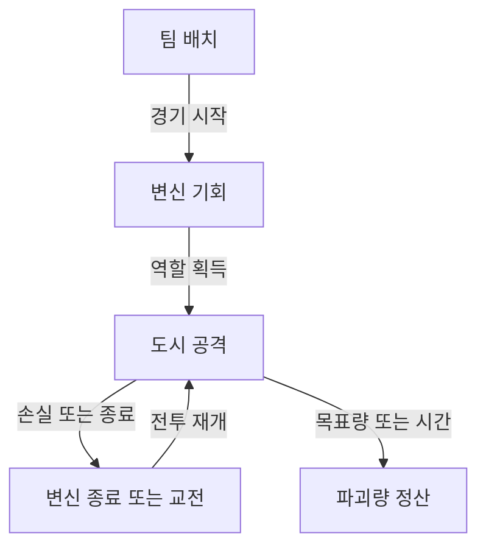

# 고질라 시티 스매시 — Godzilla City Smash 역기획서

| 항목 | 내용 |
| --- | --- |
| 문서 기준일 | 2026-11-13 |
| 분석 상태 | 2024-04-29~05-20 협업 이벤트의 역사 규칙 분석. 현재 상시 모드로 분류하지 않는다. |
| 자료 성격 | 공개 규칙 기반 역기획. 원작 내부 구현 또는 직접 플레이 실측 보고서가 아님 |

> 표기: **[공식]** 공개 자료에 명시된 사실, **[보조]** 커뮤니티 자료, **[해석]** 규칙에서 도출한 설계 분석, **[제안]** 재구현 방법, **[미확인]** 추가 검증 대상.

## 1. 핵심 규칙과 자료 경계

[공식] 두 팀이 도시 파괴량을 겨루고 각 팀 한 명이 고질라 계열로 변신할 수 있다. 당시 모드에는 돌연변이가 적용되었다. [S1]

**[미확인]** 건물별 내구와 파괴량 가중치, 변신 획득·종료 조건, 시간 종료 동률은 확인되지 않았다. 2024 돌연변이를 현재 기본 캐릭터 능력으로 섞지 않는다.

## 2. 플레이어 경험과 설계 의도 [해석]

익숙한 브롤러 전투 위에 거대 파괴자의 역할을 더해 협업 캐릭터의 판타지를 실제 목표 행동으로 연결한다. 건물은 엄폐물이면서 상대가 파괴해야 할 점수 대상이므로 전투 중 맵의 의미가 바뀐다.

이 절의 의도는 규칙을 설명하기 위한 분석이다. 개발팀의 실제 의사결정이라고 인용하지 않는다.

## 3. 경기 진행과 단계별 판단 [해석]

| 단계 | 플레이 흐름 및 판단 |
| --- | --- |
| 1 | 역할 결정: 변신 기회를 누가 맡고 나머지가 어떤 경로를 열지 판단한다. |
| 2 | 첫 파괴: 파괴 속도를 높이는 이동 경로와 상대의 대응 위치를 확인한다. |
| 3 | 공격과 수비 분할: 적 도시를 더 빨리 부술지 적 변신자를 먼저 늦출지 결정한다. |
| 4 | 지형 변화: 파괴로 사선과 이동 공간이 열리면 기존 전투 배치를 재조정한다. |
| 5 | 마감 경쟁: 남은 구조물과 상대 파괴 진척을 보고 목표를 집중한다. |

## 4. 규칙 상태 모델 [제안]

다음 모델은 검증 가능한 구현 단위로 규칙을 나눈 것이다. 원작의 클래스·함수·서버 처리 순서를 뜻하지 않는다.

## 5. 전략 구조·맵·조합·역전 [해석]

### 거대 역할의 의존도

변신자 한 명이 대부분의 점수를 내면 다른 플레이어는 보조 역할만 한다고 느낄 수 있다. 방어·경로 개척·상대 견제의 기여를 따로 보여줄 필요가 있다.

### 건물 밀도

밀집 건물은 광역 공격의 가치를 키운다. 한쪽 도시의 배치나 면적이 다르면 체력 총합이 같아도 파괴 난도가 달라진다.

### 지형과 목표의 이중성

엄폐물을 부수면 득점하지만 상대 장거리 사선도 열린다. 파괴 행동이 다음 전투의 위험을 바꾸는 피드백이 생긴다.

### 이벤트 능력 폭증

돌연변이와 변신 능력이 중첩되면 일반전에서 허용된 공격 빈도가 대량 파괴·소환·반사로 증폭될 수 있다. 이벤트 전용 상호작용 행렬이 필요하다.

## 6. 판정 불변식과 예외 처리 [제안]

아래 항목은 재구현 시 보장할 일관성 조건이다. 원작에서 확인되지 않은 우선순위는 별도 설정과 실험 결과로 확정해야 한다.

1. 일반 파괴 지형과 승리 점수 대상 건물을 데이터 태그로 구분한다.
2. 같은 건물의 파괴 점수는 공격자 수와 관계없이 한 번만 기록한다.
3. 변신 중과 기본 캐릭터 상태의 충돌·공격·입력 규칙을 명시적으로 전환한다.

모든 종료 조건은 동일 경기 ID의 결과를 한 번만 확정해야 한다. 시간 종료·사망·목표 달성이 같은 판정 묶음에 들어오면 화면에 보인 순서만으로 승패를 정하지 않고, 명시된 규칙 버전을 사용한다.

## 7. 데이터와 이벤트 설계 [제안]

| 필드 | 의미 |
| --- | --- |
| ObjectiveBuildings[] | 점수 대상 건물 |
| DestructionWeight | 건물별 파괴 기여값 |
| TeamDestruction[] | 팀별 누적 파괴량 |
| TransformationOwner | 거대 역할 보유자 |
| MutationProfile | 해당 이벤트 능력 설정 |
| TransformationExitPolicy | 체력·시간·사망 종료 처리 |

공통 메타데이터로 MatchId, RulesetVersion, EventId, ServerTime을 보관한다. 보상 정산에는 별도 SettlementId를 사용해 전투 재전송과 계정 지급을 분리한다.

### 판정 처리 흐름

1. 피해 대상이 점수 건물인지 일반 지형인지 분류한다.
2. 건물 체력이 처음 0을 넘을 때 파괴 상태를 고정한다.
3. 소유 팀·기여 규칙에 따라 상대 파괴량을 한 번 갱신한다.
4. 목표량 또는 종료 시각에 양 팀 파괴량을 비교한다.

## 8. UI·피드백 요구사항 [제안]

- 양쪽 도시 진척과 변신자 위치를 한눈에 보이게 한다.
- 파괴 가능한 목표와 단순 장애물을 실루엣·아이콘으로 구분한다.
- 돌연변이가 켜진 이벤트라는 사실을 입장 전에 보여준다.

## 9. QA 시나리오와 기대 결과 [제안]

이는 실제 테스트를 실행했다는 기록이 아니다. 미확인 규칙은 우선 클라이언트에서 관찰한 결과를 기입하고, 재구현의 합격 기준을 해당 버전에 맞춰 확정한다.

| ID | 상황 | 재구현의 기대 결과 또는 검증 기준 |
| --- | --- | --- |
| Q01 | 거대 공격이 여러 건물을 겹쳐 타격 | 각 건물 피해와 파괴가 독립적으로 한 번 처리된다. |
| Q02 | 일반 엄폐 파괴 | 점수 건물로 잘못 집계하지 않는다. |
| Q03 | 변신 중 원래 브롤러 소환물 | 잔존·소유·배율 정책을 적용한다. |
| Q04 | 변신 종료 위치가 벽 안 | 유효 위치 보정으로 복귀한다. |
| Q05 | 양 팀 마지막 건물 동시 파괴 | 동시 종료 정책대로 판정한다. |
| Q06 | 반사·다중 발사 돌연변이 중첩 | 이벤트 전용 제한과 귀속 정책을 적용한다. |
| Q07 | 파편 품질 옵션 변경 | 실제 건물 파괴 판정과 이동 가능 공간은 동일하다. |
| Q08 | 이벤트 종료 뒤 룰 로드 | 기간 전용 능력이 일반전에 남지 않는다. |

## 10. 밸런스 지표와 개선 판단 [해석·제안]

- 변신자 점수 비중: 다른 역할의 기여가 실질적인지 본다.
- 건물 유형별 파괴 시간: 특정 공격 방식의 과도한 효율을 찾는다.
- 파괴 후 사망률 변화: 열린 맵이 특정 역할만 유리하게 만드는지 평가한다.

지표는 맵·실력 구간·파티 구성·규칙 버전별로 분리한다. 단일 전체 승률만으로 규칙의 문제와 매치 구성의 문제를 구분하지 않는다.

## 11. 추가 실측 계획 [미확인]

1. 각 공격 유형으로 건물 피해와 점수 단위를 기록한다.
2. 변신 전후 체력·탄약·소환물·시야 크기의 변화를 비교한다.
3. 돌연변이 없는 기본 공격과 이벤트 변형의 구조물 효율을 분리 측정한다.

측정에는 게임 버전, 이벤트명, 맵, 캐릭터와 능력, 화면 녹화의 시작·종료 시각을 함께 기록한다. 수치를 확인하면 기존 설명을 덮어쓰기보다 규칙 버전 표를 추가한다.

## 12. 출처와 연결 문서

- **[S1]** [공식 — Godzilla Attacks Brawl!, 2024](https://supercell.com/en/games/brawlstars/blog/release-notes/patch-notes-godzilla-attacks-brawl/)

출처 접근 기준일: 2026-11-13. 공식 페이지가 로딩 화면만 제공한 경우 검색 서비스에 노출된 공식 본문 범위만 근거로 사용했다. 보조 자료는 공식 규칙으로 승격하지 않았다.

- [같은 도시 소재의 협동 방어 비교](28_super_city_rampage.md)
- [고정 목표 파괴 비교](03_heist.md)
- [전체 문서 목차](../README.md)
