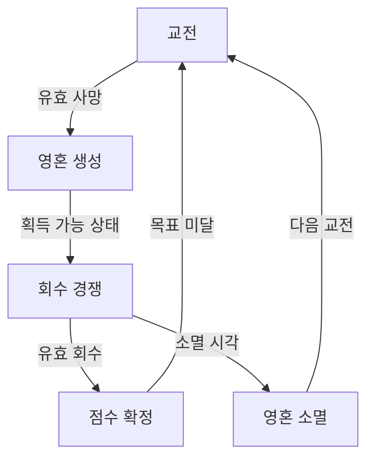

# 영혼 수집가 — Soul Collector 역기획서

| 항목 | 내용 |
| --- | --- |
| 문서 기준일 | 2026-11-13 |
| 분석 상태 | 2024 Angels vs Demons의 공식 규칙과 2025 재등장 기록을 분석한다. 현재 개방 여부 미확인. |
| 자료 성격 | 공개 규칙 기반 역기획. 원작 내부 구현 또는 직접 플레이 실측 보고서가 아님 |

> 표기: **[공식]** 공개 자료에 명시된 사실, **[보조]** 커뮤니티 자료, **[해석]** 규칙에서 도출한 설계 분석, **[제안]** 재구현 방법, **[미확인]** 추가 검증 대상.

## 1. 핵심 규칙과 자료 경계

[공식] 쓰러진 플레이어의 영혼을 회수해 득점한다. 6개 선취 또는 시간 종료 우세로 승리하며, 방치된 영혼은 사라진다. [S1] 2025 재등장이 공지되었다. [S2]

**[미확인]** 아군 영혼을 접촉해 즉시 제거할 수 있다고 단정하지 않는다. 공식 설명은 아군 영혼을 지키는 행동과 시간 소멸만 명시한다. 회수 반경·소멸 초수·동률은 검증 대상이다.

## 2. 플레이어 경험과 설계 의도 [해석]

처치와 득점 사이에 회수 단계를 넣어 사거리 우세를 곧바로 점수로 확정하지 못하게 한다. 멀리서 적을 쓰러뜨려도 그 지점까지 접근해야 하므로 공격과 전진이 연결된다.

이 절의 의도는 규칙을 설명하기 위한 분석이다. 개발팀의 실제 의사결정이라고 인용하지 않는다.

## 3. 경기 진행과 단계별 판단 [해석]

| 단계 | 플레이 흐름 및 판단 |
| --- | --- |
| 1 | 교전: 안전하게 적을 쓰러뜨릴 수 있는 사선을 만든다. |
| 2 | 영혼 생성: 처치 지점이 새로운 짧은 목표가 된다. |
| 3 | 회수와 보호: 공격 팀은 회수 경로를 열고 방어 팀은 접근을 늦춘다. |
| 4 | 소멸 판단: 위험한 진입보다 소멸을 기다리는 편이 나은지 선택한다. |
| 5 | 종료 압박: 마지막 한 영혼을 노리는 팀과 이를 지키는 팀의 역할이 갈린다. |

## 4. 규칙 상태 모델 [제안]

다음 모델은 검증 가능한 구현 단위로 규칙을 나눈 것이다. 원작의 클래스·함수·서버 처리 순서를 뜻하지 않는다.

## 5. 전략 구조·맵·조합·역전 [해석]

### 원거리 처치의 할인

멀리서 얻은 처치라도 영혼을 가져오지 못하면 점수로 실현되지 않는다. 이를 통해 전선 이동과 생존의 가치가 올라간다.

### 교환의 질

동시에 한 명씩 쓰러져도 영혼이 떨어진 위치에 따라 실질 득점이 달라진다. 아군 쪽에서 교환하면 상대의 회수가 어려울 수 있다.

### 영혼 방어

패배 직후 수비 팀에 작은 재대응 목표가 생긴다. 남은 동료가 지역을 지키는 시간이 처치 손실을 줄이는 자원이 된다.

### 연속 교전

여러 영혼이 한 곳에 쌓이면 큰 회수 기회가 생긴다. 광역 제어가 지나치게 강해지지 않도록 회수 위치·시간을 분석해야 한다.

## 6. 판정 불변식과 예외 처리 [제안]

아래 항목은 재구현 시 보장할 일관성 조건이다. 원작에서 확인되지 않은 우선순위는 별도 설정과 실험 결과로 확정해야 한다.

1. 처치 점수와 영혼 회수 점수를 이중 적용하지 않는다.
2. 영혼 ID는 생성 원인 사망 ID와 연결하여 하나의 사망에서 중복 생성되지 않게 한다.
3. 회수와 소멸이 겹치면 정해진 경계 시간 정책으로 하나만 성립시킨다.

모든 종료 조건은 동일 경기 ID의 결과를 한 번만 확정해야 한다. 시간 종료·사망·목표 달성이 같은 판정 묶음에 들어오면 화면에 보인 순서만으로 승패를 정하지 않고, 명시된 규칙 버전을 사용한다.

## 7. 데이터와 이벤트 설계 [제안]

| 필드 | 의미 |
| --- | --- |
| SoulId / DeathId | 생성 원인과 아이템 식별 |
| SoulTeam | 희생자 소속 팀 |
| EligibleCollectorTeam | 획득 자격 팀 |
| SoulExpiryTime | 소멸 시각 |
| CollectedSouls[] | 팀별 확정 점수 |
| AllyContactPolicy | 아군 접촉 처리 |

공통 메타데이터로 MatchId, RulesetVersion, EventId, ServerTime을 보관한다. 보상 정산에는 별도 SettlementId를 사용해 전투 재전송과 계정 지급을 분리한다.

### 판정 처리 흐름

1. 유효 사망에서 영혼을 하나 생성한다.
2. 회수 시 팀·생존·범위·아이템 유효성을 검사한다.
3. 회수 승인과 아이템 소모를 같은 작업으로 처리한다.
4. 미회수 영혼은 소멸 시간에 제거하고 확정 점수로만 승패를 판정한다.

## 8. UI·피드백 요구사항 [제안]

- 영혼의 팀과 회수 가능 여부를 색뿐 아니라 형태로 구분한다.
- 곧 사라질 영혼은 위험하게 추격할 가치가 있는지 판단할 단서를 준다.
- 처치 피드와 득점 피드를 분리하여 처치했는데 점수가 안 오른 이유를 알린다.

## 9. QA 시나리오와 기대 결과 [제안]

이는 실제 테스트를 실행했다는 기록이 아니다. 미확인 규칙은 우선 클라이언트에서 관찰한 결과를 기입하고, 재구현의 합격 기준을 해당 버전에 맞춰 확정한다.

| ID | 상황 | 재구현의 기대 결과 또는 검증 기준 |
| --- | --- | --- |
| Q01 | 적 처치 후 아무도 회수하지 않음 | 처치만으로 점수가 증가하지 않는다. |
| Q02 | 한 영혼을 여러 명 동시 회수 | 한 팀에 한 번만 득점한다. |
| Q03 | 아군 영혼 접촉 | 검증된 정책대로 처리하며 자동 삭제를 추정하지 않는다. |
| Q04 | 회수와 소멸 같은 시각 | 정해진 시간 경계 규칙대로 처리한다. |
| Q05 | 소환물·환경 피해로 사망 | 영혼 생성 자격 정책을 적용한다. |
| Q06 | 맵 밖 사망 위치 | 회수 가능 지점 보정 또는 예외 정책을 적용한다. |
| Q07 | 양 팀 목표 영혼 동시 회수 | 동시 목표 달성 규칙대로 종료한다. |
| Q08 | 회수 후 연결 끊김 | 확정 점수가 되돌아가거나 중복되지 않는다. |

## 10. 밸런스 지표와 개선 판단 [해석·제안]

- 처치 대비 회수 성공률: 킬과 점수의 분리가 실제 전진을 요구하는지 본다.
- 사망 위치별 상대 회수율: 맵 깊이와 수비 이점을 측정한다.
- 영혼 방어로 막은 점수: 비처치 기여를 평가한다.

지표는 맵·실력 구간·파티 구성·규칙 버전별로 분리한다. 단일 전체 승률만으로 규칙의 문제와 매치 구성의 문제를 구분하지 않는다.

## 11. 추가 실측 계획 [미확인]

1. 아군 영혼 접촉·방치·적 회수를 각각 비교한다.
2. 영혼의 소멸 시간과 소멸 직전 회수 경계를 기록한다.
3. 소환물·환경·상호 처치에서 영혼 생성 자격을 확인한다.

측정에는 게임 버전, 이벤트명, 맵, 캐릭터와 능력, 화면 녹화의 시작·종료 시각을 함께 기록한다. 수치를 확인하면 기존 설명을 덮어쓰기보다 규칙 버전 표를 추가한다.

## 12. 출처와 연결 문서

- **[S1]** [공식 — Angelic and Demonic Drops, 2024-11-07](https://supercell.com/en/games/brawlstars/blog/game-updates/how-to-get-all-the-angelic-and-demonic-drops/)
- **[S2]** [공식 — Release Notes June 2025](https://supercell.com/en/games/brawlstars/blog/game-updates/release-notes-june-2025/)

출처 접근 기준일: 2026-11-13. 공식 페이지가 로딩 화면만 제공한 경우 검색 서비스에 노출된 공식 본문 범위만 근거로 사용했다. 보조 자료는 공식 규칙으로 승격하지 않았다.

- [처치 즉시 득점과 회수형 비교](07_wipeout.md)
- [필드 자원 회수의 공통점](01_gem_grab.md)
- [전체 문서 목차](../README.md)
