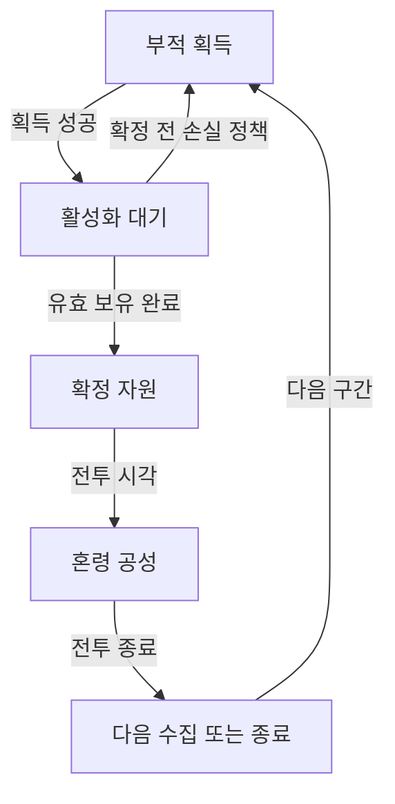

# 혼령 전쟁 — Spirit Wars 역기획서

| 항목 | 내용 |
| --- | --- |
| 문서 기준일 | 2026-11-13 |
| 분석 상태 | 2024 Angels vs Demons와 2025 복귀 기록을 바탕으로 한 이벤트 공성 모드 분석. |
| 자료 성격 | 공개 규칙 기반 역기획. 원작 내부 구현 또는 직접 플레이 실측 보고서가 아님 |

> 표기: **[공식]** 공개 자료에 명시된 사실, **[보조]** 커뮤니티 자료, **[해석]** 규칙에서 도출한 설계 분석, **[제안]** 재구현 방법, **[미확인]** 추가 검증 대상.

## 1. 핵심 규칙과 자료 경계

[공식] 부적을 일정 시간 보유해 활성화하고, 경기의 3차례 전투에서 혼령으로 전환해 적 포탑을 공격하며, 적 포탑 파괴가 승리 목표다. 수가 상한을 넘는 부적은 혼령 강화로 이어진다. [S1]

**[미확인]** 부적 활성화 초수, 소환 상한, 양 팀 소환 시점·자원 이월·포탑 공격 우선순위는 미확인이다. Siege의 우세 한 팀만 로봇을 받는 규칙을 자동 적용하지 않는다.

## 2. 플레이어 경험과 설계 의도 [해석]

중립 자원을 지연 확정한 뒤 다수의 아군 전투 개체로 바꾼다. 부적을 주운 직후에도 안전하게 유지해야 하고, 공성이 시작되면 개별 혼령의 전진을 도와야 하는 두 겹의 호위 구조다.

이 절의 의도는 규칙을 설명하기 위한 분석이다. 개발팀의 실제 의사결정이라고 인용하지 않는다.

## 3. 경기 진행과 단계별 판단 [해석]

| 단계 | 플레이 흐름 및 판단 |
| --- | --- |
| 1 | 중앙 수집: 부적 위치를 확보하되 무리한 획득이 활성화 이전 사망으로 끝나지 않게 한다. |
| 2 | 활성화 보호: 부적을 가진 선수가 안전하게 머무는 시간을 동료가 만든다. |
| 3 | 전투 직전: 남은 활성화 시간과 소환 시각을 비교하여 마지막 획득 가치를 판단한다. |
| 4 | 혼령 공성: 아군 혼령의 경로를 열거나 적 혼령을 광역으로 처리한다. |
| 5 | 다음 준비: 포탑 피해와 남은 전투 횟수에 맞춰 중앙 복귀·수비를 조절한다. |

## 4. 규칙 상태 모델 [제안]

다음 모델은 검증 가능한 구현 단위로 규칙을 나눈 것이다. 원작의 클래스·함수·서버 처리 순서를 뜻하지 않는다.

## 5. 전략 구조·맵·조합·역전 [해석]

### 확정 지연

접촉 즉시 팀 자원이 되지 않는 구조는 돌진 획득의 위험을 높인다. 획득자 생존이 자원전의 마지막 단계가 된다.

### 수량에서 강화로 전환

소환 수 상한 이후 강화로 바뀌면 화면 밀도와 전투 부하를 제한하면서 추가 수집의 가치를 유지할 수 있다. 정확한 강화 함수는 원작 비공개로 남겨야 한다.

### 다수 개체의 압박

단일 로봇과 달리 일부 혼령만 살아남아도 공격이 이어질 수 있다. 광역 공격·관통·표적 전환 능력의 효율이 달라진다.

### 이벤트 능력과 구조물

2024 공식 공지는 Demonfire 관련 구조물 피해 문제와 수정 과정을 기록한다. [S1] 분석상 구조물 피해 계수를 캐릭터 피해와 별도로 검증해야 함을 보여준다.

## 6. 판정 불변식과 예외 처리 [제안]

아래 항목은 재구현 시 보장할 일관성 조건이다. 원작에서 확인되지 않은 우선순위는 별도 설정과 실험 결과로 확정해야 한다.

1. 필드 부적·활성화 대기 부적·확정 자원을 서로 다른 상태로 둔다.
2. 생성 수와 강화량을 한 함수로 정의해 상한 경계에서 자원이 사라지거나 이중 사용되지 않게 한다.
3. 혼령·소환물·이벤트 지속 피해가 구조물에 주는 피해는 허용 대상과 계수를 별도로 판정한다.

모든 종료 조건은 동일 경기 ID의 결과를 한 번만 확정해야 한다. 시간 종료·사망·목표 달성이 같은 판정 묶음에 들어오면 화면에 보인 순서만으로 승패를 정하지 않고, 명시된 규칙 버전을 사용한다.

## 7. 데이터와 이벤트 설계 [제안]

| 필드 | 의미 |
| --- | --- |
| `TurretHP` | 팀별 포탑 잔여 체력 |
| `EndPolicy` | 포탑 파괴·시간 종료·동시 파괴 정책 |
| PendingAmulets[] | 플레이어별 확정 대기 자원 |
| ActivationDeadline | 보유 확정 시각 |
| ConfirmedAmulets[] | 팀별 소환 자원 |
| BattleSchedule[] | 3차례 전투의 시간 설정 |
| SpiritCap / OverflowCurve | 수량 상한과 강화 함수 |
| StructureDamagePolicy | 혼령·브롤러·이벤트 효과별 피해 |

공통 메타데이터로 MatchId, RulesetVersion, EventId, ServerTime을 보관한다. 보상 정산에는 별도 SettlementId를 사용해 전투 재전송과 계정 지급을 분리한다.

### 판정 처리 흐름

1. 부적 획득을 대기 상태로 만들고 활성화 시각을 기록한다.
2. 활성화 조건을 끝까지 유지했을 때 팀 확정 자원으로 이전한다.
3. 전투 스냅샷에서 소환 수와 초과 강화량을 계산한다.
4. 혼령 생성 후 자원 소비·이월 정책을 적용하고 포탑 종료 조건을 검사한다.

## 8. UI·피드백 요구사항 [제안]

- 대기 중 부적과 확정 부적을 분리해 다음 공성 규모를 오해하지 않게 한다.
- 다음 전투까지 시간과 예상 소환 수·강화 단계의 의미를 보여준다.
- 포탑 주변 위험 범위와 다수 혼령의 방향을 읽기 쉽게 표시한다.

## 9. QA 시나리오와 기대 결과 [제안]

이는 실제 테스트를 실행했다는 기록이 아니다. 미확인 규칙은 우선 클라이언트에서 관찰한 결과를 기입하고, 재구현의 합격 기준을 해당 버전에 맞춰 확정한다.

| ID | 상황 | 재구현의 기대 결과 또는 검증 기준 |
| --- | --- | --- |
| Q01 | 활성화 직전 획득자 사망 | 드롭·소멸·유지 중 선택한 원작 검증 정책대로 처리한다. |
| Q02 | 활성화 시각과 전투 스냅샷 일치 | 자원이 이번/다음 전투 중 하나에만 들어간다. |
| Q03 | 소환 상한 바로 아래·일치·초과 | 수량과 강화의 경계가 연속적이고 자원 보존을 만족한다. |
| Q04 | 양 팀 자원 동률 | Siege 규칙이 잘못 적용되지 않도록 이 모드의 생성 정책을 쓴다. |
| Q05 | 혼령 다수가 좁은 통로 이동 | 경로 혼잡으로 영구 정지하지 않는다. |
| Q06 | 이벤트 지속 피해가 포탑에 중첩 | 구조물 전용 계수·중복 제한을 적용한다. |
| Q07 | 마지막 공성 중 포탑 동시 파괴 | 동시 종료 정책으로 단일 결과를 낸다. |
| Q08 | 이벤트 능력 비활성화 후 재접속 | 경기 시작 때 고정된 룰 또는 안전 전환 정책을 따른다. |

## 10. 밸런스 지표와 개선 판단 [해석·제안]

- 획득 대비 확정 부적 비율: 지연 확정이 실질 위험을 만드는지 본다.
- 혼령 수·강화 단계별 포탑 피해: 추가 자원의 한계효과를 측정한다.
- 이벤트 능력별 구조물 피해 편차: 특수 조합이 공성 단계를 생략하는지 확인한다.

지표는 맵·실력 구간·파티 구성·규칙 버전별로 분리한다. 단일 전체 승률만으로 규칙의 문제와 매치 구성의 문제를 구분하지 않는다.

## 11. 추가 실측 계획 [미확인]

1. 부적 획득 후 사망·이동·회복·공격이 활성화에 주는 영향을 기록한다.
2. 상한 전후 자원을 모아 소환 수·체력·피해의 변화를 따로 측정한다.
3. 각 팀 동률·비동률 상태에서 실제 소환과 자원 이월을 확인한다.

측정에는 게임 버전, 이벤트명, 맵, 캐릭터와 능력, 화면 녹화의 시작·종료 시각을 함께 기록한다. 수치를 확인하면 기존 설명을 덮어쓰기보다 규칙 버전 표를 추가한다.

## 12. 출처와 연결 문서

- **[S1]** [공식 — Angelic and Demonic Drops, 2024-11-07](https://supercell.com/en/games/brawlstars/blog/game-updates/how-to-get-all-the-angelic-and-demonic-drops/)
- **[S2]** [공식 — Release Notes June 2025](https://supercell.com/en/games/brawlstars/blog/game-updates/release-notes-june-2025/)

출처 접근 기준일: 2026-11-13. 공식 페이지가 로딩 화면만 제공한 경우 검색 서비스에 노출된 공식 본문 범위만 근거로 사용했다. 보조 자료는 공식 규칙으로 승격하지 않았다.

- [단일 공성 로봇과 비교](24_siege.md)
- [구조물 직접 피해와 공성 피해 비교](03_heist.md)
- [전체 문서 목차](../README.md)
