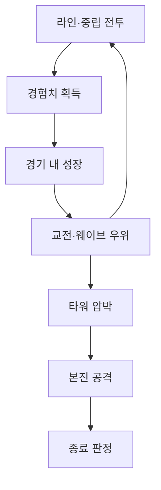

# 38. 브롤 아레나 — Brawl Arena

> 유형: 3대3, 경기 중 성장과 구조물 전진이 있는 MOBA형 모드.
> 최초 규칙은 2025년 공식 발표, 현행 수치 변경은 2026년 패치 계열로 추적한다.

## 1. 공식 확인 범위

[공식] 두 라인의 타워와 본진, 자동 전진하는 미니 봇, 중립 적·카이주, 경기 중 경험치와 레벨이 있다.
도입 설명은 아레나 레벨 0~15와 적 본진 파괴를 승리 목표로 제시한다.[S1]
근처 동료의 처치로도 경험치를 얻으며, 카이주 보상은 경험치와 일시적인 이동·피해 감소 효과를 포함한다.[S1] 정확한 공유 반경·보상식은 미확인이다. 모드 전용 성장 계수는 이후에도 따로 조정된다.[S2]

| 구분 | 명세 상태 |
| --- | --- |
| 승리 | 적 본진 파괴 |
| 지도 구조 | 라인과 중립 구역을 함께 사용 |
| 성장 | 영구 파워와 별도인 경기 중 성장 |
| 전진 자원 | 봇 웨이브·타워·지역 우위 |
| 현재 계수·부활 시간 | 최신 설정 전체를 확인하지 않았으므로 고정하지 않음 |
| 무승부·동시 본진 파괴 | 원작 판정 미확인 |

## 2. 설계 핵심 [해석]

기본 모드에서는 한 번의 교전 승리가 곧바로 목표에 접근할 시간을 만든다.
아레나에서는 그 시간이 경험치, 구조물, 다음 웨이브의 위치로 축적된다.
좋은 교전이 다음 교전을 쉽게 만드는 성장 고리가 더 길게 남는다.

이에 따라 피해를 주지 않고 라인을 정리하는 행동, 중립 적을 확보하는 행동,
상대가 없는 라인에서 구조물을 압박하는 행동이 의미를 갖는다.
전투 능력이 좋아도 어느 목표에 시간을 쓸지 판단하지 못하면 성과가 낮아질 수 있다.

## 3. 게임 흐름

| 국면 | 핵심 선택 | 위험 |
| --- | --- | --- |
| 초반 | 라인 경험치와 중립 자원 분배 | 같은 구역에 몰려 다른 라인 손실 |
| 첫 구조물 압박 | 봇과 함께 전진할지 상대를 추격할지 | 타워 아래 불리한 교전 |
| 중립 대형 목표 | 라인을 비우고 모일지 | 목표 처치 후 역으로 습격당함 |
| 중반 우위 | 경험치 우위를 시설 피해로 전환 | 무리한 진입으로 성장 차 반납 |
| 본진 공방 | 웨이브·생존자·부활 시간을 맞춤 | 탱킹과 공격 타이밍 분리 |
| 열세 수비 | 안전한 파밍과 최소 손실 방어 | 수비만 하다가 모든 자원 상실 |

## 4. 구조적 차이 [해석]

| 하이스트와 비교 | 아레나에서 추가되는 판단 |
| --- | --- |
| 시설 피해 중심 | 타워→본진의 단계와 웨이브 |
| 계정의 전투 능력 | 경기 내 경험치 성장 |
| 적 제거 뒤 시설 공격 | 라인·중립 자원·전진 시점 선택 |
| 즉각적인 공수 교환 | 다음 교전까지 남는 지도·성장 우위 |

아이템 상점이나 일반적인 다른 MOBA의 마지막 타격 규칙을 자동으로 추가하지 않는다.
공식에 확인되지 않은 경험치 공유 반경·막타 보상·타워 우선 표적은 별도 실험 대상이다.

## 5. 상태와 데이터 [제안]

| 데이터 | 필요 이유 |
| --- | --- |
| ArenaProgress | 레벨·경험치·적용 성장 계수 |
| LaneState | 웨이브 번호·진행 위치 |
| StructureState | 체력·취약 조건·공격 표적 |
| NeutralCampState | 등장·전멸·재생성 |
| TeamBuffState | 획득 주체·유효 시간 |
| RespawnPolicy | 경기 성장과 복귀 시간 관계 |
| XpGrantEvent | 원인·수혜자·중복 방지 식별 |
| ModeScalingVersion | 일반전 수치와 별도 튜닝 |

## 6. AI와 목표 판정 [제안]

미니 봇은 진행 목적지와 전투 표적을 분리한다.
주변 적을 쫓다가 영원히 라인을 이탈하지 않게 최대 추적 범위와 복귀 정책을 둔다.
타워는 공격 대상이 죽거나 사라졌을 때 다음 대상 선택 규칙이 필요하다.
본진의 취약 조건은 “적 타워가 어느 상태여야 하는가”를 명확한 데이터로 표현한다.

도입 문장의 “타워 후 본진”만으로 모든 타워를 반드시 파괴해야 하는지,
한 라인 돌파만으로 공격 가능한지까지 추정하지 않는다.

## 7. 조합과 역전 [해석]

라인 처리 능력, 구조물 공격, 중립 목표 처리, 아군 보호는 서로 다른 책임이다.
다수 적을 처리하는 능력이 빠른 성장과 결합하면 원래의 약점을 넘어설 수 있어 모드 전용 계수가 필요하다.
열세팀에게는 안전하게 회복할 공간과 상대 과진입을 처벌할 수단이 있어야 한다.

역전 장치를 새로 설계한다면 현상금, 부활 시간, 본진 방어, 중립 목표 보상 중 어느 지점을 사용할지 정해야 한다.
다른 게임의 역전 규칙이 실제 아레나에도 있다고 단정하지 않는다.

## 8. UI와 학습 [제안]

- 계정 파워와 아레나 레벨의 표시를 혼동시키지 않는다.
- 경험치 공유를 받았는지 짧고 명확하게 보여 준다.
- 양쪽 라인의 위기와 중립 목표를 동시에 파악할 수 있게 한다.
- 구조물 공격 불가 이유를 표시한다.
- 성장 계수는 체력·피해·재장전 등 변화 축을 설명한다.
- 최종 결과에 목표 기여와 구조물 성과를 포함한다.

## 9. QA

| 사례 | 제안 기대 결과 |
| --- | --- |
| 동료와 봇 동시 처치 | 정의한 공유 정책으로 한 번 지급 |
| 레벨업과 치명 피해 동시 | 체력 변경 순서가 명확 |
| 최대 레벨 도달 | 추가 경험치 처리에 오류 없음 |
| 타워 파괴와 표적 발사 동시 | 투사체 수명 정책 일관 |
| 중립 목표 동시 공격 | 처치/보상 귀속 규칙에 따라 처리 |
| 본진 두 개 동시 파괴 | 정의한 동률 정책 적용 |
| 봇이 동적 지형에 갇힘 | 경로 재평가 또는 복구 |
| 경기 종료 | 경기 내 레벨이 계정에 영구 적용되지 않음 |
| 재접속 | 경험치·버프·구조물 상태 복원 |

## 10. KPI와 출처

[제안] 첫 타워 파괴 시점, 경험치 차이별 승률, 중립 목표 후 승률, 유리한 팀의 마무리 시간,
열세 상태 체류 시간, 라인별 활동 분포를 분석한다.
플레이 시간 증가가 재미 증가를 뜻하는지 재참가율과 함께 검토한다.

- [S1: Katana Kingdom 공식 패치](https://supercell.com/en/games/brawlstars/blog/release-notes/updated-june-12-release-notes-the-battle-for-katana-kingdom/) — 검색 색인 본문의 도입 규칙.
- [S2: 2026년 11월 패치](https://supercell.com/brawlstars/en/blog/game-updates/release-notes-november-2026/) — 별도 모드 밸런스 조정의 존재.
- [하이스트](03_heist.md) · [시즈](24_siege.md) · [역할·밸런스](../systems/06_team_roles_balance.md)

