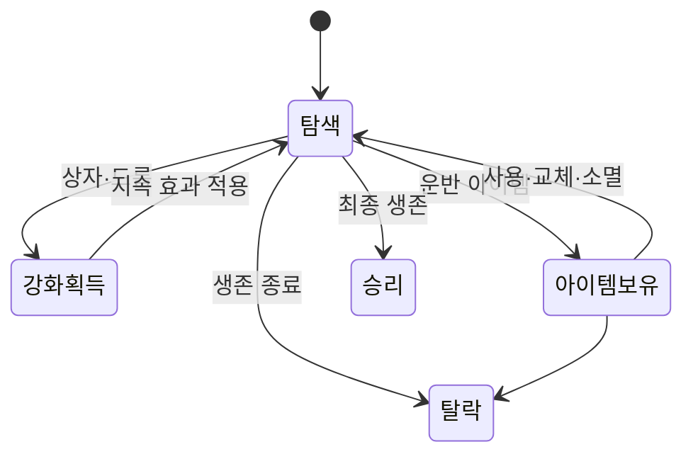

# 39. Loaded Showdown — 파워업 쇼다운

> 상태: 2026년 공식 이벤트 규칙과 11월 변경 공지 확인. 오늘 실제 열린 이벤트 슬롯은 미검증.
> 영문명을 기준으로 사용한다. 일반 쇼다운·Upside Showdown과 별도 모드다.

## 1. 확인 규칙

[공식] 2026년 2월 안내는 미스터리 상자에서 영구 강화와 추가 소비/운반 아이템을 얻는 구조를 설명한다.[S1]
11월 공지는 강화 종류와 아이템 세트를 갱신한다.[S2]
여기서 “영구”는 해당 경기 동안의 지속을 뜻하며 계정 영구 성장과 구분한다.

| 분류 | 기능 성격 | 최신 세부값 취급 |
| --- | --- | --- |
| 경기 지속 강화 | 캐릭터 전투 능력 누적 변경 | 버전별 데이터 |
| 소비 아이템 | 제한 시간 또는 즉시 효과 | 지속·중첩 확인 |
| 운반 아이템 | 획득 후 조작 가능한 행동 | 소유·투척·소멸 정책 |
| 이벤트 세트 | 사용 가능한 아이템 묶음 | 매 이벤트 설정 고정 |
| 상자 추가 드롭 확률 | 과거 공지 존재 | 과거 확률을 11월 현행으로 복사하지 않음 |

### 확인된 아이템이 바꾸는 기본 규칙

[공식] 11월 공지의 대표 사례는 은신, 벽·물 통과, 벽·캐릭터 관통이다.[S2] 지속시간을 모든 변형에 공통 적용하지 않는다.

| 대표 효과 | 기존 규칙과의 충돌 | 재구현 검증 [제안] |
| --- | --- | --- |
| 은신 | 상대 위치 노출·자동 조준 | 공격 시 해제와 팀 정보 공개 범위 |
| 벽·물 통과 | 이동 가능한 지형 | 효과 만료 때 지형 내부에서 복구 |
| 관통 | 투사체 차단·다중 타격 | 벽 통과 뒤 대상별 중복 타격 제한 |

## 2. 설계 핵심 [해석]

일반 쇼다운의 파밍은 주로 전투력을 키운다.
이 변형의 파밍은 새로운 행동 수단과 위험한 상호작용까지 만든다.
플레이어는 상대 브롤러뿐 아니라 어떤 강화와 아이템을 보유했는지도 읽어야 한다.

선택지는 늘지만 처음 보는 아이템에 즉시 탈락하면 학습이 어려워진다.
아이템의 외형, 습득 피드백, 남은 시간, 조작 방법이 일반 능력만큼 명확해야 한다.

## 3. 경기 단계

| 단계 | 선택 | 설계 위험 |
| --- | --- | --- |
| 파밍 시작 | 가까운 상자와 안전 경로 선택 | 시작 위치에 따른 과도한 격차 |
| 첫 아이템 | 즉시 사용 또는 보관 | 조작을 모르는 상태에서 손실 |
| 상대 탐색 | 강화 차이를 읽고 싸움 선택 | 보이지 않는 누적 수치 |
| 중후반 | 공간을 바꾸는 아이템 활용 | 이동 불가 지형·탈출 악용 |
| 최종 교전 | 자원과 위험 구역 타이밍 맞춤 | 일회성 무적·사거리 우위 독점 |

## 4. 상태 모델 [제안]

기본 생존 종료 정책과 아이템 정책을 나눈다.
아이템이 사망을 무효화하는지, 드롭되는지, 남은 지속 시간을 유지하는지는 정의된 정책이어야 한다.

## 5. 아이템 합성 명세 [제안]

| 필드 | 질문 |
| --- | --- |
| stackGroup / maxStacks | 같은 강화 중첩 상한은? |
| operation / order | 더하기·곱하기·최대값 중 무엇인가? |
| lifetimeScope | 경기·생명·시간 중 언제 끝나는가? |
| dropPolicy | 사망 시 얼마를 남기는가? |
| carrySlotPolicy | 기존 아이템과 교환 가능한가? |
| activationContext | 공격 버튼을 교체하는가? |
| terrainOverride | 벽·물 통과 범위는 어디까지인가? |
| revealPolicy | 상대에게 무엇을 공개하는가? |

원작의 중첩 계산식은 미확인이다.
특히 공격 사거리 변경과 투사체 분열·반사·되돌아오기,
흡혈과 보호막 흡수, 쿨다운 감소와 환급의 조합을 별도로 검증한다.

## 6. 맵과 조합 [해석]

벽 통과나 이동 아이템이 있으면 지도 경계와 통과 가능한 지형을 구분해야 한다.
일반 브롤러에게 안전했던 위치가 특정 아이템 앞에서는 안전하지 않을 수 있다.
장거리 능력을 늘리는 강화가 열린 맵에서만 지나치게 강해지는지도 봐야 한다.

운반 아이템이 주는 순간 힘과 지속 강화가 주는 안정된 힘은 교환 관계를 만든다.
파밍만 하는 전략과 공격적으로 아이템을 쓰는 전략이 모두 의미 있는지 분석한다.

## 7. 역전과 불공정감 [해석·제안]

누적 강화는 선두를 더 강하게 만들지만, 강한 상대를 쓰러뜨렸을 때 자원이 재분배되면 역전의 고리가 생길 수 있다.
다만 재분배량을 늘리면 마지막 타격만 노리는 제3자가 지나치게 이득을 볼 수 있다.
드롭 획득 위치와 위험 구역이 이 문제를 조절하는 요소가 된다.

[제안] 드롭 확률뿐 아니라 “초반 두 아이템으로 결과가 사실상 결정되는 비중”을 평가한다.
아이템 세트를 줄이면 예측 가능성과 학습 속도를 높일 수 있지만 반복성이 증가할 수 있다.

## 8. UI 요구

- 현재 지속 강화의 종류와 누적 상태.
- 들고 있는 아이템의 사용법과 소멸 시점.
- 일반 공격과 아이템 행동이 전환됐다는 표시.
- 적의 중요한 이동·은신·관통 효과.
- 이벤트별 사용 아이템 범위.
- 사망 후 무엇을 잃고 떨어뜨렸는지.

## 9. QA 시나리오

| 사례 | 제안 기대 결과 |
| --- | --- |
| 강화 최대 중첩 이후 습득 | 정책대로 교환/무시/연장 |
| 벽 통과 효과 만료 | 지형 안에 영구 고립되지 않음 |
| 운반 중 사망 | 아이템 소유권이 남지 않음 |
| 두 명 동시 습득 | 한 소유자만 확정 |
| 투척과 경기 종료 동시 | 종료 뒤 결과를 바꾸지 않음 |
| 은신 중 공격 | 해당 아이템의 공개 정책 적용 |
| 쿨다운 감소와 환급 중첩 | 음수 시간·연속 무한 발동 방지 |
| 이벤트 세트 변경 | 진행 중 경기는 원래 세트 유지 |
| 재접속 | 강화 수치와 아이템 타이머 복구 |

## 10. KPI·출처

[제안] 아이템별 습득 후 생존 시간, 초반 드롭별 순위 편향, 아이템 미사용 탈락,
기본 공격과 아이템의 처치 비중, 세트별 재참가율을 본다.

- [S1: 2026년 2월 패치](https://supercell.com/brawlstars/en/blog/release-notes/release-notes-february-2026/)
- [S2: 2026년 11월 패치](https://supercell.com/brawlstars/en/blog/game-updates/release-notes-november-2026/)
- [솔로 쇼다운](08_solo_showdown.md) · [Upside Showdown](54_upside_showdown.md) · [이벤트 운영](../systems/15_liveops_events.md)

