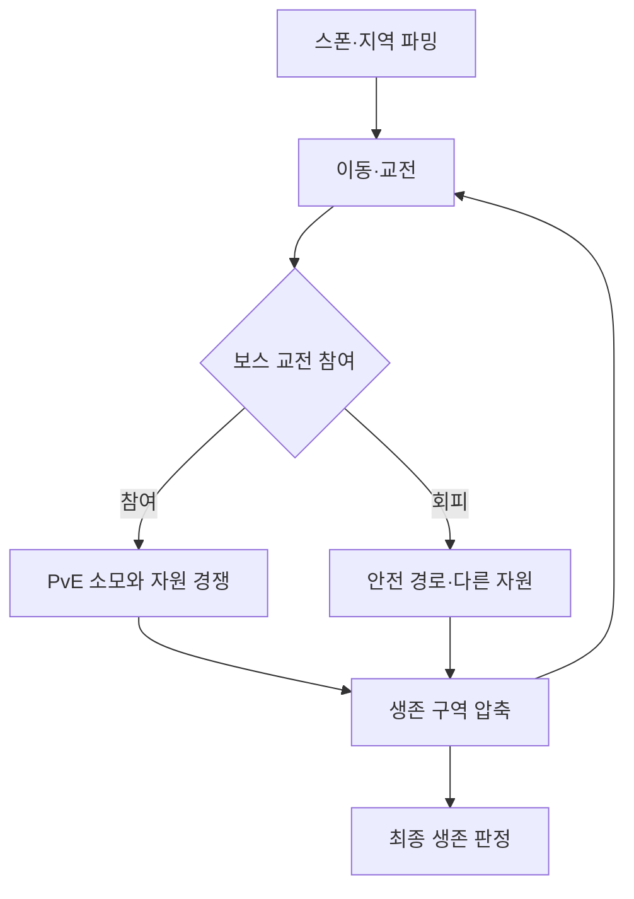

# 40. Mega Showdown — 메가 쇼다운

> 상태: 2026년 11월 공식 발표 확인. 공지에 있는 내용과 실제 운영 여부를 구분한다.
> 공개 세부 규칙이 적으므로 승리 구조는 확인 사실, 나머지 상세 설계는 [해석·제안]으로 작성한다.

## 1. 공식 규칙 카드

[공식] 20인 생존전이며 더 큰 지도, 보스·로봇과 파워 큐브, 미니맵을 사용한다.[S1]
마지막 생존이 목표다. 미니맵이 적 위치까지 상시 공개한다는 의미는 아니다.

| 변수 | 상태 |
| --- | --- |
| 참가자 수 | 20명 확인 |
| 주요 목표 | 최종 생존 |
| 보스·로봇 | 경기 내 자원 획득 대상 존재 |
| 미니맵 | 탐색용 기능 존재 |
| 팀 구조 변형 | 같은 패치의 수정 목록에 Mega Showdown Duo 명칭 확인; 상세 인원·부활 규칙은 미확인 |
| 상세 순위표 | 추가 확인 필요 |
| 가스 속도·맵 크기·스폰 분포 | 수치 미확인 |
| 보스 보상·드롭 귀속 | 세부 미확인 |

## 2. 일반 쇼다운과 달라지는 설계 압력 [해석]

인원과 지도가 함께 커지면 적을 만나는 빈도가 자동으로 두 배가 되는 것은 아니다.
지역별 자원 밀도, 이동 시간, 안전 구역이 첫 교전 시점과 중후반 혼잡도를 결정한다.
멀리 떨어진 교전의 소리를 듣거나 미니맵을 보는 판단이 근접 조준만큼 중요해진다.

보스는 강한 보상인 동시에 여러 플레이어를 한 장소로 부르는 공개 위험이다.
보스를 공격하는 사람은 체력·탄약을 지출하고, 뒤늦게 접근한 사람은 그 약화를 이용할 수 있다.
PvE와 PvP의 위험을 함께 감수하는 선택이 이 모드의 핵심 분석 대상이다.

## 3. 단계별 플레이

| 단계 | 결정 | 관찰할 실패 |
| --- | --- | --- |
| 시작 | 안전한 파밍과 빠른 중앙 진입 | 스폰 위치로 성장 기회 결정 |
| 지역 확보 | 한 구역을 계속 점유할지 이동할지 | 자원 고갈 뒤 늦은 이동 |
| 보스 발생 | 공격·견제·매복 중 선택 | 주변 시야 없이 소모전 |
| 구역 축소 | 바깥 싸움을 끝내고 이동할지 | 승리 뒤 가스에 막힘 |
| 최종 압축 | 강한 적과 약한 적 중 누구를 압박할지 | 남은 다수가 한 플레이어 집중 공격 |

## 4. 상태 모델 [제안]

보스 사건과 플레이어 탈락 사건은 별도다.
보스 처치가 최종 승리로 잘못 연결되지 않게 하고, 마지막 플레이어가 보스와 동시 사망할 때의 결과도 정의한다.

## 5. 지역 구조와 미니맵 [제안]

| 층 | 미니맵에서 필요한 정보 | 공개하지 않을 수 있는 정보 |
| --- | --- | --- |
| 지형 | 이동 경로·위험 경계 | 세부 장식 |
| 목표 | 보스 존재 또는 이벤트 지역 | 숨은 플레이어의 확정 위치 |
| 생존 | 안전 구역·남은 인원 | 비공개 강화 구성 |
| 동선 | 내 위치·방향 | 미확인 적의 미래 경로 |

미니맵은 새로운 전략 정보를 주므로 화면의 단순 축소판으로만 취급하지 않는다.
미확인 적 위치가 지도 아이콘·이펙트·사운드로 새어 나오지 않는지도 점검한다.

## 6. 자원과 역전 [해석]

자원이 많은 플레이어를 공격하면 높은 위험과 큰 보상이 연결될 수 있다.
그러나 초기 자원 편향이 너무 크면 약한 플레이어는 회피 외에 선택지가 사라진다.
초반 성장이 늦어진 플레이어도 다른 경로에서 최소한의 교전 수단을 마련할 수 있는지 확인해야 한다.

인원이 많을수록 한 번의 전투를 이긴 뒤 다른 적에게 공격당할 가능성이 커진다.
전투를 피하는 행동이 항상 지배적이 되지 않도록 목표 보상·위치 노출·교전 소모를 함께 분석한다.
이것은 조정 방향에 대한 제안이며 원작이 특정 보정 시스템을 사용한다는 뜻은 아니다.

## 7. 데이터 명세 [제안]

MapRegion, SpawnAllocation, ResourceBudget, BossEncounter, NeutralSpawnSchedule,
SafeZoneTimeline, MinimapVisibilityPolicy, EliminationOrder를 별도 데이터로 둔다.

보스에게 누적한 피해와 마지막 타격, 드롭 획득자는 서로 다를 수 있다.
어떤 정보를 보상 귀속에 사용할지 명시한다.
AI 이동·투사체·소환수가 늘어나도 플레이어 목표 판정의 안정성을 우선한다.

## 8. UI와 피드백

- 지역 이동의 방향과 위험 구역 도달 시간을 읽기 쉽게 한다.
- 미니맵 확대가 조작 영역을 가리지 않게 한다.
- 보스의 위험 공격은 플레이어의 강화 효과와 구분한다.
- 살아 있는 플레이어 수와 현재 순위 확정 여부를 분리한다.
- 탈락 뒤 보상은 일반 쇼다운 표를 자동 재사용하지 않는다.

## 9. QA

| 사례 | 제안 기대 결과 |
| --- | --- |
| 20명 시작 배치 | 중복 위치·불공정 고립 최소화 |
| 보스와 플레이어 동시 사망 | 각 사건의 귀속과 순위 일관 |
| 보스 드롭 동시 습득 | 중복 지급 없음 |
| 가스 밖 보스 출현 | 의도한 안전 구역 정책 적용 |
| 미니맵과 본화면 시야 차이 | 정보 권한 일치 |
| 마지막 둘 동시 탈락 | 미리 정한 순위/동률 정책 |
| 다수 소환수·보스 중첩 | 판정 주기·입력 응답 유지 |
| 재접속 | 남은 인원·가스·보스 상태 복원 |

## 10. KPI와 검증 과제

첫 교전 시간의 분포, 지역별 생존율, 보스 참가/비참가 최종 순위,
세 번째 플레이어 개입률, 평균 이동 시간, 미니맵 사용과 생존의 관계를 본다.
실기 확보 시 스폰 균등성·보스 드롭·가스·동시 사망을 우선 측정한다.

## 11. 출처

- [S1: 2026년 11월 공식 패치](https://supercell.com/brawlstars/en/blog/game-updates/release-notes-november-2026/)
- [솔로 쇼다운](08_solo_showdown.md) · [파워업 쇼다운](39_loaded_showdown.md) · [맵·시야](../systems/05_maps_terrain_vision.md)

