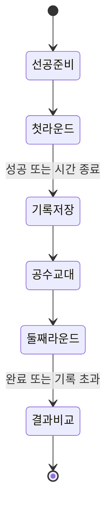

# 41. Counterlight — 공수 교대 점령 시간 경쟁

> 상태: 2026년 11월 공식 발표. 한글 제목은 기능 설명이며 공식 현지화명으로 단정하지 않는다.
> 팀당 인원·시간 제한·리스폰·정확한 점령 곡선은 확보한 공식 설명에서 확정되지 않았다.

## 1. 공식 규칙

[공식] 두 라운드에서 공격 역할을 교대한다. 공격은 두 사이트 중 한 곳을 완성하면 된다.
각 사이트의 세 지점에 분산해 서면 진행이 빨라지고, 후공은 선공이 기록한 시간과 경쟁한다.
양쪽 모두 실패하면 무승부다.[S1]

| 항목 | 확인 상태 |
| --- | --- |
| 라운드 수 | 2 |
| 선택지 | 두 사이트 중 하나 |
| 사이트 내 점령 | 서로 다른 지점 참여가 속도에 영향 |
| 결과 | 완료 시간 비교, 양측 실패 무승부 |
| 완전 동일 시간 | 미확인 |
| 양측 미완료 | 부분 진척과 관계없이 공식 무승부 규칙 적용 |
| 미완료 시 부분 진척 | 표시·기록 방식은 미확인 |
| 점령 중 적 진입·퇴각 | 차단·감쇠·보존 여부 미확인 |

## 2. 설계 핵심 [해석]

이 모드는 적을 제거한 뒤 같은 위치에 모이는 것만으로 최적화되지 않는다.
공격팀은 목표를 빠르게 진행하기 위해 서로 다른 지점에 분산해야 하고,
수비팀은 어느 지점의 참여를 끊는 것이 진행을 가장 많이 늦추는지 판단한다.

두 사이트는 공격의 방향 선택과 수비의 정보 문제를 만든다.
한쪽에 가짜 압박을 주고 다른 쪽으로 이동하면 수비의 이동 시간이 기록 차이로 변한다.
선공과 후공의 목표가 “최대한 빠르게”와 “그 기록보다 빠르게”로 달라진다.

## 3. 공수 단계

| 국면 | 공격팀 | 수비팀 |
| --- | --- | --- |
| 진입 전 | 어느 사이트를 압박할지 숨김 | 정찰과 분산 배치 |
| 첫 접촉 | 수비를 밀거나 반대 사이트 전환 | 과잉 지원으로 빈 곳 만들지 않기 |
| 점령 중 | 지점 분산과 교전 역할 균형 | 한 지점 차단으로 속도 낮추기 |
| 마무리 | 사망 위험을 감수하고 진행할지 | 시간만 벌면 되는지 판단 |
| 공수 전환 | 기록·맵·장비 상태 확인 | 새 역할의 목표 재해석 |
| 후공 막판 | 남은 시간에 맞춘 강행 | 추격보다 최소 지연 수단 |

## 4. 상태 전이 [제안]



선공 기록이 없다는 상태와 시간이 매우 큰 값이라는 상태를 동일하게 표현하지 않는다.
첫 라운드 실패를 null completionTime으로 기록하면 실패/미도착을 명확하게 분리할 수 있다.

## 5. 점령 모델 [제안]

```text
for each site:
    occupiedSlots = distinct eligible capture slots occupied by attackers
    rate = captureRatePolicy(occupiedSlots, defenders, currentState)
    progress = clamp(progress + rate * dt, 0, requiredProgress)

if any site is complete:
    commit completionTime once
```

점령 속도가 인원수에 선형 비례한다고 단정하지 않는다.
같은 지점에 여러 명이 서는 것과 서로 다른 지점에 서는 것을 별도로 계산한다.
적 진입 시 정지하는지, 되돌아가는지, 양쪽 점령이 동시에 진행되는지는 원작 확인이 필요하다.

## 6. 데이터 계약

| 필드 | 목적 |
| --- | --- |
| AttackOrder | 선공·후공과 라운드별 팀 |
| CaptureSite[] | 사이트별 지점과 진행 상태 |
| SlotOccupancy | 중복 제거된 유효 참가자 |
| RateCurve | 점령 참여에 따른 진행률 |
| CompletionRecord | 성공 여부·완료 시각 |
| AttackDeadline | 기본 제한과 선공 기록에 따른 기한 |
| SwapResetPolicy | 공수 교대 시 초기화 범위 |
| TieResolutionPolicy | 동일 시각 처리 |

[제안] 한 경기에서 두 팀이 같은 맵 조건을 경험하도록 초기 지형·소환물·충전 상태를 어떤 범위까지 복원할지 명세한다.
원작의 공수 교대 초기화 범위는 미확인이다.

## 7. 맵·역할·역전 [해석]

두 사이트의 이동 시간이 같지 않다면 특정 공격 방향이 기본 선택이 될 수 있다.
수비의 회전 경로가 너무 짧으면 가짜 공격의 가치가 낮아지고, 너무 길면 첫 정보 실수가 곧 패배가 된다.
사이트 내부 지점들은 광역 공격 하나로 모두 덮이지 않는지 검토해야 한다.

킬 능력 외에 이동 방해, 사선 확보, 진입 방어, 마지막 지점 접촉이 중요하다.
후공은 기록을 알고 있으므로 큰 위험을 감수해야 하는 순간을 더 명확하게 계산할 수 있다.
이 정보 비대칭이 공정한지 공수 순서별 결과를 따로 측정한다.

## 8. UI 요구

- 현재 공격팀·수비팀.
- 두 사이트의 진행과 유효 점령 지점.
- 선공 기록과 후공 남은 기회.
- 점령이 멈추거나 빨라진 이유.
- 라운드 승패와 최종 경기 결과의 차이.
- 양측 실패와 같은 시간 완료의 판정 이유.

## 9. QA

| 사례 | 제안 기대 결과 |
| --- | --- |
| 같은 지점에 공격자 여러 명 | 별도 지점 수와 혼동하지 않음 |
| 두 사이트 동시 완료 | 한 완료 기록만 생성 |
| 마지막 점령자 사망과 완료 동시 | 고정된 사건 순서 적용 |
| 후공이 선공과 같은 시간 | 정의한 tiePolicy 적용 |
| 선공 실패·후공 성공 | 성공 여부와 시간 비교를 올바르게 처리 |
| 선공 0%, 후공 99%지만 양측 미완료 | 부분 진척과 무관하게 공식 무승부 규칙 반영 |
| 공수 교대 중 재접속 | 역할·맵 초기 상태 복원 |
| 초읽기 직전 넉백 | 점령 존재 검출과 화면 일치 |
| 무적/은신 상태 진입 | 자격 정책에 따라 점령 |

## 10. KPI·출처

[제안] 공수 순서별 승률, 사이트 선택 편향, 첫 접촉→완료 시간,
지점 수별 유지 시간, 전환 공격 성공률, 후공의 기록 초과 분포를 본다.
실기에서 점령 차단, 진행 보존, 부활, 동률을 먼저 확인해야 한다.

- [S1: 2026년 11월 공식 패치](https://supercell.com/brawlstars/en/blog/game-updates/release-notes-november-2026/)
- [핫 존](05_hot_zone.md) · [페이로드](21_payload.md) · [규칙 데이터](../systems/08_data_rules_qa.md)

