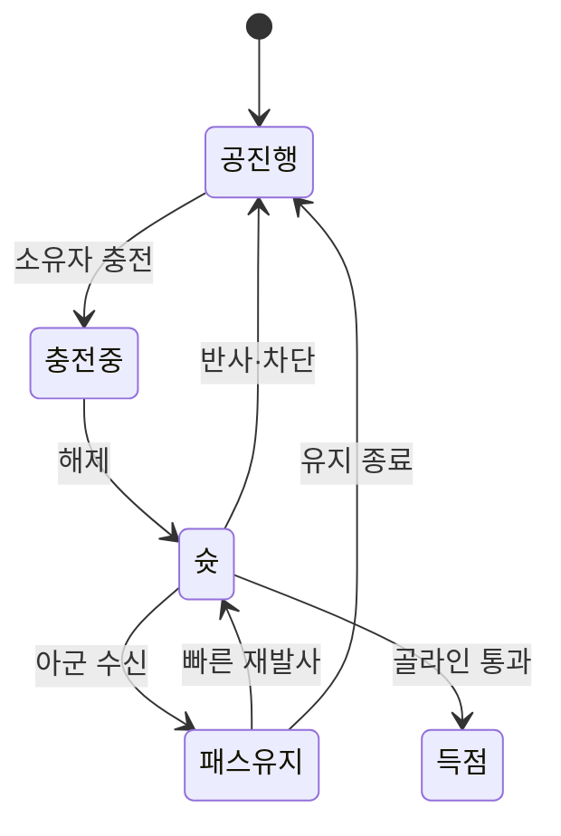

# 42. Super Ball — 충전 슛과 골키퍼가 있는 축구 변형

> 상태: 2026년 4월 공식 이벤트 발표. 공식 본문에는 Super Ball과 Super Brawl Ball 표기가 함께 사용된다.
> 기본 브롤 볼의 모든 수치가 그대로 유지된다고 가정하지 않는다.

## 1. 확인 규칙

[공식] 공격을 유지해 슛을 충전하며 최대 충전은 상대에게 피해를 줄 수 있다.
빠른 아군 패스에는 충전이 잠시 이어지고, 양쪽 골키퍼는 골과 공 사이로 움직여 슛을 반사한다.
골키퍼를 제압하면 잠시 무력화된다.[S1]

| 항목 | 상태 |
| --- | --- |
| 핵심 추가 | 충전·패스 연속성·골키퍼 |
| 골키퍼 존재 | 양팀 확인 |
| 충전 최대 시간·유지 시간 | 수치 미확인 |
| 골키퍼 이동 범위·체력 | 수치 미확인 |
| 승리 득점·연장 | 기본 모드와 동일 여부 별도 확인 |
| 골키퍼 회복·면역 | 미확인 |

## 2. 설계 핵심 [해석]

기본 공 모드의 “공을 어느 방향으로 보낼까”에 “얼마나 충전하고, 누가 그 충전을 이어받을까”가 추가된다.
충전 중의 공격 기회를 포기하는 대가로 강한 슛을 준비하고, 패스로 그 투자를 공유할 수 있다.
골키퍼는 아무도 수비하지 않는 빈 골문에도 최소한의 방어 퍼즐을 만든다.

따라서 공격은 수비수 처치 하나로 끝나지 않는다.
골키퍼 위치를 한쪽으로 유도하거나, 반대 방향으로 빠르게 공을 보내거나,
골키퍼를 무력화한 시간에 슛을 맞추는 선택이 생긴다.

## 3. 단계별 플레이

| 단계 | 공격팀 판단 | 수비팀 판단 |
| --- | --- | --- |
| 공 획득 | 즉시 전진 또는 충전 | 충전 시간을 허용할지 |
| 충전 | 노출 위험과 슛 가치 비교 | 충전자를 압박하며 패스 경로 제한 |
| 패스 | 충전 유지와 수신 위치 | 단순 운반자 추격 대신 수신점 차단 |
| 골키퍼 유도 | 골키퍼 이동을 읽고 반대각 만들기 | 플레이어 수비와 골키퍼 역할 분담 |
| 제압 창 | 무력화 시간에 공격 집중 | 시간을 벌며 재가동 기다리기 |
| 전환 | 충전 잔여 가치와 안전 복귀 | 반사된 공을 역습으로 연결 |

## 4. 상태 모델 [제안]

공의 충전값이 소유자의 능력 상태인지 공 객체의 상태인지 재구현에서 결정해야 한다.
패스가 충전을 전달한다면 최소한 전달될 상태와 만료 시점을 공과 함께 식별해야 한다.

## 5. 데이터와 골키퍼 정책 [제안]

| 필드 | 설명 |
| --- | --- |
| chargeFraction | 현재 슛 준비 정도 |
| chargeOwner / lastTeam | 충전과 팀 귀속 |
| passRetentionDeadline | 빠른 패스로 유지되는 경계 |
| shotDamagePolicy | 최대 충전의 피해 조건 |
| keeperRegion | 골키퍼 이동 제한 |
| keeperTargetPolicy | 공에 대응하는 목표 위치 |
| keeperDisableState | 무력화와 복귀 |
| reboundPolicy | 충돌 뒤 공 속도·방향 |

골키퍼가 공과 골 사이에 선다는 공개 설명을 정밀 AI 공식으로 확대하지 않는다.
반응 지연, 예측 정도, 순간이동하는 공·벽·다중 공 처리 등은 원작 미확인이다.

## 6. 충전 전달의 경계 [제안]

- 적이 가로채면 기존 충전을 지울지, 유지할지, 다른 값으로 바꿀지 명시한다.
- 아군이 받았지만 오랫동안 보유하면 유지 시간 만료를 보여 준다.
- 공 소유자가 사망할 때 충전이 남는지 결정한다.
- 충전 중 다른 능력 사용과 강제 이동의 취소 정책을 정한다.
- 골키퍼 반사 후 남는 충전과 피해 능력을 구분한다.
- 골 직후 충전·무력화·타이머를 초기화할 범위를 정한다.

## 7. 맵·역할·역전 [해석]

빠른 패스를 활용하려면 서로 보이는 공간뿐 아니라 수신 후 바로 슛할 각도도 필요하다.
공격자는 공 소유자, 수신자, 골키퍼/수비 제압자의 책임으로 나뉠 수 있다.
역할을 고정하면 수비가 대응하기 쉬우므로 공 이동에 맞춘 역할 교환이 중요하다.

골키퍼가 너무 강하면 단독 플레이의 성취감이 사라지고, 너무 약하면 추가 시스템의 의미가 줄어든다.
수비자가 살아 있어도 패스 설계로 득점할 수 있는지, 공격자가 적을 모두 제거했을 때 적절한 보상이 있는지 함께 본다.

## 8. UI와 피드백

충전 막대, 공의 현재 위협 단계, 패스 유지 시간, 골키퍼 무력화 상태를 서로 다른 신호로 보여 준다.
충전 효과가 실제 피해 가능 시점을 앞서 보이면 수비가 잘못 판단한다.
패스가 성공했지만 충전이 사라졌을 때 이유를 알 수 있는 짧은 피드백이 필요하다.

## 9. QA

| 사례 | 제안 기대 결과 |
| --- | --- |
| 충전 임계점 직전 해제 | 충전 단계와 피해 여부 일치 |
| 아군 수신과 유지 시간 종료 동시 | 명시된 시간 경계 적용 |
| 적 가로채기 | 충전 소유권 정책 일관 |
| 골키퍼 제압과 슛 동시 | 무력화/반사 순서가 고정 |
| 빠른 연속 패스 | 충전이 무제한 증폭되지 않음 |
| 공 소유자 강제 이동 | 공과 충전 상태가 분리 유실되지 않음 |
| 골키퍼가 경계에 갇힘 | 허용 영역 내 복구 |
| 득점 리셋 | 이전 공의 충전·피해 사건 제거 |
| 재접속 | 골키퍼와 공 상태 복원 |

## 10. KPI와 출처

[제안] 득점 전 패스 수, 충전 손실률, 골키퍼 제압 후 득점 전환,
단독 돌파/연계 득점 비중, 골키퍼 방어율을 관측한다.

- [S1: 2026년 4월 공식 패치](https://supercell.com/brawlstars/en/blog/release-notes/release-notes-april-2026/)
- [브롤 볼](02_brawl_ball.md) · [슈퍼 하키](43_super_hockey.md) · [조작](../systems/02_controls_camera.md)

