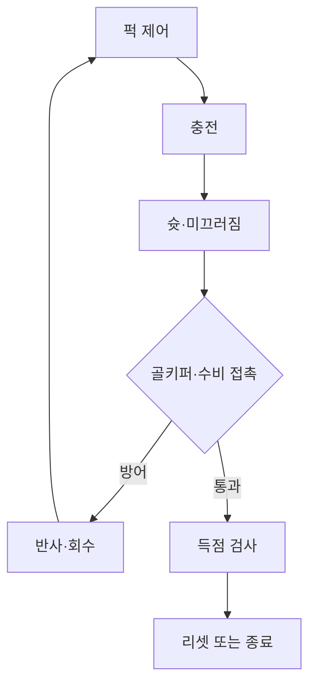

# 43. Super Hockey — 충전 퍽과 골키퍼 변형

> 상태: 2026년 11월 공식 발표 확인. 현재 플레이 가능한 시점과 전체 세부 규칙은 미검증.
> Brawl Hockey와 Super Ball을 참고하되 공개되지 않은 세부값을 자동 상속하지 않는다.

## 1. 공식 확인 범위

[공식] 퍽 충전으로 더 강한 슛을 사용하고 양쪽 골문에 골키퍼가 있는 하키 변형이다.[S1]
이는 골키퍼 AI·체력·충전 피해·패스 유지가 Super Ball과 완전히 같다는 뜻은 아니다.

| 구분 | 처리 |
| --- | --- |
| 충전 가능한 퍽 | 확인 |
| 양팀 골키퍼 | 확인 |
| 충전 슛의 정확한 피해·속도 | 미확인 |
| 충전 전달과 가로채기 | 미확인 |
| 팀당 인원·승리 득점 | 공지의 상세 명세 확인 필요 |
| 연장·리셋 | 미확인 |

## 2. 설계 핵심 [해석]

이 모드는 힘을 준비하는 판단과 미끄러지는 목표물의 미래 위치를 읽는 판단을 결합한다.
충전 슛이 빨라질수록 골키퍼와 플레이어가 반응할 시간은 줄어든다.
그러나 강한 슛이 반사되면 수비 전환도 더 급격해질 수 있다.

공의 소유자 중심 연계와 퍽의 이동 궤적 중심 연계는 다른 조작 부담을 만든다.
기존 축구 변형을 그대로 복사하기보다 어떤 순간에 플레이어가 퍽을 제어할 수 있는지부터 검증해야 한다.

## 3. 플레이 단계 [해석]

| 국면 | 중심 의사결정 |
| --- | --- |
| 퍽 접근 | 먼저 접촉할지 상대 슈팅 방향을 막을지 |
| 준비 | 충전 시간을 만들 위치 선택 |
| 전개 | 직선·반사·측면 슛 중 골키퍼 대응을 흔드는 경로 |
| 골문 압박 | 플레이어 수비와 골키퍼 중 무엇을 먼저 해제할지 |
| 반사 뒤 | 세컨드 볼을 회수할지 역습을 막을지 |
| 득점 재개 | 같은 공격 패턴을 반복할지 바꿀지 |

## 4. 상태 모델 [제안]

퍽 이동 상태, 충전 상태, 골키퍼 상태를 각각 관리한다.
한 상태 머신에 모든 조합을 나열하면 충전된 퍽이 반사되는 경우나
골키퍼가 무력화된 채 득점 리셋에 들어가는 경우를 빠뜨리기 쉽다.

## 5. 물리와 규칙의 분리 [제안]

| 시스템 | 책임 |
| --- | --- |
| PuckSimulation | 위치·속도·접촉 |
| ChargePolicy | 준비·유지·소비·전달 |
| KeeperController | 이동·막기·무력화 |
| GoalPolicy | 유효 골라인·득점 주체 |
| MatchRules | 점수·연장·종료 |
| Presentation | 잔상·충전 효과·골키퍼 반응 |

퍽이 빠를수록 충돌 누락과 반사 오차가 승패에 직접 영향을 준다.
연속 충돌 검사와 목표물의 확정 판정은 시각 연출보다 우선한다.
네트워크 보정으로 퍽이 골문 안에서 밖으로 돌아오는 상황을 어떻게 설명할지도 필요하다.

## 6. 맵과 전술 [해석]

벽 가까운 슈팅 위치는 반사각을 만들지만, 되돌아오는 퍽의 위험도 커진다.
넓은 골문은 골키퍼의 이동 책임을 늘리고 플레이어 수비의 빈틈을 만든다.
좁은 골문은 골키퍼 제압에 전략이 집중될 수 있다.

역할은 슛 준비, 골키퍼 방해, 반사 회수, 역습 차단으로 구분할 수 있다.
한 브롤러가 두 역할을 동시에 수행할 수 있을 때 조합이 지나치게 경직되는지도 살펴본다.
원작의 특정 브롤러 메타를 측정한 결과는 아니다.

## 7. 핵심 경계와 선택 [제안]

- 골키퍼가 퍽을 반사할 때 충전이 소모되는가.
- 충전 슛이 플레이어를 관통하는가, 정지하는가.
- 물리 접촉과 슛 행동이 같은 순간 발생하면 어떤 속도를 쓰는가.
- 임시 지형과 골키퍼 이동 영역이 충돌하면 어디로 복귀하는가.
- 연장에서 골키퍼·벽·충전 정책이 바뀌는가.
- 골키퍼가 처치 판정이나 특수 공격 충전에 기여하는가.

어느 항목도 공개 설명 없이 원작의 정답으로 채우지 않는다.

## 8. UI 요구

충전된 퍽은 일반 퍽과 충분히 구분되어야 한다.
동시에 충전 이펙트가 퍽 중심과 접촉 경계를 가리지 않게 한다.
골키퍼의 활성·회복·무력화는 체력 바 하나로만 표현하지 않는 편이 명확하다.
원거리에서 미끄러져 오는 퍽과 가까운 탄환의 위험 우선순위를 시각적으로 구분한다.

## 9. QA

| 사례 | 제안 기대 결과 |
| --- | --- |
| 빠른 충전 슛과 얇은 벽 | 충돌 누락 없음 |
| 골키퍼와 벽 동시 접촉 | 반사 결과 일관 |
| 반사된 슛이 반대 골로 이동 | 득점 주체·자책 정책 정의 |
| 충전 도중 퍽 제어 상실 | 충전 귀속과 종료 처리 일관 |
| 골키퍼 무력화 만료 순간 슛 | 시간 경계 고정 |
| 득점 후 잔여 충돌 | 중복 점수 없음 |
| 임시 벽으로 퍽 고립 | 복구 정책 적용 |
| 재접속 | 충전·속도·골키퍼 상태 복원 |

## 10. KPI와 출처

[제안] 직접/반사 득점, 충전 슛 성공률, 반사 후 역습 실점,
골키퍼 비활성 시간, 공정한 대응 시간이 없는 득점 비중을 본다.
이 모드의 정확한 규칙을 검증하기 전에는 Super Ball의 수치를 그대로 채택하지 않는다.

- [S1: 2026년 11월 공식 패치](https://supercell.com/brawlstars/en/blog/game-updates/release-notes-november-2026/)
- [브롤 하키](19_brawl_hockey.md) · [슈퍼 볼](42_super_ball.md) · [네트워크](../systems/07_network_architecture.md)

