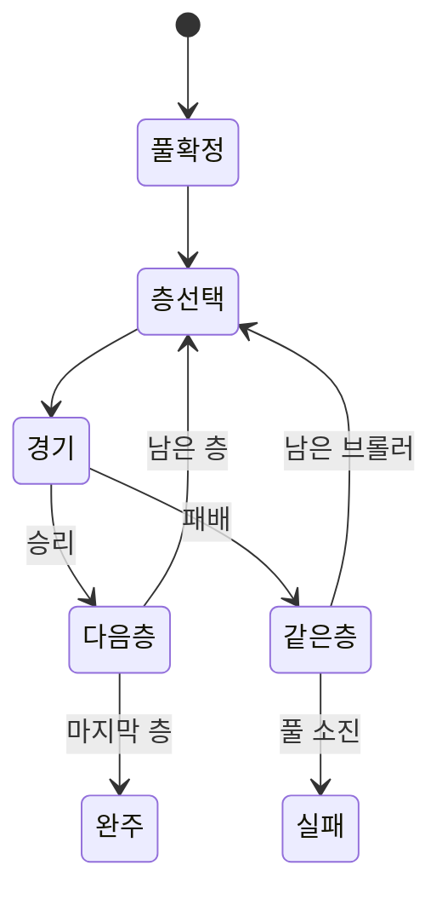

# 44. Topple the Tower — 브롤러 소모형 연속 도전

> 유형: 단일 전투 규칙을 넘어 여러 모드의 경기를 연결하는 런 구조.
> 기준 규칙: 2026년 6월 공식 이벤트 발표. 이후 모든 유사 이벤트가 같은 층수·보상을 쓴다고 단정하지 않는다.

## 1. 공식 규칙 요약

[공식] 서로 다른 맵·모드의 5개 층을, 주어진 브롤러 풀로 도전한다.
승리하면 다음 층으로 가며 사용 브롤러는 묶이고, 패배하면 같은 층에서 다른 브롤러로 재도전한다.
풀 소진 또는 완주로 런이 끝난다. 이벤트 중 하루 한 타워이며 팀은 같은 층에서 구성한다.[S1]

| 변수 | 기준 상태 |
| --- | --- |
| 층/경기 관계 | 한 런에 여러 경기 |
| 브롤러 자원 | 사용 후 다음 선택에서 제한 |
| 패배 | 즉시 모든 보상 소멸이 아니라 같은 층 재시도 구조 |
| 강화 | 공식 이벤트의 최대 강화 조건 |
| 현재 풀 크기·대상·보상 | 이벤트 버전 설정 |
| 연결 종료·무승부 | 별도 확인 필요 |

## 2. 설계 핵심 [해석]

일반전은 지금 가장 잘하는 브롤러를 반복 선택할 수 있다.
타워에서는 미래 층에 적합한 브롤러를 남겨야 하므로 현재 승률과 미래 선택지 사이의 교환이 생긴다.
패배는 시간 손실뿐 아니라 사용할 수 있는 캐릭터 하나를 잃는 손실이다.

따라서 이 모드는 계정 보유의 폭, 여러 모드 이해, 캐릭터별 숙련의 분산을 하나의 도전으로 묶는다.
강화가 정규화되어도 특정 맵에 맞는 브롤러가 풀에 있는지의 차이는 남을 수 있다.

## 3. 런과 매치의 구분 [제안]

런 상태는 경기 서버 하나의 메모리에만 두지 않는다.
매치가 종료되고 새 매치에 들어가도 브롤러 사용 기록과 보상 상태가 유지되어야 한다.
정산과 다음 층 해금의 트랜잭션 경계를 분명하게 한다.

## 4. 층별 선택 전략 [해석]

| 선택 | 장점 | 위험 |
| --- | --- | --- |
| 가장 강한 브롤러 즉시 사용 | 현재 층 실패 확률 감소 | 후반의 어려운 맵 대응 상실 |
| 특화 브롤러를 맞는 층에 저장 | 자원 효율 증가 | 지금의 불안정한 선택 |
| 범용 브롤러 먼저 사용 | 특수 대응 카드 보존 | 범용 안전망 소진 |
| 익숙한 브롤러 보존 | 마지막 성공 확률 강화 | 초반 미숙련으로 여러 장 소모 |

정확한 최적 선택을 계산하려면 각 층의 승률과 브롤러별 적합도 데이터가 필요하다.
본 문서는 실측 승률표를 만들지 않고 의사결정 구조를 제시한다.

## 5. 데이터 계약 [제안]

| 필드 | 설명 |
| --- | --- |
| towerInstanceId | 날짜·이벤트에 연결된 도전 ID |
| floorDefinitions[] | 맵·모드·변형 |
| eligiblePool[] | 시작 시 확정된 브롤러 |
| usedOnWin[] / lostOnFailure[] | 사용 제한의 서로 다른 원인 |
| currentFloor | 현재 진행 위치 |
| consumedMatchIds[] | 중복 결과 방지 |
| rewardsByFloor | 층별 수령 상태 |
| perfectRunState | 무패 조건 유지 |
| expiryPolicy | 이벤트 종료와 진행 중 경기 처리 |

풀 재추첨과 날짜 변경이 겹칠 때 이미 사용한 브롤러가 되살아나지 않게 한다.
무승부·취소·서버 장애를 패배처럼 소모할지는 제품 선택이며 원작 미확인이다.

## 6. 팀 플레이 [해석·제안]

같은 층이라는 조건은 비슷한 단계의 도전을 묶지만 남은 풀은 다를 수 있다.
팀원이 서로 다른 브롤러를 보존하려 하면 최적 조합과 개인 런 목표가 충돌한다.
선택 화면에서 다음 층의 요구와 남은 후보를 이해할 수 있게 해야 협의가 가능하다.

[제안] 파티 구성과 개별 런 상태를 분리한다.
파티장이 나가도 다른 사람의 브롤러 사용 기록과 보상은 유지한다.
한 경기 결과를 모든 팀원에게 같은 층 결과로 적용할 수 있는지 참가 시 검증한다.

## 7. 난도와 보상 [해석]

실패할수록 후보가 줄면 도전 난도가 더 높아지는 압박이 생긴다.
초반 실패가 사실상 완주 불가능으로 이어지면 남은 경기를 포기하게 된다.
풀의 최소 대응 가능성과 후반 층의 난도 급증을 함께 봐야 한다.

층별 보상은 실패한 런에도 진행감을 남긴다.
완주·무패 보상은 목표를 강화하지만 모든 플레이어에게 무패만 의미 있다고 느끼게 하면 재시도 경험이 약해진다.

## 8. UI 요구

남은 브롤러, 승리로 사용한 브롤러, 패배로 잃은 브롤러를 분명히 구분한다.
층의 모드·맵·적용 효과와 선택 잠금의 이유를 보여 준다.
다음 경기 버튼 전에 “이번 선택은 런에서 다시 사용할 수 없음”을 이해할 수 있어야 한다.
상단에는 계정 보상이 아니라 현재 런의 진행·만료·수령 상태를 표시한다.

## 9. QA

| 사례 | 제안 기대 결과 |
| --- | --- |
| 승리 결과 중복 수신 | 층 한 번 상승·보상 한 번 지급 |
| 패배 결과 중복 | 브롤러 한 번만 소모 |
| 마지막 브롤러로 승리 | 완주 여부를 소진보다 먼저 논리적으로 평가 |
| 서로 다른 층 파티 | 입장 단계에서 차단 또는 명시된 조정 |
| 무승부 | 별도 소모 정책 적용 |
| 날짜 변경 중 경기 | 기존 타워 결과의 처리 정책 유지 |
| 재접속 | 풀·층·보상 복원 |
| 이벤트 종료 | 진행 중 런의 종료·보상 처리 명확 |
| 임시 최대 강화 | 계정 성장 값 오염 없음 |

## 10. KPI·출처

층별 도달률, 실패 후 재시도율, 남은 풀과 완주율, 브롤러 선택 분포,
층별 난도 편차, 파티 구성 실패율을 분석한다.

- [S1: 2026년 6월 공식 패치](https://supercell.com/brawlstars/en/blog/release-notes/release-notes-june-2026/)
- [Jingle Brawls](45_jingle_brawls.md) · [Upside Showdown](54_upside_showdown.md) · [이벤트 운영](../systems/15_liveops_events.md)

