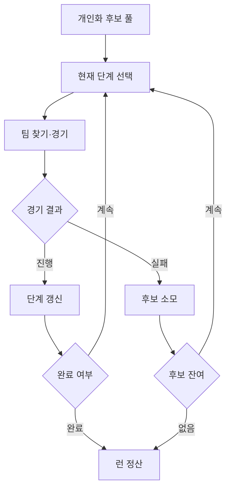

# 45. Jingle Brawls — 시즌형 브롤러 소모 도전

> 상태: 2026년 11월 공지의 시즌 이벤트 발표. 실제 개시일과 오늘 플레이 가능 여부는 미검증.
> Topple the Tower의 크리스마스 변형이지만 층수·보상·풀 크기를 원본에서 자동 복사하지 않는다.

## 1. 공식 확인 범위

[공식] 제한된 브롤러 풀로 여러 단계를 진행하며 런에서 같은 브롤러를 다시 쓰지 않는 구조다.
팀 찾기를 지원하고 높은 트로피의 브롤러를 풀 구성에서 우선한다.[S1]
모든 후보를 소진하면 도전이 끝난다.

| 항목 | 확정 여부 |
| --- | --- |
| 연속 단계와 제한 풀 | 확인 |
| 브롤러 재사용 제한 | 확인 |
| 풀 선정 경향 | 높은 트로피 브롤러 우선 |
| 팀 찾기 | 지원 공지 |
| 단계 수·지도·일일 갱신 | 원작 추가 확인 필요 |
| 완주·무패 보상 | 별도 확인 필요 |

## 2. 독립 문서로 나누는 이유 [해석]

기본 타워의 핵심 압박은 미래를 위해 캐릭터를 남기는 것이다.
이 변형은 플레이어가 많이 사용한 캐릭터를 후보에서 더 자주 보게 하므로 익숙함과 제한의 관계가 달라진다.
낯선 후보로 실패하는 불만을 줄일 수 있지만, 특정 역할에 편중된 계정은 풀도 편중될 수 있다.

“개인화된 풀”은 항상 쉬운 풀을 뜻하지 않는다.
플레이어가 좋아하는 브롤러와 현재 단계에 적합한 브롤러가 다를 수 있기 때문이다.

## 3. 런 흐름 [제안]

세부 승패 처리에서 기본 타워를 참고할 수 있으나, 실제 정책은 이벤트 설정으로 명시한다.
선택만 했을 때 소비되는지 경기를 마쳤을 때 소비되는지도 참가 취소와 연결해 정해야 한다.

## 4. 팀 찾기의 설계 문제 [해석·제안]

팀 찾기가 현재 단계와 후보 풀을 충분히 고려하지 않으면 같은 역할만 모일 수 있다.
반대로 조합을 너무 엄격하게 맞추면 매칭 대기가 늘어난다.
수락된 파티의 브롤러 선택이 바뀌는 순간 참가 자격을 다시 검증해야 한다.

| 검토 축 | 질문 |
| --- | --- |
| 단계 호환 | 같은 단계만 묶는가 |
| 후보 호환 | 각자 남은 후보로 조합이 가능한가 |
| 성장 정규화 | 표시와 실제 전투 조건이 같은가 |
| 재경기 | 같은 파티로 다음 단계에 갈 수 있는가 |
| 이탈 | 다른 팀원의 런에 어떤 영향이 있는가 |
| 중복 브롤러 | 이벤트가 허용하는가 |

위 정책의 구체적인 원작 값은 이번 공지에서 확인되지 않았다.

## 5. 데이터 명세 [제안]

기본 런 상태에 PoolSelectionPolicy, TrophySnapshot, TeamFinderEligibility,
StageCompatibility, EventTheme, ExpiryPolicy를 추가한다.
후보 선정 때 사용한 트로피 스냅샷을 보관하면 런 중 트로피 변화로 후보가 바뀌지 않는다.

개인화는 “트로피 상위만”이라는 단순 정렬과 다를 수 있다.
공식은 선호 경향을 말하므로 정확한 샘플링 가중치는 미확인이다.

## 6. 난도와 공정성 [해석]

플레이어마다 후보가 다르면 같은 층의 완주율 차이를 순수 실력 차이로 보기 어렵다.
가능한 역할 수, 지도 적합도, 익숙한 후보 수가 함께 영향을 준다.
[제안] 풀 구성과 성과를 연결해 분석하되 무조건 모두에게 같은 후보를 줄 필요는 없다.
개인화의 목적과 경쟁적 비교의 목적 중 무엇을 우선하는지 정해야 한다.

시즌 이벤트라는 이유로 규칙 안내를 줄이면 기존 타워 경험이 없는 신규 사용자가 손해를 본다.
한 단계의 전투 규칙과 런 전체의 브롤러 소모 규칙을 별도로 알려야 한다.

## 7. UI·피드백

- 평소 자주 사용한 후보가 선택된 이유.
- 런에서 이미 사용한 후보의 잠금 상태.
- 팀 찾기에 필요한 단계·참가 조건.
- 현재 이벤트가 언제 끝나는지.
- 완주 여부와 단계별 보상의 구분.
- 선택 변경과 경기 취소가 후보 소모에 미치는 영향.

## 8. 경계 사례 [제안]

| 상황 | 필요한 정책 |
| --- | --- |
| 런 중 보유 브롤러 증가 | 기존 풀 유지 또는 합법적인 확장 |
| 트로피 순위 변화 | 시작 스냅샷 유지 |
| 파티원의 후보 소진 | 다음 경기 참가 자격 갱신 |
| 이벤트 만료 직전 시작 | 완료 인정 범위 |
| 무승부 | 소모·진행·재시도 |
| 서비스 장애 | 결과 미확정 상태 보존 |
| 같은 결과 재전송 | 중복 층 이동과 보상 차단 |

## 9. QA

| 사례 | 제안 기대 결과 |
| --- | --- |
| 인기 브롤러 소수 계정 | 최소한의 실행 가능한 후보 풀 |
| 런 중 계정 트로피 변동 | 후보 불안정·재추첨 악용 없음 |
| 사용 브롤러 다시 선택 | 명확한 거부 |
| 파티 생성 뒤 단계 변경 | 입장 전 재검증 |
| 결과 수신과 만료 동시 | 고정된 만료 정책 |
| 앱 종료 후 복귀 | 런·후보·보상 복원 |
| 같은 보상 여러 번 수령 | 정산 ID로 한 번 지급 |
| 팀 찾기 취소 | 의도하지 않은 후보 소비 없음 |

## 10. KPI와 출처

[제안] 팀 찾기 대기, 풀 편중도, 단계별 포기, 사용 브롤러 다양성,
기존 타워 경험 유무에 따른 이해도, 종료 시 미완주 런 비중을 본다.

- [S1: 2026년 11월 공식 패치](https://supercell.com/brawlstars/en/blog/game-updates/release-notes-november-2026/)
- [Topple the Tower](44_topple_the_tower.md) · [매치메이킹](../systems/13_matchmaking_trophies.md)

