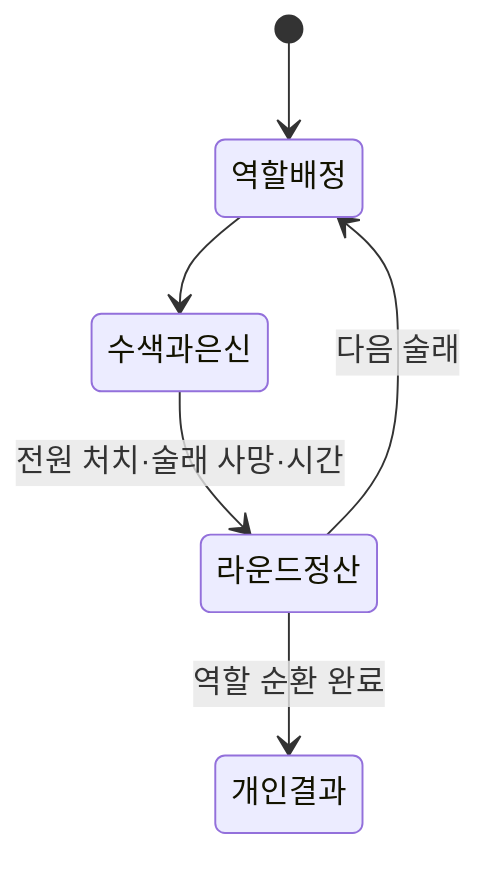

# 46. Hide & Seek — 역할 순환 숨바꼭질

> 상태: 2026년 8월 공식 발표 확인. 역할 비대칭과 Prop Hunt 변형을 결합한 모드.
> 현재 슬롯·지도·브롤러별 예외는 실기 미검증이다.

## 1. 공식 규칙

[공식] 한 명의 술래와 세 명의 도망자가 네 라운드 동안 역할을 교대한다.
라운드는 45초이며 술래는 전원을 처치해야 한다.
술래는 능력치가 강화되지만 체력을 재생할 수 없다고 안내되며, 승리하면 3점, 살아남은 도망자는 1점을 받는다.
정지 시 사물로 위장하는 Prop Hunt를 사용한다.[S1]

| 구분 | 확인/미확인 |
| --- | --- |
| 역할 | 순환하는 술래와 도망자 |
| 술래 목표 | 시간 안에 전원 제거하며 생존 |
| 도망자 목표 | 제한 시간 생존 |
| 개인 누적 점수 | 역할별 다른 보상 |
| 최종 동점 | 미확인 |
| 술래 사망 시 도망자 점수 | 세부 미확인 |
| 체력 재생 금지 범위 | 자연 재생·직접 치유·흡혈·보호막 획득의 개별 적용은 미확인 |

## 2. 설계 핵심 [해석]

비대칭 모드에서는 강한 역할이 매력적이지만 공정성 논란이 생기기 쉽다.
역할을 순환하면 모두가 술래의 공격 기회를 경험하고 개인 누적 성과로 경쟁할 수 있다.
도망자도 단순히 멀리 달아나는 것과 술래에게 피해를 남기는 것 사이에서 선택한다.

술래의 회복 제약은 시간뿐 아니라 남은 체력을 압박 자원으로 만든다.
무작정 모든 의심 지점을 공격하기보다 수색 경로와 발견 확률을 관리하게 된다.
도망자의 협력은 현재 라운드의 생존을 돕지만 최종 개인 점수에서는 이해관계가 갈릴 수 있다.

## 3. 라운드 흐름 [제안]

술래 역할이 한 플레이어에게 중복 배정되거나 누군가 건너뛰지 않도록 역할 순서를 고정한다.
중도 이탈자 처리와 대체 참가자의 역할 이력은 별도 정책이 필요하다.

## 4. Prop Hunt의 정보 설계

[공식] 정지하면 지도 테마의 벽·장식 형태로 변하며, 공격하면 노출되고 다시 비활동 상태가 되면 변할 수 있다.[S1]
실제 충돌체까지 장식처럼 바뀌는지, 시야·이름표가 어떻게 처리되는지는 미확인이다.

[해석] 숨는 재미는 완벽한 투명함보다 “풍경에서 이상한 점을 찾아내는” 관찰에서 나온다.
위장물의 위치·개수·방향이 자연스러운지, 술래가 기억할 수 있는 지도 규모인지가 중요하다.
도망자의 실루엣과 공격 효과가 우연히 계속 노출되면 규칙이 무의미해진다.

## 5. 술래와 도망자의 선택

| 역할 | 선택 | 손해 |
| --- | --- | --- |
| 술래 | 넓게 이동하며 수색 | 놓친 지역으로 도망자가 재이동 |
| 술래 | 의심 구역 집중 공격 | 탄약·시간·체력 소모 |
| 도망자 | 계속 숨어 있기 | 발각 시 탈출 방향 부족 |
| 도망자 | 위치 바꾸기 | 이동 중 노출 |
| 도망자 | 술래 공격 | 위장 해제와 표적 집중 |
| 도망자 | 동료와 분산 | 도움받기 어렵지만 한 번에 발각되지 않음 |

## 6. 데이터 명세 [제안]

RoleSchedule, RoundScore, SeekerStatProfile, HealthRegenPolicy,
DisguiseCatalog, IdleToDisguiseTime, RevealTriggers, PropSelectionSeed를 둔다.

위장 외형의 선택은 플레이어마다 다르게 렌더링하면 수색 공정성이 무너질 수 있다.
권위 있는 외형 ID 또는 일관된 선택 결과를 공유한다.
가짜 벽을 실제 길찾기 장애물로 취급할지 역시 규칙과 기술을 분리해 결정한다.

## 7. 점수와 동률 [제안]

라운드 승리와 개인 점수를 별도로 기록한다.
도망자 세 명 중 누가 살아남았는지에 따라 점수 수혜가 달라질 수 있다.
최종 동일 점수에서 술래 처치 수·생존 시간 등 추가 기준을 쓰려면 사전에 공개해야 한다.
원작이 해당 타이브레이커를 사용한다는 근거는 확보하지 않았다.

## 8. UI 요구

- 현재 역할과 남은 시간.
- 자신의 위장이 활성화됐는지.
- 위장 해제 원인과 다시 숨기 위한 조건.
- 술래의 회복 제약.
- 라운드 점수와 최종 누적 순위.
- 역할 교대 순서와 남은 라운드.

## 9. QA

| 사례 | 제안 기대 결과 |
| --- | --- |
| 이동 정지 임계점 | 같은 시간 기준으로 위장 |
| 공격과 위장 발동 동시 | 노출 우선순위 명확 |
| 술래 마지막 처치와 시간 종료 | 고정된 판정 순서 |
| 술래·마지막 도망자 동시 사망 | 정의한 승패·점수 정책 |
| 장식 외형과 충돌체 | 표시·피격 범위 오해 최소화 |
| 중도 이탈 | 역할 순환과 점수 누락 없음 |
| 은신 능력과 위장 중첩 | 상태가 서로 영구 잔류하지 않음 |
| 재접속 | 역할·위장·점수 복원 |
| 동일 최종 점수 | 공개한 동률 정책 |

## 10. KPI·출처

[제안] 술래 승률, 발견까지 시간, 첫 발견 뒤 생존 시간, 지도별 위장 선택 편향,
도망자 공격 참여, 역할별 만족도를 분리한다.
너무 자주 술래가 이기는지뿐 아니라 술래가 아무것도 찾지 못하는 라운드의 비중도 중요하다.

- [S1: 2026년 8월 공식 패치](https://supercell.com/brawlstars/en/blog/release-notes/release-notes-august-2026/)
- [빅 게임](27_big_game.md) · [시야 시스템](../systems/05_maps_terrain_vision.md) · [이벤트 변형](../systems/15_liveops_events.md)

