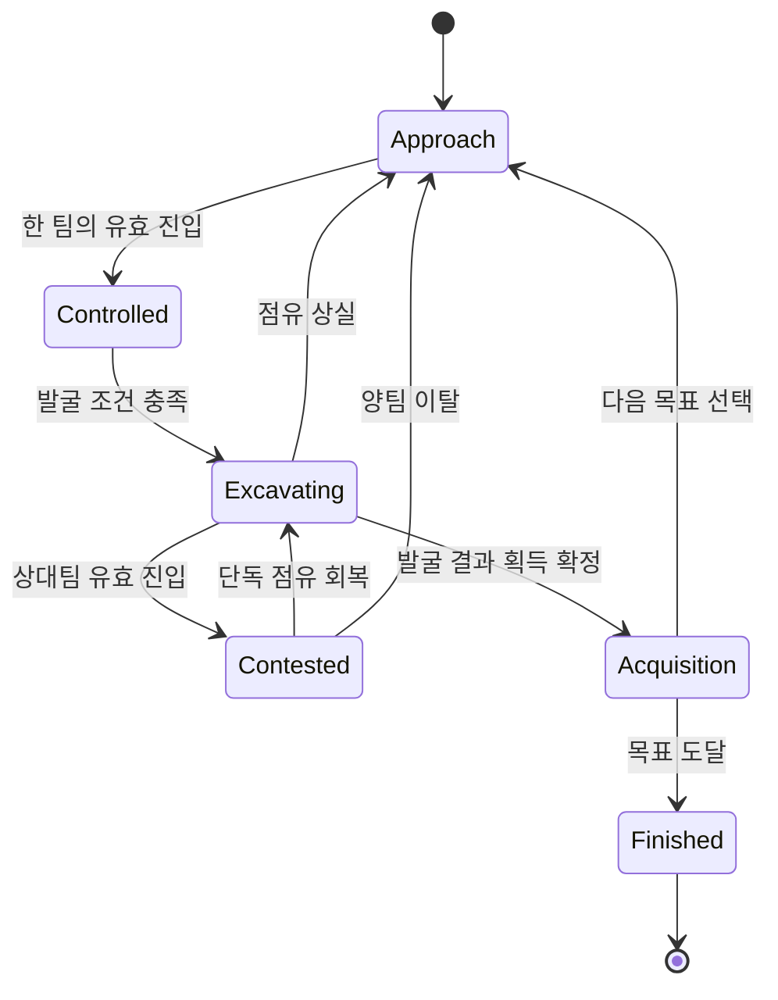

# 트레저 헌트 · Treasure Hunt — 발굴 거점과 누적 보물 경쟁 역기획

> 조사 기준일: 2026-11-13 · 상태: 2026 공식 대회·복귀 공지 확인, 당일 플레이 슬롯 미확인.
> **근거 구분:** `[확인]`은 공식 원문, `[보조]`는 실제 열람한 비공식 게임 규칙 목록, `[해석]`은 설계 분석, `[제안]`은 재구현용 모델이다. 기본 루프 일부는 보조 자료로 보완했으며 **현재 클라이언트 실기 검증은 하지 않았다.**

## 1. 모드 개요와 근거 범위

**[확인]** 2026년 2월 패치는 양 팀이 플랫폼을 경합하면 타이머가 멈추도록 변경했다고 설명한다. 같은 해 Preseason Icebreaker에는 이 모드와 전용 지도 목록이 포함된다.[S1][S2]

**[보조]** Brawls Wiki의 모드 목록은 다음 기본 규칙을 안내한다. 아래 내용은 공식 확정값으로 승격하지 않는다.[B1]

| 항목 | 보조 자료에 기재된 기본 규칙 |
| --- | --- |
| 편성 | 3 대 3 |
| 목표 | 보물 10개 수집 |
| 발굴 | Treasure Plate 위에 올라가 보물을 드러냄 |
| 획득 후 소유 | 상대가 이미 획득한 보물은 빼앗을 수 없음 |
| 위치 차이 | 중앙의 플랫폼은 보물을 더 빠르게 제공 |

B1은 목록의 기준 스냅샷을 2026-09-03으로 표시하며 당일 로테이션을 안내하지 않는다. 이 문서에서는 위 다섯 항목에만 보조 근거를 사용한다. 해당 페이지를 서버 구현, 판정 순서, 내부 필드, 실제 속도 수치의 근거로 사용하지 않는다.

**[미확인]** 발굴 소요 시간·중앙 가속 배율·전체 경기 시간·시간 종료 동률 처리·부활 시간은 확보한 자료로 확정하지 못했다. 보물이 발굴 완료와 동시에 지급되는지 별도 접촉이 필요한지도 미확인이다. 공식 문장의 ‘타이머’가 발굴 시계인지 전체 경기 시계인지를 임의로 단정하지 않는다.

## 2. 플레이어 경험과 설계 목표 [해석]

이 모드의 핵심 선택은 **안정적인 발굴 기회를 확보할지, 더 높은 생산성이 있는 장소에서 교전을 감수할지**다. 전투에서 이기는 것만으로는 목표 진척을 설명할 수 없고, 적을 밀어낸 다음 유효한 점유 시간을 확보해야 한다.

획득분의 소유가 되돌아가지 않는 구조를 분석 가정으로 삼으면, 플레이 경험은 ‘보유자를 한 번 처치해 크게 뒤집기’보다 **앞으로 남은 생산 기회를 연속으로 가져오기**에 무게가 실린다. 초반 우세가 남기 때문에 뒤진 팀은 소극적으로 상대 실수를 기다리기보다 경합과 재진입을 반복할 이유가 생긴다.

중앙 위치의 생산성 차이는 보상과 위험을 결합한다. 중앙을 차지하는 데 필요한 노출·이동 비용이 적절해야, 가까운 플랫폼을 지키는 선택과 중앙을 압박하는 선택이 모두 성립한다. 숫자가 높은 거점을 무조건 선택하게 된다면 지형과 재진입 비용의 조합을 조정해야 한다.

## 3. 기본 플레이 루프와 단계별 행동

아래 흐름은 **B1의 기본 루프와 S1의 경합 변경을 함께 읽어 정리한 역기획 모델**이다. 원작의 정확한 실행 순서와 판정 틱을 뜻하지 않는다.

| 국면 | 플레이어 행동 [해석] | 확인·검증 경계 |
| --- | --- | --- |
| 목표 선택 | 거점의 생산성, 접근 경로, 적 위치를 비교 | 플랫폼 수·배치는 지도별 확인 필요 |
| 진입·확보 | 적 화력을 분산시키며 플랫폼으로 이동 | 점유 자격·유효 범위 미확인 |
| 발굴 유지 | 점유자와 외곽 견제자의 역할을 나눔 | 인원수에 따른 가속·이탈 시 진척 보존 미확인 |
| 경합 대응 | 상대를 밀어내거나 다음 합류까지 버팀 | 공식 타이머 정지는 반영하되 정지 대상은 확인 필요 |
| 획득 확정 | 발굴 결과가 팀 진행으로 연결되었는지 확인 | 직접 지급·별도 픽업·획득 귀속 시점 미확인 |
| 다음 생산 기회 | 현재 거점 유지 또는 다른 거점으로 전환 | 재생성·소진·이동 규칙 미확인 |
| 목표 도달 | 확정된 획득량으로 승리 여부 판단 | 목표값은 B1, 동시 도달 우선순위는 미확인 |

킬은 목표를 차지할 시간을 만드는 수단으로 분석한다. 확보한 기본 설명에는 처치 그 자체를 보물 점수로 바꾼다는 규칙이 없으므로, 킬 점수나 사망 보물 드롭을 새로 추가하지 않는다.

## 4. 발굴·경합 상태 전이 [제안]



`Contested`에서는 공식 변경에 해당하는 시계를 정지시킨다. 위 도식에서 `Excavating`과 분리한 것은 경합 상태를 표현하기 위한 설계안이며, **발굴 진행과 전체 경기 시계가 모두 멈춘다는 뜻은 아니다.** 이탈 후 진척 보존·감소·초기화와 다음 발굴 시작 조건은 별도 정책으로 남긴다.

## 5. 승리·획득·종료 판정 경계

| 항목 | 역기획 해석 및 필요한 처리 |
| --- | --- |
| 목표 달성 | B1의 목표에 도달한 획득 확정 이벤트를 승리 판정의 입력으로 사용 |
| 발굴과 획득 | 발굴 완료 상태와 팀 점수 반영 상태를 분리해 직접 지급·픽업 두 방식 모두 관찰 가능하게 함 |
| 이미 확정된 소유 | B1의 탈취 금지를 따르는 모델에서 상대 처치만으로 확정 점수를 이전하지 않음 |
| 미획득 보물 | 발굴 중 진척과 바닥 물체에 같은 소유 보호가 있는지는 미확인 |
| 동시 목표 도달 | 같은 판정 묶음에서 양 팀 달성 시 무승부·추가전·선착순 여부 미확인 |
| 경기 시간 종료 | 단순 점수 비교인지 연장인지 미확인; 다른 모드의 규칙을 복사하지 않음 |
| 부활 | 부활 지연·위치·보호와 점유 가능 여부를 현재 클라이언트에서 확인해야 함 |
| 경합 종료 | 마지막 유효 상대가 나간 뒤 어떤 시계가 재개되는지 로그와 화면을 함께 비교 |

한 플랫폼에서 완료한 동일 발굴 결과가 두 번 반영되면 승리 조건 자체가 달라진다. 따라서 재구현에서는 발굴 결과의 식별자와 획득 확정 내역을 연결하는 것이 중요하다. 이는 원작 구현을 확인했다는 주장이 아니라 재현 가능한 테스트를 위한 설계 결정이다.

## 6. 맵·라인·조합과 역전 구조 [해석]

거점 중심에 선 인원보다 **거점으로 이어지는 안전한 경로**가 실제 점유 지속시간을 결정할 수 있다. 한 갈래 통로만 존재하면 앞선 팀이 출입을 봉쇄하기 쉽고, 접근이 지나치게 쉬우면 희생적 재진입만 반복될 수 있다. 경로 수, 마지막 엄폐에서 거점까지의 노출 거리, 부활 지점에서 재합류까지의 시간을 함께 본다.

| 기능적 역할 | 목표 경쟁에 기여하는 방식 |
| --- | --- |
| 점유 유지 | 외곽 견제가 벌어 준 시간을 진행으로 연결 |
| 강제 이동 | 적의 체력을 모두 소진하지 않고 점유 상태를 바꿈 |
| 광역 제어 | 거점 진입·체류의 비용을 높임 |
| 측면 압박 | 한 방향에 집중된 수비 화력을 분산 |
| 지원 | 점유자의 교대·생존·재합류를 보조 |

거점에 여러 아군이 있다고 생산 속도가 더 빠르다고 가정하지 않는다. 추가 인원이 제공하는 것은 우선 교전 안정성과 교대 여유이며, 속도 증가 여부는 별도 관찰 항목이다.

이미 누적된 진행을 되돌릴 수 없는 구조에서는 목표 하나가 남은 팀의 행동이 지나치게 수동적으로 변하는지 살펴야 한다. 뒤진 팀에 필요한 것은 상대 점수를 삭제하는 장치일 수도 있지만, **다음 생산을 막을 수 있는 진입 경로와 합류 기회**만으로 충분할 수도 있다. 이를 구분하려면 점수 격차뿐 아니라 남은 생산 시간과 다음 교전 위치를 함께 측정해야 한다.

## 7. 시계와 획득 데이터 모델 [제안]

`wallClock`는 실제 경과시간, `excavationClock`는 발굴 진행, `matchClock`는 종료 판단용 시계로 분리한다. 보조 자료는 이 내부 구조를 설명하지 않는다. 아래 필드는 규칙의 모호한 부분을 설정과 검증 대상으로 드러내기 위한 새 설계안이다.

| 필드 | 용도·확인 필요 사항 |
| --- | --- |
| `targetTreasureCount` | 보조 규칙의 목표값을 설정으로 관리 |
| `teamAcquiredCount` | 팀별 획득 확정량 |
| `platformId`, `platformBounds` | 목표 영역과 식별자 |
| `excavationDurationByPlatform` | 위치별 발굴 시간; 실제 수치는 미확인 |
| `eligibleOccupantPolicy` | 사망·무적·공중·은신 중 점유 인정 여부 |
| `contestedTeams`, `pausedClockId` | 경합 팀과 실제로 멈출 시계 |
| `progressOnVacatePolicy` | 이탈 시 진척 처리 |
| `acquisitionPolicy` | 발굴 완료 즉시 지급 또는 별도 획득 |
| `excavationResultId`, `acquisitionReceipt` | 결과 중복 반영 방지 |
| `deadlinePolicy`, `simultaneousWinPolicy` | 미확인 종료·동시 달성 정책 |

```text
updatePlatform(dt):
  occupancy = resolveEligibleTeamsInsidePlatform()
  contested = occupancy.teamCount >= 2
  wallClock += dt
  updateRuleClocks(dt, pause = contested ? pausedClockId : none)
  updateExcavation(using verified occupancy and progress policies)
  publishReadyResultOnceIfCompleted()

onAcquisitionConfirmed(resultId, teamId):
  if alreadyCommitted(resultId): return existingReceipt
  atomically commit acquisition + teamAcquiredCount change
  collectTeamsMeetingConfiguredTarget()
  resolveWinner(using configured simultaneousWinPolicy)
```

의사코드는 `pausedClockId`를 임의로 채우지 않는다. 현재 경기에서 보이는 시계와 발굴 게이지를 함께 관찰한 뒤, 어떤 변화가 경합 중 멈추는지 확인해야 한다. 종료 시점과 획득 시점의 경합도 명시적인 정책으로 처리한다.

## 8. 화면과 피드백 요구 [제안]

HUD에는 팀별 **확정 획득량**, 목표까지 남은 진행, 현재 플랫폼의 상태를 구분해 보여 준다. 발굴 중인 진행을 이미 획득한 점수처럼 표시하면 점유 상실 때 부당하게 빼앗겼다고 오해할 수 있다.

플랫폼에는 점유팀·경합·비활성 상태가 필요하다. 위치별 생산성 차이는 이름이나 바닥 색만으로 추측하게 하기보다 진행 게이지 또는 간단한 표시로 설명하는 것이 좋다. 정확한 초 수를 노출할지는 화면 복잡도와 예측 가능성의 균형을 보고 결정한다.

시계가 멈추면 `경합 중`이라는 이유를 보여 준다. 네트워크 지연과 규칙에 따른 정지를 구분할 수 있어야 한다. 관전 화면 역시 정지 대상과 획득 확정 이벤트를 같은 기준으로 보여 주어야 한다.

## 9. QA 시나리오 [제안]

아래 기대 결과는 검증용 모델의 요구사항이다. B1에만 근거한 규칙은 공식·실기 확인 전까지 잠정 규칙으로 유지한다.

| 상황 | 기대 결과 또는 관찰 포인트 |
| --- | --- |
| 한 팀만 플랫폼 유지 | 발굴과 획득의 실제 연결 시점 기록; 직접 지급·픽업 구분 |
| 양팀 동시에 플랫폼 진입 | 공식 변경에 해당하는 시계 정지; 다른 시계까지 멈추지 않는지 확인 |
| 마지막 적을 밖으로 넉백 | 경합 해제와 시계 재개 시점 일치 |
| 점유자가 중간에 이탈 | 보존·감소·초기화 중 실제 진척 정책 확인 |
| 중앙·외곽의 동일 조건 점유 | B1의 생산성 차이 실기 대조; 수치를 관찰 전 고정하지 않음 |
| 발굴 중 아군 추가 진입 | 인원수에 따른 가속 여부 확인 |
| 획득 확정 후 해당 플레이어 사망 | 확정 점수의 소유 보호를 B1과 대조; 미획득 물체는 별도 검사 |
| 마지막 목표 획득 이벤트 중복 수신 | 같은 결과가 두 번 점수로 반영되지 않음 |
| 양팀 목표 동시 달성·시간 만료 겹침 | 원작 우선순위 관찰 후 동일한 정책으로 반복 재현 |
| 무적·공중 상태로 플랫폼 진입 | 점유·경합 자격을 현재 규칙과 대조 |
| 재접속·관전 전환 | 확정 획득량, 발굴 상태, 시계 정지 이유 복원 |
| 경계 왕복과 장시간 경합 | 정지 반복·무한 지연 가능성 및 실제 종료 한도 확인 |

## 10. KPI와 남은 검증 [제안]

승패와 함께 중앙 접근 성공률, 거점별 유효 점유시간, 발굴 완료 대비 획득 확정률, 점수 격차별 역전율, 경합 시간 비중을 기록한다. 평균 경기 길이만으로는 팽팽한 경합과 반복적인 지연을 구분할 수 없다.

중앙 점유 여부만으로 승리가 과도하게 예측된다면 중앙의 생산성뿐 아니라 양쪽 부활 지점과 진입로의 비대칭을 확인한다. 뒤진 팀의 경합 진입이 성공해도 이후 진행 기회를 얻지 못한다면, 재합류 시간과 거점 간 이동 비용을 검토한다.

현재 남은 실기 확인 순서는 **발굴→획득 화면 관찰, 경합 중 어떤 시계가 멈추는지 구분, 정확한 시간값 측정, 시간 종료·동률·동시 획득 검사**다. 이 검증을 마친 뒤 보조 규칙을 현재 버전 관찰값과 대조하고 문서의 잠정 표시를 갱신한다.

## 11. 출처와 연결

- [S1 · Release Notes February 2026](https://supercell.com/brawlstars/en/blog/release-notes/release-notes-february-2026/): 공식 근거. 플랫폼 경합 시 타이머 정지 변경만 기본 판정 근거로 사용.
- [S2 · BSC Preseason Icebreaker, 2026-01-21](https://supercell.com/brawlstars/en/blog/esports/bsc-preseason-icebreaker/): 공식 근거. 모드 운영 및 경쟁 실험 이력.
- [B1 · Brawls Wiki — Game Modes / Treasure Hunt](https://brawls.wiki/game-modes/): **비공식 보조 자료**, 2026-11-13 원문 열람. §1의 편성·목표·발굴·소유 보호·위치 차이를 보완. 서버 구현 및 현재 플레이 가능 여부의 근거로 사용하지 않음.
- 관련 문서: [핫 존](05_hot_zone.md), [젬 그랩](01_gem_grab.md), [전체 목차](../README.md).
