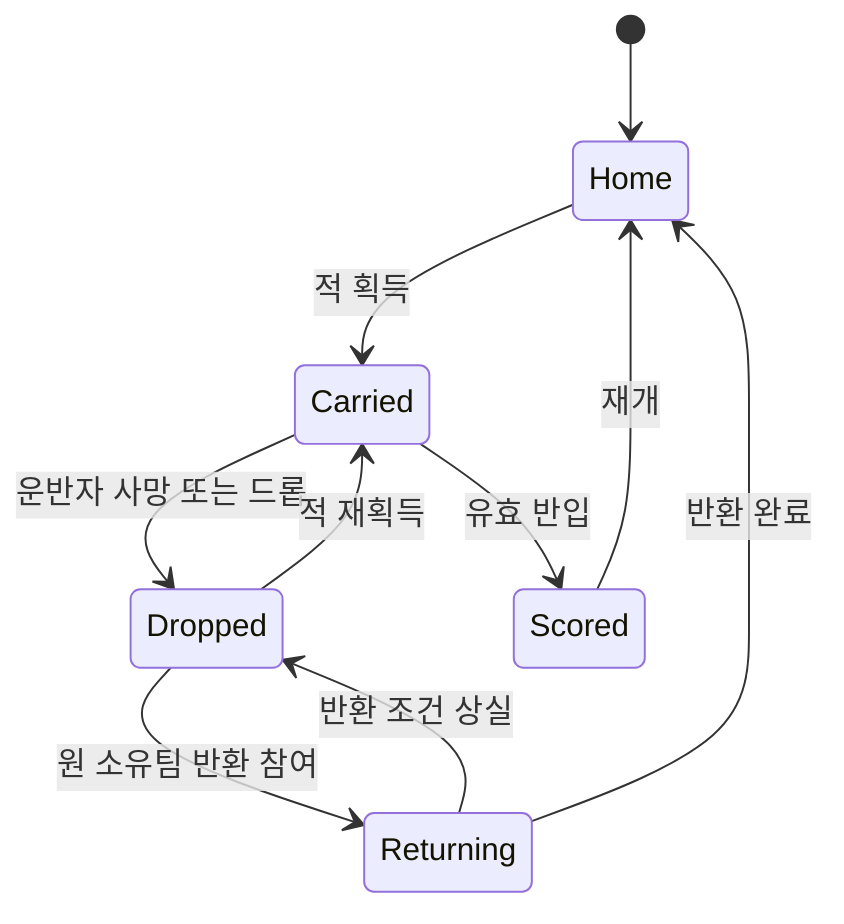

# 나이트 파이트 · Knight Fight — 운반 중 전투가 가능한 탈취전 역기획

> 조사 기준일: 2026-11-13 · 근거 버전: 2025년 6월 공식 릴리스 노트 · 당일 슬롯 미확인.
> **[확인]** 공개 규칙 · **[해석]** 설계 분석 · **[제안]** 재구현 명세 · **[미확인]** 실기 검증 필요.

## 1. 핵심 규칙과 차별점

**[확인]** 적 기지 트로피를 탈취해 득점한다. 운반 중 사격이 가능하며, 떨어진 트로피 근처에 서면 기지 복귀를 가속한다. [S1]

**[해석]** 공을 들면 공격 행동의 의미가 바뀌는 스포츠 모드와 달리, 운반자가 자체 전투력을 유지한다. 호위의 목적은 운반자 대신 싸우는 것뿐 아니라 이동 경로·회복 시간·퇴로를 확보하는 일로 바뀐다.

공식 설명은 Present Plunder와 유사한 변형으로 소개한다. 같은 기지 탈취 계열이어도 운반 입력과 드롭 반환 방식이 다르므로 하나의 데이터 상수만 바꾸는 것으로 충분하다고 가정하지 않는다.

## 2. 트로피의 생명주기

| 상태 [제안] | 소유 의미 | 주요 이벤트 |
| --- | --- | --- |
| Home | 원래 팀 기지에 존재 | 적의 획득 |
| Carried | 적 운반자가 소지 | 사망·드롭·득점 |
| Dropped | 지면에 떨어짐 | 적 재획득·아군 반환 가속 |
| Returning | 반환 조건 진행 | 진행 완료·경합 |
| Scored | 득점 확정 | 재배치 또는 경기 종료 |

원래 소유 팀과 현재 운반 팀을 별도 저장해야 한다. 캐리어의 팀 ID만으로 소유권을 표현하면 복귀 목표 기지와 득점 팀이 혼동될 수 있다.

**[미확인]** 목표 점수, 편성 인원, 제한시간, 득점 때 자기 트로피가 기지에 있어야 하는지, 반환 가속 인원수 효과, 운반 중 던지기·이동기 제약은 공식 요약만으로 확정하지 않았다.

## 3. 한 판의 흐름 [해석]

1. **경로 만들기:** 적의 수비를 한쪽으로 모으거나 제거해 기지 접근 기회를 만든다.
2. **탈취:** 트로피를 잡은 뒤 공격과 이동을 함께 수행한다. 획득 자체가 즉시 득점은 아니다.
3. **추격·호위:** 상대는 운반자를 죽이는 것뿐 아니라 반환 가능한 위치에서 트로피를 떨어뜨리게 하는 것을 노린다.
4. **드롭 경합:** 공격팀은 재획득을 시도하고 수비팀은 근처에 머물며 반환을 가속한다.
5. **복귀·득점:** 트로피의 기지 복귀와 공격팀 득점을 구분해 판정한다.
6. **재개:** 득점 후 두 트로피·플레이어·지형 중 무엇이 리셋되는지 정책에 맞게 초기화한다.

## 4. 상태전이 [제안]



반환은 서버의 권위 상태다. 애니메이션이 끝났다는 클라이언트 통지로 트로피를 생성하면 재접속이나 지연으로 복제될 수 있다.

## 5. 운반 중 사격이 만드는 조합 변화 [해석]

운반자가 공격할 수 있으면 장거리 견제나 자체 생존 기술이 직접적인 탈취 능력이 된다. 단순 이동속도만으로 좋은 운반자를 정의하기 어렵다. 반대로 사격 중 이동 제약·공격 모션·재장전이 도주 속도에 영향을 주는 캐릭터는 별도 평가해야 한다.

| 기능 | 역할 |
| --- | --- |
| 운반 | 트로피를 잃지 않고 반입 위치 도달 |
| 경로 개방 | 추격자가 사용할 사격각 제거 |
| 본진 수비 | 동시 역탈취를 저지 |
| 반환 | 드롭 지점 확보와 반환 완료 |

전원이 운반자를 호위하면 자기 기지가 비고, 전원이 수비하면 득점이 일어나지 않는다. 공격 진행도와 상대의 탈취 가능성을 함께 읽는 양방향 목표 관리가 필요하다.

## 6. 맵·역전·정체 [해석]

기지에서 기지까지의 경로가 하나면 반환 지점 경합이 반복적으로 같은 곳에 생긴다. 대체 경로와 중앙 엄폐가 있으면 운반자가 우회 선택을 할 수 있지만 지나치게 안전한 통로는 추격 상호작용을 줄인다.

떨어진 트로피의 반환 가속은 수비자가 적극적으로 현장에 머물 이유를 만든다. 단순히 운반자만 처치하고 다른 적을 쫓는 행동으로는 반환을 놓칠 수 있다. 공격팀은 드롭 지점 주변을 계속 압박해 탈취 기회를 연장할 수 있다.

양팀이 동시에 트로피를 운반하는 경우의 처리에 따라 정체가 생길 수 있다. 자기 트로피 복귀를 득점 조건으로 요구하는지 여부를 반드시 실기 확인해야 한다.

## 7. 데이터·판정 [제안]

| 필드 | 목적 |
| --- | --- |
| `trophyOriginalTeam`, `carrierId` | 원소유·운반 분리 |
| `homePosition`, `deliveryVolume` | 복귀·반입 위치 |
| `returnProgress`, `returnSpeedPolicy` | 반환 가속 |
| `carrierActionPolicy` | 사격·이동·스킬 허용 |
| `scoreRequiresOwnTrophyHome` | 동시 탈취 처리 |
| `restartPolicy` | 득점 후 초기화 |

```text
onTrophyStep():
    resolveSingleOwnership()
    if dropped:
        returnProgress += eligibleReturnRate() * dt
        if returnComplete: restoreHomeOnce()
    if carriedAndInsideDeliveryVolume:
        if scoringRequirementsMet: commitScoreOnce()
```

같은 처리 구간에 적 재획득과 반환 완료가 겹치면 권위 순서가 필요하다. 이 문서는 원작 순서를 확정하지 않았다.

## 8. UI와 QA [제안]

HUD는 두 트로피의 `기지/운반/드롭/반환 중` 상태를 따로 표시한다. 운반자가 사격 가능함을 입력 UI에서 명확히 표현하고, 반환 가속 중인지 여부도 지면 표시로 알려 준다.

| 상황 | 기대 결과 또는 확인 포인트 |
| --- | --- |
| 운반 중 일반 공격 | 공격과 트로피 소유권 공존 |
| 운반자 사망 | 트로피 한 개만 드롭 |
| 원 소유팀이 드롭 근처 접근 | 반환 가속 정책 적용 |
| 다수 아군 반환 참여 | 인원수 속도 정책 확인 |
| 적 재획득과 반환 완료 동시 | 단일 결과로 정합성 유지 |
| 양팀 동시 탈취 | 반입 조건표 적용 |
| 운반 중 변신·점프·텔레포트 | 액션 허용표 확인 |
| 득점 순간 경기 종료 | 중복 점수·트로피 생성 없음 |

## 9. 계측과 검증 우선순위 [제안]

탈취 시도 대비 반입 성공률, 드롭 후 재획득률, 반환 참여 시간, 운반 중 피해량, 양팀 동시 탈취 지속시간, 반환 지점별 편향을 본다. 운반자가 지나치게 강하면 공격 금지로 즉시 되돌리기보다 지도·호위·반환 상호작용을 분석한다.

우선 검증은 반입 조건, 운반 액션, 드롭 반환, 동시 사건이다. 목표 점수·시간은 현재 큐 데이터로 채운다.

## 10. 출처와 연결

- [S1 · Release Notes June 2025](https://supercell.com/en/games/brawlstars/blog/game-updates/release-notes-june-2025/): Knight Fight의 차별 규칙. 공식 검색 색인에서 본문 확인, 웹 본문은 로딩 화면으로 반환되는 경우가 있음.
- 관련 문서: [브롤 볼](02_brawl_ball.md), [젬 그랩](01_gem_grab.md), [전체 목차](../README.md).

데이터·판정·지도 분석은 독립적인 재구현 제안이며 미확인 값을 원작 사실로 확정하지 않았다.
