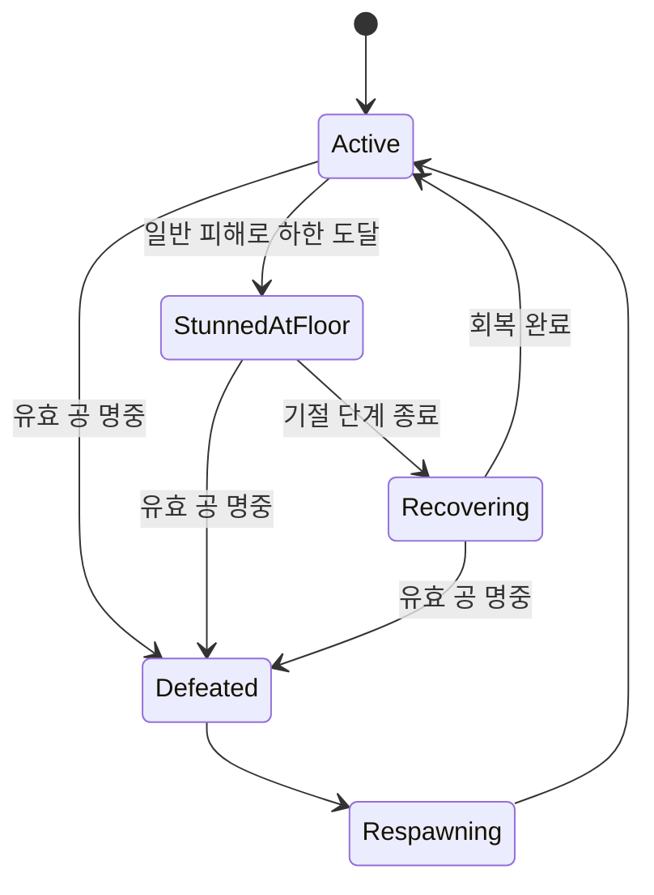

# 닷지브롤 · Dodgebrawl — 일반 피해와 최종 처치를 분리한 공 전투 역기획

> 조사 기준일: 2026-11-13 · 근거 버전: 2025년 6월 공식 릴리스 노트 · 현재 슬롯 미확인.
> **[확인]** 공개 규칙 · **[해석]** 설계 분석 · **[제안]** 구현 명세 · **[미확인]** 실기 확인 필요.

## 1. 핵심 규칙

**[확인]** 공만 적을 처치할 수 있다. 일반 피해는 체력 1에서 기절·회복으로 이어지며, 처치당 1점으로 10점 선취가 목표다. [S1]

**[해석]** 일반 공격은 점수를 직접 얻는 도구에서 공을 맞히기 쉬운 상태를 만드는 도구로 바뀐다. 공격력이 높은 캐릭터도 공을 확보하거나 팀의 공 소지자와 연계하지 못하면 처치로 전환할 수 없다.

공식 노트의 모드 설명은 Dodgebrawl, 지도 목록은 Dodgeball이라는 표기도 사용한다. 본 문서는 별도 두 모드로 중복 계산하지 않고 해당 공 처치 규칙의 이름 변형으로 취급한다.

## 2. 전투를 두 단계로 분리

| 단계 | 역할 [해석] | 구현 주의 [제안] |
| --- | --- | --- |
| 일반 피해 | 상대 체력·행동 여유 감소 | 일반 사망 처리를 우회 |
| 체력 하한 도달 | 상대를 공 공격에 취약하게 만듦 | 기절·회복 상태의 단일 진입 |
| 공 명중 | 최종 처치·점수 | 공 피해의 별도 종료 권한 |
| 리스폰 | 다음 점수 경쟁 | 공 배치·보호 상태 정합성 |

모든 피해를 무조건 체력 1에서 고정한 뒤 공에 예외를 주는 방식은 첫 구현 후보일 수 있다. 그러나 반사·지속 피해·환경 피해·소환물·즉사 효과까지 일관된 대상 규칙을 적용해야 한다.

## 3. 확인되지 않은 수치와 예외

**[미확인]** 기절 지속시간, 자동 회복 속도·완료 체력, 기절 중 추가 공격의 영향, 공 수와 생성 주기, 공의 반사·관통·재획득, 부활 보호와 공의 상호작용은 현재 실기 확인이 필요하다.

공을 던지는 행위가 일반 공격 자원을 쓰는지, 잡거나 방어할 수 있는지, 팀 동료에게 맞으면 어떻게 되는지도 요약 공지만으로 확정할 수 없다. 실제 피구 종목의 캐치·아웃 규칙을 자동 적용하지 않는다.

## 4. 한 판의 흐름 [해석]

1. **공 확보:** 점수를 낼 수 있는 핵심 자원을 누가 보유하는지 읽는다.
2. **위협 만들기:** 일반 공격으로 적을 압박하되 공 공격의 사격각을 닫지 않는다.
3. **기절 유도:** 적을 행동 제한 상태로 만들어 공 명중 확률을 높인다.
4. **마무리:** 공 소지자가 유효 사격각에서 적을 처치한다.
5. **재획득·전환:** 공이 사라지거나 지면으로 돌아오면 다음 공격권을 준비한다.
6. **후반 점수 관리:** 마지막 한 점을 위해 공 소유권을 지키는 행동과 공격 기회를 비교한다.

## 5. 캐릭터 상태전이 [제안]



기절과 회복이 순차인지 일부 겹치는지는 원작 실기 확인 대상이다. 위 그림은 명확한 구현을 위한 후보 모델이며 원작 세부 타이밍을 선언한 것이 아니다.

## 6. 조합과 역할 [해석]

| 팀 기능 | 공 전투에서의 가치 |
| --- | --- |
| 압박 | 공이 없는 동안도 적의 위치·체력 제약 |
| 행동 제한 | 공을 피하기 어렵게 만듦 |
| 공 운용 | 실제 점수 획득 |
| 보호 | 공 소지자의 공격 기회 보존 |
| 회수 | 다음 점수 기회의 연속성 확보 |

일반 전투의 폭딜 능력이 이 모드에서 곧 높은 처치 수가 되는 것은 아니다. 반대로 단일 일반 공격의 피해가 낮아도 공 명중 각도를 잘 만드는 이동·군중 제어가 중요할 수 있다.

공만 쫓고 일반 공격을 사용하지 않으면 상대를 맞히기 어려워질 수 있다. 일반 공격만 반복하면 점수가 나지 않을 수 있다. 두 행동을 연결하는 짧은 학습 과정이 필요하다.

## 7. 맵·역전·악용 가능성 [해석]

공이 특정 구역에서만 확보된다면 해당 구역의 접근성은 모드 전체의 공격권을 결정한다. 공을 가진 팀이 안전한 엄폐 뒤에서 무한 대기할 수 있는지 확인해야 한다.

체력 하한·기절·회복의 반복은 잠금 상태를 만들 위험이 있다. 공격을 계속 받는 플레이어가 회복하자마자 다시 기절하는 경우의 탈출 기회와 팀 지원 가능성을 검증한다. 이는 원작에 해당 악용이 존재한다는 주장이 아니라 재구현에서 확인해야 할 위험이다.

## 8. 데이터·판정 [제안]

| 필드 | 목적 |
| --- | --- |
| `damageChannel` | 일반 피해와 처치 가능한 공 구분 |
| `nonLethalHpFloor` | 일반 피해 하한 |
| `stunProfile`, `recoveryProfile` | 하한 이후 상태 |
| `ballAuthorityId`, `ballOwner` | 공 소유권 |
| `ballEliminationPolicy` | 무적·보호·공중 예외 |
| `targetScore`, `killValue` | 점수 |

```text
onDamage(target, hit):
    if hit.channel == DodgeBall and canEliminate(target, hit):
        defeatOnce(target)
        awardPointOnce(hit.team)
    else:
        applyNonLethalDamage(target, hpFloor)
        if floorReached and canEnterStun:
            enterConfiguredStunAndRecovery()
```

일반 즉사 효과·체력 감소 효과도 같은 정책을 통과시켜야 한다. 피해 시스템 밖에서 `kill()`을 직접 호출하는 능력이 있다면 모드 규칙을 우회할 수 있다.

## 9. UI·QA [제안]

공 소지자와 공의 위치는 가장 중요한 정보다. 일반 피해로 적이 기절했을 때 `처치 실패`가 아니라 마무리 기회가 생겼음을 표현해야 한다. 체력 1로 살아 있는 상태를 네트워크 지연으로 오해하지 않도록 고유 상태 이펙트를 사용한다.

| 상황 | 기대 결과 또는 확인 포인트 |
| --- | --- |
| 매우 큰 일반 피해 | 체력 하한과 상태 전환, 일반 사망 없음 |
| 지속 피해가 하한에 도달 | 기절 중복 진입 방지 |
| 유효 공 명중 | 처치와 점수 한 번 |
| 공과 일반 공격 동시 | 최종 처치 권한 정책 일치 |
| 소환물·반사·자폭 | 피해 채널 분류 검증 |
| 회복 중 재피격 | 상태 중첩 규칙 확인 |
| 보호막·공중 대상에 공 | 실기 예외표 적용 |
| 공이 둘 이상의 적과 접촉 | 관통·소모 정책대로 점수 처리 |
| 목표 점수 동시 도달 | 단일 종료 결과 |
| 리플레이 | 일반 피해와 공 마무리 원인 일치 |

## 10. 계측과 검증 우선순위 [제안]

기절 유도 대비 공 마무리 전환율, 공 보유시간, 공 명중률, 공 미보유팀의 득점 기회, 기절 반복 횟수, 일반 피해 기여와 실제 점수의 관계를 본다.

초기 테스트는 모든 피해 채널의 비치명성, 공 처치, 상태 중첩 순서로 진행한다. 공 수와 생성 위치는 이후 경기 속도를 조정하는 독립 축으로 다룬다.

## 11. 출처와 연결

- [S1 · Release Notes June 2025](https://supercell.com/en/games/brawlstars/blog/game-updates/release-notes-june-2025/): 일반 피해·공 처치·목표 점수의 관계. 공식 검색 색인 본문 확인.
- 관련 문서: [와이프아웃](07_wipeout.md), [브롤 볼](02_brawl_ball.md), [전체 목차](../README.md).

상태 순서·수치·공 물리·데이터 구조는 독립 설계 제안이다. 원작 내부 코드로 확인된 사항이 아니다.
