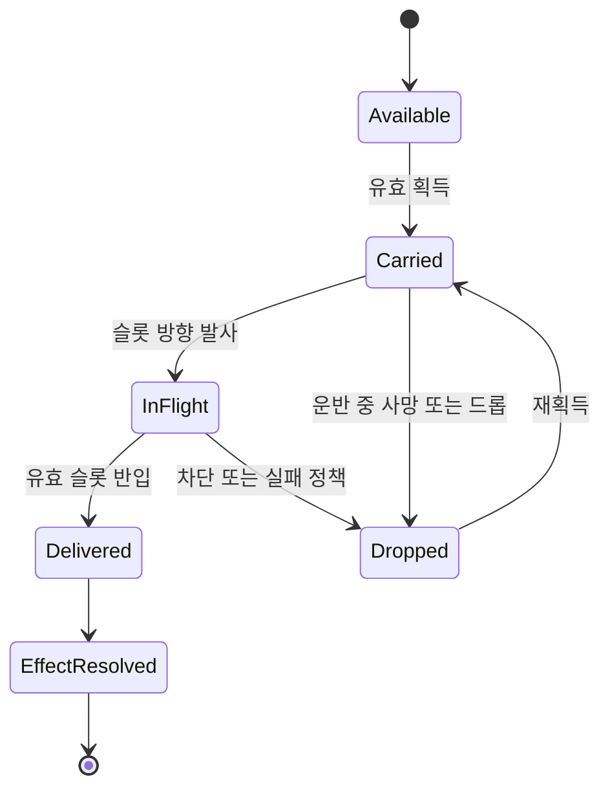

# 토큰 런 · Token Run — 반입 목표와 특수 효과를 결합한 전투 역기획

> 조사 기준일: 2026-11-13 · 근거 버전: 2025년 6월 공식 릴리스 노트 · 당일 슬롯 미확인.
> **[확인]** 공개 규칙 · **[해석]** 설계 분석 · **[제안]** 재구현 명세 · **[미확인]** 실기 확인 필요.

## 1. 핵심 규칙과 계보

**[확인]** 적 기지 슬롯에 토큰을 쏘면 토큰 능력이 발동한다. 공식 개편은 토큰 순서를 고정하고 토큰을 든 점프를 막았다. [S1]

**[해석]** 반입 성공은 승리 목표를 진척시키는 동시에 다음 교전 조건도 바꾼다. 목표 수행과 전투 강화가 연결되므로 첫 성공이 후속 성공을 쉽게 만들 수 있다. 고정 순서는 다음 토큰 효과를 예상하고 전략을 세울 여지를 준다.

공식 설명은 이전 모드의 리스킨·개선판이라고 밝힌다. 2025년 UNO 모드 역시 보유 카드를 반입하며 효과를 발동하는 구조였다. [S2] 다만 UNO의 모든 카드 효과와 승리 수량이 현재 토큰에 그대로 이식되었다고 단정하지 않는다.

## 2. 확인 범위와 미확정 항목

| 항목 | 취급 |
| --- | --- |
| 적 기지 슬롯 반입 | **[확인]** S1의 핵심 행동 |
| 토큰별 효과 | **[확인]** 효과 존재, **[미확인]** 현행 종류·수치 |
| 토큰 순서 | **[확인·개편]** 고정 순서 |
| 점프 이동 | **[확인·개편]** 토큰 소지 점프 제한 |
| 최초 수량·승리조건 | **[미확인]** 현행 데이터·실기 확인 |
| 반입 실패·사망 드롭 | **[미확인]** 재배치·소모 정책 |
| 적의 몸 차단·반사 | **[미확인]** UNO 선례와 현행 구분 |

원작의 전체 덱 구성을 확인하지 않은 상태에서 특정 효과 이름·확률을 만들어 넣지 않는다. 재구현 데이터는 미확인 칸을 비워 둔 상태로 설계할 수 있다.

## 3. 플레이 흐름 [해석]

1. **순서 확인:** 다음에 반입할 토큰이 어떤 기회를 만드는지 팀이 이해한다.
2. **운반 경로 확보:** 토큰을 들고 사용 가능한 이동 수단에 맞춰 적 기지까지 경로를 만든다.
3. **발사각 확보:** 단순히 가까이 가는 것과 슬롯에 유효하게 던질 수 있는 위치는 다를 수 있다.
4. **반입:** 토큰의 소유·비행·소모 상태를 확정한다.
5. **효과 활용:** 발동한 능력을 이용해 다음 토큰 반입 또는 수비를 준비한다.
6. **마감:** 남은 토큰·목표 진척·상대의 다음 효과를 비교해 공격과 수비를 배분한다.

## 4. 토큰 생명주기 [제안]



슬롯 반입은 단일 권위 이벤트로 처리한다. 시각적으로 토큰이 사라진 시점과 효과 승인 시점을 분리하면 효과가 두 번 발동하거나 반입만 인정되는 문제가 생길 수 있다.

## 5. 고정 순서의 설계 의미 [해석]

토큰 순서가 무작위면 초반에 유리한 효과를 얻은 팀이 전투 우세까지 가져갈 수 있다. 순서 고정은 각 경기에서 무엇을 준비해야 하는지 예측 가능하게 만든다. 이는 운반 성공 자체의 실력 차이를 비교하기 쉽게 한다.

하지만 고정 순서가 항상 균형을 보장하지는 않는다. 첫 토큰이 너무 강하면 한 번의 반입이 연쇄 우세로 이어지고, 특정 브롤러가 특정 순서와 지나치게 잘 맞으면 조합이 고정될 수 있다. 토큰 효과 단독이 아니라 **효과가 나오는 순서**를 밸런스 대상으로 봐야 한다.

| 분석 축 | 핵심 질문 |
| --- | --- |
| 첫 반입 | 첫 성공팀이 얼마나 자주 승리하는가 |
| 중간 효과 | 다음 반입 경로를 과도하게 보장하는가 |
| 마지막 토큰 | 앞선 팀이 안전하게 끝낼 수 있는가 |
| 방어 | 상대 효과를 피하거나 시간을 보낼 여지가 있는가 |
| 재획득 | 실패한 시도가 과도하게 손실되거나 무손실 반복되는가 |

## 6. 이동 제한과 맵 [해석]

토큰 소지 점프 제한은 목표 운반 경로의 공정성을 통제한다. 이동 능력으로 수비 지형을 통째로 건너뛰면 특정 브롤러만 안정적인 반입을 할 수 있기 때문이다. 다만 공지가 말하는 점프 제한을 모든 대시·텔레포트·강제 이동 금지로 확대하지 않는다.

재구현에서는 `Jump`, `Dash`, `Teleport`, `Knockback`, `LaunchPad`를 구분해 운반 중 허용표를 만든다. 행동이 거절될 때 입력 피드백과 토큰 드롭 여부도 일관되어야 한다.

슬롯 앞에 몸으로 막을 공간이 있는지, 반입을 준비할 엄폐가 있는지, 이동 제한 때문에 특정 경로만 남는지 평가한다. 공격자가 발사 가능한 위치까지 왔을 때 수비자가 대응할 수 있는 시간이 중요하다.

## 7. 데이터·원자적 반입 처리 [제안]

| 필드 | 목적 |
| --- | --- |
| `tokenSequenceId`, `sequenceIndex` | 고정 순서 |
| `tokenInstanceId`, `tokenType` | 개별 토큰과 효과 종류 |
| `ownerTeam`, `carrierId` | 원소유·운반 상태 |
| `deliverySlotId` | 유효 반입 대상 |
| `carryActionPolicy` | 이동 제약 |
| `effectDefinitionId` | 반입 후 능력 |
| `remainingObjectiveCount` | 실기 확인 후 승리 연결 |

```text
onTokenDelivered(token, slot):
    if token.delivered: return
    validateOwnershipAndEnemySlot(token, slot)
    consumeTokenOnce(token.instanceId)
    advanceObjectiveProgress(token.team)
    enqueueEffectOnce(token.effectDefinitionId)
    advanceFixedSequenceIfRequired()
    checkConfirmedVictoryRule()
```

효과 실행 실패 시 재전송하더라도 반입 점수가 다시 증가하지 않도록 이벤트 ID를 분리한다. 서버 결과를 재생하는 리플레이에서도 동일한 토큰을 두 번 처리하면 안 된다.

## 8. UI·학습 [제안]

- 현재 운반 토큰과 다음 토큰 효과를 구분한다.
- 효과가 발생한 원인이 반입 성공임을 전장 연출로 연결한다.
- 토큰 소지 중 불가능한 점프는 버튼 상태·실패 피드백으로 알린다.
- 남은 목표량과 토큰의 현재 위치를 읽을 수 있게 한다.
- 효과 설명은 실제 전투 선택에 필요한 범위·지속·대상만 보여 준다.
- UNO 협업의 카드 외형과 현재 토큰 외형이 달라도 같은 입력 학습을 재사용할 수 있는지 평가한다.

## 9. QA 시나리오 [제안]

| 상황 | 기대 결과 또는 확인 포인트 |
| --- | --- |
| 토큰 소지 중 점프 | 확인된 제한대로 처리 |
| 소지 중 대시·텔레포트 | 독립 허용표 검증 |
| 같은 토큰의 슬롯 접촉 반복 | 단일 반입·단일 효과 |
| 사망과 반입 동시 | 정의한 권위 순서 |
| 토큰이 아군 슬롯에 진입 | 유효 대상 정책 |
| 반입 뒤 재접속 | 순서·잔량·효과 상태 복원 |
| 효과 발동 중 다른 토큰 반입 | 순서·중첩 정책 일관 |
| 토큰이 벽·맵 밖으로 이동 | 실패·복귀 정책 |
| 마지막 토큰과 시간 만료 동시 | 실제 확인한 종료 정책 적용 |
| 리플레이 | 토큰 순서와 결과 동일 |

## 10. 계측과 후속 검증 [제안]

토큰 순번별 반입 성공률, 첫 반입팀 승률, 효과 발동 뒤 다음 반입까지 시간, 이동 제한으로 실패한 입력, 토큰 드롭 위치별 회수율, 특정 조합의 순서별 이점을 본다.

원작 재현을 위해서는 먼저 현행 토큰 목록·초기 수량·승리조건·효과·이동 허용표를 실기로 채워야 한다. 이후 순서와 효과 강도를 분리한 실험으로 고정 순서의 전략성을 평가한다.

## 11. 출처와 연결

- [S1 · Release Notes June 2025](https://supercell.com/en/games/brawlstars/blog/game-updates/release-notes-june-2025/): 토큰 반입·효과·순서 고정·점프 제한. 공식 검색 색인 본문 확인.
- [S2 · Ranked Rework, Lumi & Finx, 2025](https://supercell.com/en/games/brawlstars/blog/release-notes/release-notes-ranked-rework-lumi-finx-2/): UNO의 반입·효과 선례. 현재 토큰 전체 데이터의 근거로 사용하지 않음.
- 관련 문서: [브롤 볼](02_brawl_ball.md), [나이트 파이트](48_knight_fight.md), [전체 목차](../README.md).
