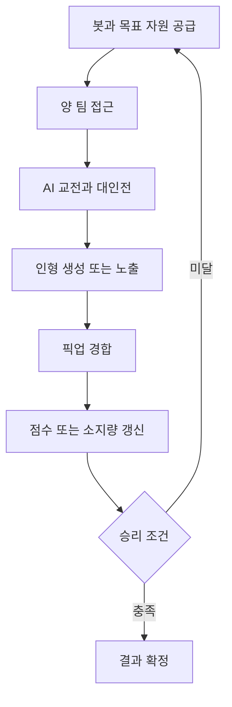

# 51. Samurai Smash 심층 역기획

> 기준일: 2026-11-13. 분석 대상은 2025년 Battle for Katana Kingdom에서 공개된 기간 모드다. 현재 로테이션 여부를 뜻하지 않는다. **[공식]**은 확인된 골격, 나머지는 **[해석]** 또는 재구현 **[제안]**이다.

## 1. 모드 정체성

[공식] 두 팀이 3v3 또는 5v5로 Daruma 인형 수집을 경쟁하고, 서로 다른 공격을 가진 사무라이 봇이 양 팀을 적대한다.[S1]

[해석] 적 플레이어와 중립 AI가 같은 공간을 점유하는 PvPvE 모드다. AI를 빨리 제거하는 능력과 상대 팀의 픽업을 막는 능력이 동시에 필요하다. ‘봇을 때릴 것인가, 상대를 밀어낼 것인가’가 핵심 선택이다.

## 2. 규칙 범위

| 항목 | 확인·검증 상태 |
|---|---|
| 팀 구조 | 3v3·5v5 두 규격 [공식] |
| 목표 자원 | Daruma 인형 [공식] |
| AI 적대 | 양 팀을 공격 [공식] |
| AI 유형 | 서로 다른 공격 방식 [공식] |
| 목표 수·제한시간 | 확보한 공식 설명에 세부 수치 없음 |
| 인형 생성·처치 드롭 | 실제 경기에서 경로별 확인 필요 |
| 사망 시 소지량 손실 | 미확인 |
| 시간 종료·동률 | 미확인 |

인형 수집이라는 설명만으로 젬 그랩의 ‘소지 후 유지’ 규칙을 가져오지 않는다. 획득 즉시 팀 점수에 고정되는지, 사망 시 다시 떨어지는지가 게임 성격을 크게 바꾼다.

## 3. 플레이 흐름 [해석]

개막에는 봇의 공격 범위와 상대 팀의 접근 방향을 읽는다. 봇을 안전하게 처리할 위치를 확보하면 인형을 얻을 기회가 생기지만, 봇에 탄약을 모두 쓴 순간 상대에게 공격받을 수 있다.

중반에는 봇 처치와 대인전의 타이밍이 겹친다. 먼저 봇을 공격한 팀이 실제 보상을 얻는지, 상대가 밀고 들어와 픽업을 가져가는지에 따라 공격 개시의 가치가 달라진다. 후반에는 남은 목표까지의 거리와 안전한 수집 경로가 중요하다.

## 4. 상태 모델 [제안]

`인형 생성 또는 노출`은 원작의 모든 공급 경로를 확정한 표현이 아니다. 구현 전 실제 공급 경로를 조사하고 해당 이벤트만 연결한다.

## 5. 중립 AI가 만드는 세 가지 선택 [해석]

| 선택 | 기대 이익 | 위험 |
|---|---|---|
| 봇 우선 공격 | 수집 자원에 빠르게 접근 | 탄약·체력 소모 후 적에게 노출 |
| 상대 팀 우선 견제 | 안전한 픽업 공간 확보 | 봇이 양쪽에 피해를 누적 |
| 교전 유도 후 개입 | 상대와 봇의 자원 소모를 이용 | 보상 타이밍을 놓칠 수 있음 |

AI를 단순 장애물로만 보면 이 모드의 핵심을 놓친다. 플레이어가 봇의 타깃·위치·공격 예고를 이용해 상대를 불편하게 만들 수 있는지에 따라 전략 깊이가 달라진다.

## 6. 3v3와 5v5의 차이 [해석]

3v3에서는 한 명이 봇을 상대하는 동안 대인전 전선의 인원이 크게 줄어든다. 5v5에서는 전담 수집·전담 견제의 역할 분리가 쉬워지지만, AI와 플레이어가 함께 화면을 채워 시각적 혼잡이 커진다.

[제안] 인원만 늘리지 말고 봇 공급량, 보상 밀도, 이동 경로, 목표 수, 안전한 퇴로를 별도 프리셋으로 만든다. 5v5의 점수 목표를 단순 5/3배로 늘리는 것이 적절한지는 실제 획득 속도로 검증한다.

## 7. AI와 맵 규격 [제안]

| 구성 요소 | 필요한 규격 |
|---|---|
| 근접 압박 봇 | 타깃 선택·추적 중단·공격 예고 |
| 원거리 압박 봇 | 사격선·엄폐 반응·탄속 |
| 지역 제어 봇 | 지속 영역·중첩·아군과 적군 피해 |
| 생성 지점 | 스폰 캠핑과 팀 거리 편향 방지 |
| 수집 지점 | 픽업 반경·벽 너머 획득 제한 |
| 안전 구역 | 회복·재집결의 기회 |

이 표의 봇 분류는 설계 도구이며 원작 봇의 실제 명칭·전체 종류를 뜻하지 않는다. 원작 공격을 확인하면 각 유형을 대응시킨다.

## 8. 이벤트 능력과 본체 규칙의 분리

[공식] 당시 시즌에는 Wasabi Powers라는 기간 능력 변형이 있었다.[S1] 모드 자체와 변형의 효과를 구분해야 한다.

[해석] 이벤트에서 특정 브롤러가 매우 강해 보여도 인형 수집 규칙 때문인지 임시 능력 때문인지 분리해야 재구현에 도움이 된다. 봇에게 적용되는 범위 공격·흡혈·슈퍼 충전은 대인전과 다른 효율을 만들 수 있다.

[제안] 모든 통계에 `modeRuleset`과 `modifierRuleset`을 함께 기록한다. 일반 브롤러 밸런스를 이벤트 결과만으로 수정하지 않는다.

## 9. 데이터·UI [제안]

`BotArchetype`, `SpawnSchedule`, `HostilityMatrix`, `PickupDefinition`, `TeamProgress`, `PersonalCarryState`, `EndPolicy`를 분리한다. 봇은 양 팀에 적대하지만 봇끼리도 서로 공격하는지는 별도 규칙이다.

UI는 인형 목표와 봇의 위험 공격을 우선한다. 봇의 경고색이 적 플레이어의 팀색과 섞이지 않게 하고, 목표물을 떨어뜨리는 적과 단순 위협을 구분한다.

## 10. QA [제안]

| ID | 시나리오 | 기대 결과 |
|---|---|---|
| SS01 | 봇이 양 팀 사이에 존재 | 적대·타깃 정책 일관 적용 |
| SS02 | 두 팀이 같은 인형 접촉 | 한 번만 획득 |
| SS03 | 봇과 플레이어가 동시 치명타 | 드롭·점수 중복 없음 |
| SS04 | 소환수가 봇을 처치 | 보상 귀속 정책 적용 |
| SS05 | 인형이 접근 불가 위치로 이동 | 복구·재배치 정책 적용 |
| SS06 | 3v3에서 5v5 프리셋 전환 | 목표·공급·스폰 설정 분리 |
| SS07 | 이벤트 능력 미적용 경기 | 기본 능력만 사용 |
| SS08 | 종료 직전 픽업 | 단일 판정 경계로 결과 일치 |

## 11. KPI와 미확인 항목 [제안]

봇 피해와 대인 피해의 비율, 봇 처치 기여 팀과 인형 획득 팀의 차이, 첫 수집 우세 팀 승률, 인원별 역할 분담, 봇에 의해 유도된 사망 비율을 측정한다.

원작을 재현하려면 목표 수·시간·드롭·사망 손실·동률·봇 목록을 추가 확보해야 한다. 본 문서는 확인된 PvPvE 수집 구조와 그 설계 효과를 중심으로 완성한 분석이며, 미확인 숫자를 다른 모드에서 차용하지 않는다.

## 출처

- [S1: Battle for Katana Kingdom 공식 패치](https://supercell.com/en/games/brawlstars/blog/release-notes/updated-june-12-release-notes-the-battle-for-katana-kingdom/) — 모드 인원·인형·사무라이 봇·기간 변형.

관련 문서: [Shadow Smash](52_shadow_smash.md), [라이브 운영](../systems/15_liveops_events.md), [전체 목차](../README.md).
