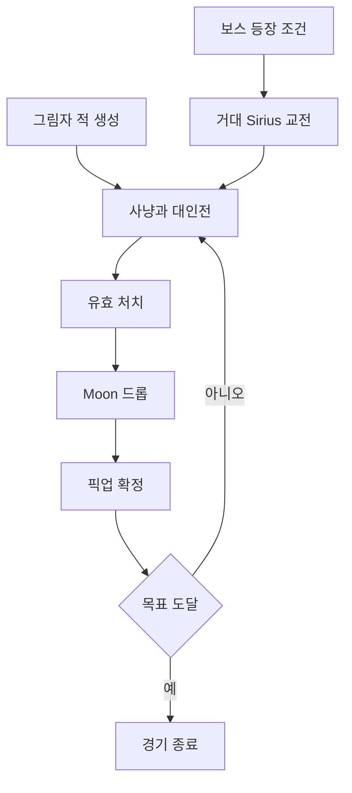

# 52. Shadow Smash 심층 역기획

> 기준일: 2026-11-13. 2026년 2월 업데이트에 기록된 Samurai Smash 변형을 분석한다. 현재 슬롯은 미확인. 공식 규칙, 설계 해석, 재구현 제안을 구분한다.

## 1. 모드 정체성

[공식] 3v3·5v5로 진행하며 그림자 거미와 플레이어 브롤러의 그림자 복제가 등장한다. 그림자 복제와 적 브롤러를 처치해 떨어진 Moon을 모으고, 거대 Sirius가 미니 보스로 등장한다. 공지는 목표 수를 60/100으로 제시한다.[S1]

[해석] Samurai Smash의 중립 AI 수집 구조에 브롤러 형태의 적을 넣어, 익숙한 전투 실루엣을 새로운 위협으로 읽게 만든다. 직접 대인전과 AI 사냥이 같은 목표 자원으로 연결되는 것이 핵심이다.

## 2. 규칙·미확인 표

| 항목 | 기준 |
|---|---|
| 인원 | 3v3·5v5 두 규격 [공식] |
| 수집물 | Moon [공식] |
| 확인된 드롭 주체 | 그림자 복제·적 브롤러 [공식] |
| AI 구성 | 그림자 거미·복제·거대 Sirius [공식] |
| 목표 수 | 공지의 60/100; 인원 프리셋별 연결은 실기 대조 |
| 거미·보스 드롭 | 공지 문장만으로 세부 확정 불가 |
| 소지·즉시 점수화 | 픽업 이후 손실 여부 실기 확인 |
| 부활·시간 종료·동률 | 미확인 |

## 3. 경기 단계 [해석]

초반에는 그림자 복제를 상대해 안정적으로 수집할지, 적 팀을 공격해 두 경로를 동시에 방해할지 선택한다. 중반에는 AI 공급 위치를 통제하는 팀이 유리해질 수 있지만, 한곳에 모이면 상대의 광역 능력과 보스 공격에 함께 노출된다.

보스가 등장하면 ‘보스에게 화력을 쓸 시간’과 ‘상대 팀이 그 틈을 이용할 가능성’을 평가해야 한다. 보스 처치가 실제로 어떤 보상을 주는지에 따라 싸울 가치가 달라지므로, 공개되지 않은 보상량을 가정하지 않는다.

## 4. 상태 모델 [제안]

보스 진행을 점수 상태와 분리하면 보스가 살아 있어도 목표를 달성해 끝나는지 같은 규칙을 설정할 수 있다. 원작의 해당 종료 관계는 실기 확인 대상이다.

## 5. 복제 브롤러의 읽기와 공정성 [해석]

플레이어와 닮은 AI는 이미 학습한 사거리·공격 형태를 재활용할 수 있다. 그러나 외형은 같은데 공격·체력이 전혀 다르면 잘못된 기대가 생긴다. 그림자 표현은 적의 정체성과 보상 가치를 동시에 알려주는 역할을 한다.

[제안] 복제의 시각적 실루엣, 이름표, 체력바, 공격 예고를 인간 적과 구분한다. 인간이 조종하지 않는다는 정보가 전술적으로 중요하다면 일부러 모호하게 숨기지 않는다.

## 6. 대인전과 사냥의 경제 [해석]

| 행동 | 가치 | 실패 조건 |
|---|---|---|
| 안전한 AI 사냥 | 일정한 수집 기회 | 적이 픽업을 빼앗음 |
| 적 팀 압박 | 상대 수집을 중단·드롭 기회 | 체력·탄약 소모만 크고 수집 못함 |
| 복제와 적을 함께 공격 | 광역 공격 효율 | 중앙 밀집으로 역공에 취약 |
| 보스 주위 통제 | 고가치 교전의 위치 선점 | 보스가 주는 이익보다 손실 큼 |
| 목표 직전 빠른 픽업 | 경기 종료 압박 | 마지막 자원 욕심으로 연속 사망 |

AI에 대한 성능과 인간 상대 성능이 모두 좋은 브롤러가 과도하게 유리해질 수 있다. 특히 관통·연쇄·흡혈·처치 시 효과가 목표 수집을 얼마나 가속하는지 별도로 측정한다.

## 7. 맵과 생성 정책 [제안]

생성 지점이 한 팀의 안전 구역에 가까우면 공짜 자원 수입이 된다. 중앙에만 생성하면 양 팀이 항상 같은 위치에 몰릴 수 있다. 안전한 작은 기회와 위험한 큰 기회를 공간적으로 나누는 방식으로 실험할 수 있다.

복제의 종류가 플레이어 로스터에 영향을 받는다면 조합 선택이 자신의 전투 성능뿐 아니라 AI 생태계까지 바꿀 수 있다. 원작이 어떤 기준으로 복제를 고르는지는 미확인이다. 재구현에서는 `cloneSourcePolicy`를 명시한다.

## 8. 데이터·판정 계약 [제안]

| 데이터 | 필요한 정보 |
|---|---|
| ShadowSpawn | 종류·원본 참조·생성 시각 |
| CloneCombatProfile | 인간 브롤러와 다른 보정 |
| DropRule | 드롭 가능 대상·수량·귀속 |
| MoonPickup | 고유 ID·위치·소유·만료 |
| BossState | 생성 조건·체력·단계·종료 관계 |
| ModePreset | 인원·목표·시간·부활 |

일반 브롤러의 밸런스를 바꿀 때 복제 AI가 자동으로 같은 수치를 쓰는지 별도 검토한다. 공유하면 유지보수가 쉽지만 PvE 난이도가 예상치 못하게 바뀔 수 있다.

## 9. UI [제안]

팀 목표 진행, 바닥의 Moon, 인간 적·AI·보스의 구분이 우선이다. 시각 효과가 강한 기간 이벤트라도 수집물의 위치와 픽업 성공 여부가 가려지지 않아야 한다. 목표 직전에는 필요한 남은 수를 강조한다.

## 10. QA [제안]

| ID | 시나리오 | 기대 결과 |
|---|---|---|
| SH01 | 복제와 인간 적이 같은 외형 | 정체성 표시는 구분 |
| SH02 | 적 브롤러 처치 | 정의된 Moon 드롭 한 번 발생 |
| SH03 | 거미·보스 처치 | 해당 대상의 독립 드롭 정책 적용 |
| SH04 | 동시 Moon 획득으로 임계 초과 | 점수·종료 한 번 확정 |
| SH05 | 보스전 중 목표 달성 | 설정된 종료 우선순위 적용 |
| SH06 | 브롤러 패치 이후 복제 | 참조 버전과 보정이 의도대로 적용 |
| SH07 | 3v3·5v5 목표 설정 | 서로 다른 프리셋의 값 혼용 없음 |
| SH08 | 재접속 | 복제·보스·Moon·점수 상태 복원 |

## 11. KPI와 추가 관찰 [제안]

수집 자원의 출처별 비중, AI 처치 시간, 인간 상대 교전 빈도, 복제 종류별 난이도, 보스 등장 전후 점수 변화, 목표 직전 역전률을 본다. AI 사냥만으로 승리하는 비율이 지나치게 높다면 대인전이 장식이 되고, 반대라면 PvE 요소의 의미가 약해진다.

실기 관찰 우선순위는 60/100 프리셋 매핑, 픽업의 영구 점수 여부, 사망 손실, 거미·보스 보상, 복제 원본 선택, 보스와 승리 판정의 관계다.

## 출처

- [S1: 2026년 2월 공식 패치](https://supercell.com/brawlstars/en/blog/release-notes/release-notes-february-2026/) — Shadow Smash의 구성과 목표 수.

관련 문서: [Samurai Smash](51_samurai_smash.md), [보스전](26_boss_fight.md), [전체 목차](../README.md).
