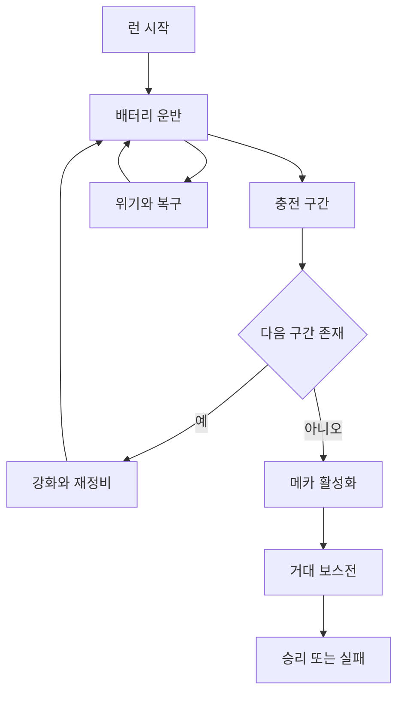

# 53. Mecha Guard 심층 역기획

> 기준일: 2026-11-13. 2026년 6월 공식 업데이트에 공개된 PvE 모드 골격을 기준으로 한다. 당시 공지는 업데이트 후반 제공을 예고했으며, 본 조사에서 후속 실서비스의 모든 규칙을 확인하지는 못했다. 아래 빈칸은 임의 수치로 채우지 않는다.

## 1. 확인된 모드 구조

[공식] 플레이어들이 Meg의 메카를 위한 배터리를 운반·충전하고, 적 무리를 상대하며 강화 효과를 얻는다. 마지막에는 충전된 메카와 함께 무작위 거대 보스에 맞선다.[S1]

[해석] 전반의 협동 운반과 후반의 큰 보스전이 하나의 준비·보상 구조로 연결된다. 배터리를 지킨 행위가 마지막 전투의 아군 전력으로 돌아오므로, 중간 목표가 단순 이동 과제가 아니라 결말을 준비하는 행동이 된다.

## 2. 확인 범위와 미확인 값

| 항목 | 상태 |
|---|---|
| PvE 협동 | 확인 [공식] |
| 배터리 운반·충전 | 확인 [공식] |
| 진행 중 적 무리·강화 | 확인 [공식] |
| 최종 메카 합류·무작위 거대 보스 | 확인 [공식] |
| 참가 인원 | 확보한 공식 설명에 수치 없음 |
| 운반 중 공격·이동 제한 | 미확인 |
| 충전 조건·충전량 손실 | 미확인 |
| 부활·전멸·시간 종료 | 미확인 |
| 경로·체크포인트 수 | 미확인 |
| 보스 종류별 확률 | 미확인 |

이 모드를 Robo Rumble의 금고를 옮기는 버전이라고 단정하지 않는다. 이동 목표와 충전·최종 합류가 만드는 별도 흐름을 분석한다.

## 3. 플레이 단계 [해석]

1. **준비:** 팀이 운반·호위·적 처리의 역할을 나눈다.
2. **이동:** 배터리의 경로를 확보하며 적의 압박을 줄인다.
3. **충전:** 목표 진행을 위해 머물거나 특정 행동을 수행한다.
4. **강화:** 얻은 전투력으로 다음 구간의 위협을 견딘다.
5. **최종전:** 준비한 메카와 함께 보스 패턴을 상대한다.

충전의 실제 행위가 시간 점유인지 적 처치인지 특정 상호작용인지는 미확인이다. 위 단계는 공개된 운반→충전→최종전의 흐름을 구조화한 분석이다.

## 4. 상태 머신 [제안]

구간 수·복구 방식은 제안의 설정값이다. 원작의 실제 체크포인트와 동일하다는 의미가 아니다.

## 5. 운반자와 호위의 역할 [해석]

운반자는 목표를 진행하지만, 이동·공격이 제한된다면 자기 방어에 의존하기 어렵다. 호위는 적을 모두 처치하는 것보다 운반자가 이동할 수 있는 길을 만드는 것이 중요하다.

| 역할 | 주요 판단 | 실패 위험 |
|---|---|---|
| 운반 | 안전 경로와 진행 타이밍 | 적을 무시하고 너무 앞서감 |
| 전방 정리 | 진입로의 위협 제거 | 후방 운반자를 놓침 |
| 측후방 보호 | 접근한 적·투사체 차단 | 목표와 무관한 추격 |
| 지원 | 회복·제어·재집결 | 불필요한 중첩과 자원 낭비 |

원작 운반자에게 어떤 제한이 있는지는 확인해야 한다. 제한이 없다면 역할의 차이는 공격 능력보다 위치와 위험 부담에서 생긴다.

## 6. 배터리의 소유·충전 모델 [제안]

배터리의 위치 상태와 충전 상태를 분리한다. 바닥에 떨어져 있어도 충전량을 유지할 수 있고, 운반 중에도 충전이 가능할 수 있으므로 하나의 상태 enum으로 모두 표현하지 않는다.

| 축 | 예시 상태 |
|---|---|
| 소유 | 바닥·플레이어 소유·장치 결합 |
| 진행 | 이동 중·충전 가능·충전 완료 |
| 안전 | 정상·위험 지역·복구 필요 |
| 메카 | 비활성·활성 준비·전투 참여 |

`BatteryId`, `carrierId`, `chargeAmount`, `chargeSource`, `position`, `checkpointId`를 관리한다. 실제 필드명과 내부 구조는 제안이다.

## 7. 적 무리와 난이도 곡선 [해석·제안]

운반 PvE는 화력이 충분한 팀이 멈추지 않고 밀어붙이면 쉬워지고, 화력이 부족한 팀은 뒤에 쌓인 적 때문에 계속 더 어려워질 수 있다. 공급량을 시간만으로 늘리면 한 번 늦어진 팀이 회복할 수 없는 흐름이 된다.

재구현에서는 진행 거리·현재 적 수·팀 생존 상태를 함께 고려하는 웨이브 설정을 실험할 수 있다. 다만 이것이 원작의 적응형 난이도라는 근거는 없다.

강화 보상은 다음 구간을 더 쉽게 만들면서도 역할 선택을 바꿀 수 있어야 한다. 단순 피해 증가만 반복하면 운반 협동보다 누적 화력이 모든 문제를 해결할 수 있다.

## 8. 최종전의 보상감 [해석]

배터리를 완성해 메카가 합류하는 순간은 앞선 노력의 시각적 결과다. 메카가 너무 강하면 플레이어는 마지막 전투에서 관객이 되고, 너무 약하면 운반 과제의 의미가 줄어든다.

[제안] 메카가 보스의 특정 압박을 받아주거나 공격 창을 만들어 주고, 플레이어가 그 기회를 활용하게 설계할 수 있다. 원작 메카의 실제 타깃·기술·조종 방식은 미확인이다.

무작위 보스는 반복 플레이를 바꾸지만, 특정 조합으로는 대응할 수 없는 보스가 선택되면 운반 단계가 헛수고로 느껴진다. 보스별 요구 행동과 팀의 선택 가능한 대응을 비교한다.

## 9. 데이터·UI [제안]

| 데이터 | 용도 |
|---|---|
| RunState | 현재 구간·진행·난이도 |
| BatteryState | 운반·충전·위치 |
| WaveState | 적 생성과 생존 목록 |
| PowerUpState | 획득 효과·팀 또는 개인 귀속 |
| MechaState | 활성화·체력·전투 상태 |
| BossSelection | 선택 결과·규칙 버전·확정 시점 |

UI는 배터리 위치·충전 진척·현재 해야 할 행동을 최우선으로 한다. 목표와 멀어진 플레이어에게 복귀 방향을 보여주고, 보스전 전환 때 조작 가능한 상태와 연출 상태를 구분한다.

## 10. QA [제안]

| ID | 시나리오 | 기대 결과 |
|---|---|---|
| MG01 | 운반자 연결 끊김 | 배터리가 사라지지 않고 복구 정책 적용 |
| MG02 | 두 명 동시 픽업 | 한 명만 운반 권한 획득 |
| MG03 | 충전 완료 이벤트 재전송 | 메카 한 번만 활성화 |
| MG04 | 배터리가 이동 불가 위치에 놓임 | 안전 위치 복구 |
| MG05 | 강화 획득과 사망 동시 | 효과 귀속·유지 정책 일관 적용 |
| MG06 | 최종전 진입 중 전멸 | 사전 정의한 전이·실패 순서 적용 |
| MG07 | 재접속 | 보스 선택을 재추첨하지 않고 현재 런 복원 |
| MG08 | 메카와 보스 동시 사망 | 승리·실패 정책을 일관 적용 |

## 11. KPI와 원작 검증 계획 [제안]

구간별 이탈·실패율, 운반 참여 편중, 배터리 방치 시간, 호위와 운반자의 거리, 충전 단계 소요시간, 보스별 성공률, 메카의 피해·피격 기여를 측정한다.

원작 상세 확보 우선순위는 참가 인원, 운반 제약, 충전 방법, 전멸 복구, 목표물 손실, 강화 선택, 메카 행동, 보스 종류다. 이 값들이 없으면 공개 골격을 참고한 독립 프로토타입은 만들 수 있지만 원작과 동일한 규칙의 복제를 주장할 수는 없다.

## 출처

- [S1: 2026년 6월 공식 패치](https://supercell.com/brawlstars/en/blog/release-notes/release-notes-june-2026/) — Mecha Guard의 공개 흐름. 후속 출시 상세 확인은 별도 필요.

관련 문서: [로보 럼블](25_robo_rumble.md), [보스전](26_boss_fight.md), [라이브 운영](../systems/15_liveops_events.md), [전체 목차](../README.md).
