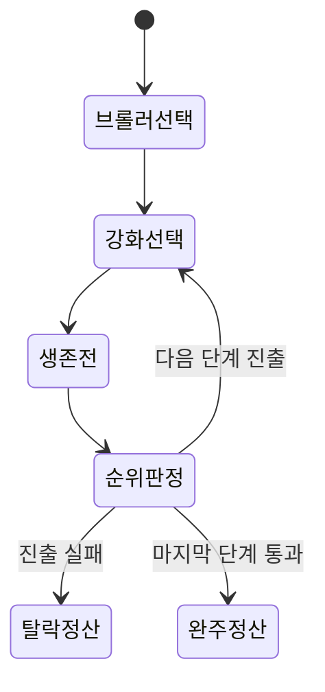

# 54. Upside Showdown — 선택형 강화 덱을 쌓는 생존 런

> 기준: 2025년 10월 Stranger Things 이벤트의 역사 규칙.
> 현재 상시 모드나 2026년 동일 운영으로 단정하지 않는다. 공식 검색 색인에서 확보한 본문 범위로 분석했다.

## 1. 공식 규칙

[공식] 한 브롤러로 시작한 런에서 매 단계 10인 개인전에 참가하고, 세 강화 후보 중 하나를 선택한다.
상위 4명이 다음 단계로 가며 5단계 통과가 완주다.
단계 순위는 다음 강화 선택지의 희귀도에 영향을 주고, 탈락하면 런이 끝난다.[S1]

| 항목 | 확인/분석 경계 |
| --- | --- |
| 경기와 런 | 여러 생존전을 연결한 하나의 도전 |
| 브롤러 | 런 시작 선택 유지 구조 |
| 강화 | 단계 사이 선택해 런 동안 축적 |
| 승리 기준 | 단순 한 경기 1위와 런 완주가 다름 |
| 재화·보상 | 당시 이벤트 Waffles와 연계 |
| 최종 동률·매칭 가중치 | 미확인 |
| 카드 확률·중첩 공식 | 미확인 |

## 2. 설계 핵심 [해석]

한 경기에서 살아남는 전략과 런 전체의 성장 경로가 연결된다.
상위권에 들기만 하면 다음 단계로 갈 수 있지만 더 높은 순위는 이후 선택의 질을 높일 수 있다.
안전하게 진출할지 추가 위험을 감수해 더 좋은 강화를 노릴지의 교환이 생긴다.

같은 브롤러를 계속 쓰면서 강화 선택이 누적되므로, 브롤러를 소모하는 타워와 경험이 다르다.
플레이어는 캐릭터 풀보다 현재 빌드의 강점과 부족한 대응 수단을 관리한다.

## 3. 런 상태 [제안]

“승리”를 1위, 진출 성공, 런 완주 중 무엇으로 쓰는지 이벤트와 UI에서 구분한다.
단계 진출 사건이 중복되면 강화가 추가되거나 보상이 두 번 지급되는 문제가 생긴다.

## 4. 선택 전략 [해석]

| 현재 빌드 | 보완 선택 | 집중 선택 |
| --- | --- | --- |
| 피해 강함·생존 약함 | 회피·체력·보호 | 빠른 처치로 위험 제거 |
| 이동 강함·화력 약함 | 실질 처치 수단 | 교전 회피와 높은 생존 순위 |
| 넓은 공격 | 명중 안정·자원 회수 | 공간 장악 극대화 |
| 소환 중심 | 본체 생존 | 소환수의 지속 압박 |
| 능력 연쇄 | 실패 시 복구 | 충전·재사용 주기 강화 |

이는 원작의 특정 카드 목록을 재현한 표가 아니다.
카드 설계가 어떤 선택을 만드는지 평가하는 분석 틀이다.
모든 후보가 수치만 다른 상위·하위 버전이면 선택은 쉬워지지만 빌드 해석의 깊이는 줄어든다.

## 5. 매칭과 공정성 [제안]

같은 단계라도 이전 순위와 강화 조합이 다를 수 있다.
단계가 다른 참가자를 한 경기에 섞으면 빌드 개수 차이가 생기므로 명시된 매칭 정책이 필요하다.
원작이 어떤 기준으로 런 참가자를 묶는지는 확인하지 않았다.

불리한 카드 후보가 나왔을 때 게임을 종료하고 재시도하는 행동을 어떻게 처리할지도 중요하다.
공식 런 제한과 이벤트 종료 규칙을 서버 상태로 관리하고 재접속으로 선택지를 바꾸지 못하게 한다.

## 6. 데이터 모델 [제안]

| 필드 | 설명 |
| --- | --- |
| runId / eventVersion | 도전과 규칙 식별 |
| chosenBrawler | 런 고정 캐릭터 |
| currentStage | 단계 |
| cardDeckVersion | 가능한 강화 정의 |
| offeredChoices / selectedCard | 제안된 후보와 확정 선택 |
| accumulatedPowers | 런 내 적용 목록 |
| previousPlacement | 다음 단계 보상 조건 |
| pendingRewards / settledRewards | 누적과 확정 정산 분리 |
| expiry | 이벤트 종료 정책 |

카드 효과는 계정에 영구 저장하는 성장과 분리한다.
당시 덱 해금과 런 내 강화 누적은 서로 다른 소유권 범위다.

## 7. 눈덩이와 역전 [해석]

높은 순위가 좋은 강화를 만들고 좋은 강화가 다음 순위를 높이는 자기 강화 고리가 존재할 수 있다.
하지만 카드 선택이 약점을 보완하거나 새 전술을 열면 처음의 우위를 단순 수치 차이로만 유지하지 않게 된다.
최종 단계에서 특정 조합만 남는지, 생존 위주의 선택이 모두를 밀어내는지 평가해야 한다.

패배로 긴 런을 잃는 비용은 기본 쇼다운보다 높다.
관전 대기와 다음 런 진입 시간이 길면 도전의 긴장보다 피로가 커질 수 있다.

## 8. UI 요구

- 현재 경기의 순위 목표와 런 전체 목표.
- 보유 강화, 이번 후보, 상호작용 설명.
- 미리 확정된 후보와 선택 시간.
- 획득 예정 보상과 지급 완료 보상.
- 이벤트 만료와 진행 중 런의 처리.
- 패배 시 다음 런에서 바꿀 수 있는 선택.

## 9. QA

| 사례 | 제안 기대 결과 |
| --- | --- |
| 강화 선택 중 재접속 | 같은 후보와 확정 상태 복원 |
| 단계 결과 중복 | 카드·보상 중복 없음 |
| 경계 순위 동시 탈락 | 진출 정책 일관 |
| 누적 강화 최대 조합 | 연산 순서·상한 정상 |
| 마지막 단계 통과 | 다음 단계 대신 완주 정산 |
| 런 중 이벤트 종료 | 명시된 만료 정책 |
| 브롤러 변경 요청 | 런의 선택 고정 유지 |
| 보상 지급 직후 종료 | 재접속해도 한 번 지급 |

## 10. KPI·출처

[제안] 단계별 진출률, 후보별 선택률, 강화 조합의 완주 집중도,
안전 진출과 1위 도전의 선택, 패배 후 새 런 시작률을 본다.

- [S1: 2025년 10월 공식 패치](https://supercell.com/brawlstars/en/blog/game-updates/release-notes-october-2025/)
- [Loaded Showdown](39_loaded_showdown.md) · [타워](44_topple_the_tower.md) · [Hawkins Hunt](55_hawkins_hunt.md)

