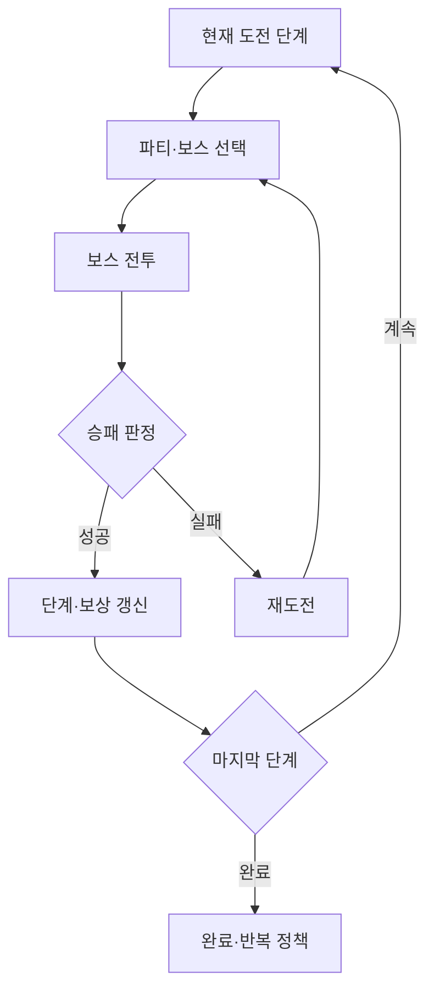

# 55. Hawkins Hunt — 이벤트 보스 연속 도전

> 기준: 2025년 10월 Stranger Things 협업 이벤트.
> 당시 3인 규칙을 2026년 일반 Boss Fight의 5인 개편과 섞지 않는다.

## 1. 공식 확인 범위

[공식] 3명이 NPC 보스에 도전하는 5단계 난도 상승 구조이며 당시 이벤트 재화 Waffles를 얻는다.
보스에는 Vecna, Demogorgon, Spirit Knight Frank가 포함된다.[S1]
이벤트 전용 보스들의 정확한 공격 패턴·체력·부활 시간은 확보한 설명만으로 확정하지 않는다.

| 항목 | 상태 |
| --- | --- |
| 협력 구조 | 당시 3인 |
| 진행 | 점점 어려워지는 단계 |
| 보상 | 이벤트 재화와 단계별 상한 연계 |
| 현재 운영 | 미확인, 역사 문서 |
| 전체 전멸·시간 종료 | 상세 판정 미확인 |
| 단계 혼합 파티 | 자료에 관련 수정 이력, 정확한 허용 정책 미확인 |

## 2. 설계 핵심 [해석]

이 모드는 같은 이벤트의 경쟁 생존전과 다른 참여 경로를 제공한다.
PvP 순위 경쟁이 부담스러운 플레이어도 협동 전투를 통해 이벤트 목표에 참여할 수 있다.
보스별 학습과 단계 상승은 반복 플레이의 이유가 되지만, 보상 상한은 특정 보스만 계속 반복하는 효율을 제한한다.

이벤트 테마가 공격 패턴과 연결되면 새 캐릭터를 익히는 느낌을 줄 수 있다.
단지 보스 외형과 체력만 바꾸면 단계가 올라갈수록 시간만 늘어나는 위험이 있다.

## 3. 협동 책임 [해석]

| 책임 | 행동 | 팀 실패 위험 |
| --- | --- | --- |
| 위험 유도 | 보스 공격 방향·위치를 관리 | 위험을 동료에게 겹침 |
| 지속 피해 | 공격 가능 시간에 자원 집중 | 회피를 포기한 무리한 화력 |
| 생존 유지 | 전멸을 막으며 복귀 기회 확보 | 너무 소극적이면 장기화 |
| 보조 적 처리 | 회피 공간과 안전지대 확보 | 보스만 공격하다 포위 |
| 기믹 대응 | 특정 패턴 조건 충족 | 한 사람만 알면 협동 실패 |

위 역할은 원작 보스별 능력의 확정 설명이 아니라 협동 보스 설계의 분석 모델이다.
실제 역할의 필요성은 보스별 패턴 관찰 후 확정해야 한다.

## 4. 단계·전투 상태 [제안]

플레이어 개인 단계와 파티에서 선택한 난도는 분리한다.
다른 단계의 플레이어가 함께 있을 때 어떤 진행을 인정할지 명시하지 않으면,
한 사람의 승리를 다른 사람의 패배로 기록하는 유형의 오류가 생긴다.

## 5. 데이터 계약 [제안]

| 필드 | 이유 |
| --- | --- |
| playerStageProgress | 개인 해금 단계 |
| selectedEncounterStage | 실제 참가 난도 |
| bossDefinitionVersion | 보스·패턴 정의 |
| phaseState | 패턴 단계와 전환 |
| partyEligibilitySnapshot | 경기 시작 자격 |
| rewardCapState | 단계별 보상 상한 |
| resultMapping | 성공을 개인 진행에 적용하는 방식 |
| revivePolicy | 사망·부활·전멸 처리 |

난도 상승은 체력·피해 배율, 패턴 간격, 보조 적, 안전지대 크기 등의 축으로 표현할 수 있다.
원작이 각 보스에서 어느 축을 쓰는지는 미확인이다.

## 6. 난도 곡선과 역전 [해석]

보스전의 역전은 뒤처진 점수 만회보다 전멸 직전 생존과 위험 구간 통과에서 발생한다.
한 명의 좋은 회피로 팀이 복귀할 수 있다면 긴장과 역할 가치가 생긴다.
반대로 한 번의 실수가 장시간의 진행을 완전히 무효화하면 반복 피로가 커질 수 있다.

[제안] 단계별 성공률뿐 아니라 실패 시점과 반복 학습을 본다.
첫 시도부터 쉬운지보다 두 번째·세 번째 시도에서 패턴 이해로 개선되는지 중요하다.
강화 격차로만 성공률이 갈리면 패턴 학습의 의미가 줄어든다.

## 7. UI 요구

- 이번 보스와 난도, 개인 진행과의 관계.
- 위험 패턴의 사전 예고.
- 동료 생존·복귀 가능 상태.
- 보상 상한의 잔여 여부.
- 완료 후 다음 단계로 갈 수 있는 조건.
- 이벤트 전용 강화가 적용되는지.

보상 상한에 도달한 사실은 참가 전에 알 수 있어야 한다.
보스를 잡았지만 기대한 보상이 없으면 전투 성공의 의미가 약해진다.

## 8. QA

| 사례 | 제안 기대 결과 |
| --- | --- |
| 서로 다른 개인 단계 파티 | 참가/진행 적용 정책 일관 |
| 보스 사망과 마지막 플레이어 사망 | 고정된 종료 우선순위 |
| 단계 결과 중복 | 진행·보상 한 번만 적용 |
| 보상 상한 도달 | 초과 지급과 설명 누락 없음 |
| 보스 변신 중 공격 | 무적·체력·표적 정책 일치 |
| 동료 재접속 | 현재 보스·단계·생존 상태 복원 |
| 이벤트 만료 중 전투 | 정산 정책 명확 |
| 이전 버전 보스 재현 | 동일 패턴 정의로 검증 가능 |

## 9. KPI와 실측 과제

[제안] 단계별 시도 횟수, 패턴별 사망, 전멸 전 마지막 생존 시간,
보상 상한 뒤 참여율, 고정 파티와 무작위 팀의 차이를 분석한다.
실기에서는 보스별 패턴, 전멸 처리, 난도 공유, 강화 적용을 우선 확인한다.

## 10. 출처와 연결

- [S1: 2025년 10월 공식 패치](https://supercell.com/brawlstars/en/blog/game-updates/release-notes-october-2025/) — 검색 색인 본문의 역사 규칙.
- [일반 보스전](26_boss_fight.md) · [Upside Showdown](54_upside_showdown.md) · [로보 럼블](25_robo_rumble.md)

