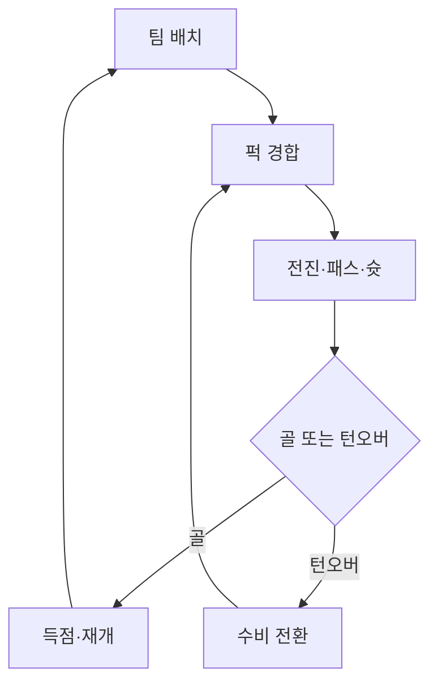

# 56. 5대5 브롤 하키 — Brawl Hockey 5v5

> 상태: 2025년 6월 공식 패치의 전용 맵 목록으로 존재 확인.
> 3대3 하키의 승리 득점·시간·골 크기까지 같다는 근거는 확보하지 못했다.

## 1. 확인 규칙과 제한

[공식] 공식 패치에는 Brawl Hockey 5v5와 해당 변형의 지도들이 별도로 등재되어 있다.[S1]
이 문서는 인원 증가에 따른 설계 차이를 분석한다.
세부 규칙이 없는 부분은 3대3에서 값을 복사하지 않고 설정·검증 항목으로 둔다.

| 항목 | 상태 |
| --- | --- |
| 팀 구성 | 5대5 변형 존재 확인 |
| 목표 유형 | 하키 계열의 퍽·골 목표로 분석 |
| 지도 | 전용 지도군 존재 |
| 승리 득점·시간 | 미확인 |
| 필드 방향·골 폭 | 미확인 |
| 부활·연장·퍽 정책 | 별도 실기 확인 |

## 2. 3대3에서 달라지는 핵심 [해석]

한 명의 이탈이 팀 전체에서 차지하는 비중은 줄지만, 여러 공격이 한 구역에 겹칠 확률은 높아진다.
퍽 주변에 모든 사람이 모이면 목표물 위치와 위험 경로를 읽기 어려워진다.
더 많은 인원은 고정 골문 수비, 중원 연결, 측면 전개, 전방 슈팅 등 역할 분화를 가능하게 한다.

반면 “누군가 수비하겠지”라는 책임 분산이 생기면 오히려 빈 골문이 많아질 수 있다.
큰 팀을 만드는 것과 협력이 잘 작동하는 것은 별개의 문제다.

## 3. 전개 단계

| 단계 | 팀 차원의 판단 |
| --- | --- |
| 시작 | 퍽 확보 인원과 후방 인원을 나눌지 |
| 중원 압박 | 인원 우위를 어느 구역에 만들지 |
| 공격 전환 | 퍽보다 앞서 가는 선수와 뒤를 지키는 선수 |
| 골 앞 밀집 | 광역 제어와 슈팅 경로를 어떻게 분리할지 |
| 수비 전환 | 퍽 추격보다 골 방향을 먼저 막을지 |
| 재개 | 이전 득점의 원인이 전투력인지 배치인지 |

## 4. 상태 구조 [제안]

전투 생명주기는 하키 계열의 목표 상태를 사용하되 팀 슬롯 수에 맞춰 확장한다.
퍽 소유권, 골판정, 팀 점수는 플레이어 수와 무관하게 하나의 권위 상태다.
점수 처리를 각 플레이어에게서 합산하는 구조를 사용하지 않는다.

## 5. 맵과 조합 [해석]

인원이 늘었다고 필드를 단순 비례 확장하면 걷는 시간이 늘어날 수 있다.
목표물에 관여할 시간, 측면으로 전개하는 시간, 수비로 복귀하는 시간을 따로 조정해야 한다.
독립적인 우회 경로가 부족하면 추가 인원이 모두 같은 통로를 두드리는 상황이 된다.

광역 피해·집단 치유·관통·충전 능력은 표적 밀도의 영향을 크게 받는다.
개별 브롤러의 3대3 성과로 5대5의 적정성을 판단하지 않는다.
기본 전투의 강점과 퍽 경로 제어의 강점도 구분한다.

## 6. 데이터 명세 [제안]

| 필드 | 목적 |
| --- | --- |
| teamSlots | 다섯 참가자의 안정된 식별 |
| formationSpawns | 시작·득점 후 배치 |
| matchGoalPolicy | 전용 목표 득점 |
| fieldGeometry | 골·벽·방향·범위 |
| puckPolicy | 접촉·슛·반사 |
| respawnDistribution | 부활 위치와 중첩 방지 |
| cameraVisibility | 목표물과 팀 밀도 처리 |
| communicationHints | 역할·위치 협의 |

3대3과 공통 정책을 공유할 수 있지만 값과 적용 범위를 버전으로 분리한다.
독립 문서의 목적은 동일한 규칙을 다시 적는 것이 아니라 확대에서 깨지는 가정을 드러내는 데 있다.

## 7. 역전과 위험 [해석]

팀 전멸 없이도 일부 인원의 위치가 무너지면 골문이 열릴 수 있다.
수적 우세가 생겼을 때 모두 공격으로 이동하면 반대로 장거리 슛에 취약해질 수 있다.
후방 책임을 남기는 조합과 전원 압박 사이의 균형이 중요한 전술 선택이다.

다수의 부활 보호가 동시에 골 앞에 나타나는 상황은 공격 성공을 무효화할 수 있으므로
부활 위치·보호 해제·퍽 상호작용을 묶어서 검증한다.
구체적인 원작 값은 미확인이다.

## 8. UI 요구

퍽 위치가 가장 우선이며 모든 플레이어 이름표가 같은 중요도를 갖지 않는다.
멀리 있는 동료보다 슛 경로와 골문 위험을 더 쉽게 읽게 한다.
부활 중인 팀원, 공수 전환 방향, 현재 점수와 남은 시간을 빠르게 파악할 수 있어야 한다.
역할 안내는 강제 직업 선택보다 간단한 위치 협의를 돕는 방식이 적절하다.

## 9. QA

| 사례 | 제안 기대 결과 |
| --- | --- |
| 열 명이 퍽에 접근 | 단일 소유/접촉 정책 유지 |
| 동시 부활 다수 | 생성 위치 겹침 처리 |
| 광역기와 퍽 충돌 중첩 | 판정 순서와 가독성 유지 |
| 득점 뒤 재개 | 모든 참가자 같은 phaseId |
| 팀원 이탈·복귀 | 슬롯 중복과 소유권 유실 없음 |
| 화면 밖 강한 슛 | 합법적인 위험 정보 제공 |
| 빠른 반사 연속 | 골라인 검사 누락 없음 |
| 시간 종료 직전 골 | 전용 시간 정책 적용 |

## 10. KPI·출처

[제안] 퍽 관여 인원 분포, 후방 무인 시간, 전원 밀집 시간, 턴오버 후 실점,
개인 참여 편차, 3대3 대비 실제 경기 길이를 비교한다.

- [S1: 2025년 6월 공식 패치](https://supercell.com/en/games/brawlstars/blog/game-updates/release-notes-june-2025/) — 검색 색인 본문의 모드·전용 맵 목록.
- [3대3 하키](19_brawl_hockey.md) · [5대5 브롤 볼](14_brawl_ball_5v5.md) · [역할·밸런스](../systems/06_team_roles_balance.md)

