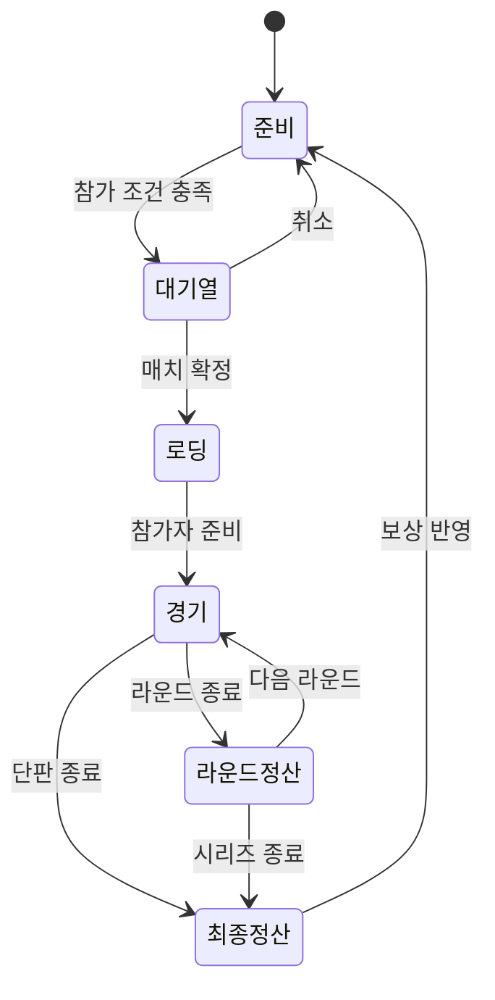

# 01. 코어 루프와 경기 생명주기

> 기준: 2026-11-13 자료 조사. 아래 분석은 공개 규칙을 구조화한 역기획이며 원본 개발 문서가 아니다.
> [공식] 출처가 확인한 기능, [해석] 플레이 구조 분석, [제안] 재구현 명세, [미확인] 실기·코드 검증이 필요한 항목.

## 1. 시스템의 역할

[해석] 브롤스타즈의 반복 동기는 짧은 전투에서 얻는 조작 숙련과, 그 결과가 계정의 선택지를 늘리는 성장 사이의 왕복에 있다.
전투마다 캐릭터를 새로 육성하는 것이 기본 전제는 아니며, 일반 전투와 경기 중 성장형 모드를 분리해 이해해야 한다.
전투의 목표는 모드가 결정하고, 이동·공격·능력 사용이라는 공통 조작은 모드 사이에서 재사용된다.

공식 게임 소개는 다양한 브롤러와 여러 모드를 제공하는 팀 전투 게임으로 설명한다.[S1]
이 문서는 그 조합을 서비스·세션·교전의 세 층으로 나눈 분석 모델이다.

| 층 | 플레이어 질문 | 입력 | 결과 | 실패했을 때 남는 것 |
| --- | --- | --- | --- | --- |
| 계정 루프 | 다음에 무엇을 얻거나 익힐까? | 브롤러 선택, 성장 자원 배분 | 사용 가능한 전술 선택지 | 해금 진행, 학습, 일부 보상 |
| 세션 루프 | 이번 판은 어떤 목표로 싸울까? | 모드·맵·파티·로드아웃 | 승패·순위·정산 | 재시도 이유와 수정점 |
| 교전 루프 | 지금 쏘고, 물러나고, 들어갈까? | 위치, 탄약, 능력, 조준 | 공간·피해·생존·목표 우위 | 상대 자원 정보 |
| 운영 루프 | 오늘 다시 접속할 이유는? | 이벤트·퀘스트·시즌 참여 | 단기 목표 갱신 | 다음 접속의 기대 |

## 2. 코어 가치의 전환 구조 [해석]

명중 자체는 최종 목적이 아니다. 명중이 상대 후퇴를 만들고, 그 후퇴가 목표에 접근할 시간을 만든다는 변환이 중요하다.
같은 피해량이라도 젬 운반자를 퇴각시키는 피해와 목표 밖에서 탱커를 회복시키며 누적한 피해는 결과가 다르다.

분석에 사용할 가치 벡터는 다음과 같다.

- 생존 가치: 팀이 지도에 존재하며 다음 행동을 선택할 수 있는 정도.
- 공간 가치: 안전하게 접근하거나 상대의 접근을 금지할 수 있는 영역.
- 시간 가치: 상대 복귀·재장전·목표 타이머 전에 확보한 행동 창.
- 목표 가치: 점수, 물건 운반, 시설 피해, 점령 진척, 생존 순위.
- 정보 가치: 상대 위치, 사용한 능력, 남은 탄약과 진입 경로에 대한 판단.

이 벡터는 원작이 내부적으로 계산하는 점수식이 아니다. 모드 분석과 밸런스 대화를 위한 도구다.

## 3. 매치 생명주기 [제안]

모드 내부의 득점·리스폰·연장과 위 생명주기는 다른 계층이다.
브롤 볼 득점 뒤 위치를 초기화하는 것은 새 계정 매치를 만드는 행위가 아니며,
넉아웃의 라운드 종료와 경쟁전의 세트 종료 역시 동일한 카운터로 표현하면 안 된다.

### 시간과 범위의 구분

| 개념 | 소유자 | 예시 | 초기화 시점 |
| --- | --- | --- | --- |
| Account | 계정 서비스 | 보유 브롤러·재화 | 로그아웃으로 지우지 않음 |
| Session | 로비 | 파티·선택 모드 | 로비 이탈 정책 |
| Match | 경기 인스턴스 | 최종 결과 식별자 | 최종 정산 뒤 |
| Set | 경쟁 포맷 | 같은 룰에서 반복 경기 | 세트 종료 |
| Round | 모드 규칙 | 넉아웃의 생존 판정 | 다음 라운드 |
| Life | 전투 개체 | 사망·부활·보호 상태 | 리스폰 |
| Possession | 목표 개체 | 공·젬·탈출 전리품 | 습득·드롭·득점 |

## 4. 플레이 단계별 요구사항

### 4.1 진입

[제안] 모드 선택 화면은 현재 참가 가능 여부, 목표, 인원, 지도, 적용 변형을 한 화면에서 확인하게 한다.
이벤트 보상만 크게 보이고 전투 규칙 차이가 숨어 있으면 첫 판의 실패가 학습으로 이어지기 어렵다.
파티원 중 한 명이 참가 조건을 충족하지 못하면 누구의 어떤 조건인지 구체적으로 알려야 한다.

### 4.2 준비

[해석] 로드아웃 선택은 맵과 상대 조합에 따라 의미가 달라진다.
능력 선택을 단순 전투력 비교로 축소하면 맵 해석과 역할 협의의 재미가 사라진다.
[제안] 경기 시작에 사용할 설정과 소유권을 확정하고, 이후 계정에서 바꾼 장비가 진행 중 경기에 섞이지 않게 한다.

### 4.3 경기

[제안] 전투 루프는 공통 사건을 생산하고 모드가 그 사건의 목적상 의미를 해석한다.
예를 들어 사망 사건은 젬 드롭, 별 이동, 생존 탈락, 리스폰 예약 중 하나 이상으로 바뀔 수 있다.
모든 모드가 공통 사망 함수 안에 조건문을 추가하는 구조는 변경 충돌을 일으키기 쉽다.

### 4.4 종료와 복귀

[제안] 종료는 화면 연출 시작보다 먼저 권위 있는 결과를 고정하는 과정이다.
종료 시점 이후 들어온 입력은 결과를 바꾸지 않아야 하며, 같은 결과가 두 번 도착해도 보상은 한 번 지급한다.
서버 결과를 기다리는 화면과 보상 지급에 실패한 화면은 다른 상태로 표시한다.

## 5. 공통 데이터 계약 [제안]

| 데이터 | 필요 필드 | 이유 |
| --- | --- | --- |
| MatchDescriptor | matchId, rulesetVersion, modeId, mapId, modifierIds | 동일 이름의 다른 시즌 규칙 구분 |
| Participant | playerId, teamId, slotId, loadoutSnapshot | 진영과 장비의 경기 중 일관성 |
| MatchClock | logicalTime, phase, phaseStart, deadline | 일시정지·연장·라운드 시간 분리 |
| ObjectiveState | objectiveId, ownerTeam, progress, possession | 점수판의 단일 근거 |
| Result | terminalEventId, placement, outcome, reason | 동률·몰수·정상 종료 구분 |
| Settlement | transactionId, rewardRuleVersion, status | 중복 정산 방지 |

원작의 실제 필드명이나 저장 형식을 뜻하지 않는다.
네트워크 상세는 [07 문서](07_network_architecture.md), 규칙 구성은 [08 문서](08_data_rules_qa.md)를 참조한다.

## 6. 종료 판정의 불변조건 [제안]

1. 한 경기의 최종 결과는 한 번만 확정된다.
2. 플레이어 사망 수, 팀 탈락 수, 라운드 승수는 서로 다른 집계다.
3. 인게임 점수와 계정 보상은 분리한다.
4. 승리 요건이 충족된 시점의 규칙 버전을 정산에도 사용한다.
5. 모드가 명시하지 않은 동률 처리법을 공통 코드가 임의로 결정하지 않는다.
6. 재접속자는 현재 단계를 복원하며 지난 득점 연출을 다시 실행하지 않는다.
7. 시즌 변경이 진행 중인 경기의 승리 조건을 바꾸지 않는다.

## 7. 콘텐츠 확장 비용을 낮추는 경계 [해석·제안]

기존 모드의 맵만 바꾸면 목표 학습은 재사용되고 공간 학습이 새로 필요하다.
인원수를 바꾸면 시야 밀도, 복귀 거리, 광역기 효율, 목표 수요가 바뀐다.
목표를 바꾸면 같은 전투 능력의 가치 순서까지 바뀐다.
따라서 새 콘텐츠 검토에서 “몇 개의 에셋을 추가하는가”보다 “어떤 학습과 밸런스 가정을 깨는가”를 먼저 확인한다.

## 8. 관찰 및 검증 계획

실제 앱 플레이와 계측은 이번 작성에서 수행하지 않았다.
다음 항목은 재구현의 수용 기준이며 원작이 모두 이렇게 동작한다는 주장이 아니다.

| 시나리오 | 제안 기대 결과 |
| --- | --- |
| 로딩 중 한 명 연결 종료 | 로딩·참가 정책에 따라 대체/취소 처리, 무기한 대기 금지 |
| 최종 득점과 종료 시간이 같은 업데이트 | 문서화한 사건 순서로 한 결과만 확정 |
| 결과 수신 직후 앱 종료 | 재접속 뒤 보상이 한 번만 반영 |
| 다음 라운드 준비 중 장비 변경 | 허용 시점 정책으로 수락/거부, 반쪽 적용 금지 |
| 팀 전체가 같은 순간 사망 | 모드별 동시 탈락 정책으로 처리 |
| 경기 중 시즌 교체 | 시작 시점의 rulesetVersion 유지 |
| 리플레이 결과와 정산 결과 비교 | 동일 terminalEventId와 outcome |
| 연속 재경기 요청 중복 | 한 대기열 참가만 생성 |

## 9. 핵심 지표 [제안]

- 재경기율은 승패·모드·파티 유무로 나누어 본다.
- 첫 경기 이탈률과 첫 패배 뒤 재시도율은 튜토리얼 효과를 평가한다.
- 경기 길이의 평균만 보지 말고 상위 꼬리와 조기 종료 비중을 함께 본다.
- 목표 참여 시간과 피해량을 같이 보아 킬 중심 지표가 모드를 왜곡하지 않는지 확인한다.
- 새 모드가 기존 모드의 이용 시간을 옮긴 것인지 총 참여를 늘린 것인지 구분한다.

## 10. 출처와 관련 문서

- [S1: Supercell, Brawl Stars 공식 소개](https://supercell.com/brawlstars/en/) — 게임의 다중 캐릭터·다중 모드 구성.
- [공식 Game Modes](https://sc-brawlstars.zendesk.com/hc/en-us/articles/49526599632923-Game-Modes) — 모드 목표 분류. 상세 규칙은 각 모드 문서에서 별도 다룬다.
- [전투 판정](03_combat_damage.md) · [모드 비교](../02_mode_comparison.md) · [문서 기준](../00_scope_evidence.md)

