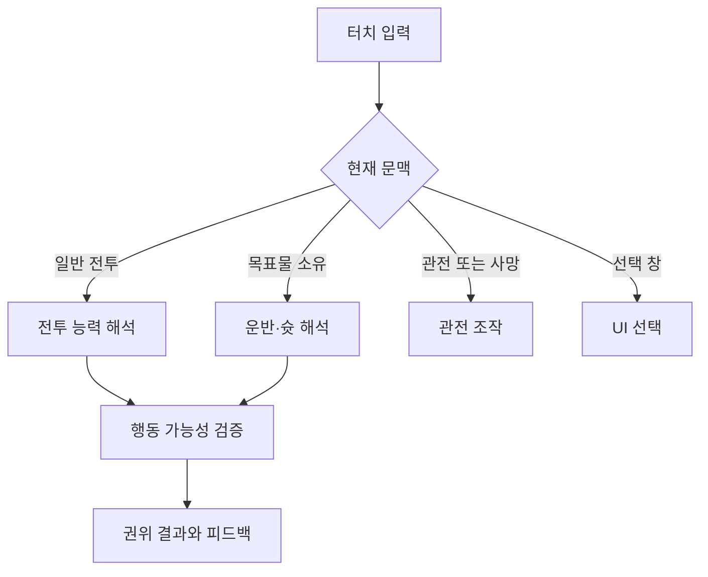

# 02. 조작·조준·카메라·전투 가독성

> 근거일: 2026-11-13. 기본 조작 분석과 재구현 설계를 분리한다.
> 원작의 입력 지연, 조이스틱 데드존, 자동 조준 가중치, 카메라 투영 수치는 공개 근거가 없어 확정하지 않는다.

## 1. 기능 범위

[해석] 이동과 조준을 동시에 수행할 수 있는 모바일 전투는 두 종류의 실력을 만든다.
하나는 상대 탄환을 피하면서 명중시키는 기계적 숙련이고, 다른 하나는 쏘지 않고 공간을 지키는 판단이다.
자동 조준은 전투 진입을 쉽게 만들지만, 예측 조준·엄폐 끝 조준·투척 위치 선정의 가치를 없애지 않는 방향으로 설계되어야 한다.

[공식] 공식 변경 안내에는 일반 공격·특수 공격과 유사하게 방향을 지정하는 가젯이 소개되어 있다.
탭 사용도 유지되므로 “모든 가젯은 방향 없는 버튼”이라는 과거 전제를 쓰지 않는다.[S1]
자동 조준 기능의 존재는 공식 밸런스 설명에서도 확인되지만, 표적 선택 알고리즘은 공개되지 않았다.[S2]

## 2. 입력을 행동 명령으로 해석하는 모델 [제안]

| 입력 | 의도 | 게임 명령 | 주요 검증 |
| --- | --- | --- | --- |
| 이동 패드 드래그 | 원하는 이동 방향 | MoveIntent | 기절·이동 금지·속도 |
| 공격 탭 | 빠른 대상 선택 | AutoAimRequest | 유효 표적·탄약 |
| 공격 드래그 후 놓기 | 방향/좌표 지정 | FireAt | 공격 종류·사거리 |
| 특수 공격 조작 | 자원 소비 능력 | CastSuper | 충전·봉쇄·전환 상태 |
| 가젯 탭/드래그 | 보조 능력 발동 | UseGadget | 가젯 종류·재사용 대기 |
| 강화 버튼 | 강화 창 사용 | ActivateHypercharge | 충전·중복 활성 |
| 공 소유 중 공격 | 패스/슛 | ObjectiveAction | 소유권·슛 정책 |
| 핀/스프레이 | 비언어 소통 | CosmeticSignal | 빈도·입력 충돌 |

원작의 화면 좌표와 정확한 제스처 임계치는 실기 검증 대상으로 남긴다.
동일한 버튼이 상황에 따라 다른 행동을 하므로 “입력 장치”와 “현재 제어 문맥”을 나누어야 한다.

## 3. 입력 문맥과 우선순위 [제안]



터치가 시작된 버튼이 손가락을 소유하게 하고, 화면을 가로질러도 다른 버튼으로 임의 전환하지 않도록 한다.
UI가 떠오르는 순간 이미 누르던 공격을 발사할지 취소할지는 별도 정책이다.
기기 회전·앱 백그라운드·터치 취소 이벤트는 손을 뗀 정상 발사와 구분하는 편이 안전하다.

## 4. 수동 조준의 정보 설계 [해석·제안]

조준선은 장식이 아니라 플레이어가 예상한 결과와 실제 결과를 연결하는 계약이다.

| 공격 형태 | 표시해야 할 정보 | 오해하기 쉬운 부분 |
| --- | --- | --- |
| 단일 직선 탄환 | 방향·유효 사거리·폭 | 폭이 보이지만 관통하지 않는 경우 |
| 산탄 | 확산 부채꼴·거리 | 최대 피해가 모든 거리에서 유지된다는 착각 |
| 연사 | 연사 축·예상 발사 시간 | 조준 중 이동으로 뒤 탄환 경로 변화 |
| 투척 | 도착 지점·범위·비행 경로 | 벽 너머 지점과 실제 착탄 차이 |
| 돌진 | 이동 경로·충돌 끝점 | 지형 통과와 적 관통의 혼동 |
| 충전 공격 | 충전 단계·범위 변화 | 최대 충전 직전/직후의 경계 |
| 반사 공격 | 첫 충돌과 가능한 반사 | 모든 연속 반사를 확정처럼 보여 주기 |

[미확인] 원작이 각 유형에서 정확히 어떤 범위를 미리 표시하는지는 브롤러별 스크린 캡처와 실기 비교가 필요하다.
재구현에서는 판정 함수와 조준 미리보기 계산을 최대한 공유하되, 비공개 적 위치를 미리보기에 사용하지 않는다.

## 5. 자동 조준 설계 [제안]

자동 조준의 목적을 “최적 공격을 대신 수행”보다 “급한 입력을 유효 행동으로 변환”으로 잡는다.
다음 요소를 후보 점수로 사용할 수 있지만 원작 공식은 아니다.

```text
candidateScore =
    wDistance * distancePreference
  + wAngle * currentFacingPreference
  + wVisibility * knownTargetPreference
  + wObjective * declaredTargetTypePreference

choose only from legally visible candidates
validate range and ability target type
if no candidate exists, use the explicitly chosen fallback policy
```

예측 조준의 정도를 높일수록 수동 조작과 차이가 줄어든다.
반면 자동 조준이 벽 뒤의 적을 반복 선택하면 초보자는 입력 실패로 인식한다.
모드 목표물·소환수·플레이어 중 누구를 우선하는지도 분리된 정책이 필요하다.

### 비교 실험

- 동일 위치의 정지 표적과 횡이동 표적에 대한 적중률 차이.
- 목표물과 플레이어가 겹쳤을 때의 선택.
- 숨겨진 대상과 방금 시야를 잃은 대상의 처리.
- 몸 방향과 이동 방향이 반대일 때의 기본 발사 방향.
- 충전형·투척형·연사형에서 자동 조준 효용 차이.

## 6. 좌표계와 카메라 [제안]

서버 세계 좌표와 각 플레이어의 화면 좌표는 분리한다.
플레이어 시점에서 우리 진영을 아래쪽으로 보여 주고 싶더라도, 서버 맵과 내비게이션 그래프를 뒤집을 이유는 없다.
화면 입력 벡터를 뷰 변환의 역변환으로 월드 벡터에 매핑하고, 결과 위치를 뷰 변환으로 표시하는 구조면 된다.

단순 반사 변환은 좌우 손잡이성이 바뀐다. 회전으로 구현할지 반사로 구현할지 명시하지 않으면
비대칭 탄환·삼각형 공격·곡선·회전 방향·발사 오프셋이 진영마다 달라질 수 있다.
이 설명은 재구현 제안이며 원작 카메라의 정확한 수학적 구현을 주장하지 않는다.

[공식] 2026년 8월 패치의 후속 수정에는 진영/미러 맵에 따른 탄환 위치·경로 문제 수정이 기록되어 있다.[S3]
이는 화면 방향을 바꾸는 기능에 대한 회귀 검증 필요성을 보여 주는 사례다.

## 7. 가독성 예산 [해석]

플레이어가 매 순간 읽어야 하는 것은 다음 네 가지로 압축할 수 있다.

1. 내가 지금 행동할 수 있는가.
2. 가장 가까운 치명적 위협은 무엇인가.
3. 팀 목표가 어디에서 변하고 있는가.
4. 전투를 지속할지 철수할지 결정할 자원이 남아 있는가.

화려한 강화 효과가 지면 위험 표시나 공 위치를 가리면 희귀도 연출이 경쟁적 정보 전달을 방해한다.
이동·피격·무적·보호막·은신·강화를 색 하나로 겹쳐 표현하지 않는 것이 좋다.
스킨 간 판정 인지 가능성은 기본 외형과 같은 검증 대상이다.

## 8. 상태·데이터 명세 [제안]

| 상태/데이터 | 설명 |
| --- | --- |
| InputCapture | 손가락 ID, 시작 컨트롤, 시작 시각 |
| AimIntent | 화면 방향, 월드 방향, 목표 좌표, 자동 여부 |
| ActionContext | 일반/목표물/변신/조종/관전 |
| CastFeedback | 수락, 자원 부족, 봉쇄, 목표 없음 |
| CameraState | 기준 위치, 줌, 회전, 안전 표시 영역 |
| VisibilitySnapshot | 현재 프레임의 합법적 표시 대상 |
| AccessibilityProfile | 패드 위치·크기·효과 강도 |

## 9. QA 시나리오

다음은 재구현 기대값이다. 원작의 미확인 세부 값은 여기서 확정하지 않는다.

| 사례 | 기대 결과 |
| --- | --- |
| 두 손가락이 서로 교차 | 이동과 공격 입력 소유권 유지 |
| 조준 중 앱 일시중단 | 복귀 직후 원치 않는 자동 발사 없음 |
| 공 습득과 공격 해제가 같은 순간 | 문맥 전환 순서에 따른 단일 행동 |
| 기절 중 슈퍼 버튼 누름 | 실패 이유 또는 버퍼 정책 명확 |
| 왼손 UI로 바꿈 | 세계 방향과 조준이 동일 |
| 두 진영에서 같은 상대 위치 입력 | 회전 변환 후 동일한 판정 |
| 조준선이 벽 가장자리에 접함 | 미리보기와 실제 충돌의 오차 제한 |
| 화면 밖 목표물 운반자 | 정보 공개 범위에 맞는 방향 표시 |
| 투사체 효과 대량 중첩 | 위험 표시와 목표물 가독성 유지 |
| 핀 메뉴에서 바깥 터치 | 닫기 동작과 전투 발사 중복 방지 |

## 10. 측정 지표와 출처

[제안] 입력 거부율, 잘못된 문맥 행동률, 자동/수동 조준 적중률, 기기별 UI 오조작률을 분리한다.
입력에서 표시까지의 지연과 입력에서 확정 판정까지의 지연은 다른 지표다.

- [S1: Buffies와 조준형 가젯 발표](https://supercell.com/brawlstars/en/blog/news/new-power-brawl-pass-changes-and-a-new-starr-drop-2/)
- [S2: 2025년 10월 패치](https://supercell.com/brawlstars/en/blog/game-updates/release-notes-october-2025/) — 자동 조준 언급. 일부 과거 페이지는 검색 색인으로 확인.
- [S3: 2026년 8월 패치](https://supercell.com/brawlstars/en/blog/release-notes/release-notes-august-2026/) — 미러 맵 수정 사례.
- [능력 시스템](04_abilities_loadout.md) · [네트워크](07_network_architecture.md) · [브롤 볼](../modes/02_brawl_ball.md)

