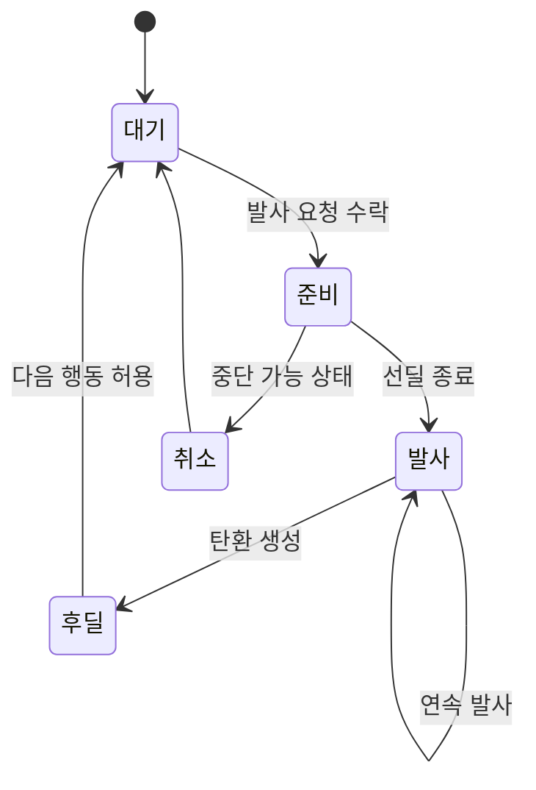

# 03. 전투·탄약·피해·회복·상태이상

> [공식] 확인된 기능과 [해석] 전투 경제, [제안] 재구현 판정 순서를 구분한다.
> 모든 브롤러의 정확한 수치표를 복제하는 문서는 아니다. 원작의 정수 반올림·프레임·충돌 순서·서버 틱은 미확인이다.

## 1. 전투를 세 개의 자원으로 읽기 [해석]

체력은 버틸 수 있는 실수의 크기, 탄약은 가까운 미래에 행사할 위협, 특수 능력은 교전 구도를 바꾸는 선택지다.
피해량만 높다고 라인을 지배하는 것은 아니다. 공격 후 다음 발사까지의 공백, 상대가 회복할 수 있는 공간,
벽과 수풀, 목표에 복귀하는 거리까지 합쳐져 실제 압박이 만들어진다.

장시간 평균 DPS와 첫 몇 발로 결정되는 폭딜은 따로 평가해야 한다.
한 번의 탄약으로 여러 투사체가 나가는 공격은 “공격 횟수”, “투사체 수”, “명중 수”가 일치하지 않는다.

## 2. 공통 전투 객체 [제안]

| 객체 | 책임 | 책임이 아닌 것 |
| --- | --- | --- |
| Combatant | 체력·자원·능력·상태 | 모드 승리 판단 |
| AttackInstance | 한 번의 공격 의도와 발사 생명주기 | 계정 성장 |
| Projectile | 이동·충돌·수명·타격 기록 | 최종 보상 |
| DamageEvent | 원인·대상·양·태그·적용 결과 | 킬 점수 직접 지급 |
| AreaEffect | 공간과 시간에 걸친 반복 효과 | 모든 틱 무조건 재타격 |
| StatusEffect | 이동·행동·받는 피해 변경 | 카메라 표현 단독 관리 |
| DeathEvent | 생존 상태 전환과 책임자 기록 | 리스폰 가능성 확정 |

공격자가 사망해도 이미 발사한 탄환을 유지할지, 소환수를 제거할지, 장판을 남길지는 공격 정의별 수명 정책으로 둔다.
모든 효과를 공격자 개체 파괴에 연결하면 정상적인 사후 타격까지 사라질 수 있다.

## 3. 공격 시간 구조 [제안]



다음 항목은 별도 값이어야 한다.

- 재장전: 소비한 자원 회복.
- 발사 간격: 같은 공격 묶음 안에서의 투사체 간 시간.
- 공격 간격: 다음 공격을 시작할 수 있는 시간.
- 충전 시간: 유지 입력에 따라 공격이 변하는 시간.
- 지속 시간: 이미 발동한 효과가 남아 있는 시간.

브롤러마다 탄약 구조가 다를 수 있으므로 최대 탄약을 공통 상수로 박아 넣지 않는다.
특수 자원·연속 에너지·되돌아오는 무기 등은 같은 인터페이스 아래 다른 자원 정책으로 표현할 수 있다.

## 4. 피해 판정 파이프라인 [제안]

```text
1. 공격 인스턴스와 대상이 유효한지 확인
2. 적대 관계, 무적, 타격 가능 태그 확인; 표적 선택 단계의 시야 조건과 실제 충돌의 피격 자격을 분리
3. 중복 타격 기록과 관통/반사 정책 확인
4. 기본 피해와 거리/충전/단계별 수정치 산출
5. 피해 감소와 방어막 정책 적용
6. 실제 HP 손실 및 흡수량 확정
7. 충전·흡혈·피격 반응에 사용할 결과 사건 생성
8. HP가 0 이하이면 사망을 한 번만 확정
9. 모드 규칙에 사건 전달
```

숨은 대상도 일반 투사체와 충돌해 피격될 수 있는 설계를 지원해야 한다. 타깃 지정 능력의 시야 조건을 모든 충돌 피해의 공통 조건으로 사용하지 않는다.

이 순서가 원작과 같다고 단정하지 않는다. 특히 보호막에 흡수된 피해가 충전이나 흡혈을 발생시키는지,
같은 순간 받은 여러 피해 중 누구에게 처치가 귀속되는지는 실기 검증이 필요하다.

### 비교용 피해 모델

D_raw = BaseDamage × RangeFactor × ChargeFactor × ModeFactor

D_hp = ApplyDefensePolicy(D_raw, shields, reductions, immunity)

이 식은 재구현 예시다. 모든 원작 수정치가 곱연산이라는 뜻은 아니다.
고정 피해, 최대 체력 비례 피해, 잃은 체력 비례 피해는 별도 연산 타입으로 선언하는 편이 명확하다.

## 5. 충돌과 탄환 유형 [해석·제안]

| 유형 | 기술상 필요 정책 | 전술상 의미 |
| --- | --- | --- |
| 직선 | 연속 충돌 검사, 최대 거리 | 열린 사선 압박 |
| 관통 | 타격 집합, 최대 관통 수 | 밀집 대형 처벌 |
| 산탄 | 다중 투사체와 개별 명중 | 근거리 폭발력 |
| 투척 | 지면 목표와 높이 표현 분리 | 엄폐 뒤 안전지대 공격 |
| 반사 | 표면 법선, 반사 수, 남은 거리 | 벽이 사선 확장 도구 |
| 귀환 | 출발·귀환 단계, 중복 타격 규칙 | 이동과 명중 경로 결합 |
| 추적 | 목표 상실·재선택 정책 | 회피와 엄폐 판단 |
| 장판 | 효과 틱과 진입·이탈 정책 | 공간·시간 통제 |

가장 빠른 탄환은 프레임 시작과 끝 위치만 검사하면 얇은 벽을 통과할 수 있다.
[제안] 구간 쓸기 검사와 안정된 충돌 우선순위를 사용하고,
벽 파괴와 탄환 도착이 같은 업데이트에 들어오는 경우를 회귀 사례로 보관한다.

## 6. 회복과 철수의 가치 [해석]

회복은 전투를 오래 끄는 기능만이 아니다. 안전하게 철수할 수 있는 위치의 가치를 만든다.
상대에게 작은 피해를 연속해서 넣는 행위는 단순 누적 피해보다 회복 기회 차단에서 의미가 생길 수 있다.
다만 원작의 자연 회복 대기 시간·초당 회복량·행동별 지연 초기화 조건은 여기서 임의로 채우지 않는다.

[제안] 회복은 자연 회복, 직접 치유, 지속 치유, 흡혈, 보호막 충전으로 구분한다.
치유 감소가 보호막 획득에도 영향을 주는지 같은 정책은 타입별로 명시한다.

## 7. 상태이상 상호작용 명세 [제안]

| 상태 | 주요 효과 | 별도 확인할 항목 |
| --- | --- | --- |
| 감속 | 이동 속도 변경 | 중첩·최소 속도·가속형 캐릭터 |
| 기절 | 행동 중단 | 이미 발사한 탄환·장판 |
| 넉백/끌어당김 | 강제 이동 | 벽·물·골라인·공 드롭 |
| 침묵 | 특정 능력 사용 금지 | 일반 공격과 목표 행동 포함 범위 |
| 속박 | 이동 입력 제한 | 돌진·점프 예외 |
| 은신 | 정보 노출 제한 | 피해·공격·근접·목표물 보유 |
| 변신 | 능력 집합 변경 | 체력 비율·탄약·보호 상태 계승 |
| 무적 | 피해 수신 금지 | 군중제어·픽업·점령 가능 여부 |

[공식] 특성은 피해·시간·근접·치유 등 다양한 계기로 특수 공격을 충전하거나 수면 이동 같은 능력을 제공한다.[S1]
따라서 충전을 “가한 HP 피해만 누적”하는 하나의 코드로 일반화하면 안 된다.

## 8. 사망·리스폰·보호 상태

[공식] 2026년 8월 패치에서 부활 보호가 공격·가젯·특수 공격·하이퍼차지 등 행동에 따라 해제되도록 바뀌었으며,
후속 수정에는 돌진·점프도 언급된다.[S2]
개별 모드의 리스폰 가능 여부와 초기 자원은 해당 모드 문서를 우선한다.

[제안] LifeId를 부여해 죽기 전 탄환과 새로 부활한 동일 플레이어를 구분한다.
무적과 피해 감소, 리스폰 보호는 서로 다른 효과 태그로 둔다.
“피해를 받지 않는다”는 공통 결과만 보고 목표물 획득과 군중제어 면역까지 묶지 않는다.

## 9. 밸런스 판단 [해석]

TTK는 상대 체력과 한 공격의 최대 피해를 나눈 값만으로 설명되지 않는다.
명중률, 재장전, 선딜, 사거리 유지, 회복, 엄폐가 실제 처치 시간을 바꾼다.
관측 TTK를 계산할 때 첫 피격부터 사망까지의 간격과, 한 교전 전체의 추격 시간을 따로 본다.

순수 피해 증가가 특수 공격 충전까지 가속하면 두 효과가 겹친다.
[제안] 피해와 충전 변경을 같이 기록하고, 능력 연쇄의 빈도와 최대 지속 압박 시간을 측정한다.

## 10. QA 시나리오

| 시나리오 | 제안 기대 결과 |
| --- | --- |
| 관통 탄환이 같은 대상을 여러 프레임 접촉 | 정의한 타격 간격 외 중복 피해 없음 |
| 벽 파괴와 반사 충돌 동시 | 고정된 사건 순서와 동일 리플레이 |
| 보호막으로 전량 흡수 | HP·흡수·충전 사건이 구분됨 |
| 두 공격이 동시에 치명타 | 사망 한 번, 처치 귀속 정책 일관 |
| 변신 중 지속 피해 | 유지/제거 정책에 따라 같은 결과 |
| 부활 직후 돌진 | 보호 해제 정책과 화면 표시 일치 |
| 공격자 사망 뒤 탄환 명중 | 공격 수명 정책에 따른 처리 |
| 치유와 피해 동시 | 정한 순서와 상한 적용, 음수 체력 오류 없음 |
| 장판 가장자리 반복 진입 | 진입 효과의 의도치 않은 연속 재발동 방지 |
| 수면 이동 캐릭터 넉백 | 착지 가능한 위치 또는 명시된 처리 |
| 프레임률이 다른 클라이언트 | 권위 피해량·횟수 동일 |
| 소환수 처치 | 모드 점수/충전 대상 분류 일치 |

## 11. 출처와 연결

- [S1: Brawler Traits](https://support.supercell.com/brawl-stars/en/articles/brawler-traits-7.html) — 특성 범주.
- [S2: Release Notes August 2026](https://supercell.com/brawlstars/en/blog/release-notes/release-notes-august-2026/) — 부활 보호 변경과 후속 수정.
- [가젯·능력](04_abilities_loadout.md) · [맵·시야](05_maps_terrain_vision.md) · [데이터·QA](08_data_rules_qa.md)

