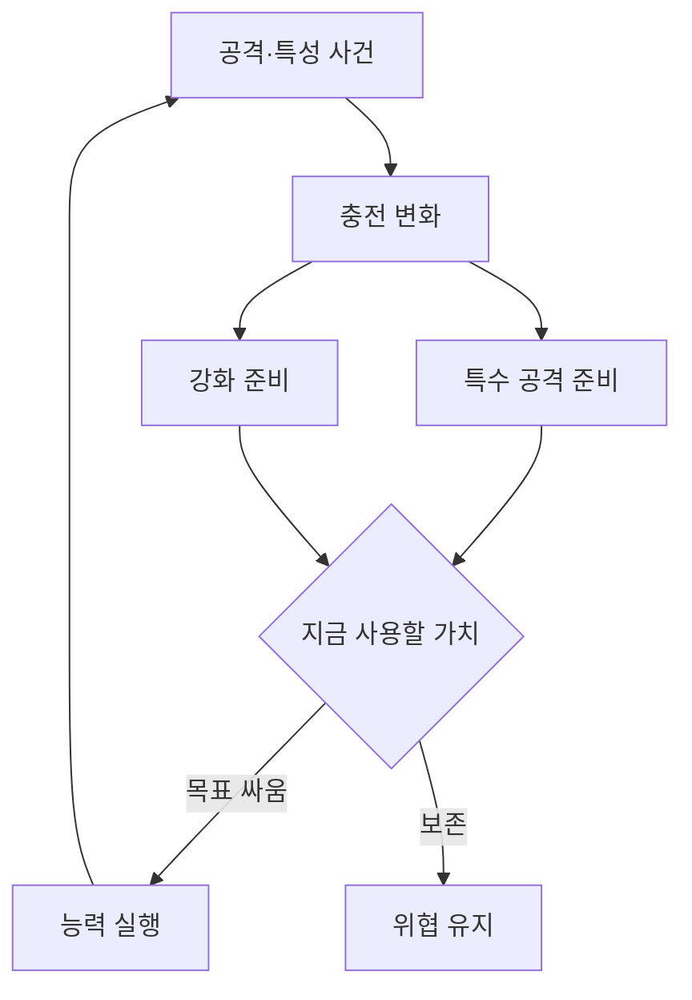

# 04. 브롤러 능력·로드아웃·가젯·기어·하이퍼차지·Buffies

> 기준일: 2026-11-13. 개별 브롤러의 수치·현재 강함 순위 대신 능력 구성과 상호작용을 분석한다.
> [공식] 최소 규칙, [해석] 의사결정 효과, [제안] 데이터화 명세. 브롤러 전체 도감은 범위 밖이다.

## 1. 구성 계층

[공식] 가젯은 현재 횟수 제한 대신 재사용 대기를 사용하며, 파워 7에서 사용 조건이 열린다.[S1]
스타 파워는 파워 9의 수동적 능력 선택이다.[S2]
하이퍼차지는 파워 11에서 사용하는 일시 강화로, 특수 공격과 전투 능력을 강화한다.[S3]
정확한 구매·획득 경로는 [성장 문서](09_roster_progression.md)에서 다룬다.

| 계층 | 분석상 역할 | 경기 전 선택 | 경기 중 판단 |
| --- | --- | --- | --- |
| 기본 공격 | 반복 교환의 성격 | 브롤러 선택에 포함 | 거리·조준·탄약 |
| 특수 공격 | 전투 국면 전환 | 브롤러 선택에 포함 | 지금 쓸지 다음 교전에 남길지 |
| 특성 | 고유 자원 획득/이동 규칙 | 브롤러 선택에 포함 | 유리한 상황 만들기 |
| 가젯 | 명확한 보조 행동 | 대안 중 선택 | 재사용 대기와 사용 창 |
| 스타 파워 | 플레이 방식 수정 | 대안 중 선택 | 조건을 만족시키는 행동 |
| 기어 | 상황 효율 보정 | 장착 선택 | 해당 조건 활용 |
| 하이퍼차지 | 일시적인 큰 위협 | 보유·사용 가능 상태 | 목표 순간에 맞춘 강화 |
| Buffies | 기존 능력의 추가 기능 | 소유 효과 적용 | 강화된 상호작용 활용 |

이 표의 “역할”은 본 문서의 분석이다. 모든 브롤러가 동일한 형태의 기본 공격·특수 공격을 갖는 것은 아니다.

## 2. 2026 기준에서 피해야 할 구버전 가정

| 오래된 가정 | 이 문서의 처리 |
| --- | --- |
| 가젯은 경기당 3번이 기본 | 현행 재사용 대기형으로 분석 |
| 가젯은 모두 방향 없는 순간 버튼 | 조준형·자원 소비형을 표현할 수 있게 설계 |
| 모든 기어 종류가 영구 유지 | Buffies 전환 대상별 변경을 버전 데이터로 관리 |
| 새 강화는 모두 독립 버튼 | 기존 능력을 변경하는 계층도 구분 |
| 미보유 능력은 데이터에 존재할 필요 없음 | 소유·장착·사용 조건을 별도 보관 |
| 선택 가능한 효과는 항상 대등 | 모드별 유효성 검증 필요 |

[공식] Buffies는 기존 가젯·스타 파워·하이퍼차지에 능력을 추가하는 구성으로 소개되었으며,
능력용과 외형용을 구분해야 한다.[S4]
출시 자료와 현행 획득 정책의 차이는 성장·경제 문서에서 기록한다.

## 3. 능력 설계의 핵심 계약 [제안]

하나의 AbilityDefinition에 모든 코드를 넣기보다 다음 계약을 분리한다.

| 계약 | 질문 |
| --- | --- |
| TargetingPolicy | 자신·방향·지점·유닛 중 무엇을 지정하는가? |
| CostPolicy | 탄약·충전·체력·별도 자원을 얼마나 쓰는가? |
| AvailabilityPolicy | 죽음·침묵·공 소유·변신 중 사용할 수 있는가? |
| ExecutionPolicy | 즉시·투사체·돌진·장판·소환 중 어떤 실행인가? |
| CooldownPolicy | 언제 시작하고 무엇으로 감소하는가? |
| InterruptPolicy | 취소 시 비용을 돌려주는가? |
| PersistencePolicy | 사망·라운드·변신 후 무엇이 남는가? |
| ReplicationPolicy | 누구에게 조준·준비·실행 정보를 보여 주는가? |

구현 제안이므로 실제 원작 클래스 구조와 무관하다.
능력 제작자는 “어떻게 화려하게 보이는가”에 앞서 이 표를 채워야 모드 예외와 충돌을 줄일 수 있다.

## 4. 가젯 재사용 대기가 만드는 변화 [해석]

횟수 자원은 한 경기 전체의 배분 문제를 만든다.
재사용 대기 자원은 교전 주기와 기다리는 시간의 문제를 만든다.
현재 구조를 분석할 때는 남은 총사용 횟수보다 “다음 목표 싸움까지 돌아오는가”가 중요하다.

이 변화는 강한 탈출기가 있는 브롤러를 공격할 때에도 영향을 준다.
상대가 막 탈출기를 사용했다는 정보는 잠시 동안 진입 가치를 높인다.
가젯 대기시간의 감소는 단순 사용 횟수 증가 외에, 적이 반격 가능한 공백을 줄이는 효과가 있다.

[제안] 가젯 가동률, 실제 유효 사용률, 실패 사용률, 탈출 뒤 생존 확률을 같이 기록한다.
무조건 자주 쓸 수 있게 하는 것보다 의미 있는 사용 창을 보존하는 것이 중요하다.

## 5. 특수 공격과 하이퍼차지의 연쇄 [해석·제안]



능력이 다음 능력을 얼마나 충전하는지에 따라 연속 압박이 만들어진다.
공격 피해, 표적 수, 충전 계수, 강화 지속시간을 따로 조정해도 조합 결과는 비선형일 수 있다.
다중 표적 모드는 같은 능력의 충전 경제를 크게 바꾼다.

[제안] 충전 입력을 피해 원인별로 집계하고 직접 공격·소환수·지속 피해·치유를 구분한다.
수치의 단위를 “퍼센트”, “고정 충전량”, “유효 명중 수” 중 무엇으로 쓰는지도 명확하게 한다.
원작 충전 계산식과 모든 예외는 미확인이다.

## 6. 로드아웃 선택의 분석 프레임 [해석]

| 조건 | 가치가 올라가는 능력 성격 | 확인할 비용 |
| --- | --- | --- |
| 좁은 통로 | 넉백·범위 억제·투척 | 열린 지도에서의 손해 |
| 보호 대상 존재 | 밀어내기·치유·견제 | 직접 목표 화력 감소 |
| 부활 없는 라운드 | 생존·정찰·확정 처치 | 자원 보존으로 인한 소극성 |
| 장기 시설 공격 | 지속 화력·탄약 회수 | 전선 복귀와 방어 능력 |
| 다수 팀 생존 | 이탈·정보·은신 | 막판 압축 공간의 한계 |
| 운반형 목표 | 이동·보호·진로 확보 | 운반 중 사용 제한 |

클래스 이름만으로 최적 로드아웃을 고르지 않는다.
같은 브롤러라도 사거리, 파괴 가능한 벽, 아군의 역할, 상대의 돌진 위협에 따라 선택이 달라진다.

## 7. 데이터 모델 [제안]

```text
BrawlerDefinition
  baseStats
  attackDefinition
  superDefinition
  traits[]
  supportedGadgets[]
  supportedStarPowers[]
  supportedGearSlots[]
  hyperchargeDefinition
  buffieModifiers[]

LoadoutSnapshot
  brawlerDefinitionVersion
  powerLevel
  selectedGadget
  selectedStarPower
  selectedGears[]
  ownedEnhancements[]
  normalizationRules
```

보유 상태와 사용 가능 조건을 분리하면, 낮은 파워에서 먼저 획득한 강화나
이벤트에서 임시로 최대 레벨을 제공하는 경우를 일관되게 처리할 수 있다.
일반전·경쟁전·이벤트에서 성장 정규화 방식이 같다고 가정하면 안 된다.

## 8. 효과 합성 규칙 [제안]

- 같은 종류의 속도 증가를 더할지, 곱할지, 가장 큰 값만 취할지 명시한다.
- 원본 능력 변경과 추가 능력 부여를 구분한다.
- 변신 전용 능력 ID와 공통 로드아웃 효과의 적용 대상을 분리한다.
- 스킨은 표현 정의를 교체하되 전투 정의를 교체하지 않게 한다.
- 조건부 강화의 시작·종료 사건을 남겨 재현 가능하게 한다.
- 쿨다운 환급은 전체 시간의 비율인지 남은 시간의 비율인지 단위를 기록한다.

## 9. QA 시나리오

| 사례 | 제안 기대 결과 |
| --- | --- |
| 쿨다운 종료와 발동 입력 동시 | 허용 경계가 클라이언트·서버에서 일치 |
| 가젯 조준 중 침묵 | 명시된 취소/버퍼 처리 |
| 자원 소비 가젯에 탄약 부족 | 효과 없이 실패 사유 표시 |
| 변신 중 Buffie 효과 발동 | 대상 형태와 수명 정책에 맞게 적용 |
| 일시 최대 레벨 이벤트 | 경기 종료 뒤 계정 성장값 보존 |
| 같은 강화 효과 중복 사건 | 중첩 정책에 따른 한 상태 |
| 사망 뒤 충전 환급 도착 | LifeId·보존 정책으로 처리 |
| 보유했지만 사용 레벨 미달 | UI에 소유와 사용 불가를 함께 표시 |
| 미지원 브롤러에 하이퍼차지 요청 | 데이터 검증 실패, 유효하지 않은 실행 금지 |
| 일반 공격이 슈퍼를 충전하지 않는 특성 | 정의된 다른 충전 정책 적용 |

## 10. 출처와 다음 문서

- [S1: Gadgets](https://support.supercell.com/brawl-stars/en/articles/gadgets-4.html)
- [S2: Star Powers](https://support.supercell.com/brawl-stars/en/articles/star-powers-3.html)
- [S3: Hypercharges](https://support.supercell.com/brawl-stars/en/articles/hypercharge-5.html)
- [S4: Buffies](https://support.supercell.com/brawl-stars/en/articles/buffies.html)
- [성장](09_roster_progression.md) · [역할과 밸런스](06_team_roles_balance.md) · [전투](03_combat_damage.md)

