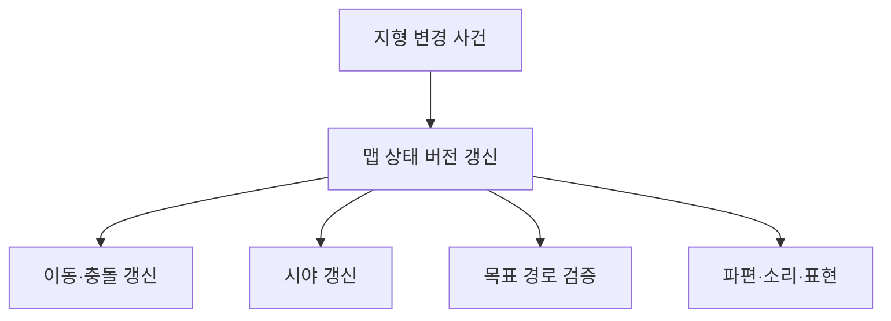

# 05. 맵·지형·시야·목표 배치·맵 메이커

> 기준일 2026-11-13. 맵 이름이나 현재 로테이션 전체를 고정하는 문서가 아니다.
> 지형의 정확한 내부 타일 단위·충돌 형태·시야 반경·풀 재생 시간은 실기 미검증이다.

## 1. 맵은 능력의 가치 변환기다 [해석]

같은 브롤러가 좁은 통로, 긴 사선, 수풀 밀집, 넓은 목표 구역에서 서로 다른 가치를 가진다.
맵은 배경 그림이 아니라 각 능력의 사거리·이동·공간 제어를 실제 의사결정으로 바꾸는 시스템이다.
목표와 출발 지점 사이의 거리는 사망 비용이 되고, 우회로의 길이는 팀이 동시에 압박할 수 있는 각도를 결정한다.

[공식] 공식 클래스 설명은 투척형의 엄폐 너머 공격, 저격형의 원거리 교전, 컨트롤러의 공간 장악을 구분한다.[S1]
다음 분석은 그 역할을 맵 구조와 연결한 역설계다.

## 2. 지형을 속성으로 분리하기 [제안]

| 요소 | 이동 | 탄환 | 시야 | 파괴/변형 | 설계상 용도 |
| --- | --- | --- | --- | --- | --- |
| 기본 바닥 | 일반 이동 | 공격 정의에 따름 | 기본 | 보통 유지 | 교전 공간 |
| 벽 | 일반 이동 차단 | 공격 태그에 따름 | 별도 규칙 | 벽 종류에 따름 | 사선과 경로 분리 |
| 수풀 | 대개 통과 | 별도 차단 아님 | 은폐 정책 | 제거/생성 가능성 | 접근 정보 제한 |
| 물 | 이동 능력에 따름 | 공격 정의에 따름 | 은폐와 분리 | 맵 정의 | 경로 비대칭 |
| 점프/이동 장치 | 지정된 이동 | 독립 | 독립 | 장치별 | 빠른 복귀·위험한 진입 |
| 목표 구역 | 진입 검출 | 독립 | 공개 표시 | 모드 소유 | 점령·탈출·득점 |
| 생성물 | 형태별 | 형태별 | 형태별 | 수명·체력 | 전투 중 지도 변화 |

표는 원작의 모든 타일 규칙을 단정하는 것이 아니라 데이터 모델의 구분이다.
“벽이므로 시야 차단” 또는 “물이므로 모든 투사체 차단”처럼 하나의 속성으로 모든 기능을 결정하지 않는다.

[공식] 수면 위를 이동하는 특성이 있는 브롤러들이 존재한다.[S2]
따라서 이동 가능 여부는 타일과 캐릭터 능력의 조합으로 판단해야 한다.

## 3. 맵을 읽는 다섯 개의 층 [해석]

1. 목표 층: 어디를 점유하거나 공격해야 이기는가.
2. 연결 층: 출발점에서 목표로 향하는 독립 경로가 몇 개인가.
3. 사선 층: 어느 위치에서 어떤 경로를 동시에 공격할 수 있는가.
4. 은폐 층: 정보 없이 들어가야 하는 경계가 어디인가.
5. 변화 층: 벽 파괴·이동 장치·가스·목표 진행이 위 네 층을 어떻게 바꾸는가.

단순히 좌우 대칭인지 확인하는 것으로 공정성이 보장되지는 않는다.
같은 이동 거리라도 회복할 수 있는 엄폐, 조준하기 쉬운 배경, 능력의 방향성, 카메라 여백이 다르면 실질 이점이 생긴다.

## 4. 라인·중앙·측면 [해석]

| 위치 | 유효 행동 | 실패 비용 |
| --- | --- | --- |
| 중앙 | 정보 공유, 양쪽 지원, 핵심 목표 접근 | 집중 공격과 퇴로 차단 |
| 측면 | 교차 사선, 상대 후퇴 경로 압박 | 팀과 분리, 장거리 복귀 |
| 후방 | 회복, 목표물 보호, 재정렬 | 목표 접촉권 상실 |
| 전방 | 상대 진입 차단, 부활 위치 압박 | 과진입 시 전체 라인 붕괴 |

라인은 지도에 그어진 고정 직업이 아니다.
상대가 이동하거나 벽이 파괴되면 역할과 안전한 위치도 바뀐다.
따라서 “미드/레인” 분석을 캐릭터 지정의 정답으로 제시하지 않고, 목표에 대한 책임 분담으로 사용한다.

## 5. 파괴 가능한 지형의 의미 [해석·제안]

벽 파괴는 공격 피해와 별개로 미래 전투의 가치 순서를 바꾼다.
장거리 사선을 열면 저격 성격의 공격이 강해질 수 있고, 근거리 접근 경로가 사라질 수 있다.
수풀 제거는 적 위치에 대한 불확실성을 낮추지만 자기 팀의 우회 경로도 줄일 수 있다.

[제안] 파괴 사건은 충돌·이동 연결·시야·시각 효과에 하나의 상태 변경으로 전달한다.
잔해의 시각 물리는 경쟁 판정과 분리하면 표현 부하를 줄이면서 규칙을 안정적으로 유지할 수 있다.
이는 원작의 기술 구현이 아니라 유사 게임 제작에 대한 제안이다.

## 6. 시야와 정보 권한 [제안]

Visibility는 보일지 말지의 단일 bool보다 다음 상태로 나눌 수 있다.

- 직접 확인: 현재 합법적인 시야 안에 존재.
- 최근 확인: 마지막 위치 정보만 기억.
- 효과로 감지: 표식·능력 등 허용된 경로로 확인.
- 숨김: 위치를 UI와 자동 조준에 사용하지 않음.
- 팀 정보 공유: 아군이 제공하는 정보 범위.

숨겨진 적이 “표시만 안 되는” 상태로 계속 클라이언트에 전달되면 정보 유출 가능성이 커진다.
필요한 정보만 전송하는 설계는 예측·관전·리플레이 요구와 함께 검토해야 한다.
원작의 관심 영역·암호화·시야 전송 방식은 공개 검증하지 않았다.

## 7. 모드별 공간 요구

| 모드 성격 | 맵 검토의 핵심 |
| --- | --- |
| 수집·운반 | 생성 지점→후퇴 지점의 안전도와 운반자 노출 |
| 골·공 | 골 앞 폭, 패스 사선, 수비 복귀, 반사 표면 |
| 시설 파괴 | 접근 시간, 방어/공격 전환 비용, 장거리 직접 사격 |
| 점령 | 각 목표의 독립 접근, 점령 안팎의 엄폐 차이 |
| 생존 | 초기 파밍 밀도, 가스 압박, 마지막 안전 구역 |
| 다수 팀 | 두 팀 이상에게 동시에 노출되는 위치 비중 |
| PvE | 적 생성 가독성, 회피 공간, 보호 시설 주변 동선 |
| 호위 | 이동 목표와 수비 지형이 만나는 순서 |

## 8. 맵 메이커와 UGC

[공식] 맵 메이커는 모드·테마를 고르고 배치물을 구성하는 사용자 맵 기능이다.
공개 안내는 최소 총 트로피 1,000과 저장 가능한 맵 5개를 설명한다.[S3]
승인·게시·후보·당선은 별도의 단계이며, 상세 운영 조건은 서비스 설정으로 관리하는 편이 적절하다.

[제안] 유효성 검사는 문법과 플레이 가능성을 분리한다.

| 검사 | 예시 |
| --- | --- |
| 구조 | 필수 스폰과 목표 존재, 영역 범위 |
| 연결 | 각 팀이 목적지에 도달 가능 |
| 안전 | 생성 직후 회피 불가능한 사망 구간 |
| 공정성 | 진영별 최단 도달 시간과 시야 차이 |
| 콘텐츠 | 금칙 표현과 공개 메타데이터 |
| 성능 | 생성물 수·효과 밀도·경로 갱신 비용 |

플레이 가능한 맵과 경쟁전에 적합한 맵은 같은 기준이 아니다.
즐거운 실험 맵을 과도하게 표준화하지 않되, 보상이 연결되는 공개 대회에서는 추가 기준을 적용한다.

## 9. 데이터 명세 [제안]

MapDefinition은 타일 레이어, 경계, 스폰, 목표 앵커, 이동 장치, 환경 테마를 갖는다.
MapRuntime은 파괴된 위치, 생성 지형, 현재 가스, 장치 상태, 버전 번호를 갖는다.
Ruleset은 해당 맵에서 활성화할 목표와 점수 정책을 지정한다.
맵 파일만 보고 승리 조건을 추정하지 않는다.

## 10. QA와 계측

| 사례 | 제안 기대 결과 |
| --- | --- |
| 벽 파괴 직후 같은 위치 통과 | 이동·시야·탄환 판정이 같은 버전 사용 |
| 물 통과 특성과 일반 캐릭터 | 접근 가능 경로가 캐릭터 정책에 맞음 |
| 숨은 적 근처 자동 조준 | 비공개 위치를 이용하지 않음 |
| 두 진영 대칭 입력 | 사선과 도착 시간 비교 가능 |
| 목표물이 이동 불가 위치에 떨어짐 | 복구/재배치 정책 작동 |
| 맵 수정 후 이전 승인 | 승인 무효화 여부를 명확히 적용 |
| 극단적인 수풀 밀도 | 가독성·성능·정보 규칙 검증 |
| 장치로 목표 구역 건너뛰기 | 규칙에서 허용한 득점 경로만 인정 |

[제안] 진영별 승률, 첫 목표 도착 시간, 사망 위치 밀도, 장거리 사선 점유,
상대 스폰 진입 빈도, 클래스별 성과를 같이 본다.
승률 50% 하나만으로 어느 팀에게도 즐거운 맵인지 판단하지 않는다.

## 11. 출처

- [S1: Brawler Classes](https://support.supercell.com/brawl-stars/en/articles/brawler-classes.html)
- [S2: Brawler Traits](https://support.supercell.com/brawl-stars/en/articles/brawler-traits-7.html)
- [S3: About Map Maker](https://support.supercell.com/brawl-stars/en/articles/about-map-maker.html)
- [Map Statuses](https://support.supercell.com/brawl-stars/en/articles/map-statuses-2.html)
- [역할·밸런스](06_team_roles_balance.md) · [조작·카메라](02_controls_camera.md)

