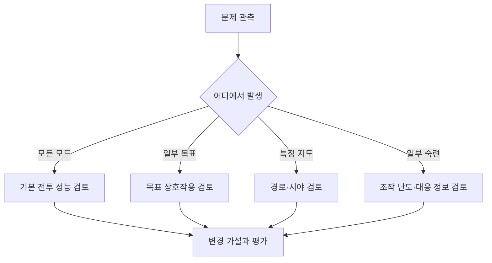

# 06. 팀 역할·조합·상성·밸런스

> 브롤러의 현재 티어리스트가 아닌 모드·맵·조합을 분석하는 체계다.
> 승률·선택률·매출·매치 로그를 수집하지 않았으며 실측 수치처럼 보이는 가상 통계를 제시하지 않는다.

## 1. 공식 클래스와 실제 역할의 분리

[공식] 클래스에는 Damage Dealer, Assassin, Marksman, Artillery, Tank, Support, Controller가 있다.[S1]
이는 캐릭터의 전투 성격을 설명하는 출발점이다.
[해석] 모드에서 맡는 운반·수비·진입·정찰·라인 유지 역할은 클래스와 일대일 대응하지 않는다.

| 전투 성격 | 분석상 강점 | 비용 또는 제약 |
| --- | --- | --- |
| 피해 교환 | 상대의 진입을 손해로 만듦 | 사거리·엄폐 조건 |
| 빠른 진입 | 고립된 대상에게 위협 | 진입 뒤 탈출과 실패 비용 |
| 원거리 압박 | 접근 전에 자원을 소모시킴 | 좁은 공간과 시야 제한 |
| 엄폐 너머 공격 | 상대 안전지대 제한 | 직접 진입에 대한 대응 |
| 피해 흡수 | 전선 유지와 아군 공간 확보 | 상대에게 충전 기회 제공 가능성 |
| 회복·강화 | 동료의 유효 전투 시간을 늘림 | 동료가 활용하지 못하면 효율 감소 |
| 공간 통제 | 목표 접촉·진입 시간을 제한 | 좁히지 못하면 직접 처치 부족 |

표는 공식 상성의 고정 승패표가 아니다. 실제 결과는 사거리, 능력 상태, 지형과 실력에 의존한다.

## 2. 조합을 책임으로 설계하기 [해석]

좋은 조합을 “다른 클래스 세 개”로 정의하기 어렵다.
아래 책임 중 누가 무엇을 맡는지 명확한 조합이 판단하기 쉽다.

- 첫 교전 공간을 확보하는 사람.
- 적의 강제 진입을 끊는 사람.
- 팀 목표를 안전하게 보관하거나 진행하는 사람.
- 적의 실수를 확정 점수로 전환하는 사람.
- 불리할 때 안전한 재집결 경로를 만드는 사람.

한 브롤러가 여러 책임을 맡을 수 있고, 경기 중 책임이 바뀔 수 있다.
공 운반자가 패스한 직후 공격 역할로 돌아오는 것처럼 역할 전환도 중요한 숙련이다.

## 3. 모드에 따른 같은 교환의 가치

| 행동 | 생존·탈락형 | 무한 부활 점수형 | 시설 공격형 | 운반형 |
| --- | --- | --- | --- | --- |
| 1대1 동시 사망 | 남은 팀 구성에 큰 영향 | 점수 차 변화 확인 | 시설 공격 시간 상실 | 물건 위치·회수 가능성이 핵심 |
| 상대 둘에게 피해 | 마무리 가능성 중요 | 회복 차단과 연속 점수 | 수비 인원 이탈 유도 | 운반 경로 확보 |
| 혼자 깊게 진입 | 팀 수적 열세 위험 | 점수 헌납 위험 | 시설 피해와 귀환 비용 교환 | 운반자 분리 기회 |
| 생존 위해 후퇴 | 다음 교전 자원 보존 | 상대 점수 방지 | 시설에 압박 전가 가능 | 보유 가치 보존 |

“잘 싸운다”는 평가가 모드마다 달라져야 한다.
킬·피해 통계만 강조하면 목표를 수행한 플레이어가 평가에서 사라진다.

## 4. 상성의 네 가지 수준 [해석]

1. 캐릭터 대 캐릭터: 사거리·진입·생존 도구의 관계.
2. 능력 대 능력: 돌진을 끊는 제어기, 장판을 회피하는 이동기.
3. 조합 대 조합: 아군이 한 캐릭터의 약점을 대신 메울 수 있는가.
4. 조합 대 맵·목표: 그 약점을 감수할 만큼 목표 수행 가치가 큰가.

예를 들어 원거리 공격에 약한 근접 캐릭터라도 안전한 접근 경로와 아군 회복이 있으면 다른 결과가 나온다.
이를 클래스 이름만으로 설명하면 밸런스 수정 대상이 잘못 선택될 수 있다.

## 5. 밸런스 조정의 인과관계 [제안]

승률이 높다는 사실과 왜 높은지는 다른 문제다.
유행하는 카운터가 줄었는지, 숙련자가 주로 선택하는지, 신캐릭터를 상대하는 지식이 부족한지 확인해야 한다.
[제안] 변경 전후를 같은 모드·맵·실력·성장·파티 조건으로 비교한다.

## 6. 조정 수단별 위험

| 조정 | 기대 효과 | 부작용 |
| --- | --- | --- |
| 피해 증가 | 처치 성공률 상승 | 특정 체력 경계에서 한 발 감소 |
| 재장전 개선 | 지속 압박 상승 | 회복 기회와 탄약 읽기 약화 |
| 탄환 크기 증가 | 명중 일관성 상승 | 회피 숙련의 보상 감소 |
| 이동 개선 | 진입·회피·복귀 모두 상승 | 여러 모드에서 광범위한 영향 |
| 제어 시간 증가 | 확정 연계 강화 | 상대 조작권 상실 증가 |
| 충전 개선 | 특수 공격 빈도 증가 | 연속 충전으로 압박이 비선형 증가 |
| 목표 대상 계수 | 특정 모드만 조절 | 규칙 설명 복잡도 증가 |
| 벽/맵 수정 | 사거리·접근 환경 변경 | 많은 캐릭터 동시 영향 |

한 번에 많은 축을 바꾸면 원인을 평가하기 어렵다.
긴급한 문제를 제한한 뒤 장기적으로 능력의 목적과 약점을 재정의하는 절차가 유용하다.

## 7. 성장 차이와 실력 차이 [해석]

영구 성장 차이는 동일한 명중 패턴의 결과를 바꿀 수 있다.
실력 차이는 명중·피해 회피·자원 낭비·목표 판단의 빈도를 바꾼다.
둘을 섞어서 매치메이킹의 문제 또는 브롤러의 강함으로 단정하지 않는다.

[제안] 분석 데이터에는 파워, 장비, 사용 가능한 강화, 계정 경험, 플레이한 브롤러 경험을 함께 남긴다.
실제 매치메이킹 공식은 [13 문서](13_matchmaking_trophies.md)의 공식 확인 범위와 미공개 범위를 따른다.

## 8. 지표 정의 [제안]

| 지표 | 정의 | 해석 주의 |
| --- | --- | --- |
| 조합별 승률 | 동일 모드·맵·범위에서의 승리 비중 | 적은 표본 |
| 선택률 | 선택 가능한 상황 대비 실제 선택 | 보유율·퀘스트 영향 |
| 금지율 | 금지 가능한 드래프트 대비 금지 | 불쾌감과 강함은 다를 수 있음 |
| 목표 전환율 | 유리한 교전 후 점수 획득 비중 | 모드별 정의 필요 |
| 수적 우위 유지 | 상대 탈락 뒤 이득을 유지한 시간 | 전략적 후퇴를 오해하지 않기 |
| 실패 진입 비용 | 진입 후 사망·목표 상실 | 공격 역할의 필연적 위험 |
| 대응 가능 시간 | 위험 예고부터 대응 불가까지 | 네트워크·기기 영향 |
| 피해 집중도 | 소수 능력이 총결과를 지배하는 정도 | 다양한 모드의 서로 다른 단위 |

## 9. 밸런스 검증용 매트릭스 [제안]

다음 상황에서 한 캐릭터의 강점이 정상적으로 드러나고, 명시한 약점도 남아 있는지 본다.

- 열린 맵과 엄폐가 많은 맵.
- 부활이 있는 모드와 없는 모드.
- 단일 목표와 여러 목표.
- 낮은 성장과 정규화된 성장.
- 단독 참가와 조직된 파티.
- 자동 조준 중심과 예측 조준 중심.
- 적 한 명과 적 다수가 겹친 상황.
- 목표물 공격과 플레이어 공격.

## 10. QA 시나리오

| 시나리오 | 제안 기대 결과 |
| --- | --- |
| 피해만 변경한 패치 | 충전량 변화를 별도로 확인 |
| 강화 없는/있는 동일 브롤러 | 장비 효과가 로그에서 분리됨 |
| 특정 맵에서만 높은 성과 | 일반 성능 변경 전에 지형 원인 검토 |
| 인원수 증가 | 광역·치유·충전의 표적 수 효과 확인 |
| 성장 정규화 이벤트 | 계정 수치 차이 제거 검증 |
| 같은 클래스 세 명 조합 | 금지보다 역할 결핍을 분석 |
| 신규 능력 직후 승률 변화 | 학습 기간과 장기 성과 분리 |
| 보상 퀘스트 도입 | 선택률 변화의 경제적 원인 기록 |

## 11. 출처와 연결

- [S1: Brawler Classes](https://support.supercell.com/brawl-stars/en/articles/brawler-classes.html) — 공식 분류명.
- [Brawler Traits](https://support.supercell.com/brawl-stars/en/articles/brawler-traits-7.html) — 클래스와 별개인 고유 특성.
- [능력](04_abilities_loadout.md) · [경쟁전](12_ranked_draft.md) · [모드 비교](../02_mode_comparison.md)

