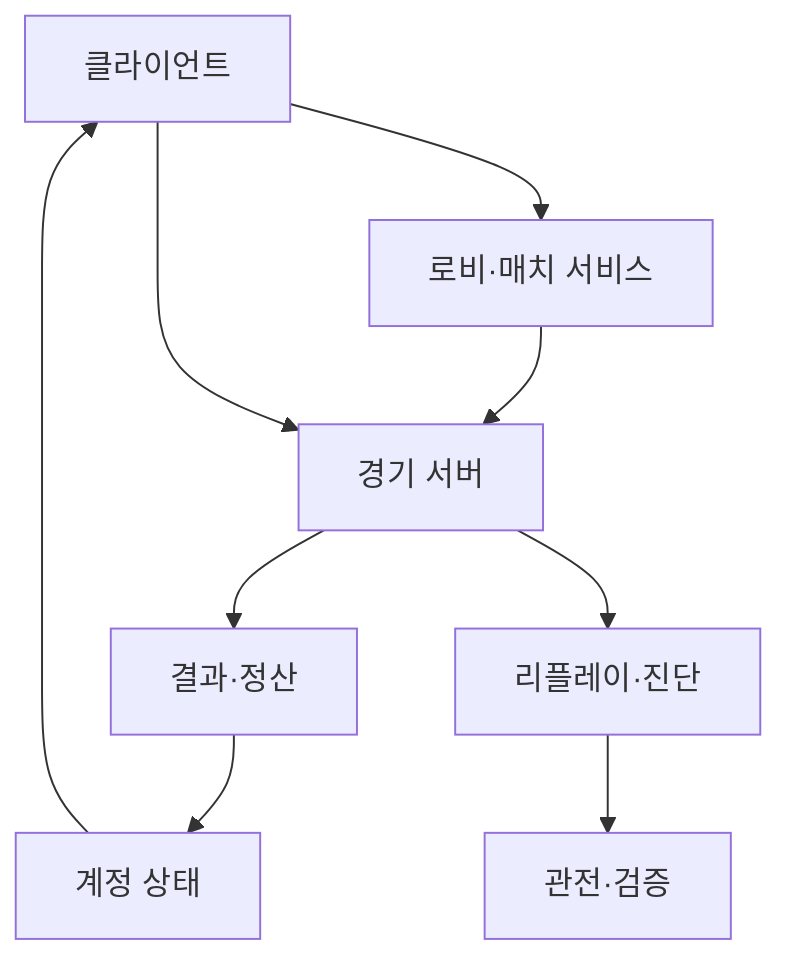

# 07. 네트워크·권위 판정·재접속·관전·기술 구조

> 이 문서의 아키텍처·프로토콜·틱·이벤트 순서는 모두 재구현 제안이다.
> 원작 소스·패킷·서버 프로파일을 분석하지 않았다. 특정 네트워크 엔진, 틱률, 물리 엔진, 보정 알고리즘을 원작 사실로 제시하지 않는다.

## 1. 공식으로 확인되는 범위

[공식] 브롤스타즈는 지역 서버를 사용하며, 매칭 사정이나 다른 지역의 친구와의 플레이에 따라
다른 적절한 서버로 연결될 수 있다고 설명한다.[S1]
이 사실만으로 서버 권위의 세부 구조나 지연 보상 방식을 증명할 수는 없다.

이하 설계는 다수의 경쟁 모드가 같은 전투를 공유하는 게임을 새로 구현할 때의 권장 분해다.

## 2. 권위의 분리 [제안]

| 항목 | 권위 주체 | 클라이언트의 역할 |
| --- | --- | --- |
| 이동·피해·자원 | 경기 서버 | 입력, 예측, 보정 표시 |
| 목표물 소유·득점 | 경기 서버 | 일시 피드백과 확정 상태 표시 |
| 전투 종료 | 경기 서버 | 결과 연출 |
| 재화·보상 | 계정/정산 서비스 | 진행 상태 표시 |
| 장비·소유권 | 계정 서비스와 시작 스냅샷 | 선택 요청 |
| 파티·대기열 | 로비/매치 서비스 | 참가·취소 |
| 리플레이 | 결과와 연결된 기록 | 재생·시점 변경 |

클라이언트가 명중했다고 주장하는 위치를 그대로 최종 피해로 사용하면 조작·지연의 영향을 통제하기 어렵다.
반대로 모든 표현을 서버 응답까지 멈추면 조작감이 떨어진다.
행동의 즉시 표시와 결과의 권위를 나누는 것이 핵심이다.

## 3. 제안 구성도



서비스를 실제로 몇 개의 프로세스에 배치할지는 규모와 운영 요구에 따라 다르다.
상자 하나가 반드시 별도 서버나 별도 마이크로서비스를 뜻하지 않는다.

## 4. 서버 전투 업데이트 [제안]

```text
receive validated input intents
advance authoritative match clock
resolve allowed actions using current life and phase
simulate movement and projectile segments
apply combat effects in a stable order
emit deaths, pickups and objective events
evaluate mode-specific terminal rules
publish state delta and acknowledged input sequence
```

같은 시간에 발생하는 치명적 피해와 목표 습득, 득점과 시간 종료는 모드별 규칙이 정한 순서로 처리한다.
모든 사건을 네트워크 도착 순서만으로 결정하면 더 빠른 연결이 우선권을 얻을 수 있다.
정확한 시간 양자화와 동률 정책은 게임의 공정성 정의와 함께 설계한다.

## 5. 입력·상태 데이터 [제안]

| 패킷/사건 | 필요한 식별 | 목적 |
| --- | --- | --- |
| InputIntent | playerId, inputSeq, lifeId, phaseId | 오래되거나 중복된 입력 구분 |
| ActionResult | actionId, accepted, reason | 예측 행동의 수락/거부 |
| StateSnapshot | serverTime, snapshotId, ruleVersion | 상태 보간·복구 |
| ObjectiveEvent | eventId, objectiveId, sequence | 점수와 소유권 순서 |
| MatchResult | resultId, finalStateHash, outcome | 최종 결과 단일성 |
| RejoinState | phase, participants, objectives, timers | 재접속 복원 |

클라이언트 시간은 관측 정보이며 서버 시간의 대체가 아니다.
입력 sequence와 gameplay event sequence는 목적이 다르므로 하나의 카운터로 합치지 않는다.

## 6. 예측과 보정 [제안]

자기 이동은 입력 반응이 중요하므로 로컬 예측 후 서버 상태로 보정할 수 있다.
상대 이동은 수신 상태 사이를 보간하고, 수신 공백에서 무제한 외삽하지 않게 한다.
빠른 탄환이나 점프·순간이동·강제 이동은 일반 이동 보간과 다른 처리 경로가 필요하다.

피해 숫자, 처치, 목표물 소유권은 되돌림 비용이 크다.
예측 연출을 하더라도 확정 전에는 보상·승패·다음 단계로 전이하지 않도록 한다.
원작이 이러한 기법을 사용한다고 단정하지 않는다.

### 핵심 선택

| 선택 | 장점 | 비용 |
| --- | --- | --- |
| 단순 서버 위치 보간 | 구현·복구 단순 | 자기 입력 반응 저하 |
| 자기 입력 예측 | 조작감 개선 | 충돌·상태 보정 복잡도 |
| 과거 상태 기반 명중 검증 | 지연 차이 완화 가능 | 엄폐 뒤 피격과 공정성 논쟁 |
| 결정적 재시뮬레이션 | 재현성과 기록 효율 | 수학·자료형·버전 통제 비용 |
| 상태 중심 리플레이 | 구현 유연성 | 저장량·세부 원인 재현 한계 |

## 7. 공·퍽과 물리 [해석·제안]

[공식] 2026년 4월 패치는 브롤 볼·브롤 하키의 공/퍽 계산을 물리 기반으로 변경했다고 설명한다.[S2]
이것이 특정 상용 물리 엔진 사용이나 완전 결정성을 뜻하지 않는다.

재구현에서 공의 위치는 경쟁 목표이므로 시각 파편보다 높은 정합성이 필요하다.
서버가 공의 충돌·득점·소유권을 확정하고, 클라이언트는 부드러운 표시를 담당하도록 분리할 수 있다.
아무리 자연스러운 물리라도 골라인 교차와 소유 전환은 명시적인 게임 규칙이 필요하다.

## 8. 재접속과 유실 처리 [제안]

- 연결이 끊겨도 기존 참가자의 slotId를 유지한다.
- 대체 봇이 있는지와 조작권을 언제 돌려주는지는 별도 정책이다.
- 복귀자는 전체 상태 스냅샷과 이후 증분을 순서대로 적용한다.
- 라운드 준비 중 복귀와 진행 중 복귀는 허용 행동이 다르다.
- 중복 세션은 한 명의 참가자를 동시에 조작하지 못하게 한다.
- 결과가 이미 확정되었다면 경기 복귀 대신 결과와 정산 상태를 제공한다.

원작의 대체 봇 투입 시점·제어 정책은 이 문서에서 확인하지 않았다.

## 9. 관전·리플레이·진단 [제안]

관전은 경기 참가자에게 없는 정보가 노출될 수 있으므로 권한·지연 정책을 따로 둔다.
공개 관전의 지연 시간은 운영 선택이며 임의의 초 값을 원작 값으로 제시하지 않는다.
리플레이에는 규칙 버전, 맵 버전, 브롤러 정의, 초기 난수 시드 또는 결과 상태, 입력/사건 기록이 필요하다.

같은 경기 기록을 새 밸런스 데이터로 재생하면 다른 결과가 나올 수 있다.
이전 버전을 보관하거나 상태 기반 재생으로 표현하고, 원본 판정 재현과 영상 재생을 구분한다.

## 10. Unreal 등으로 재구현할 때의 경계 [제안]

| 책임 | 가능한 구현 위치 |
| --- | --- |
| 매치 단계·승리 정책 | GameMode 또는 독립 Ruleset 객체 |
| 공개 경기 상태 | GameState/목표 상태 복제 |
| 플레이어별 경기 정보 | PlayerState |
| 이동·능력 | Pawn/Component 및 전투 모델 |
| 계정 성장·정산 | 경기 월드 밖 서비스 |
| HUD·조준 | 로컬 UI와 입력 계층 |
| 파편·카메라 흔들림 | 클라이언트 표현 계층 |

엔진 기본 Actor 복제를 모든 탄환·이펙트에 적용할지는 계측으로 결정한다.
2D 경기 규칙을 엔진 전체 물리에 맡기는 것과 명시적인 전투 모델을 사용하는 것은 다른 선택이다.

## 11. QA와 성능 지표

| 시나리오 | 제안 기대 결과 |
| --- | --- |
| 같은 입력 재전송 | 행동·자원 소비 중복 없음 |
| 오래된 LifeId 공격 | 부활 후 새 상태를 오염시키지 않음 |
| 득점 직후 패킷 유실 | 스냅샷으로 점수와 단계 복원 |
| 네트워크 순서 뒤집힘 | 오래된 목표물 소유권으로 회귀 없음 |
| 정산 응답 중복 | 재화 한 번만 지급 |
| 경기 중 규칙 배포 | 시작 버전으로 끝까지 진행 |
| 높은 지연에서 공 습득 경쟁 | 서버 판정과 정정 표시 일관 |
| 관전 접속 | 참가자 권한과 분리 |
| 재접속과 봇 입력 동시 | 한 제어 주체만 유효 |
| 서로 다른 프레임률 | 동일 권위 결과 |

[제안] 서버 업데이트 시간의 p95/p99, 입력 확인 지연, 위치 보정 빈도, 판정 정정률,
패킷 크기, 재접속 성공률, 중복 정산 방지 횟수를 측정한다.
정확한 틱률·대역폭 목표는 프로토타입 계측 후 정한다.

## 12. 출처

- [S1: Server Information](https://support.supercell.com/brawl-stars/en/articles/battle-sites.html)
- [S2: Release Notes April 2026](https://supercell.com/brawlstars/en/blog/release-notes/release-notes-april-2026/)
- [데이터·QA](08_data_rules_qa.md) · [전투](03_combat_damage.md) · [코어 루프](01_core_loop.md)

