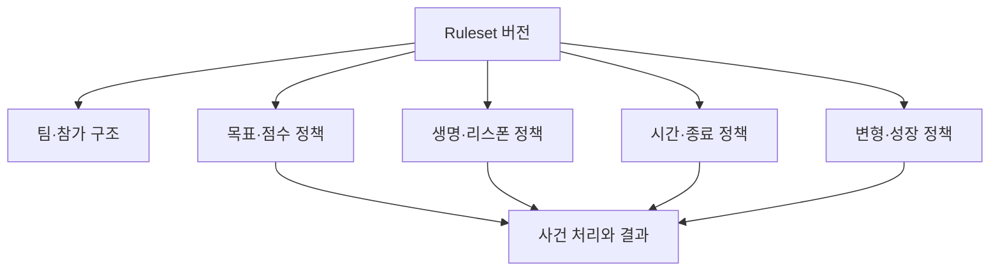

# 08. 모드 데이터·규칙 구성·분석 이벤트·QA 명세

> 문서 전체의 공통 재구현 설계. 모든 필드·의사코드·판정 순서는 [제안]이다.
> Supercell 내부 데이터 포맷·도구·테스트 조직을 설명하는 문서가 아니다.

## 1. 시스템 목적

수십 종류의 모드에 공통 전투 코드를 재사용하려면 모드 이름만 추가하는 것으로는 부족하다.
팀 구조, 목표, 리스폰, 시간, 동률, 맵, 보상, 이벤트 변형을 분리해야 한다.
두 모드가 같은 맵과 공격을 쓰더라도 최종 결과를 만드는 상태는 다를 수 있다.

공식 모드 안내에는 팀전·생존·PvE·비대칭 목표가 함께 존재한다.[S1]
이 다양성에서 출발해 아래와 같은 데이터 경계를 제안한다.

## 2. 규칙 조립 모델



상속을 너무 깊게 만들면 변형 모드가 예상하지 않은 부모 규칙을 물려받는다.
반대로 모든 것을 자유로운 스크립트로 만들면 종료 조건을 사전에 검증하기 어렵다.
공통 정책 모듈과 모드별 제한된 조합을 사용하는 절충이 유용하다.

## 3. 데이터 사전

| 필드 | 예시 의미 | 검증 규칙 |
| --- | --- | --- |
| rulesetId/version | 공개 규칙 묶음 | 경기 중 불변 |
| teamCount/teamSize | 팀 수·팀당 인원 | 참가 슬롯과 일치 |
| objectiveType | 수집·점령·파괴·생존 | 필수 맵 앵커 존재 |
| winPolicy | 점수·마지막 생존·시간 기록 | 도달 가능한 종료 조건 |
| tiePolicy | 공동·무승부·별도 기준 | 모든 종료 경로 정의 |
| respawnPolicy | 없음·시간·아군 생존 조건 | 전멸 상태 처리 존재 |
| roundPolicy | 단판·다라운드 | 라운드와 매치 결과 분리 |
| deadlinePolicy | 제한·연장·가스 | 시간 단위와 원점 명확 |
| progressionPolicy | 계정·정규화·경기 중 성장 | 종료 시 계정 환원 |
| modifierSet | 이벤트 효과 | 호환성 검증 |
| rewardPolicyVersion | 정산 규칙 | matchId와 연결 |
| availabilityWindow | 노출 기간 | 시간대와 변경 기준 |

원작 수치가 미확인인 필드는 null 또는 미설정으로 남기고 release 검증을 통과하지 않게 한다.
빈칸을 일반 모드 값으로 자동 대체하면 검증되지 않은 복제가 된다.

## 4. 사건 계약

### 입력 사건

PlayerSpawned, AttackResolved, DamageApplied, PlayerDefeated, ObjectPickedUp,
ObjectDropped, ZonePresenceChanged, StructureDestroyed, DeadlineReached.

### 파생 사건

ScoreChanged, CountdownStarted, CountdownCancelled, TeamEliminated,
RoundWon, MatchEnded, RewardRequested.

공통 전투 계층이 최종 승패를 직접 쓰지 않는다.
모드가 전투 사건을 해석하여 목표 상태와 파생 사건을 생성한다.
중간 상태가 다른 시스템에 노출되는 것을 피하려면 한 논리 업데이트 안에서 일관된 상태를 커밋한다.

## 5. 사건 처리 예시

```text
applyFrame(frame):
    inputs = validateAndOrder(frame.inputs)
    combatEvents = combat.advance(inputs)

    context = mode.beginTransaction(frame.time)
    context.apply(combatEvents)
    context.applyScheduledEvents(frame.time)

    candidates = context.evaluateTerminalConditions()
    result = context.resolveConflicts(candidates)

    commit(context)
    if result is terminal:
        emitOnce(MatchEnded(matchId, result))
```

이 의사코드는 특정 모드의 동시 판정 정답을 제공하지 않는다.
예를 들어 동시 금고 파괴를 무승부로 할지, 서버 시각으로 먼저 파괴된 쪽을 우선할지는 별도 규칙이다.
원작 미확인 조건은 모드 파일의 질문과 실험 절차로 연결한다.

## 6. 변형의 합성 순서

[제안] 규칙 적용 순서를 명시한다.

1. 기본 전투 정의.
2. 브롤러 성장·로드아웃 스냅샷.
3. 모드 고유 수치와 사용 제한.
4. 이벤트 변형.
5. 경기 중 임시 효과.
6. 최종 충돌·면역·목표 정책.

어느 단계가 우선하는지는 제품 선택이다.
예컨대 친선 정규화와 이벤트 최대 강화가 동시에 적용되면 “가장 큰 값”으로 암묵적으로 결정하지 않는다.
효과가 수치를 수정하는지, 사용 자격을 바꾸는지, 버튼을 교체하는지도 분리한다.

## 7. 분석 이벤트 설계

| 이벤트 | 최소 속성 | 답할 수 있는 질문 |
| --- | --- | --- |
| QueueEntered | mode, map, partySize, eligibility | 어떤 선택에서 대기를 포기하는가 |
| ActionAttempted | ability, accepted, reason | 조작 실패가 많은 능력은 무엇인가 |
| ObjectiveInteraction | objective, actor, delta | 교전이 목표로 전환되는가 |
| LifeEnded | cause, location, carriedValue | 어떤 사망이 승패를 바꾸는가 |
| PhaseChanged | phase, duration, trigger | 경기 템포가 어디서 늘어지는가 |
| MatchCompleted | ruleVersion, outcome, duration | 모드·버전별 결과 비교 |
| RewardSettled | resultId, ruleVersion, status | 정산 유실과 중복 문제 |

민감한 원시 사용자 정보 없이도 제품 질문에 답할 수 있게 최소화한다.
분석 이벤트 유실이 전투 판정을 중단시키지 않게 하고, 보상 정산은 진단 로그만으로 대신하지 않는다.

## 8. 모드 QA 공통 템플릿

각 모드 파일의 QA 표는 다음 네 종류를 구분한다.

| 종류 | 목적 |
| --- | --- |
| 확인 규칙 | 공개 자료의 조건이 구현에 반영됐는가 |
| 경계 조건 | 동시에 발생한 사건과 극단값 처리 |
| 불변조건 | 중복 정산·음수 자원·불가능 소유권 방지 |
| 미확인 실험 | 원작을 관찰해야 결정할 질문 |

기대 결과가 [제안]인 테스트를 통과했다고 원작과 동일하다고 주장하지 않는다.
반대로 미확인 질문은 구현 중단 사유가 아니라 명시적으로 선택해야 할 설계 결정이 될 수 있다.

## 9. 최소 검증 집합

- 정상 승리, 정상 패배, 정상 시간 종료.
- 목표 도달과 시간 종료 동시.
- 양팀 목표 도달 동시.
- 마지막 생존자 또는 마지막 아군 사망.
- 운반물 습득·드롭·리셋의 경계.
- 재접속·중복 입력·지연 도착.
- 변신·은신·무적·소환수가 목표와 상호작용.
- 연장 또는 라운드 초기화 후 잔여 효과.
- 맵 파괴 뒤 도달 불가능 목표물.
- 경기 결과와 보상 정산의 재시도.

## 10. 테스트 데이터와 재현성 [제안]

버그 재현에는 모드 이름만으로 부족하다.
rulesetVersion, mapVersion, loadoutSnapshot, participantLayout, eventSequence,
networkCondition, expectedOutcome을 함께 남긴다.

모든 순열을 테스트할 수는 없다.
공통 효과가 다양한 모드에 영향을 줄 때는 사망·소유권·시간·강제 이동·변신의 대표 경계를 우선한다.
새 브롤러를 추가하면 공격 모양뿐 아니라 목표 소유·부활·경기 종료와의 조합을 검사한다.

## 11. 변경 검토 체크포인트

| 변경 | 영향 범위 |
| --- | --- |
| 벽 충돌 | 탄환·공·퍽·강제 이동·AI 경로 |
| 사망 처리 | 점수·드롭·리스폰·보상·관전 |
| 충전 계산 | 일반 공격·소환수·치유·PvE |
| 팀 수 증가 | 목표 비교·UI·타깃 필터·순위 |
| 성장 정규화 | 소유권·장비·강화·정산 |
| 이벤트 종료 | 입장·진행 중 경기·누적 보상 |

## 12. 완료 기준

모드를 재구현 완료로 간주하려면 규칙표, 시간 흐름, 동률, 사망/부활, 목표 소유권,
UI 신호, 정산, 최소 회귀 사례가 함께 있어야 한다.
화면에서 한 번 정상 승리했다는 사실만으로 모든 경계가 정의되지는 않는다.

## 13. 출처와 연결

- [S1: 공식 Game Modes](https://sc-brawlstars.zendesk.com/hc/en-us/articles/49526599632923-Game-Modes) — 다양한 목표 유형의 존재.
- [문서 기준과 한계](../00_scope_evidence.md)
- [코어 루프](01_core_loop.md) · [네트워크](07_network_architecture.md) · [모드 비교](../02_mode_comparison.md)

