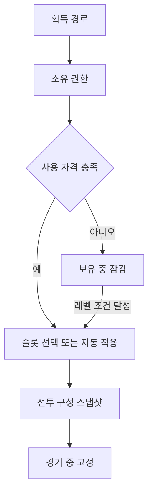

# 09. 브롤러 수집·성장·장비·업적 역기획

> 분석 기준: 2026-11-13. 공개 규칙을 근거로 한 역기획이다. **[공식]**은 출처에서 확인한 범위, **[해석]**은 설계 분석, **[제안]**은 재구현 규격, **[미확인]**은 추가 검증 항목이다.

## 1. 시스템의 역할

[해석] 성장 시스템은 새 캐릭터를 얻는 즐거움, 이미 익숙한 캐릭터를 강화하는 효용, 실력을 드러내는 장기 목표를 연결한다. 이 세 가지를 같은 진행도로 합치면 캐릭터 보유량이 실력처럼 읽히거나, 실력이 좋더라도 재화 부족 때문에 경쟁 콘텐츠에 참여하기 어려운 문제가 생긴다. 브롤스타즈의 수집·파워·트로피·Prestige·Records를 별도 축으로 분석해야 하는 이유다.

| 성장 축 | 플레이어가 해석하는 의미 | 재구현에서 분리할 값 |
|---|---|---|
| 브롤러 해금 | 새로운 공격 방식과 역할 확보 | 소유 여부, 해금 경로 |
| 파워 레벨 | 해당 브롤러의 기초 전투력 투자 | 레벨, 자원 소비 원장 |
| 능력·장비 | 플레이 방식 선택과 능력 보완 | 소유 능력, 선택 슬롯, 적용 가능 여부 |
| 트로피·Prestige | 그 브롤러로 쌓은 플레이 성취 | 실력 추정치와 별도의 표시 진행도 |
| Records | 다양한 행동·수집의 도전 목표 | 조건별 누적치와 보상 수령 여부 |
| 외형 | 취향과 소속·성취 표현 | 전투 능력과 분리된 외형 권한 |

## 2. 현행 해금 규칙과 구형 정보의 구분

[공식] 2026년 8월 업데이트는 Starr Road를 **Brawler Blast**로 개편했다. 크레딧으로 정해진 희귀도 순서의 해금에 접근하고, 사격장 연출에서 최대 10개의 후보 중 마지막 브롤러를 얻는다. Rare·Super Rare의 기존 Trophy Road 해금도 이 구조로 이동했다.[S1]

[공식] Brawler Blast의 Gem Fragments는 새 브롤러의 레벨이나 능력 보너스로 이어진다. 능력을 보유하더라도 사용할 파워 레벨에 도달하지 않았을 수 있다.[S2][S3]

| 자료상 표현 | 이 문서의 취급 |
|---|---|
| Starr Road에서 다음 브롤러를 고른다 | 2026년 8월 이전 구조 또는 미갱신 지원 문구 |
| 신규 브롤러를 얻는 즉시 모든 능력 사용 | 보유와 사용 자격을 구분해야 하므로 일반화 금지 |
| 신규 브롤러 이벤트 상자 | 과거 일반 Brawl Box 경제와 별개 상품·이벤트로 취급 |
| Mastery Points를 매 경기 누적 | 현행 일반 성장 규칙으로 사용하지 않음 |
| Mastery Title이라는 외형 명칭 | 과거 진행 시스템의 현행 존속을 증명하지 않음 |

지원 페이지에도 이전 해금 방식의 문장이 남아 있으므로, 메뉴의 명칭 하나로 전체 진행 로직을 판단하지 않는다. 날짜가 확인되는 패치와 개별 기능 문서를 우선한다.

## 3. 수집의 선택 구조 [해석]

선택권에는 두 층이 있다. 첫째는 다음에 어떤 플레이 경험을 얻을지 고르는 장기 선택이고, 둘째는 해금 순간에 제공되는 후보 중 무엇을 택할지 고르는 짧은 선택이다. 후보를 시각적으로 제거하는 연출은 단순 결과 통지보다 참여감을 주지만, 실제 확률 결정 시점과 플레이어가 통제한다고 느끼는 시점이 어긋날 수 있다.

따라서 역기획에서는 다음을 구분한다.

1. 획득 가능한 브롤러 집합을 정하는 자격 검증.
2. 서버가 결과와 보너스를 확정하는 단계.
3. 플레이어가 후보를 확인하거나 선택하는 단계.
4. 사격·파편·해금 축하 연출.
5. 소유권 지급과 사용 가능한 능력 표시.

[미확인] 원작이 정확히 어느 시점에 난수를 확정하는지, 화면의 어떤 타깃 선택이 결과에 영향을 주는지는 공개 규칙만으로 단정할 수 없다. 재구현에서는 이 관계를 명시적으로 설명해야 한다.

## 4. 소유·해금·장착을 분리하는 모델 [제안]

`Owned`와 `Usable`을 한 Boolean으로 저장하지 않는다. 보너스로 미리 받은 능력, 임시로 최고 레벨이 제공되는 이벤트, 영구 해금, 시즌 대여가 공존하기 때문이다.

| 엔티티 | 핵심 필드 | 불변 조건 |
|---|---|---|
| BrawlerOwnership | accountId, brawlerId, acquiredAt, source | 동일 소유권 중복 지급 불가 |
| BrawlerProgress | powerLevel, progressRevision | 레벨 감소는 명시적 마이그레이션만 허용 |
| AbilityOwnership | abilityId, source, acquiredAt | 잠긴 슬롯에서도 소유 기록 보존 |
| Loadout | gadgetId, starPowerId, gearIds | 경기 규칙에 맞는 유효 조합 |
| TemporaryGrant | eventId, expiresAt, overrides | 영구 소유 데이터를 덮어쓰지 않음 |
| CombatSnapshot | rulesetVersion, resolvedStats | 입장 후 계정 화면 변경의 영향 차단 |

## 5. Buffies와 장비 전환

[공식] Buffies는 능력 강화 세 범주와 외형 범주로 설명되며, 해금 시 자동 적용된다.[S4] 2026년 11월 패치에서는 브롤러 미보유 상태에서도 드롭·상점으로 해당 Buffie를 얻을 수 있게 했으므로, 모든 경로에 ‘보유 브롤러만 획득’ 제약을 적용하면 안 된다.[S5]

[해석] 자동 적용 강화는 장착 의사결정을 단순화하지만, 영구 전투력 격차를 늘린다. 따라서 유저는 ‘이번 전투에서 선택한 빌드’와 ‘계정에 누적된 강화’의 차이를 화면에서 알아야 한다. 외형 Buffie까지 능력 Buffie와 같은 경고색을 쓰면 구매 효과를 오해할 수 있다.

[제안] 각 브롤러의 장비 체계를 `EquipmentModelVersion`으로 관리한다. 특정 브롤러의 Gear 제거·환급·Buffie 전환이 다른 브롤러에도 자동 적용되지 않게 한다. 이전 구매 내역을 기준으로 환급 원장을 생성하고, 우편 수령을 반복해도 한 번만 지급한다.

## 6. 레벨업의 의사결정과 자원 압력 [해석]

플레이어는 모든 캐릭터를 넓게 키울지, 자주 쓰는 몇 명을 집중 투자할지 선택한다. 신규 모드가 특정 역할을 요구하면 수집의 폭이 의미를 얻고, 경쟁전에서 일정 수준의 캐릭터 수를 요구하면 집중 투자만으로는 부족해진다.

분석상 중요한 지표는 계정 최고 레벨보다 **유효 로스터 폭**이다. 이는 특정 모드에서 쓸 수 있는 역할군을 몇 개 확보했는지를 뜻한다. 같은 원거리형 세 명보다 원거리·지역 통제·근거리 대응을 하나씩 가진 계정이 더 다양한 맵을 다룰 수 있다.

[제안] 성장 추천은 단순 최고 승률순 대신 다음 신호를 함께 쓴다.

- 최근 즐긴 모드와 부족한 역할.
- 이미 보유한 능력과 필요한 추가 투자량.
- 대여 브롤러에서 보인 관심.
- 다음 경쟁전 자격까지의 거리.
- 잠겨 있는 능력의 실제 사용 가능 시점.

## 7. Records와 과시 보상

[공식] Records는 전투·수집 목표를 달성해 포인트와 외형·보상을 얻는 구조이며, 프로필과 클럽에도 성취를 드러낸다.[S6]

[해석] 기록 목표는 잘하는 브롤러만 반복하는 플레이를 분산시킨다. 다만 ‘위험한 행동 여러 번 성공’ 같은 목표가 승리보다 우선되면 팀 게임을 해칠 수 있다. 목표의 설계 품질은 달성률뿐 아니라 해당 목표가 활성화된 경기의 이탈·패배·아군 불만까지 보아야 한다.

[제안] 행동형 업적은 경기 결과 이벤트에서 판정하되, 친선·봇·이벤트 전투의 허용 여부를 별도 필드로 둔다. 금지된 규칙에서 수치만 채워지는 일을 막는다.

## 8. 보상 처리 예외 [제안]

| 상황 | 처리 원칙 |
|---|---|
| 해금 연출 도중 종료 | 결과를 다시 뽑지 않고 이미 확정된 지급 거래를 복원 |
| 마지막 미보유 브롤러 획득 | 다음 희귀도·대체 경로를 같은 거래에서 재평가 |
| 능력 획득과 레벨업 동시 발생 | 소유 저장 후 사용 자격을 한 번 재계산 |
| 임시 대여 종료 | 해당 경기의 구성 스냅샷은 유지, 다음 입장만 제한 |
| 패치로 장비 제거 | 소유 기록 보존 후 환급 완료 표시 |
| 중복 보상 수신 | rewardTransactionId로 중복 차단 |
| 이미 보유한 외형 보상 | 해당 경로의 대체 보상 규칙 사용; 보편 환율 금지 |

## 9. QA 시나리오 [제안]

| ID | 입력·조건 | 기대 결과 |
|---|---|---|
| RP01 | 능력을 받았지만 요구 레벨 미달 | 보유 표시와 사용 불가 이유가 함께 보임 |
| RP02 | 레벨업 도중 재접속 | 자원 차감과 레벨 증가가 한 번만 발생 |
| RP03 | Brawler Blast 중 앱 종료 | 확정된 결과·보너스가 손실 없이 복구 |
| RP04 | 후보 희귀도 미보유가 한 명 | 비어 있는 타깃과 실제 후보의 소유 처리 분리 |
| RP05 | 미보유 브롤러 Buffie 획득 | 지급은 보존, 브롤러 소유권은 임의로 생성하지 않음 |
| RP06 | 파워 대여 종료 직전에 입장 | 경기 규칙의 스냅샷 기준으로 일관된 판정 |
| RP07 | 전환 대상 아닌 브롤러의 Gear | 마이그레이션 영향을 받지 않음 |
| RP08 | 같은 업적 달성 이벤트 재전송 | 포인트·보상 중복 없음 |
| RP09 | 외형만 변경 | 전투 스탯 해시가 변하지 않음 |
| RP10 | 한 거래에서 여러 성장 단계 통과 | 단계별 지급 누락과 중복이 모두 없음 |

## 10. KPI와 검증 과제 [제안]

새 브롤러 획득 후 첫 경기까지 걸린 시간, 획득 후 7일간 사용률, 역할별 유효 로스터 수, 자원 부족으로 성장 화면에서 이탈한 비율을 함께 본다. 획득 직후 이용률이 높아도 일주일 뒤 사용하지 않으면 해금 연출은 성공했지만 새 플레이 경험의 정착은 실패했을 수 있다.

실기 검증 시에는 획득·사용 자격·자동 적용의 UI를 따로 기록하고, 무료 대여와 영구 소유의 차이를 비교한다. 성장 비용·확률·전체 브롤러 수는 변동이 크므로 이 문서에 고정 표로 복제하지 않는다.

## 출처와 확인 범위

- [S1: 2026년 8월 패치](https://supercell.com/brawlstars/en/blog/release-notes/release-notes-august-2026/) — Brawler Blast 전환, 희귀도 이동.
- [S2: Brawler Blast](https://sc-brawlstars.zendesk.com/hc/en-us/articles/56293521662107-Brawler-Blast) — 해금 연출과 보너스 종류.
- [S3: Gem Fragments](https://sc-brawlstars.zendesk.com/hc/en-us/articles/56508648689819-Gem-Fragments) — 성장 보너스 전환.
- [S4: Buffies](https://sc-brawlstars.zendesk.com/hc/en-us/articles/49526654819227-Buffies) — 범주와 자동 적용. 획득 자격은 후속 패치와 대조.
- [S5: 2026년 11월 패치](https://supercell.com/brawlstars/en/blog/game-updates/release-notes-november-2026/) — 미보유 브롤러 Buffie 획득 경로 확장.
- [S6: Records](https://sc-brawlstars.zendesk.com/hc/en-us/articles/49526600046235-Records) — 별도 업적 축.

관련 문서: [경제·보상](10_economy_rewards.md), [경쟁전](12_ranked_draft.md), [트로피·매칭](13_matchmaking_trophies.md), [전체 목차](../README.md).
