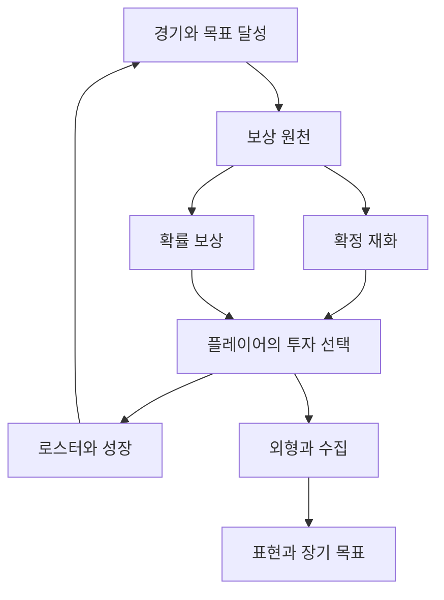

# 10. 재화·확률 보상·상점·경제 순환 역기획

> 분석 기준: 2026-11-13. **[공식]**은 공개 자료에서 확인한 규칙, **[해석]**은 경제 설계 분석, **[제안]**은 재구현 기준이다. 가격·확률은 판매 지역과 패치에 따라 달라질 수 있어 확인한 범위만 사용한다.

## 1. 경제의 목표 [해석]

전투에서 얻는 만족은 짧지만, 다음 캐릭터와 성장 목표는 다음 접속의 이유가 된다. 경제 시스템의 핵심은 보상을 많이 뿌리는 것 자체보다, 플레이어가 지금 원하는 경험으로 보상이 연결된다고 느끼게 만드는 것이다. 같은 총량이라도 이미 쓸 곳이 없는 재화와 필요한 능력의 가치는 다르다.

브롤스타즈형 경제는 캐릭터 해금, 파워 성장, 외형, 시즌 진행을 여러 재화로 나눈다. 재화별 사용처가 명확하면 목표가 읽히지만, 비슷한 보상 상자와 기간 재화가 겹치면 이해 비용이 커진다.

## 2. 재화의 역할

[공식] Coins·Power Points는 성장, Credits는 브롤러 해금, Bling은 외형, Gems는 다양한 구매, 패스 XP는 보상 트랙 진행에 연결된다.[S1] Vault Keys는 보상 범주를 선택하는 별도 권한이다.[S2]

| 경제 층 | 플레이어 질문 | 분석상 필요한 분리 |
|---|---|---|
| 전투력 자원 | 누구를 강화할까? | 수입·소비·미래 투자 비용 |
| 로스터 자원 | 어떤 새 경험을 얻을까? | 희귀도 진행과 소유 상태 |
| 외형 자원 | 무엇으로 개성을 표현할까? | 사용 가능 외형과 보유 중인 미사용 외형 |
| 범용 구매 재화 | 지금 시간을 줄일까? | 구매 선택과 확정 대체 보상 |
| 패스 경험치 | 이번 시즌 어디까지 갈까? | 누적 진행과 실제 보상 수령 |
| 이벤트 재화 | 기간 안에 무엇을 바꿀까? | 획득 기간·소비 기간·만료 처리 |

## 3. 공급과 소비의 연결 [해석]



성장 자원이 특정 범주에 몰리면 플레이어는 다른 자원이 남아도 진행이 막혔다고 느낀다. 따라서 평균 재화 수입뿐 아니라 `다음 의미 있는 업그레이드까지 부족한 최소 자원`을 계산해야 한다.

예를 들어 레벨업에 두 자원이 필요하면 실제 대기시간은 두 자원의 부족 시간을 더한 값이 아니라, 각 획득 속도로 보충했을 때 더 오래 걸리는 쪽에 가깝다. 이 관계는 경제 검증용 모델이며 원작의 내부 계산식은 아니다.

`upgrade_wait ≈ max(coin_deficit / coin_rate, point_deficit / point_rate)`

이 식의 rate는 무료·유료, 신규·복귀, 하루 플레이 횟수별로 다르게 측정한다. 단일 ‘평균 유저’만 보면 큰 병목을 놓친다.

## 4. 확률 보상과 기대값

[공식] Chaos Drops는 희귀도와 분할 수를 가진다. 공식 표의 분할 수 확률은 1개 70%, 2개 20%, 4개 8%, 8개 2%이며, 분할된 드롭은 같은 희귀도를 공유한다.[S3]

[계산] 이 표만 사용하면 1회 획득당 기대 드롭 수는 다음과 같다.

`E[N] = 1×0.70 + 2×0.20 + 4×0.08 + 8×0.02 = 1.58`

이는 재화 가치가 1.58배라는 뜻이 아니다. 보상 종류별 수량, 중복 대체, 계정의 소유 상태, 희귀도와 내용의 조건부 분포를 추가로 알아야 한다. 분할 수만으로 특정 능력 획득 확률을 계산해서도 안 된다.

[해석] 동일 희귀도를 공유하는 분할은 보상의 상관관계를 높인다. 좋은 희귀도에서 여러 개로 나뉘면 큰 순간적 만족을 주지만, 개별 결과가 독립인 여러 번의 추첨과 체감 분산이 다르다. 연출과 확률 설명은 이 차이를 숨기지 않아야 한다.

## 5. 확정 선택 보상과 확률 보상의 역할 [해석]

확률 보상은 예상하지 못한 캐릭터나 외형을 경험하게 하고, 선택형 보상은 명확한 목표로 접근하게 한다. 어느 한쪽만 있으면 반복 플레이가 무작위에 묶이거나 보상 경험이 지나치게 계산적으로 바뀔 수 있다.

Vault 형태의 선택은 ‘종류를 고르는 권한’과 ‘선택 가능한 구체 항목’을 분리한다. 재구현 시 키 하나를 모든 상품에 공통 화폐처럼 취급하면 희귀도별 비용·시즌 외형의 예외·콜라보 제외 조건을 관리하기 어려워진다.

| 설계 요소 | 기대 효과 | 확인할 위험 |
|---|---|---|
| 목표가 명확한 크레딧 진행 | 다음 캐릭터까지의 거리 인식 | 신규 해금 방식이 선택감을 줄일 수 있음 |
| 임의 보상 | 발견과 변주 | 필요 없는 중복·자원 편중 |
| 선택권 있는 키 | 개인별 자원 부족 보완 | 범주가 많아져 설명 복잡 |
| 기간 이벤트 교환 | 단기 목표와 복귀 계기 | 종료 시 잔액 손실 오해 |
| 묶음 상품 | 연관 보상의 이해 | 이미 보유한 구성품 가치 불명확 |

## 6. 거래 모델 [제안]

모든 보상·구매·대체 지급은 재화 숫자를 직접 변경하는 함수 대신 거래 원장으로 처리한다.

| 필드 | 의미 |
|---|---|
| transactionId | 동일 지급 재시도에 대한 고유 키 |
| sourceType / sourceId | 경기, 퀘스트, 패스, 상점, 보상 보정의 원천 |
| balanceVersion | 동시 소비 충돌 확인 |
| debits / credits | 차감과 지급 항목의 완전한 집합 |
| entitlementGrants | 브롤러·외형·능력 권한 |
| fallbackPolicyId | 중복·미지원·만료 시 대체 규칙 |
| rewardTableVersion | 확률과 보상 표의 버전 |
| settledAt | 지급 확정 시각 |

```text
claimReward(request):
  authenticateAccountAndVerifyRequestOwnership(request)
  key = (request.accountId, request.transactionId)
  if ledger.hasCommitted(key): return ledger.previousResult(key)
  validateEligibility(request.sourceId)
  reserveOrReuseTransactionAtomically(key)
  resolveRewards(using pinned rewardTableVersion)
  validateAllDebitsAndFallbacks()
  commit debit + grants + claimState atomically
  return durableReceipt
```

원작의 실제 서버 구현을 뜻하지 않는다. 보상 화면에서 앱을 종료해도 결과를 재추첨하거나 차감만 남기는 오류를 피하기 위한 규격이다.

## 7. 가격·가치 표시의 UX [제안]

상품 화면은 결제 금액, 받는 항목, 이미 보유한 항목의 처리, 사용 조건, 만료 시점을 한 화면에서 비교할 수 있어야 한다. ‘가치 몇 배’는 지역 가격과 개인별 중복 대체를 어떻게 처리하는지 정의하지 않으면 의미가 모호하다.

확률 상품은 열기 연출 전에 보상 풀이 확정되어야 하며, 다음 중 무엇이 일어났는지 거래 내역에서 구분할 수 있어야 한다.

- 새 권한을 얻음.
- 보유 중이어서 대체 자원을 받음.
- 아직 브롤러가 없지만 관련 외형·능력을 보관함.
- 새 능력은 받았지만 파워 조건 미달로 잠겨 있음.
- 이벤트 종료로 다른 보상으로 변환됨.

## 8. 경제 운영 지표 [제안]

| 지표 | 단독 해석의 함정 | 함께 볼 값 |
|---|---|---|
| 일평균 자원 공급량 | 보유량이 많아도 필요한 자원이 아닐 수 있음 | 업그레이드 대기시간 분포 |
| 확률 보상 개봉률 | 연출 때문에 개봉이 많아질 수 있음 | 획득 항목 사용률 |
| 상점 구매율 | 높은 구매율이 만족을 뜻하지 않음 | 구매 후 이탈·환불·문의 |
| 자원 잔액 | 수집가와 막힌 계정이 섞임 | 로스터와 투자 의도별 코호트 |
| 이벤트 참여율 | 보상 강제성이 반영될 수 있음 | 보상 종료 후 자발적 모드 이용 |
| 중복 대체 비율 | 고수 계정의 자연스러운 결과일 수 있음 | 필요 자원으로 전환되는 비율 |

## 9. QA 시나리오 [제안]

| ID | 조건 | 기대 결과 |
|---|---|---|
| EC01 | 같은 보상 수령 요청 재전송 | 동일 영수증 반환, 추가 지급 없음 |
| EC02 | 두 화면에서 잔액을 동시에 소비 | 한 거래만 성공하거나 서버 기준 순차 처리 |
| EC03 | 상자 개봉 중 네트워크 단절 | 확정 결과가 재접속 때 복원 |
| EC04 | 보유 목록이 보상 확정 직전 변경 | 정해진 소유 스냅샷·대체 정책 사용 |
| EC05 | 패치로 보상 표 변경 | 이미 확정된 보상에 새 표를 소급 적용하지 않음 |
| EC06 | 만료 직전 구매·교환 | 서버시각으로 자격을 판단하고 이유 표시 |
| EC07 | 분할 Chaos Drop | 동일 희귀도 규칙과 각 보상 거래 연결 보존 |
| EC08 | 표시 잔액과 실제 원장 불일치 | 서버 잔액으로 복구, 음수·중복 소비 방지 |
| EC09 | 지역 상품 가격 변경 | 현재 상품 스냅샷과 결제 확인 값 일치 |
| EC10 | 외형 미지원 브롤러 | 오지급 대신 경로별 명시된 처리 사용 |

## 10. 추가 검증 범위

[미확인] 원작의 경제 시뮬레이터, 동적 상품 타기팅, 개별 계정별 보상 분포 조정은 공개 자료로 확인하지 않았다. 개인화된 확률이나 ‘패배하면 좋은 보상을 준다’ 같은 설명을 이 역기획의 사실로 사용하지 않는다.

원작 경제를 수치 복제하려면 각 수입 경로의 빈도·자격·보상 수량을 동일 패치에서 수집해야 한다. 본 문서는 구조와 검증 방법을 제공하며, 확인하지 않은 전체 성장 비용을 합산하지 않는다.

## 출처와 확인 범위

- [S1: In-Game Currencies](https://sc-brawlstars.zendesk.com/hc/en-us/articles/49526629212955-In-Game-Currencies) — 재화별 기본 용도. 구형 메뉴명은 최신 성장 문서와 대조.
- [S2: Vault Keys](https://sc-brawlstars.zendesk.com/hc/en-us/articles/49526629865371-Vault-Keys) — 종류별 선택 권한.
- [S3: Chaos Drop Chances](https://sc-brawlstars.zendesk.com/hc/en-us/articles/49526626841883-Chaos-Drop-Chances) — 분할 확률과 동일 희귀도. 기대값 1.58은 이 문서에서 계산.

관련 문서: [수집·성장](09_roster_progression.md), [퀘스트·패스](11_quests_passes.md), [라이브 운영](15_liveops_events.md), [전체 목차](../README.md).
