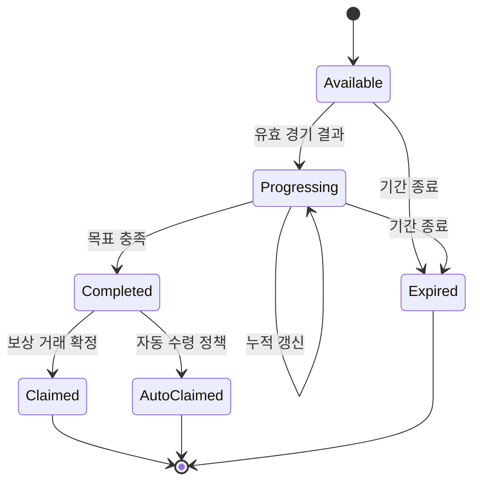

# 11. 퀘스트·Brawl Pass·Pro Pass·목표 관리 역기획

> 분석 기준: 2026-11-13. **[공식]** 규칙과 **[해석]** 설계 분석, **[제안]** 구현 모델을 구분한다. 시즌별 보상 수량·상품 가격·갱신 일시는 실기 확인이 필요한 설정값이다.

## 1. 시스템이 만드는 시간 구조 [해석]

퀘스트는 오늘 할 행동, 패스는 한 시즌의 진행, 경쟁 패스는 경쟁 실력과 시청·참여 등 다른 활동 축을 묶는다. 플레이어가 로그인했을 때 ‘어떤 모드가 재미있을까’와 ‘무엇을 해야 손해 보지 않을까’를 동시에 생각하게 만드는 구조다.

좋은 목표는 평소 플레이를 안내하면서 실력을 익히게 한다. 나쁜 목표는 팀의 승리 목표와 충돌하거나 좋아하지 않는 모드를 강제로 오래 플레이하게 만든다. 따라서 퀘스트 달성률과 유지율만으로 성과를 판단해서는 안 된다.

## 2. 공개 구조와 버전 주의

[공식] 퀘스트는 전투 목표를 통해 패스 XP를 제공한다.[S1] Brawl Pass는 무료·유료·Plus 트랙으로 진행 보상을 구성한다.[S2] 2025년 말 개편은 키와 Vault를 도입해 일부 보상의 선택권을 넓혔다.[S3]

[공식] 2026년 11월 패치에서 15 Gem Mega Quest가 제거되었고, Pro Pass는 다음 시즌을 3개월로 줄인 후 월간으로 재편할 계획을 밝혔다.[S4]

| 항목 | 역기획 기준 |
|---|---|
| Brawl Pass와 Pro Pass | 서로 다른 XP·시즌·자격 엔티티 |
| 월간 경쟁전 시즌 | Pro Pass의 길이와 동일하다고 가정하지 않음 |
| 과거 Gem Mega Quest | 현행 고정 수입으로 경제 모델에 넣지 않음 |
| 일반 패스 보상 선택 | Vault·키와 연결해 분석 |
| 시즌 종료 미수령 보상 | 지원 문서의 자동 수령 구조를 참고하되 경로별 확인 |
| 2026년 이후 Pro Pass 월간화 | 예고 상태와 실제 적용 상태를 구분 |

## 3. 퀘스트 문법 [제안]

한 퀘스트를 문자열로만 저장하면 다국어 문구와 게임 판정이 어긋난다. 다음 필드를 가진 규칙으로 정의한다.

| 필드 | 예시적 의미 |
|---|---|
| objectiveType | 승리, 피해, 회복, 처치, 목표 수행 |
| filters | 허용 모드·브롤러·파티 조건 |
| targetValue | 달성 수치 |
| aggregation | 합계, 한 경기 최대, 연속 성공 |
| eligibleMatchTypes | 일반·친선·이벤트·봇 여부 |
| activeWindow | 시작·종료 시각 |
| completionPolicy | 즉시 완료 또는 경기 정산 후 완료 |
| rerollPolicy | 교체 가능 조건과 사용 횟수 |
| rewardBundleId | 지급할 XP·재화·상자 참조 |

문구는 이 규칙에서 생성한다. 예를 들어 ‘한 경기에서’라는 제한이 있으면 누적 합계가 아니라 `max(perMatchValue)`로 판정한다.

## 4. 상태 전이와 이중 지급 방지 [제안]

보상 버튼 애니메이션과 수령 확정은 같은 상태가 아니다. 서버가 `Claimed`를 확정한 뒤 화면 전환이 실패하더라도 원장은 유지되어야 한다. 만료 직전 완료한 퀘스트는 경기 시작 시각·종료 시각 중 무엇을 기준으로 유효성을 판단할지 사전에 정한다.

## 5. 목표 설계의 질 [해석]

| 목표 유형 | 학습 효과 | 팀 게임과의 충돌 |
|---|---|---|
| 승리 | 모드의 최종 목표를 따름 | 패배가 이어지면 진행감 상실 |
| 피해 누적 | 조준과 교전 참여 | 목적물·생존보다 무의미한 포킹 선호 |
| 회복 누적 | 지원 역할 경험 | 실제 필요 없는 회복 반복 가능 |
| 특정 브롤러 사용 | 로스터 확장 | 맵에 맞지 않는 선택 강요 |
| 여러 모드 플레이 | 규칙 학습 | 비선호 모드의 피로 |
| 한 경기 고난도 행동 | 숙련 목표 | 승리와 무관한 위험 행동 유발 |

재구현에서는 일상 목표와 숙련 도전을 분리하는 편이 좋다. 일상 목표는 플레이 시간을 예측 가능하게 만들고, 숙련 도전은 긴 기간의 선택 과제로 제공한다. 모든 유저에게 같은 어려운 행동을 당일 과제로 주면 팀 품질까지 흔들린다.

## 6. 패스의 진행감 [해석]

패스 경험은 작은 보상과 큰 보상을 번갈아 배치하는 리듬이다. 트랙 끝까지 필요한 시간을 표시하지 않으면 유저는 초반의 빠른 진행을 전체 속도로 오해할 수 있다. 시즌 후반 복귀자에게는 잔여 기간에 달성 가능한 범위를 보여주는 것이 유용하다.

유료 권한은 보상 접근권을 바꾸고, XP는 진행 위치를 바꾼다. 이 둘을 분리하면 시즌 중간 구매 시 이전 단계 보상을 일괄 수령하거나 Plus로 업그레이드해도 이미 지급한 항목을 중복 지급하지 않는다.

`claimable = tierUnlocked && entitlementSatisfied && !alreadyGranted`

이 식은 설계 제안이며 원작 코드가 아니다. 특정 시즌에는 다른 조건이 추가될 수 있으므로 보상마다 자격식을 가진다.

## 7. Pro Pass와 경쟁 행동의 연결 [해석]

경쟁 승리 보상은 랭크 점수의 좌절을 완화할 수 있지만, 승수 보상을 과도하게 강조하면 자신의 실력대에서 연습하기보다 낮은 구간의 빠른 승리를 찾게 만들 수 있다. 시즌 초기화·매칭·주간 획득 상한을 함께 설계해야 한다.

월간 랭크와 더 긴 패스가 겹칠 경우, 유저에게 두 개의 종료 시각이 보인다. 화면에는 ‘랭크 초기화까지’와 ‘패스 보상 수령 종료까지’를 명시적으로 구분한다. 월간화 예고는 미래 규칙 버전으로 저장하고 적용 전 화면에 현재 규칙처럼 표시하지 않는다.

## 8. 데이터 흐름 [제안]

1. 경기 서비스가 확정 결과와 경기 종류를 발행한다.
2. 목표 서비스가 활성 퀘스트의 조건과 집계 방식을 평가한다.
3. 패스 서비스가 XP 거래를 받아 트랙 위치를 갱신한다.
4. 자격 서비스가 무료·유료·Plus·Pro의 지급 가능 보상을 계산한다.
5. 보상 서비스가 지급 거래와 수령 표시를 함께 저장한다.
6. UI는 완료·수령·다음 목표를 묶어서 보여준다.

`matchId + objectiveId`를 집계 중복 차단 키로 사용한다. 네트워크 재전송으로 같은 피해량이 두 번 더해지는 것을 막는다. 목표 변경·재배치 후에도 과거 완료 원장은 유지한다.

## 9. 예외 처리 [제안]

| 상황 | 처리 기준 |
|---|---|
| 시즌 종료를 걸쳐 경기 진행 | 사전 고정된 유효 시각 기준 적용 |
| 패스 구매 영수증 지연 | 결제 검증 완료 전 중복 구매 유도 금지 |
| 완료 목표를 교체 | 완료 보상 보존 여부를 규칙으로 명시 |
| 목표 브롤러 사용 불가 | 대체 목표 또는 명확한 자격 안내 |
| 이벤트 모드 종료 | 남은 과제의 교체·자동완료·만료 중 정책 선택 |
| 한 경기로 여러 목표 완료 | 각각 집계하되 보상 거래는 중복 없이 묶음 처리 |
| 연결 끊김 후 경기 정산 도착 | 늦은 결과를 허용하는 마감 유예 정책 |

## 10. QA 시나리오 [제안]

| ID | 테스트 | 기대 결과 |
|---|---|---|
| QP01 | 결과 이벤트 재전송 | 진행도 한 번만 증가 |
| QP02 | ‘한 경기’ 목표를 여러 경기에 분할 | 부당 완료되지 않음 |
| QP03 | 트랙 중간에 유료 패스 구매 | 이전 잠금 보상을 정확히 해제 |
| QP04 | 이미 받은 보상 뒤 Plus 업그레이드 | 추가 권한 항목만 지급 |
| QP05 | 과제 완료 직후 앱 종료 | 완료 상태 보존 |
| QP06 | 종료 시각과 경기 정산 경합 | 규칙 버전의 시간 정책으로 일관 처리 |
| QP07 | 지원하지 않는 친선 경기 | 집계되지 않는 이유를 확인 가능 |
| QP08 | 삭제된 Mega Quest가 캐시에 남음 | 새 시즌에서 획득 경로로 표시하지 않음 |
| QP09 | Pro Pass 길이 전환 | 이전 시즌 원장과 새 시즌 기간 분리 |
| QP10 | XP로 여러 단계 한 번에 통과 | 모든 새 보상 자격이 누락 없이 갱신 |

## 11. KPI와 검증 범위 [제안]

목표 종류별 완료 소요시간 중앙값·상위 꼬리, 목표와 무관한 모드의 자발적 재방문, 패스 종료 전 미수령률, 과제 교체 빈도, 팀 승리와 충돌하는 행동 증가를 측정한다. 플레이 시간이 늘어도 만족도와 승리 지향 행동이 줄면 목표 설계를 다시 검토한다.

[미확인] 실제 퀘스트 배정 확률, 개인별 과제 추천 알고리즘, 유료 패스의 지역별 가격은 이번 조사에서 확정하지 않았다. 확정되지 않은 수치를 역산해 공식 경제로 제시하지 않는다.

## 출처와 확인 범위

- [S1: Quests](https://sc-brawlstars.zendesk.com/hc/en-us/articles/49526613139227-Quests) — 목표와 XP 연결.
- [S2: Brawl Pass & Brawl Pass Plus](https://sc-brawlstars.zendesk.com/hc/en-us/articles/49526629324955-Brawl-Pass-Brawl-Pass-Plus) — 트랙·시즌·자동 수령의 기본 구조. 세부 보상은 개편 자료 우선.
- [S3: 패스 개편 공지](https://supercell.com/brawlstars/en/blog/news/new-power-brawl-pass-changes-and-a-new-starr-drop-2/) — 키·Vault 도입.
- [S4: 2026년 11월 패치](https://supercell.com/brawlstars/en/blog/game-updates/release-notes-november-2026/) — Mega Quest 변경과 Pro Pass 전환 예고.

관련 문서: [경제](10_economy_rewards.md), [경쟁전](12_ranked_draft.md), [라이브 운영](15_liveops_events.md), [전체 목차](../README.md).
