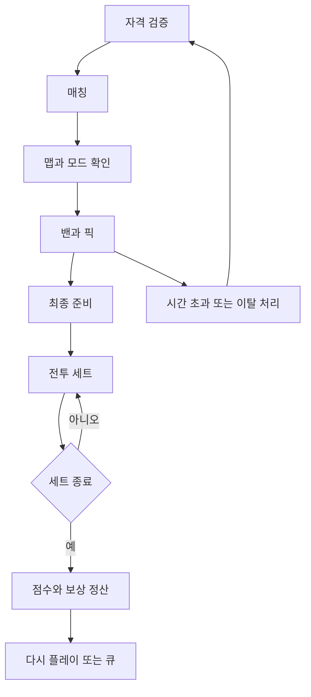

# 12. 경쟁전·픽밴·등급·시즌 역기획

> 분석 기준: 2026-11-13. 우선 기준은 2026년 11월 공식 업데이트다. **[공식]**, **[해석]**, **[제안]**, **[미확인]**을 분리한다. 공개되지 않은 Elo 계수나 내부 매칭 점수식을 복제한 문서가 아니다.

## 1. 경쟁전의 기능 [해석]

일반 전투가 선택한 브롤러를 빠르게 플레이하는 공간이라면 경쟁전은 맵·모드·상대 선택에 대응해 승리 전략을 만드는 공간이다. 캐릭터 수집의 폭과 숙련이 연결되고, 전투 전 선택 자체가 실력의 일부가 된다.

경쟁전의 품질은 전투 밸런스뿐 아니라 대기시간, 자격의 명확성, 픽밴 시간, 중도 이탈, 시즌 초기화 폭에 영향을 받는다. 이 문서는 각 단계를 하나의 상태 머신으로 연결해 분석한다.

## 2. 확인된 최신 변경 요약

[공식] 11월 개편은 신규 진입 5,000 트로피·전 등급 Power 11, Diamond 12명, 시즌 무료 최고 레벨 6명을 명시한다. 기존 접근 권한은 보존하며 Masters I 이상은 팀 큐를 제한한다. Diamond 이상은 세부 등급(minor rank) 2단계 강등으로 완화되며, 하위 등급의 초기화 기준은 별도다. 3판제 점수는 라운드 결과를 반영한다. Pro 등급의 BSC 2027 직접 자격 연계는 제거된다.[S1]

기존 지원 페이지의 1,000 트로피·Power 9·무료 3명·6단계 강등 표를 현행 기준으로 복사하지 않는다. 정확한 모든 등급 경계값은 최신 클라이언트에서 다시 확인해야 한다. 세부 등급 초기화는 [갱신된 공식 Intro to Ranked](https://support.supercell.com/brawl-stars/en/articles/intro-to-ranked.html)의 표를 대조했으며, Bronze·Silver·Gold의 기준점 초기화와 Diamond 이상의 2단계 강등을 구분한다.

## 3. 진입 자격 모델 [제안]

| 검증 축 | 이유 | 실패 시 UI |
|---|---|---|
| 계정 접근권 | 신규 조건과 기존 이용자 예외 구분 | 필요한 진행도 또는 예외 적용 표시 |
| 사용 가능한 브롤러 수 | 밴·상대 선점 후 선택 불가 방지 | 부족한 수와 확보 방법 |
| 브롤러 파워 | 전투력 바닥선 유지 | 낮은 레벨을 선택 불가로 표시 |
| 팀 구성 | 등급별 파티 제한 | 어느 팀원이 조건을 막는지 표시 |
| 시즌 유효성 | 구 시즌 큐 진입 방지 | 종료·시작 시각 |
| 제재 상태 | 이탈·불건전 행위의 운영 제한 | 제한 사유와 만료 시각 |

`Eligibility(account, party, seasonRules)`는 UI 버튼 표시뿐 아니라 서버 큐 진입과 픽 확정 시에도 검증한다. 무료 대여가 시즌 경계에서 끝나는 경우를 고려한다.

## 4. 전체 상태 흐름 [제안]

원작의 등급별 형식은 설정으로 분리한다. 모든 등급에 같은 밴 수·픽 순서·세트 길이를 하드코딩하면 운영 개편 때 UI와 실제 판정이 쉽게 어긋난다.

## 5. 픽밴을 구성하는 의사결정 [해석]

밴은 단순히 가장 강한 캐릭터를 지우는 행위가 아니다. 맵의 핵심 엄폐물을 무너뜨리는 능력, 아군 조합이 대응하기 어려운 진입, 특정 목표물에 과도한 피해를 주는 조합 등을 제거한다.

선픽은 많은 상황에 무난한 역할을 확보하고, 후픽은 드러난 약점을 공격한다. 따라서 마지막 픽까지 ‘개별 캐릭터의 점수 합’만 최적화하면 조합이 완성되지 않을 수 있다.

| 단계 | 질문 | 화면에서 필요한 정보 |
|---|---|---|
| 맵 확인 | 교전 거리와 길목은 어떤가? | 미리보기·모드 목표 |
| 밴 | 우리 조합이 감당하기 어려운 것은? | 후보·아군 제안·선택 확정 상태 |
| 선픽 | 어떤 역할을 안정적으로 확보할까? | 남은 역할군과 사용 가능 목록 |
| 후픽 | 상대 조합의 빈틈은? | 양팀 픽과 맵 구조를 동시에 표시 |
| 준비 | 선택 능력이 역할에 맞는가? | Gadget·Star Power·장비와 교환 자격 |

## 6. 커뮤니케이션과 검색 비용 [해석]

브롤러가 많아질수록 제한된 시간에 원하는 후보를 찾는 비용이 커진다. 정렬·역할 필터·즐겨찾기는 단순 편의가 아니라 실제 픽의 정확도를 결정하는 기능이다. 표시 목록이 팀원마다 다르면 ‘위에서 세 번째’처럼 위치를 가리키는 대화는 통하지 않는다.

[공식] 최신 픽밴은 필터, 밴 제안, 순서 교환 요청, 빠른 채팅 등 협업 도구를 강화했다.[S1]

[제안] 제안·선택·확정을 명확히 다른 시각 상태로 표시한다. 팀원이 제안한 브롤러를 내가 이미 확정한 것으로 오해하면 시간초과와 갈등이 생긴다. 순서 교환은 요청·수락·확정의 원자적 거래로 처리한다.

## 7. 점수와 실력의 관계 [해석]

등급 점수는 실제 실력을 추정하는 수단이면서 보상 목표다. 이 두 목적이 충돌하면 실력 추정에는 충분한 경기 수가 필요하지만 유저는 패배 직후 점수 손실을 강하게 느낀다.

라운드 결과 반영은 접전 패배와 완패를 구분한다. 다만 부분 점수 때문에 승리 시도보다 ‘한 라운드 확보 후 안정적인 패배’를 선호하는 행태가 생기지 않는지 확인해야 한다. 점수식의 세부값은 공개되지 않아 이 문서에서 임의 수치를 넣지 않는다.

시즌 강등은 재도전 동기를 만들지만, 폭이 크면 시즌 초에 실력 차이가 큰 플레이어가 섞인다. 낮아진 초기화 폭은 이런 혼합을 줄이는 방향으로 해석할 수 있다. 원작의 실제 효과는 시즌 전후 매치 데이터를 통해 검증해야 한다.

## 8. 데이터 계약 [제안]

| 데이터 | 필수 항목 |
|---|---|
| RankedSeason | seasonId, rulesVersion, dates, mapPool |
| EligibilitySnapshot | ownedRoster, temporaryGrants, partyRanks |
| DraftSession | currentPhase, deadline, turnOrder, bannedIds, pickedIds |
| SwapRequest | proposer, recipient, sourceSlot, targetSlot, revision |
| Series | roundResults, seriesScore, forfeits, completionReason |
| RankSettlement | previousScore, delta, resultingRank, reasonCode |
| SeasonTransition | highestRank, resetRuleVersion, newRank |

점수 변화와 보상 지급을 별도 거래로 만들되 동일 경기 정산 ID로 연결한다. 연결 끊김 때문에 점수는 올랐지만 패스 보상이 없거나, 점수 변화가 두 번 적용되는 경우를 막는다.

## 9. 실패·경계 사례 [제안]

- 밴 확정 직전 시즌 전환: 기존 드래프트를 유지할지 취소할지 서버 규칙으로 고정한다.
- 자유 대여 종료와 경기 시작 동시 발생: 드래프트 스냅샷을 사용할지 명시한다.
- 선택 가능 브롤러가 모두 차단됨: 무작위 불법 픽 대신 사전 자격 오류로 처리한다.
- 두 플레이어의 순서 교환 요청 교차: 세션 revision으로 하나만 확정한다.
- 리플레이·관전의 라운드 전환: 세트 식별자를 유지해 다음 라운드로 이어 붙인다.
- 제재로 한 명 이탈: 세트 결과와 점수·보상의 영향 범위를 분리한다.

[미확인] 원작의 이탈 제재 시간·정확한 점수 보호 조건·동일 브롤러 선택 제한 예외는 이 자료만으로 확정하지 않았다.

## 10. QA 시나리오 [제안]

| ID | 조건 | 기대 결과 |
|---|---|---|
| RD01 | 새 계정이 이전 진입 기준만 충족 | 신규 규칙 안내, 잘못된 접근 허용 없음 |
| RD02 | 개편 전 접근권 보유 | 명시된 기존 권한 보존 |
| RD03 | 시즌 대여 포함 자격 계산 | 소유·대여를 규칙에 맞춰 구분 |
| RD04 | Masters I 이상 파티 큐 | 최신 팀 제한을 일관 적용 |
| RD05 | 픽과 밴 확정 요청 충돌 | 확정된 세션 버전 기준으로 판정 |
| RD06 | 순서 교환 수락 직후 재접속 | 양측 슬롯의 동일한 최종 상태 복원 |
| RD07 | 2-0과 2-1 정산 | 공개된 차등 반영 방향 유지; 계수는 설정값 |
| RD08 | 시즌 초기화 재시도 | 강등·보상이 한 번만 적용 |
| RD09 | Pro 도달 | 삭제된 BSC 직접 자격을 표시하지 않음 |
| RD10 | 라운드 종료 후 관전 | 세트가 끝날 때까지 대상 유지 |

## 11. 운영 KPI [제안]

진입 자격에서 이탈한 비율, 픽밴 평균 소요시간, 시간초과·중도 이탈률, 선후픽 승률 차이, 모드별 대기시간, 시즌 초기 접전률, 역할군 다양성, 임시 대여 브롤러 편중을 함께 본다.

경쟁전 개선 목표는 등급 상승자 수만 늘리는 것이 아니다. 자신의 실력과 가까운 상대를 만나고, 패배 이유를 이해하며, 다음 드래프트에서 바꿀 선택을 찾게 하는 것이 핵심이다.

## 출처와 확인 범위

- [S1: 2026년 11월 Ranked Refresh](https://supercell.com/brawlstars/en/blog/game-updates/release-notes-november-2026/) — 최신 자격·초기화·팀 제한·픽밴·대회 연계 변경.
- [S2: Intro to Ranked](https://sc-brawlstars.zendesk.com/hc/en-us/articles/49526628006555-Intro-to-Ranked) — 기본 흐름 참고. 검색·열람본에 남은 과거 자격 표는 최신값으로 사용하지 않음.

관련 문서: [성장](09_roster_progression.md), [패스](11_quests_passes.md), [매칭](13_matchmaking_trophies.md), [전체 목차](../README.md).
