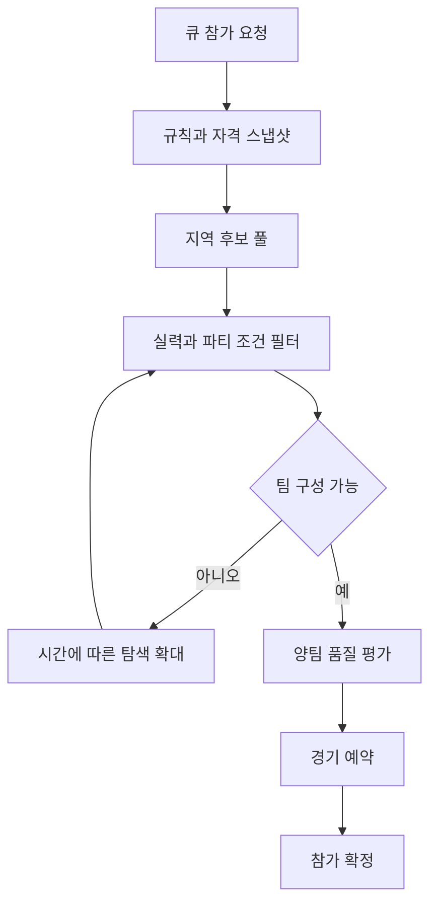

# 13. 매치메이킹·트로피·Prestige·대전 품질 역기획

> 분석 기준: 2026-11-13. **[공식]**은 공개된 정책, **[해석]**은 시스템 효과 분석, **[제안]**은 재구현 모델이다. MMR 산식·서버 배치 계수·봇 삽입 확률은 공개되지 않아 추정값을 사실로 쓰지 않는다.

## 1. 표시 점수와 실력 추정을 구분해야 하는 이유 [해석]

트로피는 성취와 진행을 보여준다. 매칭은 다음 경기를 공정하고 빠르게 성립시켜야 한다. 두 목적이 항상 같지는 않다. 새 브롤러의 트로피가 낮더라도 계정 소유자는 조준·회피·맵 이해에 숙련되어 있을 수 있고, 많은 경기로 진행도를 쌓았다고 모든 역할에 같은 실력을 가진 것도 아니다.

따라서 역기획의 첫 원칙은 표시 진행도, 숨은 실력 추정, 경쟁전 등급, 이벤트 전용 매칭을 같은 숫자로 취급하지 않는 것이다.

## 2. 공개된 현행 매칭 정책

[공식] 일반 솔로 매칭은 MMR을 사용하며 승패·총 트로피·브롤러 평균 트로피 등을 고려한다. 파티는 가장 높은 MMR의 구성원을 기준으로 한다. 특별 모드에는 별도 기준이 있을 수 있고, 경쟁전은 Rank Score를 사용한다. 지역과 탐색 시간도 고려한다.[S1]

[공식] 2026년 2월 개편은 트로피와 분리된 숨은 MMR, 영구 Prestige 진행을 도입했다.[S2]

| 잘못된 단순화 | 문서에서 사용할 구분 |
|---|---|
| 같은 브롤러 트로피끼리만 만남 | 현재 일반전은 MMR 기반 정책 |
| 파티 평균 MMR로 매칭 | 공개 설명은 파티 최고 MMR |
| 모든 모드에 같은 매칭 적용 | 일반·경쟁·클럽 이벤트 별도 규칙 |
| 트로피가 0이면 완전 초보 | Prestige 이후 표시 초기화 가능 |
| 시즌마다 모든 브롤러 트로피 초기화 | 현재 Prestige와 과거 시즌 상자 체계 분리 |
| MMR이 같으면 같은 실력 | 팀 역할·브롤러 숙련·당일 상태 차이 존재 |

## 3. Prestige의 진행 모델

[공식] 지원 문서상 브롤러 1,000 트로피 도달 뒤 승리하면 Prestige 1로 전환되고 표시 트로피는 0에서 새 구간을 시작한다. 이후 1,000 단위로 Prestige가 증가하며, 진행은 Trophy Road와 관련 퀘스트에 반영된다.[S3]

[제안] 화면의 순환 트로피와 누적 진행 기여를 별도 값으로 저장한다. 그렇지 않으면 Prestige 순간 전체 계정 진행이 줄거나, 퀘스트가 음수로 변하는 오류가 생긴다.

| 값 | 사용처 |
|---|---|
| brawlerDisplayTrophies | 현재 Prestige 구간의 화면 표시 |
| prestigeLevel | 브롤러별 영구 성취 단계 |
| trophyRoadContribution | 계정 진행 보상의 기준 |
| matchRating | 상대 탐색을 위한 내부 추정치 |
| rankedScore | 경쟁전 등급과 매칭 |
| legacySeasonStat | 과거 시즌·구 Prestige 기록의 보존 |

이 필드명과 분리 방식은 제안이다. 원작 데이터베이스의 실제 스키마가 공개되었다는 뜻이 아니다.

## 4. 매칭 파이프라인 [제안]

탐색 확대는 원작의 세부 알고리즘을 복제한 것이 아니라, 공개된 ‘완벽한 매치보다 대기시간을 우선하는 경우’의 구현 모델이다. 확대 폭과 순서를 설정값으로 두고, 현재 적용된 제약을 로그에 남긴다.

## 5. 최적화 목표와 상충 관계 [해석]

매칭 품질은 실력차 하나로 설명되지 않는다. 비슷한 실력이라도 높은 지연, 역할 편중, 파티 대 솔로의 소통 차이가 있으면 불공정하게 느껴질 수 있다. 반대로 엄격한 조건만 고수하면 대기시간이 길어져 실제 경기 수가 줄어든다.

| 품질 축 | 개선 방향 | 다른 축에 미치는 영향 |
|---|---|---|
| 실력 근접 | 점수 범위 축소 | 대기시간 증가 |
| 네트워크 품질 | 가까운 서버 우선 | 후보 풀이 작아짐 |
| 파티 대칭 | 비슷한 파티 규모끼리 배치 | 드문 큐에서 지연 |
| 로스터 다양성 | 조합 중복 감소 | 신캐 출시 때 후보 부족 |
| 신규 보호 | 숙련자와 초기 계정 분리 | 친구와의 혼합 파티 처리 복잡 |
| 빠른 재경기 | 기존 좋은 팀 유지 | 높은 승률 팀의 체감 우위 |

설계 검토용 목적 함수는 `quality = skillCost + latencyCost + compositionCost + waitCost`처럼 분해할 수 있다. 실제 가중치·비선형 항·원작 사용 여부는 미확인이다.

## 6. 파티 매칭의 핵심 문제 [해석]

최고 MMR 기준은 숙련자가 낮은 계정과 함께 쉽게 상대 수준을 낮추는 것을 억제한다. 동시에 친구 간 실력차가 크면 초보 파티원이 어려운 경기를 경험할 수 있다. 이를 해결하려고 평균값으로 바꾸면 다른 악용 경로가 생긴다.

[제안] 큐 화면에서 ‘팀에서 가장 높은 수준을 기준으로 상대를 찾는다’는 점을 짧게 알리고, 승패 부담이 없는 연습 경로를 연결한다. 파티 리더만 알고 다른 구성원은 모르는 조건을 만들지 않는다.

## 7. 봇·연결 끊김·불공정 행위

[공식] 지원 문서는 일정 시간 활동하지 않는 팀원을 봇으로 대체할 수 있다고 설명한다.[S1] 이는 경기 중 대체 정책이며 처음부터 봇 상대를 배정하는 매칭 정책과 다르다.

[해석] 두 봇 경로를 같은 로그로 기록하면 매칭 보호의 효과와 AFK 복구 효과를 분리할 수 없다. 또한 반복적인 의도적 패배로 쉬운 매치를 얻으려는 행동은 정상적인 실력 하락과 구분하기 어렵다.

[제안] 이상행동 탐지는 개별 패배가 아니라 장기간의 입력 패턴·매치 반복·계정 관계와 운영 검토를 조합한다. 자동 판정 오류의 복구 경로를 두고, 일반 사용자에게 비공개 탐지 임계값을 추측해서 안내하지 않는다.

## 8. 경기 결과 정산 [제안]

1. 서버가 경기 종료 사유·팀 결과·개인 참가 상태를 확정한다.
2. 매칭 점수 갱신과 표시 트로피 변화를 별도로 계산한다.
3. Prestige 경계 통과 여부를 판정한다.
4. Trophy Road와 퀘스트에 기여할 유효 증가분을 발행한다.
5. 보상 거래를 연결하고 클라이언트에 결과 영수증을 보낸다.

`(matchId, playerId)`를 기본 정산 고유키로 고정하고, `settlementVersion`은 최초 확정 규칙 버전으로 보존한다. 재처리로 버전이 달라져도 같은 경기를 다시 지급하지 않는다. 사후 정정은 별도 `correctionId`와 차액 거래로 처리한다. 프레스티지 전환 연출을 건너뛰어도 영구 단계가 보존되어야 한다.

## 9. QA 시나리오 [제안]

| ID | 조건 | 기대 결과 |
|---|---|---|
| MT01 | 신규 브롤러를 선택한 숙련 계정 | 표시 트로피만으로 완전 신규 풀에 배치하지 않음 |
| MT02 | MMR 차이 큰 파티 | 최고 구성원 기준 정책 적용 |
| MT03 | 오프피크 탐색 장기화 | 완화된 제약과 대기시간을 로그에서 추적 |
| MT04 | 원거리 친구와 파티 | 서버 선택과 예상 지연의 일관성 |
| MT05 | Prestige 경계 승리 | 표시 초기화와 영구 진행 기여가 함께 정확히 반영 |
| MT06 | 결과 중복 수신 | 트로피·Prestige·MMR 중복 변화 없음 |
| MT07 | 경기 중 AFK 후 복귀 | 봇과 인간의 제어권이 겹치지 않음 |
| MT08 | 일반전에서 경쟁전으로 전환 | 매칭 지표와 자격 규칙 분리 |
| MT09 | 구 시즌 통계 마이그레이션 | 현재 점수에 중복 합산하지 않음 |
| MT10 | 승리 후 UI만 오래된 값 표시 | 재조회 시 확정 원장으로 복구 |

## 10. 대전 품질 지표 [제안]

평균 대기시간은 전체 큐의 꼬리를 숨긴다. 모드·시간대·지역·파티 크기·실력 구간별 p50/p95 대기시간을 분리한다. 접전률은 재밌는 경기의 대리 지표이지만, 한쪽이 초반부터 밀리고 마지막 점수만 가까웠을 수도 있어 시간대별 우세 변화도 봐야 한다.

| 지표 | 목적 |
|---|---|
| 예상 승률과 실제 결과의 보정 | 점수 추정이 맞는지 확인 |
| 구간별 대기시간 | 드문 큐에서 접근성이 무너지는지 확인 |
| 일방적 경기 비율 | 매칭과 모드 눈덩이 효과를 분리 |
| 파티 대 솔로 성과 | 소통 우위의 영향 |
| 재경기 선택률 | 같은 팀·모드 경험 만족의 참고 |
| AFK·봇 대체 비율 | 매칭과 접속 품질 문제 구분 |

## 출처와 확인 범위

- [S1: How Matchmaking Works](https://sc-brawlstars.zendesk.com/hc/en-us/articles/49526614537371-How-Matchmaking-Works) — MMR·파티·모드·지역·AFK의 공개 정책.
- [S2: 2026년 2월 패치](https://supercell.com/brawlstars/en/blog/release-notes/release-notes-february-2026/) — 새 트로피·Prestige·MMR 체계.
- [S3: Prestige](https://sc-brawlstars.zendesk.com/hc/en-us/articles/49526655347483-Prestige) — 전환과 누적 진행.

관련 문서: [성장](09_roster_progression.md), [경쟁전](12_ranked_draft.md), [클럽](14_social_clubs.md), [전체 목차](../README.md).
