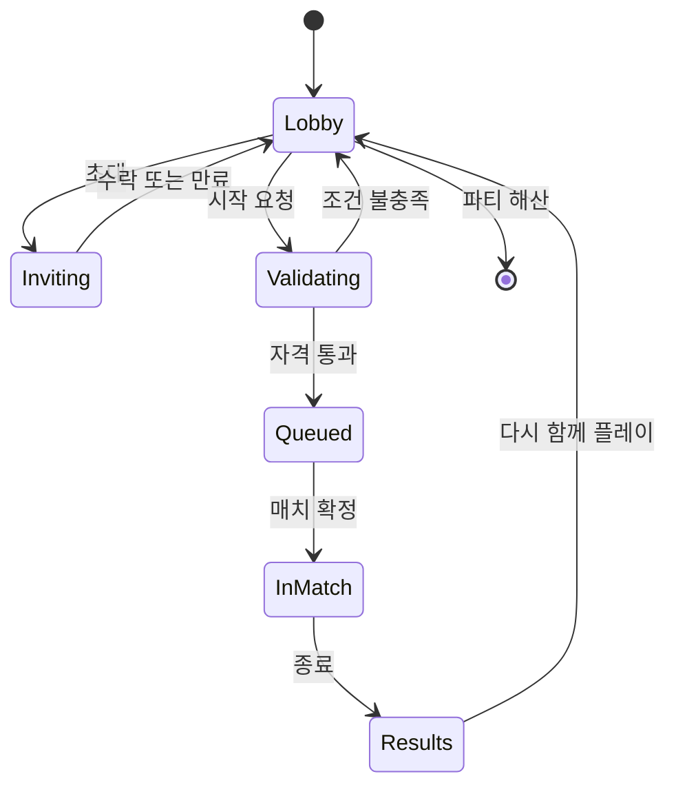

# 14. 친구·파티·클럽·공동 보상 역기획

> 분석 기준: 2026-11-13. **[공식]** 공개 기능, **[해석]** 협동 구조 분석, **[제안]** 데이터·UI·검증 규격을 분리한다.

## 1. 소셜 구조가 게임에 필요한 이유 [해석]

짧은 팀 전투에서는 조준 실력만큼 ‘아군이 무엇을 할지 예상할 수 있는가’가 중요하다. 친구·파티는 소통 비용을 줄이고, 클럽은 반복적으로 만날 사람과 공동 목표를 제공한다. 개인전과 달리 아군의 실수가 자신의 패배로 이어지므로 좋은 팀원을 다시 만나는 경로가 유지율과 밀접하다.

다만 공동 보상을 너무 강하게 연결하면 클럽을 친목보다 의무 노동 조직으로 느낄 수 있다. 참여 기회와 보상 자격의 투명성이 필요하다.

## 2. 공식 구조 요약

[공식] 클럽은 채팅·리플레이 공유·공동 이벤트를 제공하며, President·Vice President·Senior·Member 역할에 따라 관리 권한이 다르다.[S1]

[공식] Mega Pig는 제한된 티켓으로 승리를 모으는 클럽 이벤트다. 참여 승리와 클럽 이동 여부가 보상 자격에 영향을 주며, 티켓이 없는 클럽원도 조건에 따라 동행할 수 있지만 자신의 승리가 추가 기여로 계산되지는 않는다.[S2]

| 연결 단계 | 사용자 기대 | 설계상 분리 |
|---|---|---|
| 친구 | 다시 만나기 | 관계 상태와 온라인 상태 |
| 파티 | 바로 함께 플레이 | 일시적 세션과 리더 권한 |
| 클럽 | 지속적인 소속 | 멤버십·역할·기여 원장 |
| 공동 이벤트 | 함께 보상 얻기 | 현재 소속과 보상 자격 스냅샷 |
| 관전·리플레이 | 배우고 공유하기 | 전투 데이터 접근 권한 |

## 3. 파티의 상태 흐름 [제안]

파티 구성과 큐 상태를 분리한다. 매칭 취소가 파티 해산을 뜻해서는 안 되고, 경기에서 잠시 연결이 끊긴 플레이어가 자동으로 다른 파티에 합류해 두 세션에 속해서도 안 된다.

## 4. 권한 설계 [해석·제안]

역할의 이름보다 중요한 것은 누가 누구를 대상으로 어떤 행동을 할 수 있는가다. 같은 등급끼리 서로 추방할 수 있는지, 회장이 자리를 비우면 누가 위임받는지, 실수로 승격한 뒤 되돌릴 수 있는지가 운영 경험을 결정한다.

| 기능 | 구현 시 검증 |
|---|---|
| 가입 승인 | 요청 상태·정원·현재 자격 |
| 추방 | 행위자와 대상의 역할 관계 |
| 승격·강등 | 허용되는 역할 전이 |
| 설명 변경 | 수정 권한과 버전 충돌 |
| 이벤트 기여 확인 | 개인별 공개 범위와 총합 |
| 채팅·리플레이 공유 | 멤버십·차단·연령 관련 계정 정책 |

원작의 정확한 자동 회장 위임 정책이나 클럽 정원은 이 자료에서 재확정하지 않았다. 재구현 값은 운영 설정으로 둔다.

## 5. 공동 보상의 두 가지 원장 [제안]

클럽의 진행도와 개인의 보상 자격을 별도로 기록한다.

- `ClubEventProgress`: 클럽이 이벤트 전체에서 쌓은 유효 기여.
- `MemberEventEligibility`: 개인이 어느 클럽에서 어떤 유효 행동을 했는지.
- `MembershipTimeline`: 가입·탈퇴·추방 시점의 이력.
- `RewardReceipt`: 최종 보상 대상과 실제 지급 내역.

이 구분이 없으면 기여 후 탈퇴·재가입한 유저의 승리가 중복 합산되거나, 현재 멤버라는 이유만으로 아무 기여 없이 보상을 받을 수 있다.

## 6. Mega Pig의 설계 분석 [해석]

티켓 제한은 숙련자의 무제한 플레이가 전체 결과를 독점하는 것을 막고, 여러 멤버의 참여를 중요하게 만든다. 반면 초보자가 티켓을 모두 잃으면 팀에 기여하지 못했다는 부담을 느낄 수 있다. 능숙한 클럽원의 동행 경로는 이 간극을 줄이는 역할로 해석할 수 있다.

공동 보상을 받기 위한 최소 기여 조건은 무임승차를 줄이지만, 늦게 가입한 사람이나 일정이 맞지 않는 사람을 배제한다. 이벤트가 시작되기 전 참여 기간과 자격을 보여주는 것이 중요하다.

상위 기여자 보상은 경쟁을 만들지만, 팀 플레이에서 마지막 처치나 쉬운 상대를 독점하게 하면 협동을 해칠 수 있다. 가능한 한 공동 승리와 기여가 일치하도록 지표를 정해야 한다.

## 7. 클럽 이동과 보상 자격 [제안]

| 사례 | 필요한 질문 |
|---|---|
| A 클럽 기여 후 탈퇴 | 기존 기여의 개인 자격이 남는가? |
| B 클럽 가입 후 새 기여 | 어느 클럽 보상만 받는가? |
| B 클럽 가입만 하고 미기여 | A·B 중 어느 자격이 소멸하는가? |
| 종료 직전 추방 | 운영자가 보상을 박탈할 수 있는가? |
| 이벤트 도중 클럽 삭제 | 기여 원장과 최종 지급 주체는? |
| 티켓 없는 멤버 동행 | 경기 결과와 기여 계산을 어떻게 구분하는가? |

[공식] Mega Pig 지원 문서는 A에서 기여 후 B에 가입했으나 B에 기여하지 않은 경우 두 클럽 보상 모두 받지 못하는 예시를 제공한다.[S2] 이 규칙을 다른 모든 클럽 이벤트의 보편 정책으로 확대하지 않는다.

## 8. 사회적 피드백과 피로 [해석]

랭크 상승·기록 달성·리플레이 공유는 말이 없어도 소속감을 만든다. 그러나 자동 알림이 많아지면 사람이 보낸 메시지가 묻힌다. 참여 독촉과 성과 축하를 같은 시각 무게로 표시하면 접속할 때마다 숙제를 검사받는 느낌이 생길 수 있다.

[제안] 사람이 보낸 채팅, 시스템 성취, 이벤트 진행 알림을 시각적으로 분리한다. 활동이 없는 클럽원을 공개적으로 낙인찍는 기능보다, 이벤트 잔여시간과 개인 자격을 본인에게 정확히 알려주는 것이 낫다.

## 9. 데이터 계약 [제안]

| 엔티티 | 핵심 필드 |
|---|---|
| SocialRelation | requester, target, state, blocked |
| PartySession | leaderId, members, modeId, revision |
| ClubMembership | clubId, playerId, role, joinedAt, leftAt |
| ClubEvent | eventId, rulesVersion, startAt, endAt |
| Contribution | eventId, matchId, playerId, clubIdAtCredit, amount |
| RewardEligibility | eventId, playerId, eligibleClubId, reason |
| ModerationAction | actorId, targetId, action, reason, auditTime |

친구·파티·클럽 각각에 동일한 ‘팀 ID’만 사용하면 수명이 다른 관계가 섞인다. 초대는 일회성이고 클럽 기여는 이벤트가 끝난 뒤에도 감사를 위해 남겨야 한다.

## 10. QA 시나리오 [제안]

| ID | 조건 | 기대 결과 |
|---|---|---|
| SC01 | 같은 초대 중복 수락 | 파티 멤버 한 번만 추가 |
| SC02 | 리더 이탈과 시작 요청 동시 | 단일 리더·단일 큐 상태 유지 |
| SC03 | 권한 없는 멤버의 추방 요청 | 서버에서 거절 |
| SC04 | 기여 경기 결과 재전송 | 클럽·개인 기여 중복 없음 |
| SC05 | 기여 후 다른 클럽 가입 | 해당 이벤트의 이동 정책 적용 |
| SC06 | 티켓 없는 동행 승리 | 유효 기여와 경기 승리 기록 분리 |
| SC07 | 보상 지급 직전 탈퇴 | 고정된 자격 스냅샷으로 일관 처리 |
| SC08 | 재접속 시 옛 역할 캐시 | 현재 서버 권한으로 갱신 |
| SC09 | 차단한 플레이어의 초대 | 계정 정책에 따라 차단·제한 |
| SC10 | 삭제된 리플레이 링크 | 안전한 만료 표시와 화면 복귀 |

## 11. KPI [제안]

친구 추가 후 함께 플레이한 비율, 첫 클럽 가입 후 참여까지 걸린 시간, 파티 재경기율, 이벤트 멤버 참여 분포, 상위 소수에게 기여가 집중되는 정도, 클럽 이동 후 보상 관련 문의를 본다.

클럽 규모가 크다는 이유만으로 활발하다고 판단하지 않는다. 서로 다른 구성원 사이의 실제 동행 관계와 반복 참여가 존재하는지 확인한다.

## 출처와 확인 범위

- [S1: Clubs and Club Roles](https://sc-brawlstars.zendesk.com/hc/en-us/articles/49526584348443-Clubs-and-Club-Roles) — 클럽 기능과 역할 권한.
- [S2: Mega Pig](https://sc-brawlstars.zendesk.com/hc/en-us/articles/49526598894235-Mega-Pig) — 티켓·기여·동행·클럽 이동 보상 예시.

관련 문서: [매칭](13_matchmaking_trophies.md), [라이브 운영](15_liveops_events.md), [경제](10_economy_rewards.md), [전체 목차](../README.md).
