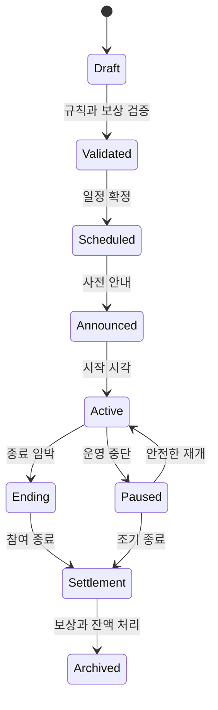

# 15. 라이브 운영·시즌·로테이션·기간 이벤트 역기획

> 분석 기준: 2026-11-13. 공식 공지에 등장하는 모드와 실제 오늘 열려 있는 슬롯은 다르다. 본 문서는 클라이언트의 실시간 이벤트 화면을 확인한 운영 달력이 아니다.

## 1. 운영 단위의 분리 [해석]

브롤스타즈는 동일한 전투 조작을 유지하면서 모드·맵·능력 변형·보상·외형을 바꿔 새로운 경험을 만든다. 이를 모두 ‘시즌’ 한 단어로 묶으면 어떤 변화가 실제 경기 규칙을 바꾸고 어떤 변화가 보상만 바꾸는지 흐려진다.

| 운영 단위 | 바뀌는 것 | 다른 단위와의 관계 |
|---|---|---|
| 밸런스 패치 | 브롤러 수치·능력 | 여러 모드에 동시에 영향 |
| 맵 로테이션 | 교전 지형·엄폐·목표 배치 | 같은 모드의 역할 가치를 바꿈 |
| 모드 슬롯 | 가능한 경기 규칙 | 큐 인구를 분산·집중 |
| 규칙 변형 | 기존 모드에 추가 조건 | 경쟁전·기간 이벤트 허용 구분 |
| 테마 시즌 | 외형·화면·보상 정체성 | 핵심 승리 규칙과 독립 가능 |
| 이벤트 | 기간 목표·임시 능력·재화 | 참여 자격과 종료 정책 필요 |
| 커뮤니티 목표 | 전체 이용자의 누적 행동 | 개별 보상 자격과 구분 |

## 2. 확인된 운영 구조

[공식] 공식 모드 안내는 이벤트 슬롯이 주기적으로 바뀌며 일반 트로피·경쟁전·맵 메이커·특별 이벤트가 서로 다른 기간을 가진다고 설명한다.[S1] 공식 패치들은 신규 모드·복귀 모드·밸런스·맵 변경을 함께 공지한다.[S2]

[해석] 복귀 모드의 이름이 같더라도 점수·맵·변형 능력이 바뀔 수 있다. 따라서 ‘이름=규칙 버전’이라는 저장 방식을 피해야 한다. 역사 모드 분석은 당시 버전의 기록으로 남기고, 재등장 때 덮어쓰지 않는다.

## 3. 이벤트 생애주기 [제안]

참여 종료와 보상 수령 종료를 분리한다. 전투는 끝났지만 이미 달성한 보상을 받을 수 있는 기간이 남을 수 있기 때문이다. 이벤트를 화면에서 숨기는 것만으로 종료 처리하면 미수령 보상이 사라진 것처럼 보인다.

## 4. 모드·변형·인구의 관계 [해석]

모드를 추가하면 선택 폭이 넓어지지만 각 큐의 인구는 줄어들 수 있다. 3v3·5v5·개인전·PvE를 모두 동시에 열면 희소 지역과 시간대에서 매칭 조건을 완화해야 할 가능성이 커진다.

로테이션은 콘텐츠의 희소성을 만드는 장치이면서 대전 인구를 관리하는 장치다. 다만 좋아하는 모드가 사라졌을 때 플레이어가 다른 모드로 이동하는지 게임을 떠나는지 구분해야 한다.

[제안] 운영 실험은 다음 세 집단을 비교한다.

- 원래 그 모드를 즐기던 유저.
- 보상을 얻기 위해 처음 들어온 유저.
- 친구·클럽 때문에 함께 들어온 유저.

종료 후 재방문이 유지되는지까지 보아야 모드 자체의 매력을 평가할 수 있다.

## 5. 임시 능력과 영구 성장의 경계 [해석]

기간 능력은 평소 불가능한 조합을 체험하게 하고 테마의 개성을 만든다. 그러나 영구 로스터의 약점을 가려 실제 성능 평가를 왜곡할 수 있다. 이벤트에서 강했던 브롤러를 평소 전투에서도 강하다고 기대하는 문제다.

[제안] 전투 입장 직전에 적용되는 모든 변형을 보여주고, 결과 화면에서도 이벤트 규칙이 적용되었다는 태그를 남긴다. 통계·리플레이·퀘스트·밸런스 분석은 규칙 버전으로 필터링한다.

`resolvedRules = baseMode + eventModifier + mapRules + rosterOverrides`

충돌 우선순위는 데이터에서 명시한다. 같은 능력의 사거리와 재사용 대기시간을 여러 변형이 바꾸면 덮어쓰기·합산·곱산 중 무엇을 쓰는지 테스트해야 한다.

## 6. 이벤트 설정 스키마 [제안]

| 필드 | 용도 |
|---|---|
| eventId / revision | 이벤트 정체성과 수정 버전 |
| modeRulesetId | 승리·점수·리스폰 규칙 |
| mapPoolId | 후보 맵과 선택 가중치 |
| modifiers | 임시 능력·점수·환경 규칙 |
| eligibility | 계정 진행·브롤러 수·지역 등 |
| rosterPolicy | 보유 브롤러·대여·최고 레벨 처리 |
| rewardPolicy | 티켓·승리·순위·참가 보상 |
| schedule | 안내·참여·교환·수령 종료 |
| economyExpiry | 남은 재화·권한의 처리 |
| rollout | 적용 대상·점진 배포·중단 조건 |

설정 파일만 바꿔 새 이벤트를 만들 수 있더라도, 지원하지 않는 조합은 검증 단계에서 거부해야 한다. 예를 들어 무리스폰 라운드와 ‘리스폰 직후 효과’를 무조건 함께 켜지 않는다.

## 7. 밸런스 패치가 만드는 연쇄 영향 [해석]

단일 브롤러의 지속 피해 상승은 금고 모드의 경기 길이, 보스 모드의 난이도, 회복형 지원의 가치에 서로 다른 영향을 준다. 전체 승률 평균만 보면 특정 모드가 붕괴해도 드러나지 않을 수 있다.

[제안] 패치 검토 단위는 `브롤러×모드×맵 특성×플레이 수준`이다. 전체 조합을 모두 실기 시험하기 어렵다면 목표물 피해·이동 범위·생존 보정 등 영향 축을 태깅해 위험도가 높은 셀을 우선 검증한다.

## 8. 예고와 실제 적용의 문서 관리 [제안]

| 상태 | 사용자에게 표시할 표현 |
|---|---|
| 공개 예고 | 예정, 적용일 확인 필요 |
| 패치 파일 포함 | 클라이언트 제공 가능, 슬롯 활성 별도 |
| 운영 슬롯 활성 | 해당 지역·시각에서 플레이 가능 |
| 종료 후 역사 기록 | 과거 규칙, 재등장 시 변경 가능 |
| 기능 중단 | 재개 여부 미확정 |

공식 공지의 ‘later this update’를 즉시 플레이 가능한 것으로 번역하지 않는다. 특정 장비의 사전 밸런스 변경이 공개되었다고 브롤러가 출시되었다고 단정하지 않는다.

## 9. 운영 중단과 복구 [제안]

이벤트 장애는 전투·보상·상점·랭킹 중 어디에 문제가 있는지 먼저 구분한다. 보상 중복 오류 때문에 전체 전투를 중단할 필요가 없을 수도 있고, 경기 판정 오류라면 보상만 잠가도 공정성이 훼손된다.

복구 원칙은 진행 중 경기의 규칙 스냅샷을 유지하고, 신규 진입을 제한하며, 미정산 결과를 추적 가능한 상태로 보관하는 것이다. 보상 보정은 이벤트 ID와 장애 시간 범위에 연결한다.

## 10. QA 시나리오 [제안]

| ID | 조건 | 기대 결과 |
|---|---|---|
| LO01 | 일정 시작 직전 앱 실행 | 서버 시각에 맞는 상태 표시 |
| LO02 | 종료를 걸친 경기 | 사전 정의된 보상 자격 적용 |
| LO03 | 맵과 모드 규칙 조합 불가 | 배포 전 설정 검증 실패 |
| LO04 | 임시 능력 종료 | 영구 소유·성장 데이터 손상 없음 |
| LO05 | 이벤트 재등장 | 과거 규칙과 신규 규칙 버전 분리 |
| LO06 | 같은 보상 보정 재실행 | 중복 지급 없음 |
| LO07 | 일부 지역 활성화 | 비대상 계정에 잘못된 큐 노출 없음 |
| LO08 | 전투만 중단 | 교환·수령 기간 UI와 분리 |
| LO09 | 패치 직후 리플레이 재생 | 당시 규칙 버전을 확인하거나 만료 안내 |
| LO10 | 미수령 보상 존재한 채 종료 | 정책에 맞는 자동 수령 또는 유예 안내 |

## 11. KPI와 역기획 활용 [제안]

신규 모드의 성과는 첫 접속 클릭률, 첫 세 경기 이탈률, 보상 획득 후 재플레이, 파티 생성률, 기존 모드의 큐 품질 변화로 평가한다. 이벤트의 경제 가치를 줄였을 때도 남는 플레이 수요가 모드의 독립적인 강점을 보여준다.

이 시스템을 재구현한다면 첫 프로토타입에서는 모드 두 개와 변형 한 개로 설정 경계를 검증한다. 콘텐츠 수를 늘리기 전에 시작·종료·정산·재등장까지 한 번 완주해야 한다.

## 출처와 확인 범위

- [S1: Game Modes](https://sc-brawlstars.zendesk.com/hc/en-us/articles/49526599632923-Game-Modes) — 슬롯과 이벤트 분리.
- [S2: 공식 업데이트 아카이브](https://supercell.com/brawlstars/en/blog/) — 날짜가 있는 변경 문서의 접근점.

관련 문서: [퀘스트·패스](11_quests_passes.md), [매칭](13_matchmaking_trophies.md), [클럽](14_social_clubs.md), [전체 목차](../README.md).
