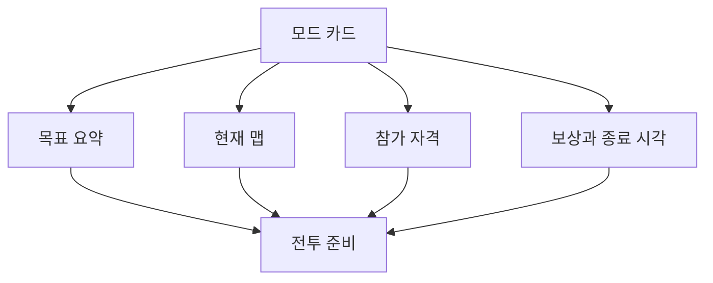

# 16. 홈·온보딩·메타 UI·결과 피드백 역기획

> 분석 기준: 2026-11-13. 공식 기능 설명을 토대로 한 UX 역기획이다. 실제 클라이언트의 모든 화면을 직접 캡처·실측한 자료가 아니다. 이하 구체적인 화면 배치·우선순위는 별도 표시가 없으면 **[제안]**이다.

## 1. UX의 중심 과제 [해석]

브롤스타즈의 홈 화면은 전투 시작, 브롤러 선택, 성장, 보상 수령, 시즌 목표, 소셜 기능을 연결해야 한다. 정보가 많아도 플레이어가 지금 할 수 있는 가장 중요한 행동을 바로 찾게 만드는 것이 핵심이다.

초보에게 필요한 것은 모든 기능의 설명이 아니라 다음 전투에서 성공할 수 있는 작은 학습이다. 숙련자에게는 원하는 모드·브롤러·장비로 빠르게 진입하는 경로가 중요하다. 같은 화면이 두 사용자 모두를 지원해야 한다.

## 2. 정보 구조 [제안]

| 사용자 질문 | 우선 정보 | 연결 행동 |
|---|---|---|
| 지금 무엇을 할까? | 선택 모드·맵·목표·이벤트 상태 | 전투 시작 또는 모드 변경 |
| 누구로 할까? | 선택 브롤러·역할·구성 | 브롤러 선택·연습 |
| 준비가 됐나? | 레벨·능력·모드 자격 | 성장·장비 변경 |
| 무엇을 얻었나? | 미수령 보상과 출처 | 요약 수령 |
| 다음 목표는? | 퀘스트·패스·성장 목표 | 관련 화면 진입 |
| 누구와 할까? | 파티·친구·클럽 상태 | 초대·합류 |

새 이벤트가 추가될 때마다 홈 버튼을 늘리는 방식은 장기적으로 복잡해진다. 같은 목적의 진입점은 묶되, 현재 참가 중인 이벤트와 종료 임박 보상은 맥락적으로 드러낸다.

## 3. 온보딩을 기능 해금보다 경험으로 설계하기 [해석]

기능을 일정 진행도에서 여는 것은 정보를 나누는 방법이다. 하지만 숫자만 채웠다고 필요한 개념을 이해한 것은 아니다. 이동·조준·재장전·회복·목표 수행을 설명한 뒤 실제로 사용하게 해야 한다.

| 학습 단계 | 배울 판단 | 다음 단계로 넘어갈 증거 |
|---|---|---|
| 이동·사격 | 공격과 회피를 동시에 수행 | 조작을 멈추지 않고 짧은 교전 완료 |
| 탄약·회복 | 계속 공격하는 것 외의 선택 | 후퇴 후 회복·재진입 경험 |
| 목표 이해 | 처치와 승리가 다를 수 있음 | 모드 목표의 유효 기여 |
| 역할·맵 | 같은 브롤러가 모든 상황에 맞지 않음 | 다른 거리·역할을 경험 |
| 성장·구성 | 보유 능력과 사용 자격 구분 | 변경 결과를 연습에서 확인 |
| 경쟁·협동 | 팀과 맵에 맞춰 준비 | 자격·픽·목표를 스스로 확인 |

이 표는 교육 설계 제안이며 원작의 튜토리얼 구현을 그대로 기록한 것이 아니다.

## 4. 해금 안내와 권한의 불일치

[공식] 지원 문서에는 퀘스트·클럽·Records·Buffies 등에 서로 다른 진행도 조건이 제시된다.[S1–S4] 경쟁전은 2026년 11월 개편으로 신규 계정 조건이 변경되며 기존 접근권 예외가 있다.[S5]

[해석] 이런 구조에서는 ‘총 트로피가 이 숫자면 모든 계정이 같은 메뉴를 본다’는 가정이 위험하다. 기존 계정, 신규 계정, 복귀 계정, 대여 권한을 가진 계정이 서로 다를 수 있다.

[제안] 메뉴는 단순 수치 비교보다 서버의 기능 자격 결과를 사용한다. 잠긴 기능에는 충족하지 못한 조건 하나를 우선 보여주고, 여러 조건이 있으면 상세 화면에서 확인하게 한다.

## 5. 모드 선택 화면 [제안]

각 모드 카드는 이름과 그림 외에 참가 인원, 목표 유형, 트로피 변화 여부, 임시 규칙, 남은 기간을 전달한다. 3인 팀 쇼다운과 4팀 젬 그랩처럼 모두 ‘Trio’라는 단어가 들어갈 수 있으므로 팀 수와 팀당 인원을 별도로 표시한다.

기간 이벤트는 ‘새로운 전투 규칙’과 ‘기존 모드에서 보상만 증가’를 구분한다. 플레이어가 보상 이미지를 보고 전혀 다른 게임을 예상하지 않게 한다.

## 6. 브롤러 선택과 성장 화면 [제안]

브롤러 목록은 소유·미보유·대여·사용 불가를 명확히 구분한다. 성장 추천이 있어도 바로 구매 화면으로 보내기보다, 역할과 공격 방식을 확인하고 연습할 수 있어야 한다.

장비 화면은 다음 세 가지 질문에 답해야 한다.

1. 이미 가진 능력인가?
2. 지금 사용할 수 있는가?
3. 이번 경기 구성에 실제로 적용되는가?

예를 들어 Buffie가 자동 적용되는 경우와 Gadget 선택 슬롯이 있는 경우를 같은 체크 표시로 표현하면 혼란이 생긴다. 영구 강화·선택 장착·임시 최고 레벨의 출처를 구분한다.

## 7. 결과 화면과 학습 피드백 [해석]

처치 수만 강조하면 지원·목표 수행·생존의 가치가 낮게 보일 수 있다. 반대로 모든 숫자를 같은 크기로 나열하면 무엇을 개선해야 하는지 알 수 없다.

[공식] 최신 패치는 전투 후 통계와 Battle Log에서 피해·회복·피격·목표 점수 등을 더 상세히 볼 수 있도록 개선했다.[S5]

[제안] 첫 결과 화면은 승패, 목표 결과, 진행 변화, 다시 플레이를 우선한다. 상세 통계는 별도 펼침으로 제공하고, 모드마다 의미가 다른 지표를 구분한다. 금고 피해와 적 브롤러 피해, 보석 운반과 처치 수를 같은 기여 점수처럼 단순 합산하지 않는다.

## 8. 경고·오류·네트워크 상태 [제안]

| 상황 | 좋은 피드백 |
|---|---|
| 매칭이 오래 걸림 | 현재 대기 중임과 취소 가능 여부 |
| 자격이 부족함 | 부족한 조건과 해결 경로 |
| 보상 정산 지연 | 미지급과 처리 중을 구분 |
| 경기 연결 복구 | 조작 가능 시점과 대상 유지 |
| 이벤트 종료 | 참가 종료와 수령 기간 분리 |
| 장비 적용 실패 | 실제 구성 스냅샷과 실패 원인 |

오류 메시지는 내부 오류코드만 보여주지 않는다. 플레이어가 다시 시도해도 되는지, 이미 보상이 지급되었는지, 기존 파티가 유지되는지 행동에 필요한 정보를 준다.

## 9. 접근성과 읽기 부담 [제안]

팀 색상만으로 적과 아군을 구분하지 않고 윤곽·아이콘·배치 정보를 함께 쓴다. 특히 4팀 모드는 두 팀보다 색상 구분 부담이 크다. 화면 밖 목표 표시에는 팀과 목적을 함께 표기한다.

숫자와 효과음은 중복된 정보를 줄 수 있지만, 중요한 판정이 소리에만 의존해서는 안 된다. 카운트다운·연장·점수 변화는 시각적으로도 전달한다. 터치 버튼은 장치의 비율과 손잡이에 맞게 바뀔 수 있어도 경기 판정 좌표는 일관되어야 한다.

## 10. QA 시나리오 [제안]

| ID | 조건 | 기대 결과 |
|---|---|---|
| UX01 | 신규 계정과 기존 접근권 계정 | 같은 트로피라도 자격에 맞는 UI 표시 |
| UX02 | 4팀 모드 선택 | 3인 팀과 전체 12인을 혼동하지 않음 |
| UX03 | 능력 소유·레벨 미달 | 소유와 사용 불가를 동시에 이해 가능 |
| UX04 | 임시 최고 레벨 이벤트 종료 | 영구 성장 수치로 자연스럽게 복귀 |
| UX05 | 결과 화면 닫기 후 재접속 | 지급된 보상과 통계가 유지 |
| UX06 | 작은 화면·긴 번역 문자열 | 목표·타이머·버튼이 잘리지 않음 |
| UX07 | 색상 인지 차이 | 팀 정보와 주요 목표를 다른 단서로 판별 |
| UX08 | 보상 정산 지연 | 중복 구매·중복 수령을 유도하지 않음 |
| UX09 | 드래프트 제안과 확정 | 시각 상태가 명확히 구분 |
| UX10 | 옛 이벤트 캐시 | 현재 서버 규칙과 다른 입장을 막음 |

## 11. KPI와 실기 검증 계획 [제안]

홈에서 첫 전투까지의 시간, 목표 설명을 읽은 뒤 실패하는 비율, 새 브롤러의 연습 사용률, 장비 변경 직후 되돌리기 비율, 자격 오류 후 회복률, 결과 화면에서 다음 전투로 이어지는 비율을 본다.

실기 검증에서는 신규·복귀·숙련 계정별로 같은 과제를 수행하게 하고, ‘버튼을 찾았는가’보다 ‘그 행동이 무엇을 바꾼다고 이해했는가’를 묻는다. 본 문서의 UI 배치 제안은 이 검증 결과로 수정해야 한다.

## 출처와 확인 범위

- [S1: Quests](https://sc-brawlstars.zendesk.com/hc/en-us/articles/49526613139227-Quests) — 퀘스트 진입.
- [S2: Clubs and Club Roles](https://sc-brawlstars.zendesk.com/hc/en-us/articles/49526584348443-Clubs-and-Club-Roles) — 클럽 진입과 기능.
- [S3: Records](https://sc-brawlstars.zendesk.com/hc/en-us/articles/49526600046235-Records) — 기록 화면과 성취 표시.
- [S4: Buffies](https://sc-brawlstars.zendesk.com/hc/en-us/articles/49526654819227-Buffies) — 자동 적용·진행 자격.
- [S5: 2026년 11월 패치](https://supercell.com/brawlstars/en/blog/game-updates/release-notes-november-2026/) — 경쟁전 자격 예외와 결과 통계 개선.

관련 문서: [성장](09_roster_progression.md), [경쟁전](12_ranked_draft.md), [라이브 운영](15_liveops_events.md), [전체 목차](../README.md).
