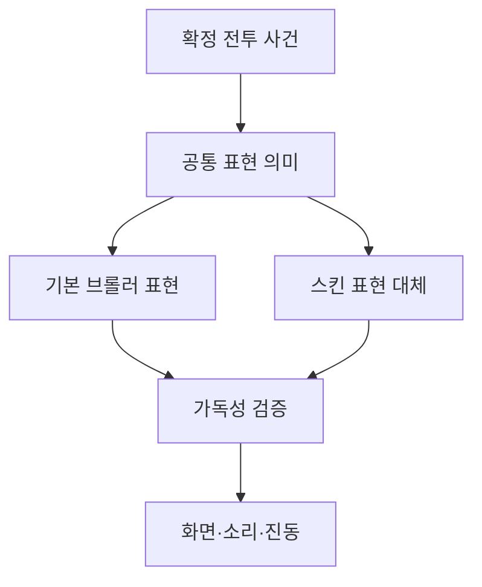

# 17. 아트·애니메이션·VFX·오디오·경쟁 가독성

> 공개 기능과 화면을 해석한 설계 원칙, 재구현 시 필요한 제작 계약을 다룬다.
> 원작의 에셋 해상도, 폴리곤 수, 애니메이션 프레임 수, 사운드 믹서·엔진은 조사하지 않았다.

## 1. 시스템 목적 [해석]

전투 아트는 캐릭터의 개성을 보여 주는 동시에 판정 정보를 전달한다.
캐릭터가 어디에 있고, 무엇을 준비하며, 어느 쪽이 위험한지를 작은 모바일 화면에서 빠르게 읽게 해야 한다.
특히 여러 브롤러와 스킨이 같은 경기에서 나타나도 공격 의미를 다시 배울 필요가 적어야 한다.

[공식] 스킨은 모델·효과·애니메이션·소리를 바꿀 수 있는 외형 요소이며 전투 능력을 바꾸지 않는다고 설명된다.[S1]
이 원칙을 실제로 지키려면 데이터만 동일한 것으로는 부족하다. 공격을 알아보는 난도도 함께 검토해야 한다.

## 2. 시각 정보의 우선순위 [제안]

| 우선순위 | 정보 | 표현 원칙 |
| --- | --- | --- |
| 1 | 즉각적인 치명 위험과 목표물 | 배경·장식에 묻히지 않음 |
| 2 | 자기 위치·체력·행동 가능성 | 자신의 상태를 빠르게 읽음 |
| 3 | 적의 공격 준비·방향 | 대응할 시간을 제공 |
| 4 | 팀 목표·아군 협력 신호 | 화면 밖 사건도 전달 |
| 5 | 캐릭터 성격·희귀도·장식 | 핵심 정보를 덮지 않음 |

이 순위는 제작 제안이다.
실제 게임의 모든 프레임을 측정해 도출한 결과로 제시하지 않는다.

## 3. 실루엣과 동작 언어 [해석·제안]

캐릭터 크기와 자세는 전투 성격을 예측하는 단서가 된다.
그러나 큰 외형이 반드시 큰 피격 범위를 뜻하지 않는다면, 지면 표시와 실제 판정 중심을 일관되게 보여 줘야 한다.
지나친 과장 동작으로 공격 방향이나 공 소유 위치가 불명확해지지 않게 한다.

| 상태 | 제작 계약 |
| --- | --- |
| 대기 | 공격 준비와 혼동되지 않는 움직임 |
| 이동 | 실제 속도·방향 변화와 발 디딤의 일관성 |
| 공격 준비 | 발사 순간과 구분되는 예고 |
| 발사 | 판정과 연결된 핵심 포즈·소리 |
| 피격 | 행동 불가와 단순 피격 반응 구분 |
| 기절·속박 | 조작 제한의 종류 표시 |
| 강화 | 지속 시간과 실제 능력 상태 일치 |
| 사망·부활 | 생존·보호·조작 가능 시점 구분 |

표현을 위해 애니메이션을 지연하더라도 피해 판정이 애니메이션 종료를 무조건 기다리게 하지 않는다.
반대로 판정이 먼저 끝났는데 공격 준비 연출만 남는 일도 피한다.

## 4. VFX의 데이터 분리 [제안]

CombatDefinition은 피해·충돌·자원·시간을 정의하고,
PresentationDefinition은 투사체 외형·색·잔상·소리·카메라 반응을 정의한다.
SkinOverride는 후자를 교체하되 판정상의 위험 폭과 시점을 가리지 않도록 검사한다.

효과 파일을 재사용할 때도 아군/적군, 치유/피해, 장판/장식의 의미를 확인한다.
다른 색만 입히면 의미가 분명해진다는 가정은 색각 접근성에서 실패할 수 있다.

## 5. 오디오의 역할 [해석]

소리는 화면 밖 목표 피해, 능력 준비, 공 이동, 경기 종료 같은 사건을 전달할 수 있다.
동시에 여러 효과가 재생될 때 모든 음량을 높이면 중요한 사건을 찾기 어렵다.
킬·명중·목표 달성의 소리를 구분하면 무엇을 잘했는지 학습하기 쉽다.

[제안] 중요도, 거리, 반복 빈도, 같은 종류의 중복 수로 재생 우선순위를 관리한다.
무음 플레이에도 필수 정보가 남도록 시각적 대응 신호를 함께 둔다.
숨겨진 적 위치를 소리로 제공할지 여부는 시야 정책과 같은 설계 결정이다.

## 6. 카메라와 화면 반응 [제안]

큰 공격의 카메라 흔들림은 타격감을 높일 수 있지만 조준을 흔들고 멀미를 유발할 수 있다.
강도 조절과 감소 옵션을 제공하고, 경쟁적 조준 정보는 흔들림에 영향을 덜 받게 한다.
화면 확대·축소가 시야 정보량을 바꾸는 능력이라면 단순 연출이 아니라 게임 규칙으로 취급한다.

피격 플래시·슬로모션·정지 연출을 사용할 경우 로컬 표현인지 전투 시간 자체를 바꾸는지 명확히 한다.
원작이 어느 기법을 사용하는지는 기술 분석으로 확정하지 않았다.

## 7. 모드별 표현 요구

| 모드 성격 | 가장 중요한 표현 |
| --- | --- |
| 수집·운반 | 보유량·드롭 위치·운반자 |
| 점령 | 현재 진척·유효 참여·차단 원인 |
| 골 | 공·골라인·슛 경로 |
| 시설 | 화면 밖 시설 피해·임계 체력 |
| 생존 | 안전 구역·남은 생존자 |
| 보스 | 예고 공격·안전 공간·단계 변화 |
| 다라운드 런 | 경기 결과와 런 진행의 차이 |

## 8. 제작 데이터 [제안]

AttackCue, HitCue, StatusCue, ObjectiveCue, TeamPalette,
SkinReadabilityProfile, AudioPriority, HapticPolicy를 분리한다.

각 효과에는 시작·종료 사건, 재생 위치, 소유 대상, 팀 관계,
최대 동시 재생 수, 지연 도착 시 재생 여부가 필요하다.
동일 eventId의 재전송 때문에 소리와 피격 숫자가 두 번 나타나지 않게 한다.

## 9. QA

| 사례 | 제안 기대 결과 |
| --- | --- |
| 같은 공격의 여러 스킨 | 판정 크기와 위험 인지가 동등한 범위 |
| 열 명과 소환수·장판 | 목표물과 치명 위험 식별 가능 |
| 보호 종료와 VFX 종료 | 실제 상태와 일치 |
| 낮은 그래픽 옵션 | 필수 판정 정보 유지 |
| 무음 플레이 | 목표·위험 정보의 대체 표현 |
| 색각 조건 시뮬레이션 | 팀·위험 구분 가능 |
| 화면 밖 금고 피격 | 적절한 경고, 과도한 반복 방지 |
| 같은 사건 재전송 | 연출 중복 없음 |
| 빠른 변신·사망 | 이전 형태 효과가 영구 잔류하지 않음 |

## 10. KPI·출처

[제안] 공격 유형 오인율, 스킨별 회피 반응 차이, 효과 밀도별 목표 인지 시간,
음소거 비중, 저사양에서 필수 효과 누락을 평가한다.
실측 데이터가 없으므로 본 문서에 정답 임계값을 제시하지 않는다.

- [S1: Skins](https://support.supercell.com/brawl-stars/en/articles/skins-7.html)
- [조작·카메라](02_controls_camera.md) · [UX](16_ux_onboarding.md) · [전투](03_combat_damage.md)

