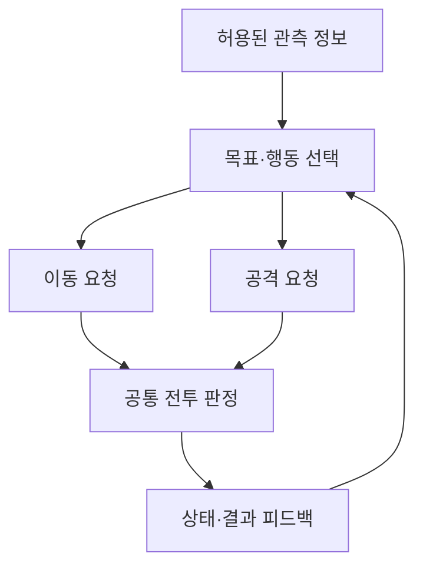

# 18. AI·소환수·중립 적·보스 패턴

> 원작 AI 소스·행동 트리·난도 테이블은 비공개이며 이 문서에서 확인하지 않았다.
> 공개 모드의 요구를 바탕으로 한 [해석]과 재구현 [제안]을 구분한다.

## 1. AI의 역할을 나누기

[공식] 모드 설명에는 금고를 공격하는 로봇 웨이브와 보스·소형 적을 상대하는 협동전이 존재한다.[S1]
같은 비플레이어 개체라도 경기에서 맡는 역할은 다르다.

| 유형 | 목적 | 잘못 설계했을 때 |
| --- | --- | --- |
| 전진 병력 | 공간 압박·라인 진행 | 경로 막힘·목표 망각 |
| 소환수 | 주인의 능력 확장 | 무한 추적·가독성 붕괴 |
| 중립 자원 적 | 위험을 감수한 성장 기회 | 공격자보다 마지막 개입자만 이득 |
| 보스 | 패턴 학습·협동 역할 | 체력만 많은 표적 |
| 수비 시설 | 안전 영역·공격 순서 | 표적 전환이 예측 불가 |
| 대체 플레이어 | 연결 공백 보완 | 비정상 정보 사용·실력 불일치 |

마지막 유형은 구현 검토용이다. 원작의 투입 조건과 정책은 미확인이다.

## 2. 판단과 실행의 분리 [제안]

AI가 목표를 선택하는 속도와 이동·공격을 시뮬레이션하는 속도는 같을 필요가 없다.
멀리 있는 적은 판단 빈도를 낮추고, 실제 투사체와 피해 판정은 공통 전투 모델을 사용하게 할 수 있다.
이는 원작의 최적화 방식을 설명하는 것이 아니다.



AI가 플레이어에게 보이지 않는 적 위치를 항상 정확히 사용하면 숨는 전략이 무의미해질 수 있다.
AI 종류별로 시야·청각·최종 확인 위치의 사용 범위를 정한다.

## 3. 표적 선택 [제안]

| 축 | 정책 예시 |
| --- | --- |
| 우선 목적 | 시설·가장 가까운 적·주인의 표적 |
| 유효 대상 | 플레이어·소환수·목표물 태그 |
| 추적 범위 | 시작 위치 또는 주인 기준 |
| 표적 고정 | 일정 시간 유지 또는 즉시 전환 |
| 시야 상실 | 마지막 위치 이동·포기·재탐색 |
| 경로 실패 | 우회·재계산·리셋 |
| 위험 회피 | 장판·가스·막다른 길 처리 |
| 공격 취소 | 대상 사망·무적·사거리 이탈 |

표적을 매번 가장 가까운 대상으로 바꾸면 두 플레이어 사이에서 계속 흔들릴 수 있다.
목표 고정과 변경 비용을 두면 플레이어가 AI를 읽고 유도할 수 있다.

## 4. 보스 패턴의 구성 [해석·제안]

좋은 보스 패턴은 위험을 예고하고, 플레이어가 회피 또는 대응을 선택하며,
그 선택의 결과가 다음 기회로 연결되는 구조를 가진다.
피해 범위와 예고 범위가 다르면 학습보다 억울함이 남는다.

```text
Pattern:
  select target or region
  telegraph threat
  lock or track aim according to explicit policy
  execute attack
  expose recovery window
  transition based on health/time/objective
```

도중 표적 변경이 가능한 패턴과 조준이 고정되는 패턴을 구분한다.
높은 난도에서도 예고를 없애기보다 동시에 처리해야 할 요구를 조절하는 방법을 먼저 검토할 수 있다.

## 5. 난도 축

| 축 | 조정 효과 | 위험 |
| --- | --- | --- |
| 체력 | 소요 시간 증가 | 반복 피로 |
| 피해 | 실수 허용 감소 | 한 번의 실수로 전멸 |
| 공격 간격 | 판단 압박 증가 | 회복·재장전 기회 소멸 |
| 보조 적 수 | 목표 우선순위 증가 | 화면·경로 과밀 |
| 패턴 조합 | 협동·공간 판단 증가 | 대응 불가능 조합 |
| 안전 구역 | 위치 선정 중요 | 특정 이동 능력 강제 |
| 부활 정책 | 팀 생존 앵커 가치 | 대기 시간 증가 |
| 단계 전환 | 전투 리듬 변화 | 과도한 무적 대기 |

모든 축을 한꺼번에 올리지 않는다.
어떤 실력을 시험하려는 난도인지 먼저 정해야 조정 결과를 평가할 수 있다.

## 6. 소환수와 능력 상호작용 [제안]

주인이 죽거나 변신해도 소환수가 남는지, 보스가 소환물을 공격하는지,
소환수 피해가 특수 공격 충전에 기여하는지, 처치 점수를 주는지는 개별 정책이다.
일반 브롤러를 작은 크기로 복제하면 이런 차이를 관리하기 어렵다.

소환수 수가 늘어날 때 경로 탐색·타깃 선정·피격 검사가 모두 증가한다.
같은 지점으로 몰리는 개체의 분산, 경로 캐시, 지역 단위 검색을 고려할 수 있지만
성능 계측 전에 특정 구현이 최적이라고 단정하지 않는다.

## 7. 웨이브·보스 데이터 [제안]

EncounterDefinition은 단계 조건과 목표를,
SpawnSchedule은 적 종류·등장 위치·시각을,
BehaviorProfile은 이동·공격·표적 규칙을,
DifficultyProfile은 수치와 패턴 변형을 관리한다.

보상 드롭과 보스 사망은 전투 사건에서 분리해 중복 처치를 방지한다.
한 보스가 형태를 바꾸는 경우 같은 encounterId 아래 phaseId만 갱신할지,
새 생명으로 처리할지 정한다.

## 8. 협동 실패와 복구 [해석·제안]

협동전에서는 한 사람이 실수해도 다른 사람이 복구할 여지가 있으면 역할이 선명해진다.
하지만 복구를 무한히 허용하면 전투가 끝나지 않을 수 있다.
전멸, 시간, 보호 시설 파괴, 보스 탈출 중 어떤 것이 실패를 결정하는지 모드별로 명시한다.

부활한 플레이어를 곧바로 같은 위험 한가운데 놓지 않되,
무적을 이용해 목표를 무제한 지키는 전략도 검토한다.
원작 부활 보호의 일반 규칙과 각 이벤트 예외를 구분해야 한다.

## 9. QA

| 사례 | 제안 기대 결과 |
| --- | --- |
| 목표에 경로가 없음 | 재계산·복귀·복구로 무한 정지 방지 |
| 표적이 순간이동 | 추적·공격 취소 정책 일치 |
| 숨은 플레이어 | 허용된 관측 정보만 사용 |
| 보스 사망과 단계 전환 동시 | 사망/다음 단계 하나로 처리 |
| 소환수 주인 사망 | 수명·귀속 정책 적용 |
| 전원 사망 직전 보스 처치 | 정해진 성공/실패 우선순위 |
| 적 대량 생성 | 전투 판정 성능 유지 |
| 벽 파괴로 새 경로 생성 | 경로 상태 갱신 |
| 재접속 | AI 단계와 예고 상태 복원 |
| 보상 사건 재전송 | 드롭·보상 중복 없음 |

## 10. KPI·출처

[제안] 패턴별 피격·사망, 목표 선택 변경 빈도, 경로 실패 시간,
난도별 재도전 성공, 보스 공격 가능 시간 비율, 역할별 기여 편차를 본다.
보스가 오래 산다는 이유만으로 어렵다고 평가하지 않는다.

- [S1: 공식 Game Modes](https://sc-brawlstars.zendesk.com/hc/en-us/articles/49526599632923-Game-Modes)
- [보스전](../modes/26_boss_fight.md) · [메카 가드](../modes/53_mecha_guard.md) · [브롤 아레나](../modes/38_brawl_arena.md)

