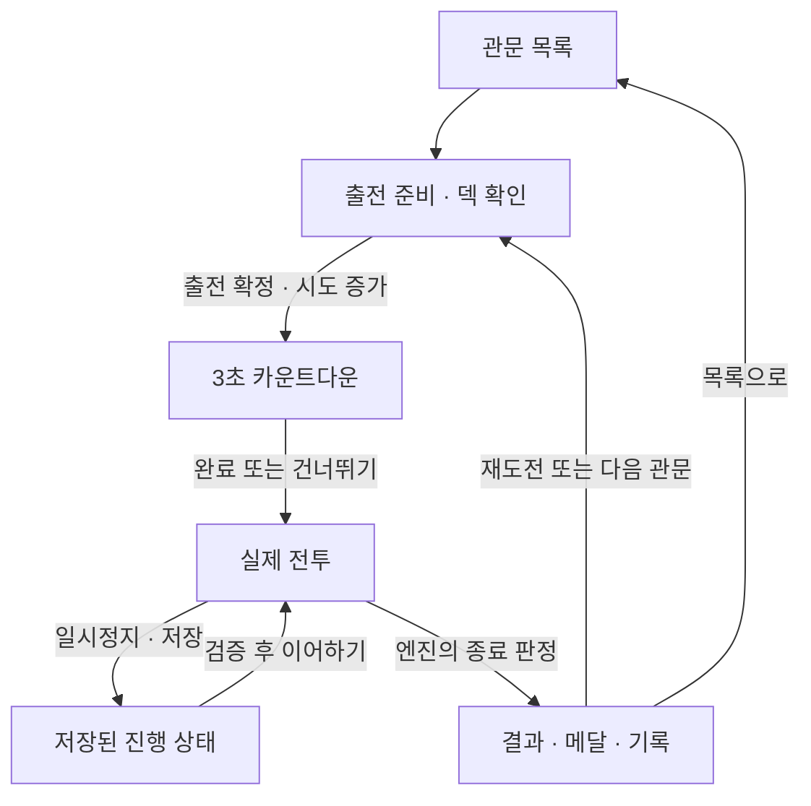

# Crownfall Arena — 싱글플레이와 캠페인

기준일: 2026-11-16. 이 문서는 현재 구현된 싱글플레이를 이용하는 방법과, 캠페인·저장·전투 기록을 연결하는 개발 계약을 설명한다. 캠페인과 전투 기록의 저장 스키마는 각각 버전 1이며, 신규 전투는 규칙 4를 사용한다. 이전 규칙 3의 진행 중 전투는 기존 규칙으로 복원한다. 엔진 저장과 리플레이 데이터는 버전 2, AI 저장은 버전 2다.

캠페인은 현재 선택한 8장 덱으로 여섯 관문에 도전하는 모드다. 승리하면 다음 관문이 열리고, 같은 관문을 다시 이겨 메달과 최고 기록을 개선할 수 있다. 세 상대의 원본 덱을 유지하며 단계에 따라 상대·판단 난이도·고정 seed·아레나 테마가 정해진다. 카드 능력치나 엘릭서 생성량에 캠페인 전용 보정은 없다. 원작의 계정 성장, 상점, 시즌, 네트워크 대전을 제공하는 모드는 아니다.

## 1. 구현의 기준 파일

| 역할 | 기준 파일 |
|---|---|
| 여섯 단계와 진척, 바인딩, 결과 적용 | [campaign.js](../dist/js/campaign.js) |
| 상대와 추천 덱 | [decks.js](../dist/js/decks.js) |
| 준비 화면, 카운트다운, 저장, 결과, 다음 단계 연결 | [app.js](../dist/js/app.js) |
| 실제 카드·자원·승패·항복·전투 상태 | [engine.js](../dist/js/engine.js) |
| 상대 판단과 AI 상태 복원 | [ai.js](../dist/js/ai.js) |
| 최근 8경기 기록 | [history.js](../dist/js/history.js) |
| 리플레이, JSON 파일, 전투 분석 | [session.js](../dist/js/session.js) |
| 별도의 목표 기반 전술 훈련 | [training.js](../dist/js/training.js) |

이 문서의 캠페인 API는 DOM, 타이머, LocalStorage를 직접 사용하지 않는다. 화면과 영속 저장은 앱이 담당한다. 전투 배치·이동·피해의 세부 규칙은 [코어 게임플레이 문서](CORE_GAMEPLAY.md)를 함께 참고한다.

## 2. 플레이 흐름

1. **관문 선택:** 캠페인 목록에서 열린 관문을 고른다. 첫 실행에는 1단계만 열려 있다. 목록에는 완료 여부와 단계별 최고 메달, 최고 클리어 시간이 표시된다.
2. **출전 준비:** 상대와 난이도, 상대 덱, 현재 내 덱, 평균 엘릭서, 단계 힌트를 확인한다. 덱 편집을 열어 바꾼 뒤 준비 화면으로 돌아올 수 있다. 준비 화면을 둘러보는 것만으로 시도 수가 늘지는 않는다.
3. **출전 확정:** 출전 버튼을 누르면 새 시도가 만들어지고 시도 수가 1 증가한다. 이후 3초 카운트다운을 거쳐 전투가 시작된다. 즉시 시작 버튼으로 준비 시간을 건너뛸 수도 있다.
4. **전투:** 카드 선택·필드 클릭, 드래그, 키보드 조준을 통해 일반 전투와 같은 비용으로 배치한다. 일시정지와 저장 후 로비 복귀, 항복을 사용할 수 있다.
5. **결과:** 승패, 크라운, 전투 시간, 카드 사용과 누적 피해, 메달 결과를 확인한다. 분석과 리플레이로 복기하거나 같은 관문을 다시 시작할 수 있다.
6. **다음 관문:** 승리 결과가 정상 적용되면 다음 관문의 준비 화면으로 이동할 수 있다. 6단계 완료 후에는 도전 기록을 확인한다. 패배나 무승부에는 다음 단계가 열리지 않는다.



카운트다운 중에는 엔진의 전투 시간이 흐르지 않는다. 따라서 준비 시간은 180초 메달 조건이나 리플레이 전투 시간에 포함되지 않는다. 다만 시도는 출전 확정 시점에 이미 생성되므로, 카운트다운에서 중단하거나 다시 시작해도 그 시도 수는 남는다. 숨긴 탭이나 열린 모달에서는 카운트다운 진행이 멈춘다. 저장 후 다시 들어오면 남은 준비 시간도 복원한다. 구현 기준은 [app.js](../dist/js/app.js)의 `startCampaign()`, `resetGame()`, `completeCountdown()`, `restoreMatch()`다.

### 모드별 기록 범위

| 모드 | 캠페인 해금·메달 | 일반 승·전 기록 | 최근 전투 기록 |
|---|---|---|---|
| 캠페인 | 실제 연결된 단계 결과만 적용 | 완료한 실제 대전 반영 | 완료 경기 보관 |
| 자유 AI 대전 | 적용하지 않음 | 완료 경기 반영 | 완료 경기 보관 |
| 자유 연습 | 적용하지 않음 | 적용하지 않음 | 정상 대전 기록에 추가하지 않음 |
| 전술 훈련 | 별도의 훈련 완료 기록 사용 | 적용하지 않음 | 정상 대전 기록에 추가하지 않음 |
| 리플레이·가져온 파일 | 적용하지 않음 | 적용하지 않음 | 재생만으로 새 경기 추가하지 않음 |

## 3. 여섯 단계와 상대 덱

단계 정보의 공통 기준은 [campaign.js](../dist/js/campaign.js)의 `CAMPAIGN_STAGES`다. 각 단계의 `enemyDeck`은 실제 Game 설정과 출전 준비 화면이 함께 사용하는 값이다. 현재 여섯 단계는 모두 해당 상대의 원본 덱을 독립적인 동결 배열로 복사해 사용한다. **첫 단계에도 별도의 입문 덱 변형을 적용하지 않았다.**

| 단계 ID | 관문 | 상대 | 난이도 | 테마 | 고정 seed | 전술 초점 |
|---|---|---|---|---|---:|---|
| `stage-1` | 숲길의 첫 왕관 | 철벽의 브란 | 입문 `easy` | `grove` | 410601 | 거인 뒤의 지원 병력을 보고 수비 후 역공 |
| `stage-2` | 갈림길의 추격전 | 질주의 루나 | 입문 `easy` | `grove` | 410602 | 기수의 중앙 유인과 반대 레인 압박 |
| `stage-3` | 황혼의 안개 | 안개의 세라 | 보통 `normal` | `dusk` | 410603 | 병력 간격을 벌리고 독 지역을 피해 후속 배치 |
| `stage-4` | 성문 앞의 행진 | 철벽의 브란 | 보통 `normal` | `dusk` | 410604 | 큰 전열이 완성되기 전에 지원 병력 정리 |
| `stage-5` | 빙원의 질주 | 질주의 루나 | 도전 `hard` | `frost` | 410605 | 다음 공격의 수비 카드를 남기고 짧게 역공 |
| `stage-6` | 얼어붙은 성채 | 안개의 세라 | 도전 `hard` | `frost` | 410606 | 레인별 투자 비교와 위험한 킹 타워 보호 |

### 현재 원본 상대 덱

| 상대·성향 | 여덟 카드 |
|---|---|
| 브란 · `beatdown` | 거인 `giant`, 강철 검사 `duelist`, 총사 `musketeer`, 폭탄병 `bomber`, 미니언 `minions`, 고블린 `goblins`, 화염구 `fireball`, 감전 `zap` |
| 루나 · `cycle` | 돌격 기수 `hog_rider`, 기사 `knight`, 총사 `musketeer`, 해골 병사 `skeletons`, 얼음 정령 `ice_spirit`, 대포 `cannon`, 화염구 `fireball`, 감전 `zap` |
| 세라 · `control` | 돌격 기수 `hog_rider`, 전투 여전사 `valkyrie`, 궁수 `archers`, 창 고블린 `spear_goblins`, 대포 `cannon`, 독 안개 `poison`, 화살비 `arrows`, 얼음 정령 `ice_spirit` |

덱 구성은 [decks.js](../dist/js/decks.js)의 `OPPONENTS`와 같다. 상대 이름이나 성향이 같아도 단계의 난이도가 다르면 판단 주기·반응·선택 방식이 달라진다. 능력치나 자원 특혜로 난이도를 올리지 않는다.

`grove`, `dusk`, `frost`는 화면의 아레나 테마다. 지형·카드 수치·자원 규칙을 바꾸는 필드는 아니다. 고정 seed는 재현 가능한 초기 조건을 제공하지만, 플레이어의 덱·배치·시점이 달라지면 경기 진행과 승패도 달라진다.

## 4. 승리, 해금, 메달

### 승패는 엔진이 결정한다

캠페인은 [engine.js](../dist/js/engine.js)의 종료 결과를 받아들인다. 킹 타워 파괴, 180초 정규전 종료의 크라운 비교, 동률 시 최대 120초 연장전, 연장 종료의 타워 체력 비교와 완전 동률의 무승부를 그대로 사용한다.

항복은 `Game.concede(team)`으로 처리한다. 항복한 진영의 반대편이 승리하며, 기존 크라운과 자원·피해 통계를 새로 만들어 주지 않는다. 따라서 플레이어가 크라운에서 앞선 상태로 항복해도 패배다. 캠페인도 `state.winner`로 판정하며, 표시된 크라운만으로 승리를 추정하지 않는다.

### 순차 해금

첫 단계는 기본 해금된다. 다음 단계는 그 앞의 모든 단계에 최소 1승이 있어야 열린다. 한 번 완료한 관문은 다시 플레이할 수 있으며, 실패나 재도전이 기존 완료·최고 메달을 지우지 않는다. 6단계 뒤에 추가 단계는 생성되지 않는다.

### 한 경기에서 얻는 메달

| 조건 | 메달 |
|---|---:|
| 플레이어가 승리 | 1 |
| 승리했고 플레이어 타워를 하나도 잃지 않음 | 추가 1 |
| 승리했고 엔진 전투 시간이 180초 이내 | 추가 1 |
| 패배 또는 무승부 | 0 |

최대는 한 경기당 3개다. 타워 무손실은 최종 실제 플레이어 타워들의 `hp > 0`과 `destroyed === false`로 판정한다. 체력이 조금 줄어드는 것은 타워 손실이 아니다. 180초 경계에는 고정 스텝의 부동소수 오차를 위한 `1e-7`초 허용치를 둔다. 코드 기준은 [campaign.js](../dist/js/campaign.js)의 `applyResult()`다.

| 결과 예시 | 획득 메달 |
|---|---:|
| 150초 승리, 타워 손실 없음 | 3 |
| 180초 승리, 타워 손실 없음 | 3 |
| 180초를 한 스텝 초과해 승리, 타워 손실 없음 | 2 |
| 100초 승리, 자기 프린세스 타워 1개 손실 | 2 |
| 190초 승리, 자기 타워 손실 있음 | 1 |
| 빠른 패배 또는 무승부 | 0 |

상대 항복도 실제 승리이므로 같은 조건으로 평가한다. UI에서 플레이어가 항복하는 경우에는 승리 메달과 다음 단계 해금이 발생하지 않는다.

## 5. 시도와 기록의 의미

| 필드 | 의미와 갱신 시점 |
|---|---|
| `attempts` | 출전을 확정해 `beginAttempt()`가 성공할 때 증가 |
| `wins` | 연결된 실제 경기의 승리 결과가 처음 적용될 때 증가 |
| `bestMedals` | 그 단계에서 한 번의 승리로 얻은 최고 메달, 0~3 |
| `totalMedals` | 유효하게 적용한 모든 승리의 메달 합계; 재클리어 포함 |
| `bestCrowns` | 승패와 관계없이 완료한 시도에서 얻은 최고 플레이어 크라운, 0~3 |
| `bestTime` | 승리한 시도의 최단 엔진 전투 시간(초); 없으면 `null` |
| `completed` | `wins > 0`에서 계산한 완료 여부 |
| `unlocked` | 앞선 단계들의 완료 기록에서 계산한 해금 여부 |

저장한 같은 전투를 이어하는 것은 새 시도가 아니다. 같은 관문을 새로 시작하는 것은 새 시도다. 이전 미완료 시도를 남긴 채 새 캠페인 시도를 만들면, 이전 시도는 활성 시도 자격을 잃고 나중에 완료해도 진척을 적용할 수 없다. 완료하지 않은 시도는 `attempts`에는 남지만 승리·메달·최근 완료 경기로 추가되지 않는다.

예를 들어 1단계를 1메달, 3메달, 2메달로 세 번 이기면 `wins=3`, `bestMedals=3`, `totalMedals=6`이다. 단계별 최고 메달을 합친 캠페인 표시의 최대는 **18**이고, 재클리어 누적 메달에는 그런 상한이 없다. 실제 수치 저장은 JavaScript 안전 정수 범위 안에서 처리하며, 게임상의 입장권·재시도 횟수 제한은 없다.

## 6. 캠페인 API 계약

[CampaignProgress](../dist/js/campaign.js)는 단계 정의와 진행 데이터를 다룬다. 앱이나 엔진을 대신해 시간을 진행하거나 카드를 배치하지 않는다.

| API | 반환·동작 |
|---|---|
| `new CampaignProgress(snapshot = null)` | 저장 데이터에서 진척 생성; 없으면 초기 진척 |
| `CampaignProgress.fromSnapshot(snapshot)` | 생성자와 같은 복원 계약 |
| `isUnlocked(stageId)` | 알려진 단계의 해금 여부; 모르는 ID는 `false` |
| `getStageProgress(stageId)` | 단계 기록의 복사본; 모르는 ID는 예외 |
| `getSummary()` | 전체 시도·승리·누적/최고 메달·완료/해금 단계 수 |
| `beginAttempt(stageId, deck)` | 시도를 생성하고 `{config, context}` 반환; 잠긴 단계·잘못된 덱은 예외 |
| `validateContext(game, context)` | 실제 Game과 현재 활성 시도의 설정 일치를 부작용 없이 검사 |
| `bindGame(game, context, options)` | 미완료 실제 Game 인스턴스 연결; 성공 여부 반환 |
| `applyResult(game, context, options)` | 연결된 종료 경기의 결과를 한 번 적용 |
| `exportSnapshot()` | JSON으로 저장 가능한 진척 복사본 |

### 생성 설정과 context

`beginAttempt()`의 `config`에는 선택한 플레이어 덱, `stage.enemyDeck` 복사본, 단계 난이도와 seed, `practice:false`, `rulesVersion:4`가 들어간다. 새 캠페인 context에도 `rulesVersion:4`를 저장한다. 이 필드가 없던 과거 context는 3으로 해석하여 기존 규칙 3 전투와 바인딩하며, 새 규칙 4 context를 규칙 3 전투에 연결하는 요청은 거절한다. 전달한 덱은 서로 다른 유효 카드 8장이어야 한다. 덱의 순서도 초기 설정 일치 검사에 포함한다.

```js
const { config, context } = campaign.beginAttempt('stage-1', selectedDeck);

// context 예시: 플레이어가 기본 덱으로 첫 시도를 시작한 경우
// {
//   version: 1,
//   mode: 'campaign',
//   stageId: 'stage-1',
//   battleId: 'campaign-1',
//   attempt: 1,
//   deck: ['giant', 'knight', 'archers', 'goblins',
//          'fireball', 'arrows', 'minions', 'cannon']
// }

const game = new Game(config);
if (!campaign.bindGame(game, context)) {
  throw new Error('캠페인 전투 설정과 시도 기록이 일치하지 않습니다.');
}

// 앱은 여기서 진척과 진행 중 전투를 저장하고 카운트다운을 보여 준다.
// 카운트다운이 완료된 다음 호출한다.
game.start();
```

AI는 단계 상대의 `style`과 `config.difficulty`로 생성한다. 앱의 자유 대전 난이도를 캠페인 설정에 덮어쓰지 않는다. 시작할 때 반환한 `context`를 해당 전투의 저장 데이터와 함께 유지해야 한다.

### 결과 반환

```js
const result = campaign.applyResult(game, context, {
  replay: false,
  training: false,
});

// 성공:
// {
//   ok: true, stageId, battleId, won, medals, newBest,
//   unlockedStageId, progress, summary
// }
// 거절:
// { ok: false, reason }
```

`newBest`는 최고 메달, 최고 크라운, 최단 승리 시간 중 하나라도 개선되면 참이다. `unlockedStageId`는 이번 승리로 새로 열린 다음 단계의 ID이며, 이미 열렸거나 마지막 단계라면 `null`이다.

| 거절 코드 | 의미 |
|---|---|
| `excluded-mode` | 연습, 훈련 또는 명시된 리플레이 경로 |
| `already-applied` | 결과 처리 기준선 이하의 과거 시도 번호 |
| `invalid-context` | 실제 Game·단계·현재 시도·설정 중 불일치 |
| `unbound-game` | 설정은 같더라도 해당 실제 인스턴스를 연결하지 않음 |
| `not-finished` | 종료되지 않았거나 유효한 최종 승자가 없음 |
| `invalid-result` | 종료 엔진 스냅샷 검증 실패 또는 지원하지 않는 종료 사유 |

거절된 결과는 진척에 부분적으로 반영되지 않는다. 화면의 결과 문구가 먼저 바뀌었다는 이유만으로 `applyResult()`를 생략하거나 승리를 수동 가산하지 않는다.

## 7. 정확한 인스턴스 연결과 중복 방지

캠페인 결과에는 세 종류의 일치가 필요하다.

1. **시도 일치:** 저장된 활성 `context`와 `stageId`, `battleId`, 단계 내 `attempt`, 플레이어 덱이 같다.
2. **설정 일치:** 실제 Game과 그 `initialConfig`의 덱·상대 덱·난이도·seed·규칙 버전이 해당 단계의 설정과 같다. 연습 설정은 허용하지 않는다.
3. **인스턴스 일치:** 미완료 상태에서 `bindGame()`으로 연결했던 바로 그 `Game` 객체다.

연결 정보는 `WeakMap`에 보관한다. 리플레이가 원본과 동일한 설정과 결과를 재현해도 별도로 생성한 Game이므로, 원래 전투의 연결을 상속하지 않는다. `validateContext()`가 참이라는 것만으로 결과를 적용할 수 있는 것은 아니다. 이미 끝난 Game을 뒤늦게 연결하는 것도 허용하지 않는다. 한 번 연결한 객체를 다른 시도에 다시 연결할 수도 없다.

전투 복원은 새 객체를 만들기 때문에, 정상적인 복원 흐름에서는 저장한 진척과 `context`를 대조한 뒤 미완료 복원 Game을 다시 연결해야 한다. 앱의 리플레이 시작 경로는 `campaignContext`를 제거하고 바인딩을 하지 않는다. 훈련·연습도 캠페인 적용 경로에서 제외한다.

중복 판정은 증가하는 `sequence`와 처리 기준선 `settledThrough`를 사용한다. 결과가 적용되면 그 시도를 정리하고 활성 context를 비운다. 같은 `battleId`를 다시 전달해도, 저장 후 재로드한 새 `CampaignProgress`에 전달해도 결과가 추가되지 않는다. 모든 과거 ID를 계속 저장하지 않으므로 재시도로 저장 데이터가 무한히 커지지 않는다.

이 계약은 로컬 앱의 잘못된 결과 연결과 중복 처리를 막는 구조다. 서버의 권위 판정이나 브라우저 개발자 도구에 대한 변조 방지 체계로 해석해서는 안 된다. 관련 경계 검사는 [campaign.test.mjs](../tests/campaign.test.mjs)에 있다.

## 8. 진척 스냅샷과 손상 처리

스냅샷의 저장 구조는 다음과 같다. `stages`에는 여섯 단계의 동일한 기록 필드가 들어간다. 해금·완료 불리언과 합계는 저장값을 그대로 믿지 않고 읽을 때 계산한다.

```js
{
  version: 1,
  sequence: 2,
  settledThrough: 1,
  stages: {
    'stage-1': {
      attempts: 1, wins: 1, bestMedals: 3, totalMedals: 3,
      bestCrowns: 3, bestTime: 145
    },
    'stage-2': {
      attempts: 1, wins: 0, bestMedals: 0, totalMedals: 0,
      bestCrowns: 0, bestTime: null
    }
    // stage-3~stage-6도 같은 필드로 저장한다.
  },
  activeAttempt: {
    version: 1, mode: 'campaign', stageId: 'stage-2',
    battleId: 'campaign-2', attempt: 1,
    deck: ['giant', 'knight', 'archers', 'goblins',
           'fireball', 'arrows', 'minions', 'cannon']
  }
}
```

빈 저장·누락 필드는 초기값으로 처리한다. 잘못된 카운터와 범위를 정규화하고 승리를 시도 수보다 크게 유지하지 않는다. 선행 단계를 완료하지 않았는데 후속 단계에 존재하는 불가능한 진척은 보존하지 않는다. 활성 시도도 단계·시도 수·전체 순서와 일치할 때만 복원한다.

지원하지 않는 명시적 버전, 순환 객체, 접근자 속성, 허용하지 않는 객체 구조, 과도한 크기 등은 예외로 거절한다. 앱은 생성 실패를 잡아 새 캠페인 객체로 초기화한다. 손상된 모든 데이터를 완벽하게 복구한다고 보장하지 않는다.

단계 seed·난이도·상대 덱을 나중에 변경하면 이전 미완료 전투가 새 단계 설정과 달라져 복원이 거절될 수 있다. 이런 변경에는 기존 활성 시도에 대한 별도 호환 정책이 필요하다. 현재는 여섯 단계의 원본 상대 덱을 유지한다.

## 9. 브라우저 저장과 이어하기

저장 책임은 [app.js](../dist/js/app.js)에 있다. 현재 저장은 같은 브라우저의 LocalStorage를 사용하며, 계정 간 동기화나 다른 기기로의 캠페인 진척 이동 기능은 없다.

| 저장 키 | 내용 |
|---|---|
| `crownfall.v1` | 선택 덱·자유 대전 설정·일반 전적·훈련 완료·`campaign`·`history`를 담는 프로필 |
| `crownfall.match.v2` | 진행 중 엔진·AI 스냅샷, 훈련 상태, 캠페인 context, match ID, 테마, 카운트다운 잔여 시간 |
| `crownfall.replay.v2` | 최근 경기 리플레이를 위한 기존 보조 저장 |

키 이름의 `v1`은 현재 캠페인 전체 기능 버전을 뜻하지 않는다. 프로필 내부의 캠페인과 history에는 각자의 `version:1`이 있고 엔진·AI 저장에는 별도 버전이 있다.

### 저장 시점

출전 확정 후 캠페인 시도 상태를 저장하고, 준비 중인 전투도 저장한다. 배치 성공, 일시정지, 로비 복귀, 페이지 숨김·종료 관련 이벤트에서도 전투 체크포인트를 갱신한다. 진행 중에는 300틱마다, 즉 5초의 시뮬레이션 시간마다 저장한다. 리플레이를 현재 실제 전투의 체크포인트로 저장하지 않는다.

종료 시 일반 전적, 캠페인 진척, 최근 전투 기록은 같은 프로필 JSON에 넣어 한 번의 `setItem()`으로 저장한다. 프로필 내부에서 기록과 전적이 따로 저장되는 위험을 줄이는 방식이다. 진행 중 전투 키와 최근 리플레이 키까지 포함한 여러 키 전체의 트랜잭션을 제공하는 것은 아니다.

### 복원 순서

1. 프로필에서 `CampaignProgress`를 복원한다.
2. `Game.fromSnapshot()`으로 엔진을 복원한다. 엔진은 일시정지 상태로 돌아온다.
3. `BattleAI.fromSnapshot()`으로 난수 상태와 판단 타이머를 복원한다. 캠페인 전투에서 AI를 새로 초기화해 이어하면 기존 진행과 달라질 수 있다.
4. 체크포인트의 캠페인 context를 프로필의 활성 시도와 대조하고 `bindGame()`을 호출한다.
5. 카운트다운이 남았으면 준비 화면을 이어가고, 아니면 전투를 재개한다.

```js
const campaign = CampaignProgress.fromSnapshot(profile.campaign);
const game = Game.fromSnapshot(checkpoint.engine);
const ai = BattleAI.fromSnapshot(game, checkpoint.ai);

if (!campaign.bindGame(game, checkpoint.campaign, {
  replay: false,
  training: Boolean(checkpoint.training),
})) {
  throw new Error('진척 저장과 전투 체크포인트가 일치하지 않습니다.');
}

// 앱에서 카운트다운 잔여 시간까지 복원한 뒤 적절한 시점에 재개한다.
game.resume();
```

실제로 종료된 체크포인트, 다른 시도와 섞인 context, 잘못된 엔진 데이터는 이어하기 경로에서 거절한다. 저장에 실패해도 현재 화면의 전투는 계속할 수 있지만, 앱은 저장 실패 메시지를 보여 준다. 브라우저 저장을 지우면 로컬 진척을 잃을 수 있다. 리플레이 JSON은 전투 복기용이며 캠페인 진척 백업을 대체하지 않는다.

## 10. 최근 8경기와 리플레이

### 최근 경기 목록

[BattleHistory](../dist/js/history.js)는 최근 완료 경기 **8개**를 최신순으로 보관한다. 항목에는 경기 ID, 리플레이, 상대 ID, 선택적인 단계 ID, 테마, 저장 시각이 있다. 캠페인과 자유 AI 대전의 정상 완료 결과가 목록에 들어간다. 플레이어 항복도 정상적인 완료 결과로 기록한다.

| API | 역할 |
|---|---|
| `new BattleHistory(snapshot)` | 정상 항목을 읽고 손상된 행을 제외 |
| `add(game, metadata)` | 완료한 실제 일반 Game을 추가; 중복·미완료·연습이면 `false` |
| `has(id)` | 최근 처리 ID 집합에 포함되는지 확인 |
| `get(id)` | 남아 있는 한 경기의 복사본 또는 `null` |
| `list()` | 최신순 목록의 복사본 |
| `exportSnapshot()` | `{version:1, entries, seenIds}` 복사본 |

표시 목록에서 빠진 ID도 최근 처리 ID 집합에는 잠시 남는다. `seenIds`는 최대 **128개**이며, 모든 과거 일반 경기 ID를 영구히 보관하는 구조는 아니다. 캠페인의 `sequence/settledThrough` 중복 방지와 history의 이 제한된 ID 목록은 서로 다른 장치다.

앱은 `history.add()`가 새 기록을 추가했을 때만 일반 전적의 경기·승리 수를 증가시킨다. history 자체가 캠페인 메달이나 프로필 전적을 지급하지는 않는다. 리플레이 시작·파일 가져오기 경로는 전투 완료 집계 경로를 사용하지 않는다. 목록에서 경기를 제거할 만큼 새 경기가 쌓여도 캠페인의 누적 진척이 감소하지 않는다.

### 리플레이의 의미

[ReplayPlayer](../dist/js/session.js)는 원래 경기에서 승인된 배치 명령을 같은 초기 설정과 `1/60초` 스텝으로 재생한다. 상대 AI를 다시 실행하지 않는다. 재생 속도 1·2·4배와 시간 탐색은 볼 위치와 진행 속도를 바꾸는 기능이며 카드 능력치나 전투 입력을 바꾸지 않는다.

항복은 `endAction: {type:'concede', team, tick}`로 기록한다. 종료 틱에서 처리할 명령을 적용한 뒤 항복을 재현한다. 종료 시각, 소비한 명령 수, 승자, 종료 사유, 크라운, 타워 체력, 누적 피해를 원래 결과와 대조하며 불일치가 있으면 오류로 알린다. 과거 기록에서 `rulesVersion`이 없으면 규칙 2로 해석하는 호환 경로가 있다.

실제 전투 중 최근 기록을 열면 앱은 현재 경기를 멈추고 체크포인트를 저장한 후 재생으로 전환한다. 다시 보기와 처음부터 재생, 뒤로 탐색은 시도·승리·메달을 새로 지급하지 않는다.

### 파일 내보내기와 가져오기

리플레이 파일은 JSON이며 포맷 표지는 `format:'crownfall-replay'`, 외부 포맷 버전은 1이다. 그 안의 실제 `replay` 데이터는 엔진 형식 2다. 앱의 파일 크기 검사 기준은 1,000,000바이트이고 파서는 텍스트 길이도 제한한다.

현재 파일에는 리플레이와 상대 ID를 포함하며, 선택 메타데이터인 `arenaTheme`과 `stageId`도 허용 목록에 맞으면 보존하고 복원한다. 허용 테마는 `grove`, `dusk`, `frost`이고 단계 ID는 `stage-1`부터 `stage-6`까지다. 테마 메타데이터가 없으면 기본 테마로 표시한다.

이 메타데이터는 전투의 표시 정보를 보존하기 위한 값이다. 캠페인 진척, 프로필 전적, 활성 시도 context나 실제 Game 인스턴스에 대한 결과 적용 권한을 내보내지 않는다. 따라서 단계 ID가 있는 파일을 가져와도 캠페인 해금·메달을 복원하거나 지급하지 않는다. 파일을 가져오는 것만으로 최근 경기 목록이나 승·전 기록을 덮어쓰지도 않는다.

## 11. 확인한 범위와 난이도 한계

### 자동 검사

[campaign.test.mjs](../tests/campaign.test.mjs)의 16개 검사는 첫 단계 해금, 잘못된 시작의 무변경, 실제 종료 결과, 메달 경계, 패배·무승부·항복, 재시도 최고 기록, 저장 전후 중복 방지, 미완료 복원, 다른 인스턴스·설정 거절, 훈련·리플레이 제외, 여섯 단계 완료, 손상 처리 등을 포함한다.

[history.test.mjs](../tests/history.test.mjs)는 8개 제한, 표시 목록에서 빠진 최근 ID의 중복 거절, 저장·복원, 항목 복사본, 손상된 행 분리 등을 검사한다. 전투 자체와 항복·리플레이 연결은 [gameplay_v4.test.mjs](../tests/gameplay_v4.test.mjs), [session.test.mjs](../tests/session.test.mjs), [session_v3.test.mjs](../tests/session_v3.test.mjs)를 함께 확인한다.

개발자는 프로젝트 루트에서 다음과 같이 관련 검사를 실행할 수 있다.

```sh
node --test tests/campaign.test.mjs tests/history.test.mjs tests/gameplay_v4.test.mjs
```

### 캠페인 18경기 제한 표본

개발 중 여섯 단계와 세 추천 덱의 조합을 각각 한 번 실행했다. 이는 [core_stress.test.mjs](../tests/core_stress.test.mjs)의 별도 3상대×3난이도×2 seed 검사와 다른 표본이다. 아래 캠페인 검사는 단계별 고정 seed에서 수행한 일회성 수용 검사이며, 범위를 자동으로 확대하지 않았다.

조건은 다음과 같다.

- 적 AI는 실제 단계의 고정 seed, 지정 난이도와 상대 성향을 사용했다.
- 플레이어 AI는 `hard`이고, 거인의 행진·번개의 질주·안개의 성채에 각각 `beatdown`·`cycle`·`control` 성향을 사용했다.
- 플레이어 AI 난수 seed는 `stage.seed + 811`로 분리했다.
- 플레이어 관점에서는 전장을 상하로 뒤집은 정상 배치 API를 제공했다. 상대 손패나 엘릭서 접근은 예외로 차단했다.
- 매 스텝 플레이어 AI, 적 AI, 엔진의 순서로 실행했고 엔진 스텝은 `1/60초`였다. 비용·자원 범위·유한 좌표와 정상 종료를 검사했다.

승패는 플레이어 기준이며 시간은 엔진의 전투 시간이다.

| 단계 | 거인의 행진 | 번개의 질주 | 안개의 성채 |
|---|---|---|---|
| 1 · 브란 easy | 승 · 300.00초 | 패 · 180.00초 | 패 · 127.68초 |
| 2 · 루나 easy | 승 · 180.00초 | 승 · 180.00초 | 승 · 180.00초 |
| 3 · 세라 normal | 승 · 180.45초 | 패 · 180.00초 | 패 · 197.67초 |
| 4 · 브란 normal | 승 · 236.08초 | 패 · 180.00초 | 패 · 180.00초 |
| 5 · 루나 hard | 승 · 180.00초 | 패 · 180.00초 | 승 · 180.00초 |
| 6 · 세라 hard | 승 · 209.50초 | 패 · 180.00초 | 패 · 184.43초 |

여섯 단계 모두 이 표본에서 최소 하나의 승리 사례가 있었다. 18경기는 모두 종료됐고, 불법 배치·자원 범위 오류·NaN·예외는 발견하지 못했다. 그러나 첫 단계는 거인의 행진만 1:1 크라운 이후 300초 체력 판정으로 이겼고, 다른 두 프리셋은 패배했다. 첫 관문이 사람에게 충분히 쉬운지는 확인되지 않았다.

**실제 인간 플레이어의 난이도, 학습 시간, 모바일 조작 부담은 미검증이다.** 위 결과로 일반 승률, 모든 덱의 클리어 가능성, 단계별 난이도의 단조 증가를 주장할 수 없다. `easy`라는 이름은 AI의 반응·판단 설정을 가리키며, 누구나 쉽게 승리한다는 보장은 아니다. 브라우저 전체 화면 흐름과 실제 모바일 조작을 클릭·터치로 검증한 결과로도 해석하지 않는다.

개발 참고로 첫 단계 상대 덱을 바꾸는 후보를 같은 조건의 세 경기에서 추가로 확인했으나 모두 패배했다. 해당 후보는 채택하지 않았고, 현재 문서·데이터·플레이 흐름은 원본 상대 덱을 기준으로 한다. 다른 미검증 후보도 적용된 기능으로 취급하지 않는다.

## 12. 변경할 때 지켜야 할 경계

단계 정보를 확장할 때는 실제 전투 설정과 준비 화면이 같은 `stage.enemyDeck`을 보도록 유지한다. 시도 증가를 준비 화면 진입이나 단순 모달 열기에 옮기지 않는다. 완료 처리는 실제 엔진 종료 뒤에 한 번 수행하고, 리플레이에 캠페인 인스턴스 연결을 부여하지 않는다.

진척 스키마를 바꾸면 누락 필드와 활성 시도의 복원 정책을 함께 정의한다. 최근 8경기의 보관 한계를 캠페인 누적 기록의 한계로 사용하지 않는다. UI의 카운트다운·모달·재생 속도를 전투 시간이나 메달 계산에 섞지 않는다. 원작 또는 미래 계획에서 가져온 규칙을 현재 코드에 이미 구현된 기능으로 문서화하지 않는다.
