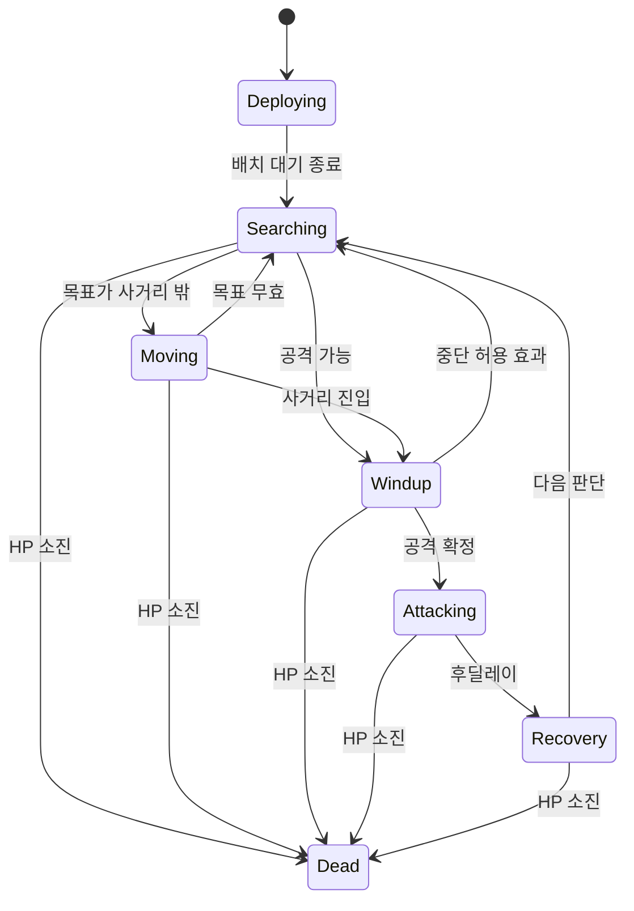

# 05. 유닛 AI·타겟 선정·이동·충돌

> 조사 기준일: 2026-11-13 · 범위: 카드 배치 이후 자동 전투  
> **[확인]** 공식 공개 동작·수정 사례, **[분석]** 그 동작의 게임 디자인 의미, **[재현 설계]** 구현 가능한 모델, **[검증 필요]** 실제 플레이 실험이 필요한 조건. 소스 코드·패킷·엔진 자료를 확보하지 않았으므로 NavMesh, 물리 엔진, 탐색 알고리즘, 시뮬레이션 틱을 원작 사양으로 단정하지 않는다.

## 1. AI의 역할

**[분석]** 플레이어가 개별 유닛을 계속 조종하지 않아도 배치 후 결과를 예측할 수 있어야 한다. 이 게임에서 AI의 목표는 상대를 인간처럼 속이는 것이 아니라, 단순한 규칙을 안정적으로 따르면서 위치·사거리·시간에 따른 차이를 만들어 내는 것이다.

따라서 좋은 유닛 AI는 전투에서 다음 질문에 일관되게 답한다.

1. 무엇을 공격할 수 있는가?
2. 지금 목표를 계속 유지할 수 있는가?
3. 공격할 수 없다면 어디로 이동해야 하는가?
4. 언제 공격이 실제 피해로 확정되는가?
5. 기절·밀치기·죽음·변신 이후 무엇을 다시 계산하는가?

## 2. 세 가지 분류 축

| 축 | 예시 값 | 정의 |
| --- | --- | --- |
| 이동 방식 | 지상, 비행, 부유, 점프, 지하 이동 | 경로와 통과 가능한 지형 |
| 피격 대상 층 | 지상 대상, 공중 대상, 건물 | 상대 공격이 나를 선택할 수 있는지 |
| 공격 가능 대상 | 지상, 공중 포함, 건물만 | 내가 선택할 수 있는 적 집합 |

**[확인]** 공식 2026년 9월 소개의 Minion Giant는 비행하면서 건물·타워를 원거리 공격한다. 이동 방식과 공격 대상 제한이 독립적이라는 직접적인 사례다. [C16](https://supercell.com/en/games/clashroyale/blog/release-notes/new-season-minion-academy/)

**[분석]** 건물만 공격하는 병력은 적 병력에 발이 묶여 이동이 지연될 수 있어도 그것을 공격 목표로 선택하지 않을 수 있다. 반대로 지상 병력이 공중을 공격할 수 있는 경우도 있으므로, 애니메이션의 높이나 지형 통과 방식만으로 공격 마스크를 결정하면 안 된다.

## 3. 타겟 후보와 실제 목표

### 3.1 후보 필터

다음은 **[재현 설계]**다.

```text
후보 = 적 팀 개체
      ∩ 살아 있는 개체
      ∩ 공격 가능한 분류
      ∩ 현재 상태에서 표적 가능한 개체
      ∩ 카드별 탐지 조건을 만족한 개체
```

| 검사 | 고려할 예외 |
| --- | --- |
| 적·아군 | 소환 소유자, 반사, 특수 모드 |
| 생존 | 사망 확정 전, 죽음 효과 개체, 부활형 개체 |
| 분류 | 변신해 건물이 된 유닛, 공중·지상 전환 |
| 표적 가능 | 은신, 지하, 비활성, 무적과 비표적의 차이 |
| 탐지 범위 | 공격 사거리와 별도인지 확인 |
| 경로 | 후보까지 접근 가능한가, 우회가 허용되는가 |

**[확인]** 2025년 1월 Electro Giant에 Sight Clipping을 추가한 공식 설명은 너무 멀리 있는 건물을 공격 대상으로 삼지 않도록 했다고 밝힌다. 이는 건물 전용 타겟이라고 해서 전장 모든 건물을 무조건 같은 후보로 삼는 것은 아니라는 근거다. [C15](https://supercell.com/en/games/clashroyale/blog/release-notes/january-balance-changes-2/)

### 3.2 목표 유지와 재선정

**[분석]** `가장 가까운 적을 매 프레임 선택`하는 규칙은 간단하지만, 새 적이 등장할 때마다 목표를 바꿔 공격을 끊는 불안정한 행동을 만들 수 있다. 반대로 목표를 죽을 때까지 무조건 유지하면 기절·밀치기·은신·사거리 이탈에 어색한 반응을 만들 수 있다.

**[재현 설계]** 현재 목표를 먼저 검증하고, 잃었을 때만 재탐색하는 구조를 시작점으로 삼는다. 다만 카드별 도발·돌진·고정 조준 같은 예외는 별도 정책으로 둔다.

```text
if current_target is valid under card.retain_policy:
    keep current_target
else:
    candidates = collect_legal_candidates()
    current_target = choose(candidates, card.target_policy)
```

**[검증 필요]** 일부 카드의 Sight Range는 공식 패치에 공개된다. 다만 전체 카드의 현행 탐지 범위와 목표 유지 거리, 시야 판정 방식, 새 건물이 생겼을 때의 목표 전환 조건, 공격 완료 전후 재선정 순서를 이번 조사에서 모두 확정하지는 못했다. 2026년 9월 공지의 Battle Ram·Golem 탐지 범위 조정은 공개된 사례이며 전체 카드의 현재 수치표를 뜻하지 않는다. [C18](https://supercell.com/en/games/clashroyale/blog/release-notes/september-balance-changes-2027/)

## 4. 타겟 동률의 해소

**[확인]** 2026년 9월 공식 수정 사항은 Vines와 Lightning이 HP가 같은 병력 중 주문 중심에 가까운 대상을 선택한다고 명시했다. 이 규칙은 해당 주문의 특정 동률 조건에 관한 것이며 모든 유닛 AI에 확대 적용하면 안 된다. [C16](https://supercell.com/en/games/clashroyale/blog/release-notes/new-season-minion-academy/)

**[재현 설계]** 타겟 정책은 단계별 비교로 표현할 수 있다.

| 우선순위 | 유닛용 예시 | 주문용 예시 |
| --- | --- | --- |
| 1차 | 공격 가능 대상 필터 | 영역 내 유효 대상 필터 |
| 2차 | 현재 목표 유지 가능 여부 | 카드 고유 대상 우선순위 |
| 3차 | 선택 정책상의 거리 | HP·거리 등 명시된 정렬 키 |
| 4차 | 안정적인 내부 식별자로 동률 해소 | 완전 동률의 안정적인 순서 |

실제 원작의 마지막 동률 해소 방식은 확인되지 않았다. 엔티티 생성 순서·배치 순서·진영 우선 같은 정책을 임의로 원작 사실처럼 넣지 않는다. 재현 프로젝트에서는 완전 동률 결과가 장치·플랫폼마다 달라지지 않게 고정해야 한다.

## 5. 행동 상태 모델

아래는 **[재현 설계]**다.



기절·빙결·넉백을 모든 상태를 대체하는 하나의 거대한 상태로 만들 필요는 없다. `이동 가능`, `공격 진행 가능`, `타겟 유지 가능`, `강제 이동 중` 등의 제한을 별도 층으로 처리할 수 있다. 어느 방식이든 상태 변경이 공격 타이머에 미치는 영향을 명시해야 한다.

| 전이 사건 | 확인할 정보 |
| --- | --- |
| 첫 배치 완료 | 즉시 탐색하는가, 배치 피해가 먼저인가 |
| 사거리 진입 | 첫 공격 대기를 새로 시작하는가 |
| 목표 사망 | 이미 날아간 투사체가 소멸하는가 |
| 기절 종료 | 첫 공격 대기를 다시 적용하는가 |
| 밀치기 종료 | 원래 타겟을 유지하는가 |
| 형태 변화 | 체력·타겟·공격 타이머를 어떻게 승계하는가 |

## 6. 경로와 진형

### 6.1 경로 선택

**[확인·변경 이력]** 2025-03-31 공식 업데이트는 병력이 건물에 충돌하기 전에 이동을 조정하도록 개선했다고 설명한다. 또한 먼저 레인에 수평 정렬한 뒤 전진하던 움직임에서 레인 의존도를 낮춘 대각선 이동으로 변경했다. 이 행동 설명만으로 실제 NavMesh·경로 그래프·회피 알고리즘까지 확정할 수는 없다. [C22](https://supercell.com/en/games/clashroyale/blog/release-notes/april-update/)

**[재현 설계]** 작은 고정 지형에서는 지상 경로를 다리 통과점을 포함한 그래프, 소규모 격자, 탐색 가능한 영역 데이터 중 하나로 구성할 수 있다. 도구 선택은 규모·정확도·개발 비용에 따라 달라진다. 원작이 어느 방식을 쓰는지는 공개 근거 없이 단정하지 않는다.

추천 분리는 다음과 같다.

- **대역 경로:** 어느 라인·다리를 통해 목표에 접근할지 결정한다.
- **국소 이동:** 주변 유닛·건물에 겹치지 않도록 이동한다.
- **공격 접근:** 개체 반경과 공격 사거리를 만족하는 위치를 찾는다.
- **특수 이동:** 점프·대시·끌어당김·텔레포트를 명시적인 규칙으로 처리한다.

### 6.2 군집과 충돌

**[분석]** 작은 병력이 큰 병력을 지연시키거나, 중앙 건물 때문에 경로가 바뀌거나, 다리에서 병력이 모이는 현상은 전투의 일부다. 이동은 단순한 시각 연출이 아니므로 충돌 처리를 무작위 물리 반응에 맡기면 타워 도달 시간이 달라질 수 있다.

**[재현 설계]** 수평 2D에서 논리 원형 또는 캡슐형 점유체로 충돌을 계산하고 높이는 표현·피격 층에 따로 두는 접근을 검토할 수 있다. 큰 병력과 작은 병력의 밀림 관계는 `collisionRadius`, `pushPriority`, `canBeDisplaced` 같은 명시적 데이터로 제어한다. 이 필드 이름은 제안이며 실제 원작 데이터명이 아니다.

동일 위치에서 생성한 복수 병력의 분리 순서가 항상 같아야 대칭 배치와 리플레이가 일관된다. 성능을 위해 주변 셀 검색을 하더라도 후보 열거 순서가 결과를 바꾸지 않도록 한다.

## 7. 공격·투사체와 AI의 연결

**[확인]** 공식 설명은 First Hit Speed와 반복 공격 속도를 구별하며, 실제 패치에서도 투사체 속도와 타겟 전환 문제를 함께 조정한 사례가 있다. 공격 모션이 시작됐다는 사실만으로 피해가 확정됐다고 해석할 수 없다. [C12](https://supercell.com/en/games/clashroyale/blog/release-notes/season-16/) [C15](https://supercell.com/en/games/clashroyale/blog/release-notes/january-balance-changes-2/)

| 단계 | 논리 질문 | 예외 사례 |
| --- | --- | --- |
| 공격 준비 | 현재 상태에서 준비를 시작할 수 있는가 | 기절·사거리 밖 |
| 발사·타격 확정 | 공격 비용·탄환을 확정하는가 | 차지 해제, 목표 사망 |
| 이동 | 유도·직선·관통 중 무엇인가 | 목표 이동·대시·투명화 |
| 충돌 | 실제로 누구를 맞히는가 | 범위·관통·산탄 |
| 피해 | 최종 수치와 상태 효과는 무엇인가 | 방패·크라운 피해·무적 |
| 재평가 | 다음 공격에 같은 목표를 쓰는가 | 타겟 죽음·숨음·이탈 |

**[분석 예시: 가상 수치]** 같은 DPS인 A와 B가 있어도 A의 첫 공격이 0.2초, B가 1.0초라면 HP가 낮은 빠른 적에 대한 결과가 다르다. B의 투사체가 더 빨라도 배치 직후 방어 결과가 반드시 같아지지는 않는다. DPS 하나로 수비 성능을 대체할 수 없는 이유다.

## 8. 대표 상황의 재현 설명

### 8.1 건물 유인

**[분석]** 건물만 공격하는 적이 타워로 가던 중 중앙 건물이 배치되면, 새 건물이 유효 탐지 범위·접근 조건 안에 들어오는지에 따라 경로가 바뀔 수 있다. 중앙에 놓았다는 이유만으로 모든 적을 자동으로 끌어서는 안 된다. 이미 목표를 고정한 시점과 새 건물 등장 시점이 결과를 바꿀 가능성이 있다.

### 8.2 탱커와 지원병 분리

전방 탱커가 가까운 수비 유닛에 묶인 동안 후방 원거리 병력이 다른 경로 또는 사거리 때문에 먼저 공격할 수 있다. 반대로 광역 피해가 동시에 닿도록 몰아넣으면 공격 측의 화력 누적이 무력화된다. 이 차이를 설명하려면 유닛별 목표·이동 상태·공격 타이머를 함께 볼 수 있어야 한다.

### 8.3 은신과 범위 피해

은신은 타겟 선택 불가와 모든 피해 면역을 구분해야 하는 대표 상태다. 이미 발사된 공격, 타겟 없는 영역 피해, 근처 다른 대상을 맞힌 광역 피해가 어떻게 처리되는지는 카드별로 확인해야 한다. `invisible=true` 하나로 모든 충돌과 피해를 끄는 재현 구현은 과도한 단순화다.

## 9. 디버그·관측 요구

**[재현 설계]** 일반 플레이 화면에 내부 수치를 노출할 필요는 없지만 개발·QA 도구에는 다음이 필요하다.

| 표시 | 활용 목적 |
| --- | --- |
| 현재 타겟 ID·전환 사유 | 유인·리타겟 오류 분석 |
| 탐지 범위·공격 범위 | 사거리와 시야 혼동 제거 |
| 이동 경로·다음 통과점 | 라인 선택과 우회 분석 |
| 충돌 반경·보정 벡터 | 겹침과 밀림 분석 |
| 첫 공격·반복 공격 타이머 | 기절 이후 공격 지연 분석 |
| 투사체 ID·이미 맞은 대상 | 관통·연쇄 중복 피해 검증 |
| 상태 효과 시작·종료 시각 | 무적·빙결·돌진 예외 검증 |

## 10. QA 매트릭스

| ID | 시험 | 판정 기준 |
| --- | --- | --- |
| AI-01 | 지상 전용 유닛 앞에 공중 유닛 | 타겟 불가와 물리 충돌의 정책 구분 |
| AI-02 | 건물 전용 유닛 앞에 수비 병력 | 병력을 공격 대상으로 삼지 않음 |
| AI-03 | 기존 목표 주변에 더 가까운 적 생성 | 목표 유지/교체 정책 실측 |
| AI-04 | 타겟 사망과 공격 확정 동시 | 중복 피해·유실 공격 정책 일관성 |
| AI-05 | 같은 HP·같은 거리 대상 | 완전 동률의 결과 재현 |
| AI-06 | Lightning/Vines 같은 HP 대상 | 주문 중심 거리 규칙 확인 |
| AI-07 | 이동 중 기절·넉백 | 이동·공격·타겟 타이머 변화 실측 |
| AI-08 | 다리 입구에 대량 병력 | 장시간 교착·비결정적 진동 없음 |
| AI-09 | 유닛에서 건물로 형태 변화 | 타겟 분류·충돌·체력 전이 확인 |
| AI-10 | 은신·무적·지하 상태 | 타겟 가능 여부와 피해 가능 여부 구분 |
| AI-11 | 같은 입력을 양 진영에서 실행 | 대칭 전술 결과의 차이 검사 |
| AI-12 | 장치별 같은 전투 입력 재현 | 위치·공격 시점·최종 결과 일치 |

정확한 범위와 프레임 수는 정상 플레이 기록을 반복 촬영하고 같은 레벨·타워·형태·배치 좌표로 통제해 확인해야 한다. 한 장면의 결과를 모든 카드에 적용하지 않는다.

## 11. 근거와 연결

- **C12** · Supercell, [New Cards, Pass Royale & Balance Changes](https://supercell.com/en/games/clashroyale/blog/release-notes/season-16/) · 2020-10-06 · First Hit Speed 설명
- **C15** · Supercell, [January Balance Changes](https://supercell.com/en/games/clashroyale/blog/release-notes/january-balance-changes-2/) · 2025-01-07 · Sight Clipping·투사체·방패 조정 사례
- **C16** · Supercell, [New Season: Minion Academy!](https://supercell.com/en/games/clashroyale/blog/release-notes/new-season-minion-academy/) · 2026-09-07 · 비행·건물 타겟과 주문 동률 선정 수정

- **C18** [September Balance Changes](https://supercell.com/en/games/clashroyale/blog/release-notes/september-balance-changes-2027/), Supercell, 본문 게시 2026-09-23, 09-08 변경 절.
- **C22** [April Update!](https://supercell.com/en/games/clashroyale/blog/release-notes/april-update/), Supercell, 2025-03-31. 경로 이동 개선.

연결: [아레나·배치](04_arena_and_deployment.md), [피해·상태 효과](06_damage_and_status_effects.md), [전투 진행](02_battle_flow_and_victory.md).
