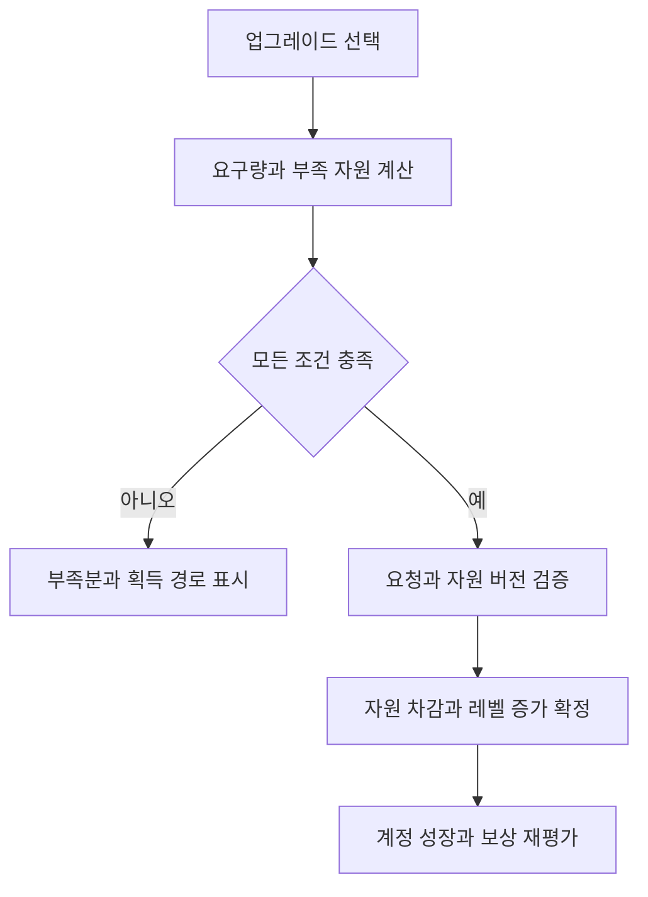

# 09. 컬렉션·카드 성장·마스터리

> 조사 기준: 2026-11-13. 카드 소유권, 업그레이드, 중복 획득, 마법 아이템과 숙련도 보상을 다룬다. **[확인]**은 공식 자료, **[분석]**은 설계 해석, **[재현 설계]**는 시스템 제안이다. 업그레이드 수치는 공개된 특정 개편의 대표값이며 향후 밸런스 테이블과 구분한다.

## 1. 성장 상태를 분리하는 이유

**[분석]** 카드 성장에는 서로 다른 네 질문이 있다.

1. 이 카드를 사용할 수 있는가: 해금·소유.
2. 이 카드의 기본 전투 성능은 얼마인가: 영구 카드 레벨.
3. 이 카드의 특수 운용을 사용할 수 있는가: 진화·히어로 형태 소유.
4. 이 카드로 얼마나 플레이했는가: 마스터리·배지.

레벨과 마스터리를 같은 값으로 두면 카드만 많이 구매한 플레이어와 실제로 여러 번 사용한 플레이어의 기록을 구별하지 못한다. 반대로 마스터리 보상까지 전투 수치에 직접 결합하면 자주 사용한 카드만 계속 강해지는 구조가 된다. 별도 축으로 유지하면 수집, 전투 준비, 숙련의 목적을 구분할 수 있다.

## 2. 현재 카드 업그레이드 규칙

**[확인]** 공식 지원 기준 카드 최대 레벨은 16이다. 동일 카드 복제본 또는 같은 희귀도의 와일드 카드와 골드를 사용해 업그레이드하며, 부족분을 Gems로 구매할 수 있다. 와일드 카드는 미보유 카드를 새로 해금하는 용도로 사용할 수 없다. [E01](https://support.clashroyale.com/hc/en-us/articles/49484924205595-Cards-Decks), [E23](https://support.clashroyale.com/hc/en-us/articles/49484940179483-Magic-Items)

**[확인]** 2025-11-24 개편에서 Elite Wild Cards, Books, Magic Coins 체계를 정리하고 카드·골드 중심으로 전환했다. 따라서 “레벨 14→15는 엘리트 와일드 카드 50,000개만 필요하다”는 설명은 현행 규칙이 아니다. [E10](https://supercell.com/en/games/clashroyale/blog/release-notes/december-update-2025/)

### 2.1 대표 업그레이드 요구량

**[확인·발표 스냅샷]** 아래는 2025-11-10 공식 개편표의 일부다. `목표 레벨`은 그 레벨로 한 단계 올라가는 비용을 뜻한다. 모든 레벨의 총 누적 비용이 아니다. [E09](https://supercell.com/en/games/clashroyale/blog/news/coming-in-the-next-update/)

| 목표 레벨 | 일반 복제본 | 희귀 복제본 | 영웅 복제본 | 전설 복제본 | 챔피언 복제본 | 골드 |
| --- | ---: | ---: | ---: | ---: | ---: | ---: |
| 12 | 1,500 | 400 | 50 | 6 | 2 | 25,000 |
| 14 | 3,500 | 750 | 100 | 12 | 8 | 60,000 |
| 16 | 7,500 | 1,400 | 180 | 20 | 15 | 120,000 |

전체 비용표를 코드에 고정하기보다 `rarity × targetLevel × economyVersion` 데이터로 관리해야 한다. 카드 희귀도별 시작 레벨이 다르므로 존재하지 않는 저레벨 구간을 자동 생성하지 않는다.

**[가상 계산 예시]** 위 레벨 14 일반 카드 비용을 사용하는 검증 환경에서 복제본 2,900장과 일반 와일드 카드 600장을 보유했다면 카드 요구량 3,500장을 충족한다. 골드가 59,000이라면 업그레이드는 아직 불가하다. 카드 조건과 골드 조건은 독립적이며, 부족 골드를 자동 결제하는 동작은 명시적인 사용자 선택 없이 실행하지 않는다.

## 3. 업그레이드 거래의 상태 흐름

**[재현 설계]** 업그레이드는 아래 상태 전이로 모델링한다.



서버 승인 전에 클라이언트가 영구 레벨을 바꾸지 않는다. 동일한 요청의 재전송은 한 번만 처리하고, 자원 차감·레벨 상승·관련 마일스톤 갱신은 부분 성공 상태를 만들지 않도록 함께 확정한다.

| 입력 조건 | 실패 유형 | 처리 제안 |
| --- | --- | --- |
| 카드 레벨이 이미 16 | 상한 도달 | 업그레이드 버튼 대신 완료 상태 |
| 다른 기기에서 같은 카드를 먼저 강화 | 버전 불일치 | 최신 상태를 받아 비용 재계산 |
| 자원 수령과 강화 요청이 동시 실행 | 순서 충돌 | 계정 거래 순서로 직렬화 |
| 네트워크 응답만 유실 | 성공 여부 불명 | 거래 ID로 결과 조회 |
| 카드 부스트가 활성화 | 영구/임시 레벨 혼동 | 영구 레벨 기준으로 업그레이드 |
| 타워 유닛 레벨이 킹 타워에 도달 | 계정 상한 | 킹 타워 성장 조건으로 연결 |

## 4. 레벨이 만드는 전투 차이

**[분석]** 레벨 변화는 평균 피해량보다 **상호작용 경계**에서 크게 체감된다. 한 번에 제거되던 유닛이 체력을 조금 남기거나, 타워에 한 번 더 공격하면 같은 전술이 다른 결과를 만든다.

**[재현 설계]** 레벨별 수치를 단순히 일괄 배율로 가정하지 않고 카드 데이터에 기록한다. 밸런스 검증에서는 다음 계산을 함께 수행한다.

```text
RequiredHits = ceil(TargetHealth / EffectiveHitDamage)
SurvivingHealth = TargetHealth - Sum(ResolvedDamage)
TowerContacts = 실제 이동·타깃·첫 공격 지연을 포함해 시뮬레이션한 타격 수
```

예를 들어 가상 대상 체력이 500이고 공격 피해가 250이라면 두 번에 제거된다. 공격 피해가 249면 세 번이 필요하다. 피해 수치 차이는 0.4%이지만 필요한 공격 횟수는 50% 증가한다. 이 예시는 특정 카드의 현재 레벨 차이를 의미하지 않는다.

## 5. 영구 레벨과 전투 유효 레벨

**[확인]** 카드 부스트 포션은 카드 레벨을 일시적으로 킹 타워 레벨까지 올리며, 활성화 후 3시간 유지된다. 타워 유닛은 영구 성장 시에도 킹 타워 레벨을 넘지 못한다. [E23](https://support.clashroyale.com/hc/en-us/articles/49484940179483-Magic-Items), [E06](https://support.supercell.com/clash-royale/en/articles/tower-troops-4.html)

**[재현 설계]** `ownedLevel`, `temporaryBoost`, `modeFloor`, `modeCap`을 구분한다. 적용 순서는 모드별 정책으로 명시하고, 덱 화면과 전장 UI가 같은 유효 레벨을 사용해야 한다. 이벤트의 레벨 하한 보정과 경쟁전의 상한 제한을 동일한 “부스트”라는 상태로 저장하지 않는다.

```text
ownedLevel: 영구 저장, 업그레이드 비용의 기준
boostedLevel: 기간·카드 조건으로 계산
effectiveBattleLevel: 모드의 규칙을 적용해 매치 시작 때 확정
```

부스트 만료가 경기 도중 발생했을 때 이미 시작한 매치의 능력치를 바꾸지 않는 방식은 재현 구현을 위한 권장안이다. 실제 제품의 정확한 만료 경계 동작은 별도 검증이 필요하다.

## 6. 중복 카드와 초과 자원

**[확인]** 카드 복제본은 카드가 레벨 16에 도달할 때까지 보관하며, 최대 레벨 카드의 추가 복제본은 Crystals로 전환된다. 희귀도별 대표 전환량은 일반 1, 희귀 6, 영웅 60, 전설 600, 챔피언 1,200이다. 특정 희귀도의 모든 카드를 최대 레벨로 만든 경우 그 희귀도의 와일드 카드를 수동으로 Crystals로 전환할 수 있다. [E22](https://support.clashroyale.com/hc/en-us/articles/49484891791771-Resource-Magic-Item-Conversion-Details)

**[분석]** “다음 업그레이드에 필요한 카드가 이미 모였다”와 “카드가 실제 최대 레벨이다”는 다르다. 전자의 추가 카드를 즉시 최대 레벨 중복으로 처리하면 나중에 필요한 성장 재료를 빼앗게 된다.

**[재현 설계]** 보상 처리에는 세 단계가 필요하다.

1. 보상 수령 시점의 카드 레벨·인벤토리·모드 상태를 읽는다.
2. 해당 보상 종류의 초과 정책을 적용한다.
3. 원 보상과 전환 결과를 한 영수증에 기록해 UI와 고객 지원이 동일한 내역을 볼 수 있게 한다.

모든 자원에 `min(balance + reward, cap)`을 적용하면 안 된다. 절대 상한, 한 번의 묶음 보상 초과 허용, 유료 구매의 예외, 대체 자원 전환이 각각 다르다. 일반화된 모델은 [12 경제 문서](12_economy_rewards_and_monetization.md)를 따른다.

## 7. 마스터리의 역할과 보상 분리

**[확인]** 마스터리는 아레나 4에 열리며 카드별 전투 과제를 진행해 배지와 보상을 받는다. 기본 과제는 해당 카드를 포함한 전투 승리, 후속 과제는 피해 또는 카드 특유 행동을 추적한다. [E27](https://support.supercell.com/clash-royale/en/articles/card-mastery-4.html)

**[확인·개편 기준]** 2026년 Collection Level 개편은 마스터리 과제를 완화하고 보상 중심을 골드로 옮겼다. Gems와 Wild Cards는 Collection Level 마일스톤으로 이동했다. 옛 지원 문서 일부에 남은 마스터리 Gems·Card Stacks 설명과 혼합하지 않는다. [E13](https://supercell.com/en/games/clashroyale/blog/news/new-collection-levels-and-mastery-changes/)

**[분석]** 마스터리는 특정 카드를 쓰는 행동에 목표를 부여하지만, 계정 전체 수집 보상은 여러 카드를 강화하도록 유도한다. 두 시스템을 연결하면 익숙한 카드로 골드를 벌고 새로운 카드에 투자하는 교차 동기가 생긴다. 다만 의도적으로 비효율적 플레이를 하며 과제 수치만 채우는 행동이 발생할 수 있으므로 승리 기여와 과제 속도의 균형을 관찰해야 한다.

### 7.1 과제 집계 데이터 제안

| 필드 | 의미 | 오류 예방 |
| --- | --- | --- |
| `taskDefinitionId` | 카드·과제 종류·단계 식별 | 서로 다른 버전 과제의 수치 혼합 방지 |
| `eligibleModes` | 집계 가능한 모드 | 연습 모드로 무제한 보상 생성 방지 |
| `eventMetric` | 피해, 타워 타격, 방어 등 | 의도한 행동과 정확히 연결 |
| `attributionPolicy` | 소환물·진화·히어로의 원본 귀속 | 효과 중복 집계 방지 |
| `progress` | 누적 값 | 중복 매치 결과 재처리 방지 |
| `claimedMilestones` | 수령 완료 단계 | 과제 완료와 수령을 분리 |

**[검증 필요]** 보호막 피해, 과잉 피해, 소환물의 피해, 변신 후 피해, Mirror 생성물의 피해가 각 과제에 어떻게 귀속되는지는 카드별 실제 동작을 측정해야 한다. 공개 일반 설명으로 모두 확정하지 않는다.

## 8. 스타 레벨과 장식 성장

**[확인]** Star Levels는 카드 외형을 바꾸며 게임플레이 성능을 바꾸지 않는다. 현재 지원 문서는 아레나 5에서 Star Points 체계가 열리고, 카드 레벨 7 이상부터 관련 외형 성장을 사용할 수 있다고 설명한다. [E01](https://support.clashroyale.com/hc/en-us/articles/49484924205595-Cards-Decks)

**[분석]** 외형 성장의 목적은 전투 준비가 완료된 카드에도 추가 애착과 표시 수단을 주는 것이다. 레벨 숫자와 외형 단계 숫자가 둘 다 “강화”로 보이지 않게 전투 영향 여부를 명확히 표현해야 한다.

## 9. 성장 UX와 데이터 제안

**[재현 설계]** 카드 상세 화면은 상단에 영구 레벨과 다음 단계의 체력·피해 변화, 중앙에 복제본/와일드/골드의 요구량, 별도 탭에 형태 및 마스터리를 보여 주는 구조가 적합하다. 임시 부스트나 모드 제한이 있으면 원래 수치와 적용 수치를 혼동하지 않게 표시한다.

| 객체 | 보관 내용 | 갱신 시점 |
| --- | --- | --- |
| `CardOwnership` | 소유·영구 레벨·복제본·획득 이력 | 보상과 강화 |
| `FormOwnership` | 진화 조각·진화 해금·히어로 해금 | 조각/코인 소비와 보상 |
| `UpgradeCostTable` | 희귀도별 목표 레벨 비용 | 경제 패치 |
| `InventoryPolicy` | 상한·초과·구매 예외·전환 규칙 | 경제 패치 |
| `CardMastery` | 과제 진행·배지·수령 이력 | 매치 확정 |
| `CardPresentation` | 스타 레벨·선택 외형 | 장식 소비 |
| `UpgradeTransaction` | 전후 상태·소비·요청 ID | 모든 강화 |

## 10. QA와 분석 지표

| ID | 시험 | 기대 결과 |
| --- | --- | --- |
| PG-01 | 복제본 충족, 골드 1 부족 | 유료 재화 자동 소비 없이 차단 |
| PG-02 | 같은 강화 요청 두 번 | 한 번만 자원 차감·레벨 증가 |
| PG-03 | 최대치 이전 복제본 대량 획득 | 실제 최대 레벨 여부에 맞는 처리 |
| PG-04 | 부스트 상태에서 카드 강화 | 영구 레벨만 한 단계 증가 |
| PG-05 | 타워 카드 레벨 제한 | 킹 타워 상한 준수 |
| PG-06 | 패치로 과제 요구량 감소 | 이전 진행량 보존, 새 완료 상태 재계산 |
| PG-07 | 과제 보상 재수령 요청 | 중복 지급 없음 |
| PG-08 | 진화·히어로 피해 발생 | 과제의 귀속 정책에 맞게 한 번 집계 |

**[분석]** 성장 병목은 “카드가 부족한 사용자”, “골드가 부족한 사용자”, “형태는 있지만 레벨이 낮은 사용자”를 나눠 보아야 한다. 평균 카드 레벨만으로는 플레이어가 실제로 사용하는 8장의 준비 상태를 설명하지 못한다. 주력 덱 평균 레벨, 사용하지 않는 카드의 투자 비율, 수령 후 미사용 자원, 업그레이드 직전 이탈률을 함께 보는 것이 유용하다.

## 11. 출처

- **E01** [Cards & Decks](https://support.clashroyale.com/hc/en-us/articles/49484924205595-Cards-Decks), Supercell Support, 2026-11-13 조회.
- **E06** [Tower Troops](https://support.supercell.com/clash-royale/en/articles/tower-troops-4.html), Supercell Support, 2026-11-13 검색 본문 확인.
- **E09** [Coming in the Next Update…](https://supercell.com/en/games/clashroyale/blog/news/coming-in-the-next-update/), Supercell, 2025-11-10. 비용표 발표 스냅샷.
- **E10** [December Update 2025](https://supercell.com/en/games/clashroyale/blog/release-notes/december-update-2025/), Supercell, 2025-11-21.
- **E13** [New Collection Levels & Mastery Changes](https://supercell.com/en/games/clashroyale/blog/news/new-collection-levels-and-mastery-changes/), Supercell, 2026-05-13, 적용 예고 05-26.
- **E22** [Resource & Magic Item Conversion Details](https://support.clashroyale.com/hc/en-us/articles/49484891791771-Resource-Magic-Item-Conversion-Details), Supercell Support, 2026-11-13 조회.
- **E23** [Magic Items](https://support.clashroyale.com/hc/en-us/articles/49484940179483-Magic-Items), Supercell Support, 2026-11-13 조회. 일부 총개수·오래된 보상 문구는 다른 공식 문서와 교차 확인 필요.
- **E27** [Card Mastery](https://support.supercell.com/clash-royale/en/articles/card-mastery-4.html), Supercell Support, 2026-11-13 검색 본문 확인. 보상 종류는 E13 개편을 우선.
- 관련: [계정 성장](10_player_progression_trophy_and_ranked.md), [형태 해금](08_evolutions_champions_heroes_towers.md), [경제와 보상](12_economy_rewards_and_monetization.md).
