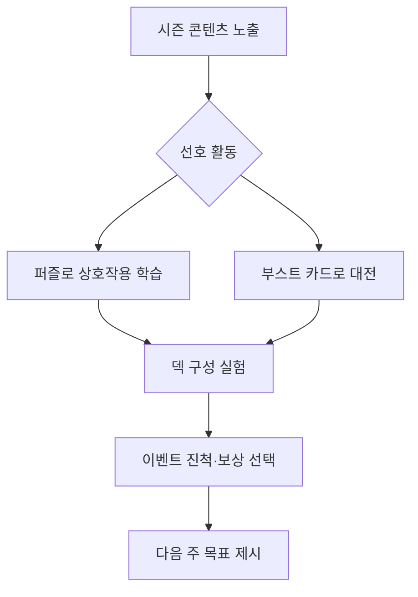

# 13. 시즌·이벤트·반복 플레이 동기

> 조사 기준: 2026-11-13 · 범위: 일일 보상, 패스, 시즌 일정, 한정 이벤트, 복귀 지원.
> **[확인]** 공식 공개 규칙 · **[분석]** 기획 해석 · **[재현 설계]** 구현 제안 · **[검증 필요]** 공개 자료만으로 확정하지 못한 내용.

## 1. 서로 다른 시간 단위를 연결하는 구조

**[분석]** 클래시 로얄의 반복 동기는 한 판의 승패, 하루의 보상, 시즌의 성장, 여러 시즌의 수집이 겹치는 형태다. 패배한 플레이어에게도 남은 보상 목표를 보여 주되, 모든 목표가 같은 시간에 만료되면 피로와 우선순위 혼란이 커진다. 따라서 역기획에서는 다음 시간 단위를 별도 시스템으로 정의한다.

| 시간 단위 | 대표 목표 | 플레이어의 판단 | 주요 위험 |
| --- | --- | --- | --- |
| 한 판 | 승리·크라운·숙련도 | 한 판 더 할 가치가 있는가 | 패배 직후 보상이 아무것도 없다는 느낌 |
| 하루 | 일일 전투 보상·연속 기록 | 오늘 필요한 만큼 플레이했는가 | 과도한 의무감 |
| 수일 | 특별 도전·퍼즐·미니 패스 | 제한 기간 안에 달성할 수 있는가 | 규칙 학습 시간이 부족함 |
| 주말 | 듀얼 대회 | 여러 덱을 준비할 수 있는가 | 시간·성장 부담 |
| 시즌 | 패스·시즌 랭킹·이벤트 상점 | 이번 시즌에 무엇을 우선할 것인가 | 재화·진척 초기화 오해 |
| 장기 | 카드·폼·배지·컬렉션 | 새 시즌에도 남는 것이 무엇인가 | 성장 축이 너무 많아짐 |

## 2. 일일 보상의 현재 규칙

**[확인]** Daily Battle Rewards 지원 문서는 첫 **4승**에 Magic Lucky Chest를 지급하고, 첫 **3회 전투**에는 회당 보너스 크라운 5개를 준다고 설명한다. 골드는 정해진 일일 승리 횟수까지 지급하며 아레나에 따라 양이 달라진다. 앨범 진행 중에는 승리로 Snippet을 받을 수 있다. 초기화는 상점 Daily Deals와 같은 시각이다. 연속 기록은 하루 첫 승리에 1 증가한다. [M09](https://support.clashroyale.com/hc/en-us/articles/49484956220443-Daily-Battle-Rewards)

**[재현 설계]** 전투 참여 보상과 승리 보상을 같은 카운터로 만들지 않는다.

| 카운터 | 증가 조건 | 지급 검증 |
| --- | --- | --- |
| dailyBattles | 보상 대상 전투 완료 | 승패와 관계없는 첫 N회 보상 |
| dailyWins | 보상 대상 모드의 승리 판정 | 첫 N승 보상 |
| streakDays | 오늘의 첫 적격 승리 | 같은 날짜의 재승리로 중복 증가하지 않음 |
| eventWins | 특정 이벤트·규칙에 맞는 승리 | 전용 재화·수집 아이템 지급 |
| grantedRewardKeys | 보상 발급 완료 | 재접속·재전송 중복 지급 방지 |

**[분석]** 3회 전투와 4승은 다른 목표다. 초반 패배에도 패스 진척을 주는 조건은 첫 실패 후 이탈을 줄이는 방향으로 작동할 수 있다. 4승 목표는 실력과 매칭에 따라 체감 소요 시간이 크게 달라지므로 승률별 완주 시간을 측정해야 한다.

### 가상 소요 시간 모델

**[재현 설계·가상 예시]** 승률을 `p`, 목표 승수를 `w`, 한 판 평균 시간을 `t`라고 단순화하면 독립 승패 가정에서 필요한 평균 판수는 `w/p`, 평균 시간은 `t×w/p`다. `w=4`, `p=0.5`, `t=4분`이면 8판·32분이다. 실제 플레이의 연패·모드 변경·대기시간은 빠진 모델이며 실제 이용 시간을 측정한 수치가 아니다.

이 모델은 “4승은 짧은 목표”라는 기획자의 직감을 검증하는 도구다. 낮은 승률 구간에서는 일일 승리 수를 늘리는 것보다 참여 보상 또는 복귀 보정을 조절하는 편이 부담을 줄일 수 있다.

## 3. 크라운과 패스

**[확인]** 크라운은 파괴한 타워, 살아남은 자기 타워, Merge Tactics의 승리 라운드 등에서 획득하며 Pass Royale을 진행시키는 재화다. Trophy Road·Ranked·클랜전·이벤트 등 여러 경로가 연결된다. [M10](https://support.clashroyale.com/hc/en-us/articles/49484913891483-Crowns)

**[분석]** 파괴뿐 아니라 생존한 타워도 보상에 연결되면 수비 성공의 가치가 결산 화면에 드러난다. 전투 승리 판정에 쓰이는 크라운과 계정 패스에 지급되는 크라운을 동일한 숫자로 가정해서는 안 된다. 특수모드는 별도 지급 규칙을 가질 수 있다.

**[재현 설계]** 패스에는 `seasonId`, `trackId`, `earnedCrowns`, `entitlement`, `claimedMilestones`를 둔다. 무료 트랙과 유료 트랙을 별도 경로로 관리하고, 시즌 중간 구매 시 이미 달성한 유료 보상을 소급해서 청구할 수 있는 구조를 검토한다. 실제 보상·가격·소급 정책은 [12번 경제 문서](12_economy_rewards_and_monetization.md)의 출처 기준을 따른다.

## 4. 복귀 지원과 실험 기능

**[확인]** 현재 지원 문서는 최대 28일의 미수령 일일 보상 중 일부를 Catch-Up Rewards로 보충할 수 있다고 설명한다. 정상적으로 매일 받은 총량보다 적고, 여러 날에 나누어 지급될 수 있으며 테스트 대상이 아닌 계정에는 보이지 않을 수 있다. [M09](https://support.clashroyale.com/hc/en-us/articles/49484956220443-Daily-Battle-Rewards)

**[확인]** 2026년 6월 업데이트 공지는 연속 패스 구매 보상과 Mini Pass를 테스트 기능으로 소개했다. Mini Pass는 약 5~7일의 별도 무료·유료 트랙이며, 패스 연속 구매 보상은 구매를 건너뛰면 기록이 초기화된다. 계정마다 노출·세부 조건이 다를 수 있다. [M11](https://supercell.com/en/games/clashroyale/blog/release-notes/june-update-2026/)

**[분석]** 복귀 지원은 쉬는 것이 가장 효율적인 전략이 되지 않도록 설계해야 한다. 반대로 복귀 보상이 너무 작으면 격차를 회복할 수 없다고 느낄 수 있다. 효과는 복귀 첫날 결제보다 7일 뒤 잔존과 메인 덱의 성장 회복으로 평가하는 편이 적절하다.

**[재현 설계]** 실험 기능은 `experimentId`, `cohort`, `assignmentAt`, `ruleVersion`을 결과 로그에 함께 기록한다. UI에 기능이 없는 계정을 버그로 판단하기 전에 해당 계정의 실험 배정을 확인한다. 테스트 그룹 사이에서 선물·교환으로 혜택이 우회 이동할 수 있는지도 검토한다.

## 5. 한정 이벤트의 유형

| 유형 | 플레이 입력 | 성과 저장 | 보상 방식 | 설계상 역할 |
| --- | --- | --- | --- | --- |
| 승수 도전 | 지정 규칙의 전투 | 승/패 누적 | 승리 단계 또는 종료 보상 | 숙련 검증 |
| 크라운 이벤트 | 여러 적격 모드의 플레이 | 크라운 합계 | 단계 보상 | 넓은 참여 |
| 앨범 | 조각 획득·중복 처리 | 세트 완성 | 세트·전체 완성 보상 | 수집 목표 |
| 전용 상점 | 이벤트 재화 소비 | 지갑·구매 기록 | 선택 교환 | 보상 선택권 |
| 퍼즐 | 정해진 적·손패에 대응 | 시도 횟수·완료 | 명예·학습 중심 | 전투 기술 교육 |
| 카드 부스트 | 지정 카드 사용 | 적용 기간 | 임시 전력 보정 | 새로운 덱 체험 |

위 표의 유형 분류는 **[분석]**이며, 이벤트의 구체적 존재 근거는 2026년 11월 시즌 공지와 앨범 지원 문서다. 동일 유형이라고 해서 보상·모드 인정 범위가 항상 같지는 않다. [M08](https://supercell.com/en/games/clashroyale/blog/release-notes/new-season-king-vs-king/) [M12](https://support.clashroyale.com/hc/en-us/articles/49484914939163-Album-Event)

## 6. 2026년 11월 시즌에서 확인한 운영 조합

**[확인·일정 사례]** 10월 27일 공지는 11월 2~8일 Daily Puzzles, 11월 9일~12월 7일 King of Cards와 Royal Market을 안내했다. 퍼즐은 제한된 카드로 동일 상황을 반복 해결하고, 이벤트·상점에서 얻는 한정 Crown Tokens를 Royal Market에 사용한다. Deck Wizard는 11월 시즌 둘째 주부터 순차 테스트한다고 밝혔다. 11월 2~8일 퍼즐을 조사일의 상시 진행 콘텐츠로 표시하면 안 된다. [M08](https://supercell.com/en/games/clashroyale/blog/release-notes/new-season-king-vs-king/)

**[분석]** 이 조합은 새 카드를 추가하는 것보다 플레이어의 기존 카드 사용 범위를 넓히는 방향이다. 퍼즐이 특정 상호작용을 가르치고, 카드 부스트가 성장 격차를 낮추며, 추천 덱이 실제 대전으로의 진입을 돕는다. 세 기능의 전환을 하나의 학습 경로로 볼 수 있다.



## 7. 앨범의 중복 완충 구조

**[확인]** 앨범은 조각을 모아 이미지를 완성하고 세트별·전체 보상을 받는 한정 콘텐츠다. 조각은 전투·이벤트·상점에서 얻을 수 있고, 중복 조각은 보장 신규 조각을 얻는 게이지로 전환된다. 완료 후 추가 조각에도 보상이 있다. [M12](https://support.clashroyale.com/hc/en-us/articles/49484914939163-Album-Event)

**[분석]** 무작위 수집이 끝에 가까워질수록 신규 조각 확률은 내려간다. 중복 보정은 마지막 몇 개에서 진행이 멈추는 문제를 완화한다. 다만 신규 보장이 “전체 미보유 중 무작위”인지 “현재 세트의 미보유”인지에 따라 완주 분포가 달라진다. 공개 문서에서 분포가 확인되지 않은 부분은 계산에 임의로 넣지 않는다.

**[재현 설계]** 상태는 `Collecting → SetComplete → AllComplete → OverflowRewards`로 나눈다. 한 번에 여러 조각을 지급할 때 순서에 따라 보정 게이지와 신규 보장 결과가 바뀔 수 있으므로, 지급 묶음의 처리 순서를 고정하고 로그에 남긴다. 이벤트 종료 직전 획득한 보상을 나중에 열었을 때 어느 앨범에 귀속되는지도 정의한다.

## 8. 이벤트 설정과 정산 데이터

**[재현 설계]** 서버 설정에서 다음을 독립적으로 관리한다.

```json
{
  "eventId": "sample_event_001",
  "rulesetVersion": 1,
  "startsAt": "2026-11-01T00:00:00Z",
  "endsAt": "2026-11-08T00:00:00Z",
  "claimEndsAt": "2026-11-09T00:00:00Z",
  "eligibleModes": ["sample_1v1"],
  "progressMetric": "eligible_win",
  "currencyId": "sample_token",
  "overflowPolicy": "configured_conversion",
  "experimentId": null
}
```

위 JSON의 ID·일정은 구현 구조를 설명하는 가상 예시다. 실제 클래시 로얄의 데이터 포맷이 아니다.

전투 시작, 종료, 결과 수신이 각각 이벤트 경계의 앞뒤에 걸칠 수 있다. “시작 당시 참여 가능했던 전투의 결과 인정 여부”와 “보상 수령 유예기간”을 별도 정책으로 정의한다. 클라이언트 시계 대신 서버 날짜 키를 사용한다.

## 9. 운영 검증과 지표

| 검증 항목 | 기대 결과 |
| --- | --- |
| 첫3전 중 패배 포함 | 참여 기반 크라운과 승리 기반 보상 분리 |
| 하루 경계에 전투 완료 | 하나의 날짜에만 귀속 |
| 재접속 후 보상 팝업 재생 | 지급은 한 번, 연출만 재개 |
| 이벤트 종료 후 재화 잔량 | 고지한 만료·전환 정책 적용 |
| 부스트 종료와 매칭 겹침 | 전투 시작 시 적용 스냅샷 유지 |
| 앨범 마지막 조각과 중복 보상 동시 획득 | 완료 보상 중복 없음 |
| 패스 완료 후 중간 업그레이드 | 권리·보상·추가 부스트의 예외 설명 |
| 테스트 기능 미노출 | 배정 여부를 먼저 확인 |
| 장기간 미접속 후 복귀 | Catch-Up 총량·분할 지급 검증 |

**[분석]** 비교할 지표는 이벤트 참여율, 최초 보상까지의 시간, 완주율, 보상 수령 누락률, 세션 길이, 모드 이동, 다음 시즌 재방문이다. 참여자만 집계하면 적극 이용자 편향이 생기므로 노출된 전체 계정과 해금 가능 계정도 함께 분모로 둔다. 제한 재화의 만료량이 높으면 수입 부족뿐 아니라 보상 구조 이해 실패와 UI 발견 문제를 의심해야 한다.

## 10. 출처

열람일: 2026-11-13. 지원 문서의 발행일은 미표기.

- **M08** Supercell, [New Season: King vs. King!](https://supercell.com/en/games/clashroyale/blog/release-notes/new-season-king-vs-king/), 2026-10-27.
- **M09** Supercell Support, [Daily Battle Rewards](https://support.clashroyale.com/hc/en-us/articles/49484956220443-Daily-Battle-Rewards).
- **M10** Supercell Support, [Crowns](https://support.clashroyale.com/hc/en-us/articles/49484913891483-Crowns).
- **M11** Supercell, [June Update 2026](https://supercell.com/en/games/clashroyale/blog/release-notes/june-update-2026/), 2026-05-21 게시.
- **M12** Supercell Support, [Album Event](https://support.clashroyale.com/hc/en-us/articles/49484914939163-Album-Event).

관련 문서: [11 모드](11_matchmaking_and_game_modes.md) · [12 경제](12_economy_rewards_and_monetization.md).
